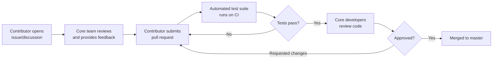

OpenMM is not just a toolkit -- it is one of the most foundational pieces of infrastructure in computational molecular biology. With over 7,300 commits, 1.9k stars on GitHub, and a deployment scale that peaked at an estimated 280,000 GPUs during the COVID-19 pandemic via Folding@home, the project owes its longevity and reach to a relatively small but extraordinarily dedicated group of contributors. Some have been with the project since its Stanford origins; others bring expertise from industry, national labs, and competing simulation packages.

What follows is a look at the people behind the code.

---

## Peter Eastman -- The Architect

If OpenMM has a single identifiable author, it is [Peter Eastman](https://github.com/peastman). He is the original creator of the library, having built it at the Vijay S. Pande lab at Stanford University, and he remains the most prolific contributor by a wide margin. A glance at the commit log tells the story: across the last several months alone, Peter authored or merged the majority of commits touching core simulation features -- from [ReplicaExchangeSampler](https://github.com/openmm/openmm/commit/efd891695c7e242a92bc793cc429f82ac8f14bcd) and [ReplicaExchangeReporter](https://github.com/openmm/openmm/commit/46376ea3e4d0ff37cdaa5e55e034dbf5c3296b81) to low-level fixes for [memory usage in SerializationNode](https://github.com/openmm/openmm/commit/6717a85cc4255c7e3985d5cfdb022fbc9106830f), [inefficient sorting in single-atom blocks](https://github.com/openmm/openmm/commit/2c287f10fadd01b2a9422ab87c3d33fd92ff767d), and [worker thread scheduling](https://github.com/openmm/openmm/commit/5d8d5874b9692f02a3547fbf96efd18126f949bb).

Peter's background is unusual for a molecular dynamics developer. He spent seven years writing commercial bioinformatics software at Agilent Technologies and Silicon Genetics before returning to academia, earning his Ph.D. at Stanford with a focus on algorithms for protein MD simulations. As his [Simbios profile](http://simbios.stanford.edu/Bios/eastman.htm) notes, his passion lies in "designing elegant APIs and creating tools that help people to solve problems." This design-first philosophy is visible throughout OpenMM: the clean separation of the platform abstraction layer, the modularity of the force and integrator hierarchies, and the thoughtful Python wrappers all bear his fingerprints.

Beyond OpenMM itself, Peter is also the primary author of [Lepton](https://github.com/openmm/lepton), the mathematical expression parser that powers OpenMM's CustomIntegrator and CustomForce, and he has contributed to the broader SimTK ecosystem including [Simbody](https://github.com/simbody/simbody) and [PDBFixer](https://github.com/openmm/pdbfixer). He has co-authored landmark publications including [OpenMM 7](https://doi.org/10.1371/journal.pcbi.1005659) and [OpenMM 8](https://doi.org/10.1021/acs.jpcb.3c08559), and he curates the [SPICE dataset](https://github.com/openmm/spice-dataset) for training machine learning potentials.

Peter is affiliated with Stanford University and is a member of 26 projects on the SimTK platform, with over 2,600 forum posts spanning nearly two decades.

---

## John D. Chodera -- The Scientific Catalyst

[John Chodera](https://github.com/jchodera) is a computational chemist at Memorial Sloan Kettering Cancer Center and one of the most influential voices in the OpenMM ecosystem. He is a co-author on every major OpenMM publication -- from [OpenMM 4 (2013)](https://doi.org/10.1021/ct3008574) through [OpenMM 8 (2024)](https://doi.org/10.1021/acs.jpcb.3c08559) -- and his lab at MSKCC has been instrumental in pushing OpenMM into new scientific domains.

Chodera's contributions extend well beyond code commits. He is the driving force behind the [Open Force Field Initiative](https://openforcefield.org/), which uses OpenMM as its primary simulation engine, and the [openmmforcefields](https://github.com/openmm/openmmforcefields) repository. His group maintains [OpenMMTools](https://github.com/choderalab/openmmtools), a widely used library of utilities for replica exchange, free energy calculations, and enhanced sampling that fills gaps in the core API.

He is also a regular presence in OpenMM's issue tracker, frequently CC'd on [design discussions](https://github.com/openmm/openmm/issues/5235) about multistate sampling, replica exchange infrastructure, and machine learning potential integration. His 2021 Nature Chemistry paper on SARS-CoV-2 simulations -- which relied on OpenMM via Folding@home -- remains one of the most high-profile validations of the toolkit's scalability.

---

## Anton Gorenko -- The Platform Builder

The introduction of AMD GPU support in OpenMM 8.2.0 was one of the most significant architectural changes in years, and it was largely the work of [Anton Gorenko](https://github.com/agorenko), a developer at [StreamHPC](https://streamcomputing.eu/). The [8.2.0 release notes](https://github.com/openmm/openmm/releases/tag/8.2.0) explicitly acknowledge this: "Many thanks to Anton Gorenko for his amazing work on this!"

The HIP platform that Anton built delivers roughly double the performance of the OpenCL platform on recent AMD GPUs, bringing OpenMM to a hardware ecosystem that had previously been a pain point for researchers without NVIDIA hardware. This was not a trivial port -- it required deep familiarity with AMD's HIP framework, careful kernel optimization, and extensive testing across different GPU architectures. The [fix for compilation errors on certain AMD GPUs](https://github.com/openmm/openmm/commit/068495f3700d627319618efe9ef4ce9ed0e822d2) that Peter merged shortly afterward underscores the ongoing complexity of supporting a second vendor.

---

## Evan Pretti -- The Precision-Minded Contributor

[Evan Pretti](https://github.com/epretti) is a researcher affiliated with the Shell research group in the Department of Chemical Engineering at UC Santa Barbara. His most recent contribution to the core repository is a [precision fix in the energy minimizer](https://github.com/openmm/openmm/commit/1c528ca8429ce38d7e6d16989162085ff669de88) that takes line search energy differences on the CPU before reducing precision -- the sort of subtle numerical fix that prevents silent accuracy degradation.

Evan has a broader interest in replica exchange and parallel simulation methodologies. He independently developed [MultiOpenMM](https://github.com/epretti/multiopenmm), a package for running parallel molecular dynamics simulations (including replica exchange) within a single OpenMM context, which can dramatically improve GPU utilization when simulating many small replicas. He has also built tools for crystal free energy calculations ([PyPhase](https://evan.pretti.net/software.html)) and colloidal crystal structure analysis (_paccs_), with support from the Molecular Sciences Software Institute (MolSSI).

---

## Jeff Wagner -- The Force Field Tinkerer

[Jeff Wagner](https://github.com/jwagner) is associated with the [Open Force Field Consortium](https://openforcefield.org/) and has contributed both to the core OpenMM repository and to the openmmforcefields package. His most recent core contribution is a [fix for a leaked variable causing spurious template constraint assignment](https://github.com/openmm/openmm/commit/13c568d08d5a9829a6de621e94cdaebd014f4f7d) (#5236), which was significant enough to be included in the [8.5.1 patch release](https://github.com/openmm/openmm/releases).

Jeff's work on openmmforcefields -- including converting Amber ion parameters and supporting SMIRNOFF-based force fields -- directly benefits the community of researchers using OpenMM for drug design and biomolecular simulation.

---

## Yulian Manchev -- The Documentation Contributor

[Yulian Manchev](https://github.com/ymanchev) made a focused but important contribution by [updating the patch documentation](https://github.com/openmm/openmm/commit/bc6fe72928817f33edfbec3150e40bcfc636c2c7) (#5208), clarifying the definition and purpose of patches in the force field XML format. Documentation improvements like this might seem minor, but they directly reduce the barrier for users trying to understand how OpenMM's force field system works -- a common pain point for newcomers.

Yulian's research background is in molecular simulation using machine learning potentials. He has published work on [FFLUX molecular simulations driven by atomic Gaussian process regression models](https://doi.org/10.1002/jcc.27323), connecting him to the broader wave of ML/MM hybrid approaches that OpenMM 8 was designed to support.

---

## ramdoys -- The Performance Optimizer

The contributor known as [ramdoys](https://github.com/ramdoys) made a targeted performance improvement by [switching atomFlags to an unordered_map](https://github.com/openmm/openmm/commit/e4728a2160d2f25ca108d7fddeb1dd20654e644e) (#5247), reducing the allocation overhead and improving lookup performance. This is the kind of data-structure-level optimization that requires familiarity with the hot paths in the codebase and a willingness to profile before proposing changes.

---

## The Broader Network

The [Zenodo record for OpenMM 8.2.0](https://zenodo.org/records/14058389) lists over 25 contributors spanning an impressive range of institutions and companies:

| Affiliation | Notable Contributors |
|---|---|
| Stanford University | Peter Eastman, Vijay Pande |
| Memorial Sloan Kettering Cancer Center | John Chodera, Rafal Wiewiora |
| D.E. Shaw Research | Robert McGibbon |
| Schrodinger | Joao Rodrigues |
| QC Ware | Andy Simmonett |
| Toyota Research Institute | Michael Sherman |
| StreamHPC | Anton Gorenko |
| Google | Matthew Harrigan |
| Iambic Therapeutics | Jason Swails |
| Pacific Biosciences | Saurabh Belsare |
| University of Texas at Austin | Chengwen Liu |
| University of Calgary | Justin MacCallum |
| The University of Iowa | Michael Schnieders |
| Westlake University | Jing Huang |
| ENS de Lyon | Zheng Gong |
| Redesign Science | Charlles Abreu |

This institutional diversity is a structural strength. OpenMM benefits from contributors who encounter real-world simulation challenges in pharmaceutical research, materials science, and structural biology, and who bring those requirements back into the core codebase.

---

## How OpenMM's Contribution Model Works

The project's contribution model, described in its [CONTRIBUTING.md](https://github.com/openmm/openmm/blob/master/CONTRIBUTING.md), is intentionally lightweight:

1. **Open an issue first.** For bug fixes, the core developers confirm the behavior. For new features, the community discusses design before code is written.
2. **Submit a pull request.** For larger features, work-in-progress PRs prefixed with "WIP" are encouraged for early feedback.
3. **Automated testing.** The full test suite runs on every PR and reruns on every push to the branch.
4. **Review and merge.** Core developers review code quality, test coverage, serialization support, and API consistency before merging.

The [New Feature Checklist](https://github.com/openmm/openmm/blob/master/CONTRIBUTING.md) mandates documentation, tests, serialization support, and compatibility across all API layers (C++, Python wrappers) for any significant addition. This is a demanding bar, but it is part of the reason OpenMM has maintained backwards compatibility across major version transitions.

---

## What This Means for You as a Developer

If you are considering contributing to OpenMM, a few things are worth knowing:

**The codebase is deep.** OpenMM spans C++ core libraries, CUDA and OpenCL kernel implementations, a HIP platform, Python wrappers via SWIG, serialization infrastructure, plugin architectures, and documentation. The surface area is enormous, but the modularity means you can contribute meaningfully to a single layer without understanding the whole system.

**The maintainer is responsive but stretched thin.** Peter Eastman reviews essentially every PR and issue. The recent commit cadence -- multiple substantive merges per week -- reflects a high level of engagement, but it also means that PRs requiring deep architectural review may take time.

**Performance contributions are especially valued.** Recent merges like the [unordered_map optimization](https://github.com/openmm/openmm/commit/e4728a2160d2f25ca108d7fddeb1dd20654e644e), [long-range correction caching](https://github.com/openmm/openmm/commit/26df7a872512ce427bb3d7be817ebf37fe99fff7), and [serialization memory reduction](https://github.com/openmm/openmm/commit/6717a85cc4255c7e3985d5cfdb022fbc9106830f) show that even incremental optimizations are welcomed and merged promptly.

**The project has outsized impact.** During the COVID-19 pandemic, a [Nature Chemistry paper](https://doi.org/10.1038/s41557-021-00707-0) described how an estimated 280,000 GPUs were running OpenMM via Folding@home to simulate SARS-CoV-2 proteins. Your contribution, however small, ships to that scale.

---

## Acknowledgments

OpenMM has been funded through multiple NIH grants, including the Simbios National Center for Biomedical Computing (U54 GM072970) and ongoing support from R01GM124443. The [OpenMM Developer's Guide](https://docs.openmm.org/7.6.0/developerguide) credits these sources and lists the broader set of institutional contributors. The project is licensed under a mix of MIT and LGPL terms, and its governance remains centered at Stanford University.

For a complete list of everyone who has contributed, consult the [contributors page on GitHub](https://github.com/openmm/openmm/graphs/contributors). For current contribution guidelines, see the [CONTRIBUTING.md](https://github.com/openmm/openmm/blob/master/CONTRIBUTING.md).