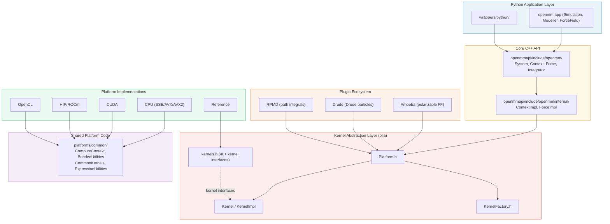
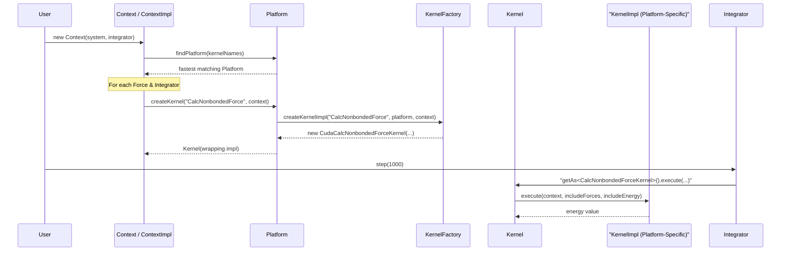
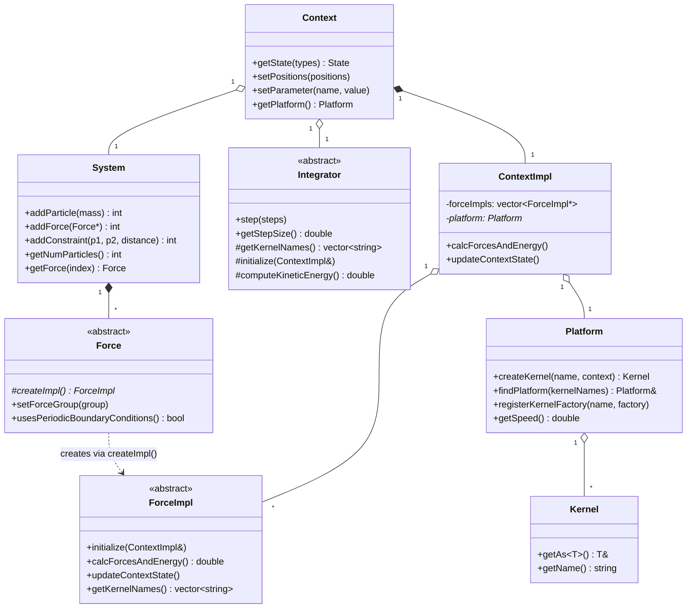

OpenMM is a high-performance molecular dynamics simulation toolkit whose architecture separates the **declaration of what to simulate** from the **decision of how to simulate it**. This decoupling is the single most important design principle in the codebase: users define physical systems through a platform-agnostic public API, while the execution engine transparently dispatches computations to whatever hardware backend is available — CUDA GPUs, OpenCL devices, HIP accelerators, SIMD-optimized CPUs, or a portable reference implementation. The entire system is structured around a factory-driven kernel abstraction that makes this possible.

## Top-Level Layer Model

The repository organizes code into six principal layers, each with a distinct responsibility in the simulation pipeline. Understanding these layers is the prerequisite for navigating any part of the codebase effectively.



Each layer maps to a top-level directory in the repository. The `openmmapi/` directory contains the user-facing C++ API classes. The `olla/` directory (the name is a nod to the molecular dynamics library OLLA) defines the platform and kernel abstraction machinery. The `platforms/` directory holds every hardware-specific backend. The `wrappers/` directory provides Python bindings generated via SWIG. Plugins reside in `plugins/`, and `serialization/` handles XML-based state persistence.

Sources: [CMakeLists.txt](CMakeLists.txt), [Platform.h](olla/include/openmm/Platform.h), [Kernel.h](olla/include/openmm/Kernel.h)

## The Platform and Kernel Abstraction

The central architectural innovation of OpenMM is the **Platform-Kernel-Factory** pattern, defined entirely within the `olla/` layer. This pattern ensures that simulation logic never contains hardware-specific code — instead, every computable operation is declared as an abstract "kernel," and each platform provides its own concrete implementation via factories.

### Core Abstraction Classes

The abstraction is built on four classes defined in `olla/include/openmm/`:

| Class | Header | Role |
|-------|--------|------|
| **Platform** | [Platform.h](olla/include/openmm/Platform.h#L64-L297) | Static registry of all available platforms; factory for creating `Kernel` objects; provides platform-specific properties (device selection, precision mode, etc.) |
| **Kernel** | [Kernel.h](olla/include/openmm/Kernel.h#L44-L107) | Opaque handle wrapping a `KernelImpl*`; provides type-safe access via `getAs<T>()` template method |
| **KernelImpl** | [KernelImpl.h](olla/include/openmm/KernelImpl.h#L43-L76) | Abstract base for platform-specific computation; subclasses define concrete `execute()` or equivalent APIs |
| **KernelFactory** | [KernelFactory.h](olla/include/openmm/KernelFactory.h#L42-L59) | Abstract factory with a single `createKernelImpl()` method; each Platform registers factories keyed by kernel name |

The lifecycle flows as follows: when a `Context` is constructed, it queries `Platform::findPlatform()` with the set of kernel names required by the user's `System` and `Integrator`. The platform with the highest `getSpeed()` rating that supports all required kernels is selected. That platform then creates `Kernel` objects on demand, each wrapping a platform-specific `KernelImpl` produced by a registered `KernelFactory`.



### The Kernel Catalog

The file [kernels.h](olla/include/openmm/kernels.h) defines over **40 distinct kernel interfaces**, each as an abstract class inheriting from `KernelImpl`. Every kernel has a static `Name()` method returning its string identifier. These kernels fall into several categories:

| Category | Example Kernels | Purpose |
|----------|----------------|---------|
| **Orchestration** | `CalcForcesAndEnergyKernel`, `UpdateStateDataKernel` | Begin/finish force computation; get/set positions, velocities, time |
| **Constraints** | `ApplyConstraintsKernel`, `VirtualSitesKernel` | Enforce distance constraints (SETTLE, SHAKE, CCMA) |
| **Bonded Forces** | `CalcHarmonicBondForceKernel`, `CalcHarmonicAngleForceKernel`, `CalcPeriodicTorsionForceKernel` | Standard bonded interactions |
| **Nonbonded Forces** | `CalcNonbondedForceKernel`, `CalcCustomNonbondedForceKernel`, `CalcGBSAOBCForceKernel` | Electrostatics, van der Waals, implicit solvent |
| **Special Forces** | `CalcGayBerneForceKernel`, `CalcCustomManyParticleForceKernel`, `CalcATMForceKernel` | Anisotropic potentials, N-body custom forces, alchemical free energy |
| **Integrators** | `IntegrateVerletStepKernel`, `IntegrateLangevinMiddleStepKernel`, `IntegrateCustomStepKernel` | Time-stepping algorithms |
| **Thermostats/Barostats** | `ApplyAndersenThermostatKernel`, `ApplyMonteCarloBarostatKernel`, `RemoveCMMotionKernel` | Temperature/pressure control |
| **Energy Minimization** | `MinimizeKernel` | L-BFGS minimization |

Each platform registers factories for the subset of kernels it supports. The Reference platform registers all of them; the CPU platform registers a performance-critical subset; GPU platforms register the most expensive kernels (nonbonded, PME) while sometimes delegating simpler operations to shared code.

Sources: [kernels.h](olla/include/openmm/kernels.h#L57-L120), [kernels.h](olla/include/openmm/kernels.h#L200-L400)

## The Core API Layer

The `openmmapi/` directory defines the public API that all users interact with, regardless of programming language. This layer is responsible for two things: **declaring the physical system** and **mediating between the user's description and the kernel abstraction**.

### The Four Pillars: System, Force, Integrator, Context

**System** ([System.h](openmmapi/include/openmm/System.h#L46-L200)) is a pure data container. It holds the number of particles and their masses, a list of `Force` objects, a list of distance constraints, periodic box dimensions, and optional virtual site definitions. It contains absolutely no computation logic — it is a declarative description of the molecular system.

**Force** ([Force.h](openmmapi/include/openmm/Force.h#L41-L126)) is the abstract base class for all interactions. Each subclass (e.g., `NonbondedForce`, `HarmonicBondForce`, `CustomGBForce`) defines methods for adding interaction parameters. Crucially, `Force` also defines a protected `createImpl()` method that returns a `ForceImpl` — this is the bridge to the kernel layer. Forces support **force groups** (32 bit-flags from 0–31) enabling multiple-time-step integration strategies, and they declare whether they use periodic boundary conditions.

**Integrator** ([Integrator.h](openmmapi/include/openmm/Integrator.h#L44-L201)) is the abstract base for time-stepping algorithms. Its public API is minimal: `step(int steps)`, `getStepSize()`, `setStepSize()`. Internally, it defines `getKernelNames()` (returning the integrator kernels it needs), `initialize(ContextImpl&)`, and `computeKineticEnergy()`. Each concrete integrator (`VerletIntegrator`, `LangevinMiddleIntegrator`, `CustomIntegrator`, etc.) binds to its platform-specific kernel at Context creation time.

**Context** ([Context.h](openmmapi/include/openmm/Context.h#L51-L200)) is the central object that brings everything together. It stores the complete simulation state (time, positions, velocities, parameters), owns a reference to the Platform, and delegates all computation to `ContextImpl`. Users interact with the simulation exclusively through Context: calling `getState()` to retrieve snapshots, `setPositions()` to modify coordinates, or `setParameter()` to adjust global variables.

### The Internal Implementation Bridge

The `openmmapi/include/openmm/internal/` directory contains the **implementation classes** that translate public API calls into kernel invocations. The two most important are:

- **ContextImpl** ([ContextImpl.h](openmmapi/include/openmm/internal/ContextImpl.h#L43-L200)): The non-public counterpart to `Context`. It holds references to the Platform, all `ForceImpl` objects, and the bound `Integrator`. It orchestrates the per-timestep loop: call `updateContextState()` on each ForceImpl, call `beginComputation()` on the orchestration kernel, call `calcForcesAndEnergy()` on each ForceImpl, call `finishComputation()`, then invoke the integrator kernel's step function.

- **ForceImpl** ([ForceImpl.h](openmmapi/include/openmm/internal/ForceImpl.h#L44-L131)): The internal counterpart to each `Force` subclass. Created by `Force::createImpl()` when a Context is constructed, each ForceImpl caches force parameters in a format efficient for the target platform, creates its required kernels, and provides `calcForcesAndEnergy()` for per-force computation. It also provides `updateContextState()` for forces that modify simulation state (like barostats).



Sources: [System.h](openmmapi/include/openmm/System.h#L46-L200), [Force.h](openmmapi/include/openmm/Force.h#L41-L126), [Integrator.h](openmmapi/include/openmm/Integrator.h#L44-L201), [Context.h](openmmapi/include/openmm/Context.h#L51-L200), [ContextImpl.h](openmmapi/include/openmm/internal/ContextImpl.h#L43-L200), [ForceImpl.h](openmmapi/include/openmm/internal/ForceImpl.h#L44-L131)

## Platform Implementations

Each directory under `platforms/` provides a complete backend that registers itself as a `Platform` subclass and implements the kernel interfaces for its target hardware. The structure is highly regular: every platform contains a `*Platform.cpp` (registration and property management), a `*KernelFactory.cpp` (kernel instantiation), and a `*Kernels.cpp` (concrete kernel implementations).

### Platform Comparison

| Platform | Directory | Hardware | Speed Rating | Key Properties | Kernel Coverage |
|----------|-----------|----------|-------------|----------------|-----------------|
| **Reference** | `platforms/reference/` | Any CPU (portable C++) | 1.0 | `Threads` | Full (all 40+ kernels) |
| **CPU** | `platforms/cpu/` | x86 with SSE4.1/AVX/AVX2 | ~10–100 | `CpuThreads`, `CpuDeterministicForces` | Subset: nonbonded, GBSA, Langevin, custom forces |
| **CUDA** | `platforms/cuda/` | NVIDIA GPUs | ~100–1000 | `DeviceIndex`, `DeviceName`, `Precision`, `UseBlockingSync`, `TempDirectory`, `DisablePmeStream`, `DeterministicForces`, `UseCpuPme` | Full (most comprehensive GPU platform) |
| **OpenCL** | `platforms/opencl/` | GPUs, CPUs via OpenCL | ~50–500 | `OpenCLDeviceIndex`, `OpenCLPlatformIndex`, `Precision` | Full |
| **HIP** | `platforms/hip/` | AMD GPUs via ROCm | ~100–1000 | `HipDeviceIndex`, `HipPrecision`, `HipUseBlockingSync` | Full |

The **Reference platform** ([ReferencePlatform.cpp](platforms/reference/src/ReferencePlatform.cpp#L43-L100)) is pedagogically important: it registers every single kernel against a single `ReferenceKernelFactory`, which dispatches all kernel creation to `ReferenceKernels.cpp`. This makes it the most readable entry point for understanding how any kernel works.

The **CPU platform** ([CpuPlatform.cpp](platforms/cpu/src/CpuPlatform.cpp#L43-L80)) exploits SIMD vectorization. It conditionally compiles different kernel variants for SSE, AVX, and AVX2 instruction sets (visible in files like `CpuNonbondedForceAvx.cpp`, `CpuNonbondedForceAvx2.cpp`). It deliberately omits some kernels it cannot accelerate, relying on the Reference platform as a fallback for those operations.

The **CUDA platform** ([CudaPlatform.cpp](platforms/cuda/src/CudaPlatform.cpp#L43-L80)) provides the highest performance for NVIDIA hardware. It supports configurable precision modes (single, mixed, double), device selection by index or name, and options for PME stream control and temporary directory placement.

### The Common Platform Layer

The `platforms/common/` directory contains code shared across GPU platforms (CUDA, OpenCL, HIP). This is a significant architectural choice: rather than duplicating algorithm logic across three GPU backends, the common layer implements the **algorithms** in a hardware-agnostic way while each GPU platform provides the **primitive operations** (memory allocation, kernel launches, FFT).

Key shared components include:

- **ComputeContext** — abstract base for GPU resource management; each GPU platform subclasses it
- **BondedUtilities** — bonded force calculation helpers
- **CommonCalcNonbondedForce** — shared nonbonded force logic with cutoff and PME support
- **ExpressionUtilities** — Lepton expression compilation for custom forces
- **IntegrationUtilities** — shared integration helpers
- **kernels/** — GPU kernel source templates (`.cu` and `.cl` variants)

Sources: [ReferencePlatform.cpp](platforms/reference/src/ReferencePlatform.cpp#L43-L100), [CpuPlatform.cpp](platforms/cpu/src/CpuPlatform.cpp#L43-L80), [CudaPlatform.cpp](platforms/cuda/src/CudaPlatform.cpp#L43-L80), [platforms/common/src](platforms/common/src)

## The Plugin System

OpenMM's plugin architecture enables third-party force fields and simulation methods to be distributed as separate shared libraries, loaded at runtime without recompiling the core. The `Platform::loadPluginLibrary()` method ([Platform.h](olla/include/openmm/Platform.h#L255-L275)) dynamically loads a shared object and invokes its `registerPlatforms()` entry point, which registers any new Platform subclasses and their kernel factories.

The `plugins/` directory contains four built-in plugins that demonstrate the pattern:

| Plugin | Directory | Extension Provided |
|--------|-----------|-------------------|
| **Amoeba** | `plugins/amoeba/` | `AmoebaMultipoleForce`, `AmoebaTorsionTorsionForce`, `AmoebaVdwForce`, `HippoNonbondedForce`, `AmoebaGeneralizedKirkwoodForce` — polarizable force field with induced dipoles |
| **Drude** | `plugins/drude/` | `DrudeForce`, `DrudeLangevinIntegrator`, `DrudeSCFIntegrator` — Drude polarizable particle model |
| **RPMD** | `plugins/rpmd/` | `RPMDIntegrator` — ring-polymer molecular dynamics for nuclear quantum effects |
| **CpuPME** | `plugins/cpupme/` | CPU-optimized PME plugin for platforms that benefit from a separate PME implementation |

Each plugin mirrors the core structure: it defines new `Force` subclasses in its own `openmmapi/` subdirectory, provides platform-specific kernel implementations (reference, CUDA, OpenCL, HIP) in its `platforms/` subdirectory, and includes serialization and Python wrappers.

> [!TIP]
> Plugin force classes follow the exact same `Force` → `ForceImpl` → `KernelImpl` chain as core forces. When writing a plugin, your new `Force` subclass must implement `createImpl()`, your `ForceImpl` must list required kernel names in `getKernelNames()`, and each target platform must register a factory for those kernel names. The system will not discover your kernels otherwise.

Sources: [Platform.h](olla/include/openmm/Platform.h#L255-L275), [PluginInitializer.h](olla/include/openmm/PluginInitializer.h), [plugins/](plugins/)

## Supporting Infrastructure

### Third-Party Libraries

The `libraries/` directory bundles vetted dependencies that OpenMM relies on for core computation. These are not external in the traditional sense — they are compiled directly into the OpenMM libraries, ensuring consistent builds across platforms.

| Library | Purpose | Used By |
|---------|---------|---------|
| **lepton** | Expression parsing and compilation for custom forces | `CustomBondForce`, `CustomNonbondedForce`, `CustomIntegrator`, `ExpressionUtilities` |
| **sfmt** | SIMD-oriented Fast Mersenne Twister random number generator | Langevin and Monte Carlo integrators |
| **jama** | Jama matrix library (eigenvalue decomposition) | Normal mode analysis, constraint algorithms |
| **quern** | Minimum-norm least-squares solver | Constraint enforcement (SETTLE, CCMA) |
| **lbfgs** | Limited-memory BFGS optimization | `LocalEnergyMinimizer` |
| **pocketfft** | PocketFFT for Fast Fourier Transforms | PME electrostatics on CPU |
| **vkfft** | VKFFT for GPU FFT | PME electrostatics on GPU platforms |
| **vecmath** | SIMD vector math (OpenMM's own Vec3, SimdFloat, etc.) | All platforms |
| **asmjit** | JIT assembler for dynamic code generation | `CustomIntegrator` expression compilation on CPU |
| **csha1** | SHA-1 hash computation | Build system kernel source encoding |
| **hilbert** | Hilbert space-filling curves | Neighbor list spatial sorting |
| **irrxml** | XML parser | Serialization/XML state files |

### Serialization and Checkpointing

The `serialization/` directory provides XML-based serialization for the entire simulation state, enabling system definitions, force parameters, integrator configurations, and particle states to be saved and restored across sessions. This is critical for reproducibility and workflow continuity. The serialization layer maps directly to the core API classes — every `Force`, `Integrator`, and `System` subclass has a corresponding serialization adapter.

Sources: [libraries/](libraries/), [serialization/](serialization/)

## Directory Structure Reference

```
openmm/
├── olla/                          # Platform/Kernel abstraction layer
│   ├── include/openmm/
│   │   ├── Platform.h             # Platform registry & factory hub
│   │   ├── Kernel.h               # Opaque kernel handle with type-safe access
│   │   ├── KernelImpl.h           # Abstract kernel implementation base
│   │   ├── KernelFactory.h        # Abstract factory for kernel creation
│   │   └── kernels.h              # 40+ kernel interface definitions
│   └── src/
│
├── openmmapi/                     # Public C++ API
│   ├── include/openmm/
│   │   ├── System.h               # Molecular system definition
│   │   ├── Context.h              # Simulation state & computation driver
│   │   ├── Force.h                # Abstract force base class
│   │   ├── Integrator.h           # Abstract integrator base class
│   │   ├── State.h                # Simulation snapshot container
│   │   ├── NonbondedForce.h       # Lennard-Jones + PME electrostatics
│   │   ├── HarmonicBondForce.h    # Bonded interactions
│   │   ├── CustomIntegrator.h     # User-defined integration algorithms
│   │   └── internal/
│   │       ├── ContextImpl.h      # Internal context orchestration
│   │       ├── ForceImpl.h        # Internal force implementation base
│   │       └── vectorize*.h       # SIMD abstraction headers
│   └── src/
│
├── platforms/                     # Hardware backend implementations
│   ├── common/                    # Shared GPU platform code
│   │   └── src/                   # ComputeContext, utilities, kernel sources
│   ├── reference/                 # Portable C++ reference (speed = 1.0)
│   ├── cpu/                       # x86 SSE/AVX/AVX2 optimized
│   ├── cuda/                      # NVIDIA GPU via CUDA
│   ├── hip/                       # AMD GPU via ROCm/HIP
│   └── opencl/                    # Portable GPU via OpenCL
│
├── plugins/                       # Dynamically loadable extensions
│   ├── amoeba/                    # Amoeba polarizable force field
│   ├── drude/                     # Drude polarizable particles
│   ├── rpmd/                      # Ring-polymer molecular dynamics
│   └── cpupme/                    # CPU PME plugin
│
├── libraries/                     # Bundled third-party dependencies
│   ├── lepton/                    # Expression compiler
│   ├── sfmt/                      # SIMD random number generator
│   ├── lbfgs/                     # L-BFGS optimizer
│   ├── pocketfft/                 # CPU FFT
│   ├── vkfft/                     # GPU FFT
│   └── vecmath/                   # SIMD math primitives
│
├── serialization/                 # XML state persistence
├── wrappers/python/               # Python bindings (SWIG)
├── tests/                         # Comprehensive test suite
└── examples/                      # C++ and Python example programs
```

## How a Simulation Request Flows Through the Architecture

To consolidate the architectural picture, consider what happens when a user calls `integrator.step(1000)`:

1. **Integrator.step()** invokes the platform-specific integration kernel (e.g., `IntegrateLangevinMiddleStepKernel`).
2. The integration kernel calls **ContextImpl.calcForcesAndEnergy()**, which orchestrates the force loop.
3. **ContextImpl** iterates over all `ForceImpl` objects, first calling `updateContextState()` on each (allowing barostats and thermostats to modify state).
4. The orchestration kernel's **beginComputation()** initializes force buffers.
5. Each `ForceImpl.calcForcesAndEnergy()` invokes its platform-specific kernel (e.g., `CudaCalcNonbondedForceKernel::execute()`), which runs GPU kernels or CPU loops.
6. The orchestration kernel's **finishComputation()** performs final reductions and validation.
7. The integration kernel reads forces and velocities, applies the integration algorithm, updates positions and velocities through the `UpdateStateDataKernel`, then calls `ApplyConstraintsKernel` if constraints exist.

This entire pipeline is hardware-agnostic at the orchestration level — only steps 5 and 7 involve platform-specific code.

> [!TIP]
> When debugging performance, the key insight is that the force computation loop in `ContextImpl` is the hottest path. Platform selection via `Platform::findPlatform()` happens once at Context creation, so the overhead is zero during simulation. If a particular Force is slow, check whether the selected platform actually provides an optimized kernel for it (some platforms fall back to Reference for less common forces).

Sources: [ContextImpl.h](openmmapi/include/openmm/internal/ContextImpl.h#L43-L200), [ForceImpl.h](openmmapi/include/openmm/internal/ForceImpl.h#L44-L131), [kernels.h](olla/include/openmm/kernels.h#L57-L120)

## Where to Go Next

This page has mapped the architectural landscape at the structural level. The following pages in this guide descend into the specific mechanisms:

- **[Platform and Kernel System](8-platform-and-kernel-system)** — detailed examination of how Platform registration, kernel factory chains, and the `findPlatform()` selection algorithm work
- **[System and Context](11-system-and-context)** — deep dive into the System definition model and Context lifecycle management
- **[CUDA Platform Implementation](9-cuda-platform-implementation)** — walkthrough of the most performant backend, including memory management, kernel compilation, and PME stream pipelining
- **[Plugin Architecture](20-plugin-architecture)** — how to write and load custom plugins with new Force types and platform implementations
- **[Serialization and Checkpointing](23-serialization-and-checkpointing)** — the XML serialization format and binary checkpoint system