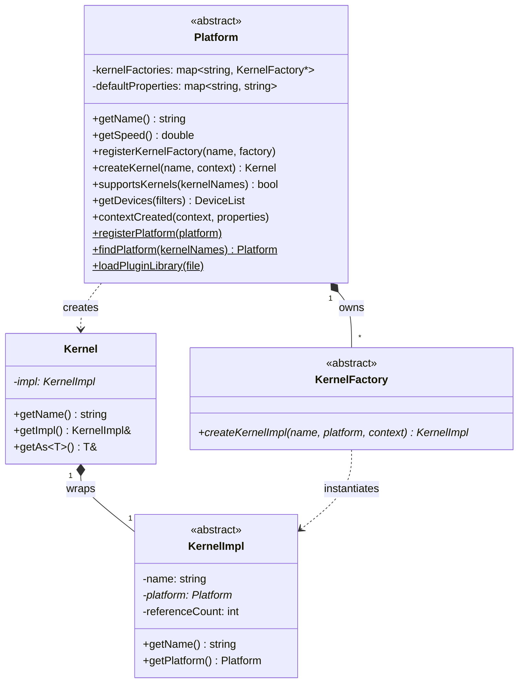
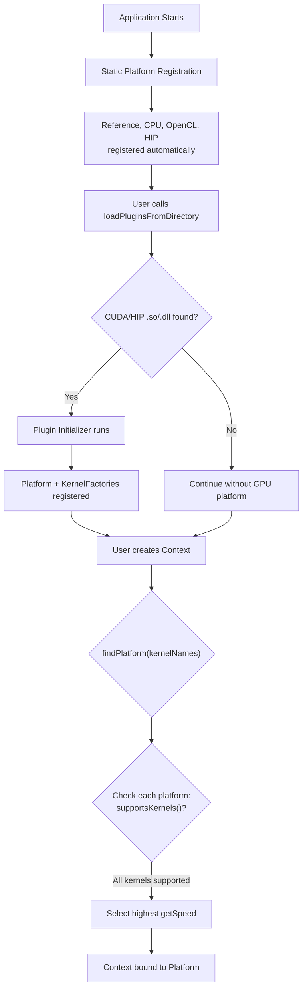
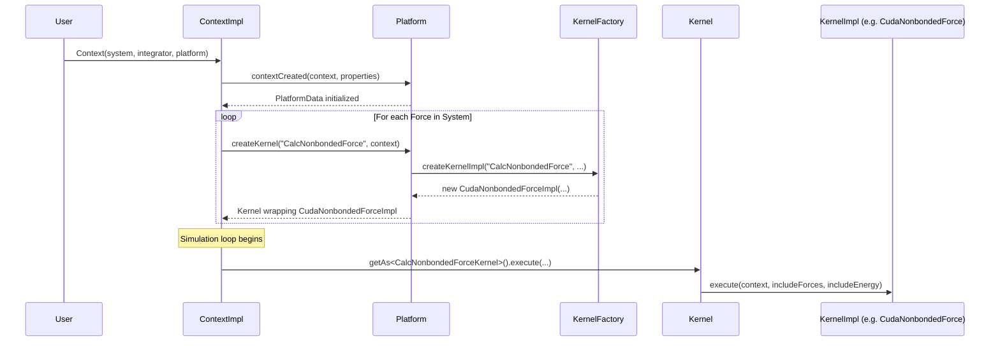

OpenMM's defining architectural achievement is its ability to execute identical molecular dynamics simulations across radically different hardware — CPU cores, NVIDIA GPUs, AMD GPUs, and OpenCL devices — without the user writing a single platform-specific line of code. This is made possible by the **Platform and Kernel system**, a layered abstraction that decouples the *what* of a computation (the physics) from the *where* and *how* (the hardware). Understanding this system is the prerequisite for everything that follows: reading platform-specific implementations, extending OpenMM with custom forces, or writing plugins.

## The Architectural Problem

A molecular dynamics simulation requires dozens of distinct computational operations: bonded force evaluation, nonbonded pair interactions, constraint enforcement, integration, thermostat application, barostat scaling, virtual site computation, and checkpoint serialization. Each of these must execute efficiently on very different hardware architectures. Rather than scattering `#ifdef` preprocessor guards throughout the codebase, OpenMM introduces a **double dispatch** architecture: a *Platform* acts as a hardware-aware factory registry, and *Kernels* are type-erased computation objects whose concrete implementations live entirely within platform-specific libraries.

Sources: [Platform.h](/openmm/openmm/blob/master/olla/include/openmm/Platform.h#L60-L80), [Kernel.h](/openmm/openmm/blob/master/olla/include/openmm/Kernel.h#L46-L60)

## Core Abstraction Layers

The system is built on four foundational classes arranged in a strict hierarchy. The `Platform` class serves as the top-level registry — it holds a map of named `KernelFactory` objects and provides a global static registry of all loaded platforms. When a kernel is requested by name, the platform delegates to the appropriate factory, which instantiates a concrete `KernelImpl` subclass. The `Kernel` wrapper then provides type-erased access to that implementation via `dynamic_cast`.



Sources: [Platform.h](/openmm/openmm/blob/master/olla/include/openmm/Platform.h#L98-L175), [KernelFactory.h](/openmm/openmm/blob/master/olla/include/openmm/KernelFactory.h#L38-L45), [KernelImpl.h](/openmm/openmm/blob/master/olla/include/openmm/KernelImpl.h#L42-L62), [Kernel.h](/openmm/openmm/blob/master/olla/include/openmm/Kernel.h#L71-L82)

## The Kernel Catalog: Named Operations in `kernels.h`

The central design decision is that every computational operation in OpenMM is identified by a **string name**. The file [kernels.h](/openmm/openmm/blob/master/olla/include/openmm/kernels.h) defines approximately 50 abstract kernel classes — one for each type of operation the system must perform. Each kernel class inherits from `KernelImpl` and declares a `static Name()` method returning its canonical string identifier, along with a pure virtual API specific to that operation.

These kernel classes fall into distinct functional categories, shown in the table below.

| Category | Representative Kernels | String Names |
|----------|----------------------|--------------|
| **Computation Orchestration** | `CalcForcesAndEnergyKernel`, `UpdateStateDataKernel` | `"CalcForcesAndEnergyKernel"`, `"UpdateTime"` |
| **Constraint Handling** | `ApplyConstraintsKernel`, `VirtualSitesKernel` | `"ApplyConstraints"`, `"VirtualSites"` |
| **Bonded Forces** | `CalcHarmonicBondForceKernel`, `CalcHarmonicAngleForceKernel`, `CalcPeriodicTorsionForceKernel`, `CalcRBTorsionForceKernel` | `"CalcHarmonicBondForce"`, `"CalcHarmonicAngleForce"`, `"CalcPeriodicTorsionForce"`, `"CalcRBTorsionForce"` |
| **Nonbonded Forces** | `CalcNonbondedForceKernel`, `CalcCustomNonbondedForceKernel`, `CalcGBSAOBCForceKernel` | `"CalcNonbondedForce"`, `"CalcCustomNonbondedForce"`, `"CalcGBSAOBCForce"` |
| **Integration** | `IntegrateVerletStepKernel`, `IntegrateLangevinStepKernel`, `IntegrateBrownianStepKernel`, `IntegrateCustomStepKernel` | `"IntegrateVerletStep"`, `"IntegrateLangevinStep"`, `"IntegrateBrownianStep"`, `"IntegrateCustomStep"` |
| **Thermostats & Barostats** | `ApplyAndersenThermostatKernel`, `ApplyMonteCarloBarostatKernel` | `"ApplyAndersenThermostat"`, `"ApplyMonteCarloBarostat"` |
| **Energy Minimization** | `MinimizeEnergyKernel`, `CalcHarmonicAngleForceKernel` | `"MinimizeEnergy"`, ... |
| **Special Forces** | `CalcGayBerneForceKernel`, `CalcCustomCVForceKernel`, `CalcATMForceKernel`, `CalcRMSDForceKernel` | `"CalcGayBerneForce"`, `"CalcCustomCVForce"`, `"CalcATMForce"`, `"CalcRMSDForce"` |

The `CalcForcesAndEnergyKernel` deserves special attention: it brackets all force evaluation with `beginComputation()` and `finishComputation()`, giving the platform a chance to clear GPU buffers, initiate async transfers, or aggregate partial energy results from multiple devices. This is where the CUDA platform, for example, can split work across multiple GPUs and merge results.

Sources: [kernels.h](/openmm/openmm/blob/master/olla/include/openmm/kernels.h#L73-L97), [kernels.h](/openmm/openmm/blob/master/olla/include/openmm/kernels.h#L102-L175)

## Platform Registration and Discovery

Platforms are discovered through a two-phase process: **static registration** at library load time, and **dynamic discovery** via plugin loading.

### Static Registration

Each built-in platform registers itself into the global platform registry when the shared library is loaded. The `Platform::registerPlatform()` static method adds a platform to an internal static vector. The `ContextImpl` constructor, created when the user constructs a `Context`, triggers this chain: it either accepts an explicitly named platform or calls `Platform::findPlatform()`, which iterates over all registered platforms, checks `supportsKernels()` for the required kernel set, and returns the one with the highest `getSpeed()` value.

### Plugin Loading

Platforms that are distributed separately (such as the CUDA platform on systems without CUDA hardware) are loaded as dynamic libraries at runtime. The `Platform::loadPluginsFromDirectory()` method scans directories for shared library files, calling `loadPluginLibrary()` on each. Each plugin library exposes an initialization function (via `PluginInitializer`) that registers its platform and kernel factories. The `OPENMM_PLUGIN_DIR` environment variable controls the default search path, with a sensible platform-specific fallback.



Sources: [Platform.h](/openmm/openmm/blob/master/olla/include/openmm/Platform.h#L240-L270), [PluginInitializer.h](/openmm/openmm/blob/master/olla/include/openmm/PluginInitializer.h)

## How Context Binds to a Platform

The `ContextImpl` constructor is where the abstract becomes concrete. It receives a `System`, an `Integrator`, and either a `Platform` pointer or platform name. It calls `contextCreated()` on the platform, which initializes platform-specific data structures, and then iterates over every `ForceImpl` created for the system's forces, calling `getKernelNames()` on each and requesting those kernels from the platform. Each `ForceImpl` holds its kernel as a member and invokes it during force computation.

The key insight is that the `ForceImpl` layer (defined in the public API) is *platform-agnostic* — it knows what kernel names it needs but not how they are implemented. The `KernelImpl` layer (defined in `kernels.h`) provides the platform-specific API. The concrete platform implementation (e.g., `CudaKernels.h`) provides the actual GPU-accelerated code.



Sources: [ContextImpl.h](/openmm/openmm/blob/master/openmmapi/include/openmm/internal/ContextImpl.h#L55-L70), [ForceImpl.h](/openmm/openmm/blob/master/openmmapi/include/openmm/internal/ForceImpl.h#L82-L101), [Platform.h](/openmm/openmm/blob/master/olla/include/openmm/Platform.h#L155-L170)

## Concrete Platform Implementations

OpenMM ships with five built-in platforms, each living in its own directory under `platforms/`. Every platform follows the same structural pattern: a `XxxPlatform` class (subclassing `Platform`), a `XxxKernelFactory` (subclassing `KernelFactory`), a `XxxKernels.h` header containing concrete kernel implementations, and a `XxxPlatform.cpp` that registers all kernel factories in the constructor.

| Platform | Directory | Hardware Target | Speed Rating | Key Characteristics |
|----------|-----------|----------------|--------------|-------------------|
| **Reference** | `platforms/reference/` | Any CPU (scalar) | ~1.0 | Baseline correctness reference, no optimization, supports double precision |
| **CPU** | `platforms/cpu/` | Any CPU (SIMD) | ~10–50 | Vectorized with SSE/AVX/NEON, includes PME via CPU plugin |
| **CUDA** | `platforms/cuda/` | NVIDIA GPUs | ~100–1000 | Multi-GPU support, configurable precision (single/mixed/double), PME stream |
| **OpenCL** | `platforms/opencl/` | Any GPU via OpenCL | ~50–500 | Cross-vendor GPU support, deprecated in favor of HIP |
| **HIP** | `platforms/hip/` | AMD GPUs | ~100–500 | AMD ROCm backend, newer replacement for OpenCL on AMD |

The **CUDA platform** demonstrates the full power of the system. Its `CudaPlatform` class defines 8 platform-specific properties — `DeviceIndex`, `DeviceName`, `Precision`, `UseCpuPme`, `UseBlockingSync`, `TempDirectory`, `DisablePmeStream`, and `DeterministicForces` — that users can set via `context.setPropertyValue()` or pass as a dictionary in Python. Its `PlatformData` manages multiple `CudaContext` objects for multi-GPU execution, a thread pool for CPU fallback work, and synchronization primitives.

The **Reference platform** is intentionally minimal. Its `PlatformData` stores raw `std::vector<Vec3>` pointers for positions, velocities, and forces, along with `ReferenceConstraints` and `ReferenceVirtualSites` objects. Its speed rating of ~1.0 serves as the baseline for the `findPlatform()` selection algorithm.

Sources: [CudaPlatform.h](/openmm/openmm/blob/master/platforms/cuda/include/CudaPlatform.h#L50-L155), [ReferencePlatform.h](/openmm/openmm/blob/master/platforms/reference/include/ReferencePlatform.h#L57-L82), [CudaKernelFactory.h](/openmm/openmm/blob/master/platforms/cuda/include/CudaKernelFactory.h#L37-L42), [ReferenceKernelFactory.h](/openmm/openmm/blob/master/platforms/reference/include/ReferenceKernelFactory.h#L37-L42)

## The Kernel Lifecycle

Every kernel follows a predictable lifecycle governed by the `ContextImpl` and the `ForceImpl` that owns it:

1. **Creation**: `Platform::createKernel()` calls the registered `KernelFactory`, which instantiates a `KernelImpl` subclass. The `Kernel` wrapper takes ownership via an internal reference count.
2. **Initialization**: The `ForceImpl::initialize()` method retrieves the kernel via `getAs<T>()` and calls its type-specific `initialize(system, force)` method, which typically allocates GPU buffers, compiles compute kernels, or precomputes lookup tables.
3. **Execution**: During each timestep, `ForceImpl::calcForcesAndEnergy()` calls the kernel's `execute()` method. The kernel reads particle state from the platform's internal buffers (which may reside in GPU memory) and writes forces and energy contributions.
4. **Parameter Updates**: When the user modifies force parameters, `copyParametersToContext()` propagates the changes to the kernel, which may reinitialize GPU data structures.
5. **Destruction**: When the `Context` is destroyed, `Platform::contextDestroyed()` cleans up platform-wide resources, and the `Kernel` wrapper decrements the reference count, eventually deleting the `KernelImpl`.

> [!TIP]
> The `Kernel::getAs<T>()` template method is the primary mechanism for type-safe access to platform-specific kernel APIs. The call uses `dynamic_cast` internally, which means that requesting the wrong type will throw `std::bad_cast` — a useful diagnostic if kernel name mismatches occur during development.

Sources: [Kernel.h](/openmm/openmm/blob/master/olla/include/openmm/Kernel.h#L71-L88), [KernelImpl.h](/openmm/openmm/blob/master/olla/include/openmm/KernelImpl.h#L57-L59), [ForceImpl.h](/openmm/openmm/blob/master/openmmapi/include/openmm/internal/ForceImpl.h#L52-L55)

## Platform Properties and Device Selection

Each platform can define an arbitrary set of **properties** — named string values that control hardware selection and runtime behavior. The `Platform` base class provides `getPropertyNames()`, `getPropertyDefaultValue()`, and `setPropertyDefaultValue()` for managing these. Properties can be set at two levels: as **defaults** on the platform (affecting all future contexts) or as **per-context overrides** via the context constructor.

The `getDevices()` method is particularly important for GPU platforms. It returns a list of available hardware devices as a vector of property maps. Each map contains the properties needed to select that specific device (e.g., `{"DeviceIndex": "0", "DeviceName": "GeForce RTX 4090"}`). Users can pass these maps directly to the `Context` constructor. The optional `filters` parameter allows narrowing the list — for example, requesting only devices that support double precision.

```python
# Python example: querying and selecting CUDA devices
import openmm as mm

platform = mm.Platform.getPlatformByName('CUDA')
devices = platform.getDevices()
for d in devices:
    print(f"Device {d['DeviceIndex']}: {d['DeviceName']}")

# Select a specific device for a Context
context = mm.Context(system, integrator, platform, 
                     {'DeviceIndex': '1', 'Precision': 'mixed'})
```

Sources: [Platform.h](/openmm/openmm/blob/master/olla/include/openmm/Platform.h#L100-L145)

## Directory Layout of the Platform System

Understanding the physical code organization clarifies the architectural boundaries. The platform system spans three distinct areas of the repository:

```
olla/                          ← Core abstraction layer (no physics)
├── include/openmm/
│   ├── Platform.h             ← Abstract platform interface + global registry
│   ├── Kernel.h               ← Type-erased kernel wrapper
│   ├── KernelImpl.h           ← Abstract kernel base class
│   ├── KernelFactory.h        ← Abstract factory interface
│   ├── kernels.h              ← 50+ abstract kernel API definitions
│   └── PluginInitializer.h    ← Plugin loading entry point
└── src/                       ← Platform/Kernel/KernelFactory implementations

openmmapi/include/openmm/
├── internal/
│   ├── ContextImpl.h          ← Platform binding orchestration
│   └── ForceImpl.h            ← Platform-agnostic force implementation
└── (Force classes)            ← Public API, no platform knowledge

platforms/
├── reference/                 ← Reference platform (correctness baseline)
│   ├── include/
│   │   ├── ReferencePlatform.h
│   │   ├── ReferenceKernelFactory.h
│   │   └── ReferenceKernels.h
│   └── src/
├── cuda/                      ← NVIDIA GPU platform
│   ├── include/
│   │   ├── CudaPlatform.h
│   │   ├── CudaKernelFactory.h
│   │   ├── CudaKernels.h
│   │   └── CudaContext.h / CudaArray.h / CudaProgram.h
│   └── src/
├── cpu/                       ← SIMD-optimized CPU platform
├── opencl/                    ← OpenCL GPU platform
└── hip/                       ← AMD ROCm platform

plugins/                       ← External platforms (loaded dynamically)
├── amoeba/                    ← Amoeba polarizable force field
├── drude/                     ← Drude polarizable model
├── cpupme/                    ← CPU PME plugin
└── rpmd/                      ← Ring polymer MD
```

The `olla/` directory (named after the internal project codename) contains the pure abstraction machinery with zero physics knowledge. The `openmmapi/` directory contains the public-facing API that users interact with. The `platforms/` directory contains the concrete implementations, each with its own CMake target and test suite.

Sources: [olla/include/openmm/](/openmm/openmm/blob/master/olla/include/openmm/Platform.h), [platforms/](/openmm/openmm/blob/master/platforms/reference/include/ReferencePlatform.h), [openmmapi/include/openmm/internal/](/openmm/openmm/blob/master/openmmapi/include/openmm/internal/ContextImpl.h)

## Platform Selection Algorithm

When no platform is explicitly specified, `Platform::findPlatform()` performs the selection. The algorithm is straightforward but has important nuances:

1. For each registered platform, call `supportsKernels(kernelNames)` — this checks whether the platform has a `KernelFactory` registered for *every* requested kernel name.
2. Filter to only platforms that support all kernels.
3. Among the candidates, select the one with the highest `getSpeed()` value.
4. If no platform supports all kernels, throw an `OpenMMException`.

This means that if you use a force class that is only implemented by certain platforms (e.g., a plugin force), the system will automatically select a compatible platform. The speed heuristic ensures that GPU platforms are preferred over CPU platforms when both are available and both support the required kernels.

> [!TIP]
> When developing custom forces or integrators, you must ensure the kernel names returned by `ForceImpl::getKernelNames()` or `Integrator::getKernelNames()` are actually registered by the target platform. A missing kernel registration is the most common cause of "no Platform supports all kernels" exceptions.

Sources: [Platform.h](/openmm/openmm/blob/master/olla/include/openmm/Platform.h#L265-L270), [ForceImpl.h](/openmm/openmm/blob/master/openmmapi/include/openmm/internal/ForceImpl.h#L103-L106)

## Summary of the Contract Between Layers

The entire system rests on a set of explicit contracts between its layers:

| Contract | Between | Mechanism |
|----------|---------|-----------|
| Kernel name registry | `Platform` ↔ `KernelFactory` | String-keyed map in `Platform::kernelFactories` |
| Kernel API | `kernels.h` ↔ Platform implementations | Abstract virtual methods in kernel classes |
| Force-to-kernel binding | `ForceImpl` ↔ `Platform` | `getKernelNames()` returns required strings |
| State data access | `UpdateStateDataKernel` ↔ `ContextImpl` | Positions/velocities/forces via platform buffers |
| Property configuration | `Platform` ↔ `Context` | String-keyed property map at construction |
| Platform discovery | Global registry ↔ Plugins | `loadPluginsFromDirectory()` + static init |

Understanding these contracts is essential before diving into any specific platform's implementation details. The [CUDA Platform Implementation](9-cuda-platform-implementation) page explores how the CUDA platform fulfills these contracts with multi-GPU orchestration and mixed-precision arithmetic. The [CPU and OpenCL Platforms](10-cpu-and-opencl-platforms) page covers the SIMD vectorization strategies and OpenCL compute kernel compilation. For the broader picture of how platforms fit into the overall simulation setup, see [Architecture Overview](7-architecture-overview).