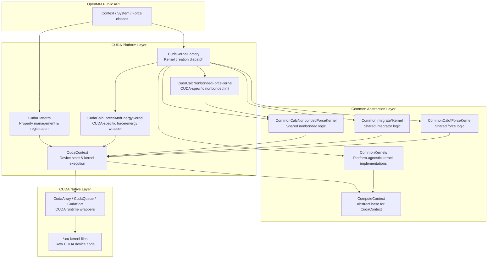

The CUDA Platform is OpenMM's highest-performance execution backend, translating the abstract simulation API into native CUDA kernel launches on NVIDIA GPUs. It occupies the most privileged position in the platform hierarchy — returning a speed score of 100 and supporting double precision — and serves as the reference for what a fully-featured GPU platform looks like in OpenMM's architecture. This page dissects its internal design, from device management through kernel dispatch to the multi-GPU parallelism model, grounding every claim in source evidence.

## Platform Registration and Property System

The CUDA Platform enters the runtime through the `registerPlatforms()` entry point, which constructs a `CudaPlatform` instance and registers it via `Platform::registerPlatform()` [CudaPlatform.cpp](platforms/cuda/src/CudaPlatform.cpp#L52-L60). The constructor performs three critical initialization tasks: it registers deprecated property name mappings for backward compatibility with older scripts that prefixed properties with `"Cuda"`, it creates a single `CudaKernelFactory` and registers it for every kernel name the platform supports, and it defines the full set of platform properties with their defaults [CudaPlatform.cpp](platforms/cuda/src/CudaPlatform.cpp#L62-L142).

The platform exposes 10 configurable properties, each accessible through static accessor methods on `CudaPlatform` [CudaPlatform.h](platforms/cuda/include/CudaPlatform.h#L60-L130):

| Property | Default | Purpose |
|----------|---------|---------|
| `DeviceIndex` | `""` (auto) | Selects which CUDA device(s) to use (comma-separated for multi-GPU) |
| `DeviceName` | `""` | Reports the CUDA device name; can filter by name |
| `UseBlockingSync` | `"false"` | Controls whether CUDA syncs or spin-loops while waiting for results |
| `Precision` | `"single"` | Numerical precision: `"single"`, `"mixed"`, or `"double"` |
| `UseCpuPme` | `"false"` | Offloads PME reciprocal-space computation to the CPU |
| `TempDirectory` | System temp | Directory for temporary files (e.g., kernel compilation artifacts) |
| `DisablePmeStream` | `"false"` | Disables the separate CUDA stream used for PME |
| `DeterministicForces` | `"false"` | Forces fully deterministic force computation (potential performance cost) |
| `CudaCompiler` | `""` | **Deprecated** — ignored, retained for backward compatibility |
| `CudaHostCompiler` | `""` | **Deprecated** — ignored, retained for backward compatibility |

The deprecated property replacement map (`deprecatedPropertyReplacements`) ensures that legacy code referencing `"CudaDeviceIndex"`, `"CudaPrecision"`, etc. is silently redirected to the unprefixed property names [CudaPlatform.cpp](platforms/cuda/src/CudaPlatform.cpp#L63-L70). The `getSpeed()` method unconditionally returns 100, giving CUDA the highest priority among all platforms during automatic selection [CudaPlatform.cpp](platforms/cuda/src/CudaPlatform.cpp#L144-L146).

Device enumeration via `getDevices()` queries CUDA runtime with `cuDeviceGetCount`, iterates over available devices, and returns a vector of property maps containing each device's name, compute capability, and supported precision modes [CudaPlatform.cpp](platforms/cuda/src/CudaPlatform.cpp#L167-L200).

## CudaContext: The Device Abstraction Layer

`CudaContext` is the architectural heart of the CUDA platform. It extends `ComputeContext` — the common abstract base shared with OpenCL and HIP platforms — and encapsulates everything required to execute computations on a single CUDA device [CudaContext.h](platforms/cuda/include/CudaContext.h#L66-L67). When a simulation is parallelized across multiple GPUs, one `CudaContext` is created per device, and the collection is stored in `CudaPlatform::PlatformData::contexts` [CudaContext.h](platforms/cuda/include/CudaContext.h#L56-L63).

### Construction and Device Binding

The constructor accepts the `System`, a `deviceIndex`, synchronization and precision flags, a temporary directory path, a reference to the parent `PlatformData`, and an optional `originalContext` for linked contexts [CudaContext.h](platforms/cuda/include/CudaContext.h#L75-L76). It binds to the specified CUDA device, creates a `CUcontext`, and stores device properties including the compute capability (`computeCapability`), GPU architecture (`gpuArchitecture`), and the blocking-sync flag [CudaContext.h](platforms/cuda/include/CudaContext.h#L593-L610). A worker thread is created for each context when running in multi-device mode, ensuring that blocking calls to one device do not stall others.

### Precision Model

The platform supports three precision modes, controlled by the `Precision` property:

- **Single precision** (`"single"`): All computations in `float` (32-bit). Fastest but may accumulate numerical error.
- **Mixed precision** (`"mixed"`): Forces accumulated in 64-bit fixed-point (`long long`), positions stored in `float` with a separate correction array. This is the recommended balance of speed and accuracy.
- **Double precision** (`"double"`): All computations in `double` (64-bit). Slowest but most accurate.

The precision state is tracked by the `useDoublePrecision` and `useMixedPrecision` boolean members [CudaContext.h](platforms/cuda/include/CudaContext.h#L600). The `getSupportsDoublePrecision()` method unconditionally returns `true` since all CUDA devices with compute capability ≥ 1.3 support double-precision arithmetic [CudaContext.h](platforms/cuda/include/CudaContext.h#L396-L399).

### Core Data Arrays

`CudaContext` owns the primary simulation state arrays, each wrapped as a `CudaArray` object:

| Array | Contents | Precision Notes |
|-------|----------|-----------------|
| `posq` | Position (xyz) + charge (w) per atom | `float4` or `double4` |
| `posqCorrection` | Position correction for mixed precision | Exists only when `useMixedPrecision` is true |
| `velm` | Velocity (xyz) + inverse mass (w) per atom | `float4` or `double4` |
| `force` | Force per atom as 64-bit fixed-point (`long long`) | Always 64-bit — CUDA's atomic add on `unsigned long long` |
| `energyBuffer` | Per-block energy accumulation buffer | Reduced to scalar by `reduceEnergy()` |
| `energyParamDerivBuffer` | Energy derivatives with respect to parameters | For parameter sensitivity analysis |
| `atomIndexDevice` | Atom index mapping array | Used for reordering operations |

The force array is notable: it uses 64-bit fixed-point representation regardless of the precision mode, because CUDA hardware guarantees atomic 64-bit integer operations on global memory (`getSupports64BitGlobalAtomics()` returns `true`), enabling race-free parallel force accumulation [CudaContext.h](platforms/cuda/include/CudaContext.h#L389-L393). Attempting to access a floating-point force buffer throws an exception [CudaContext.h](platforms/cuda/include/CudaContext.h#L234-L250).

### Periodic Box Management

Periodic boundary conditions are maintained in both `double4` and `float4` formats to match the current precision mode, avoiding runtime casts in kernels [CudaContext.h](platforms/cuda/include/CudaContext.h#L425-L491). The `setPeriodicBoxVectors()` method simultaneously updates both representations along with the box size and its inverse, while getter methods like `getPeriodicBoxSizePointer()` return a `void*` pointing to whichever representation matches the active precision [CudaContext.h](platforms/cuda/include/CudaContext.h#L461-L491).

### Utility Subsystems

`CudaContext` aggregates four utility objects that provide higher-level abstractions over raw kernel launches:

- **`CudaIntegrationUtilities`** — constraint solver (SETTLE, SHAKE), velocity Verlet integration helpers [CudaContext.h](platforms/cuda/include/CudaContext.h#L494-L497).
- **`CudaExpressionUtilities`** — compiles and evaluates Lepton mathematical expressions as CUDA kernels [CudaContext.h](platforms/cuda/include/CudaContext.h#L499-L503).
- **`CudaBondedUtilities`** — manages bonded force kernel arguments and dispatch [CudaContext.h](platforms/cuda/include/CudaContext.h#L505-L509).
- **`CudaNonbondedUtilities`** — manages neighbor list construction, interaction block sorting, and nonbonded force kernel dispatch [CudaContext.h](platforms/cuda/include/CudaContext.h#L511-L524).

### Kernel Compilation and Execution

`CudaContext` provides two compilation paths: `createModule()` for direct CUDA module compilation using the CUDA driver API, and `compileProgram()` which returns a `ComputeProgram` wrapper compatible with the common abstraction layer [CudaContext.h](platforms/cuda/include/CudaContext.h#L201-L302). The `executeKernel()` method encapsulates kernel launch configuration — it accepts a `CUfunction`, argument array, work unit count, optional block size, and optional shared memory size, handling the grid/block dimension calculation internally [CudaContext.h](platforms/cuda/include/CudaContext.h#L319-L320). The `computeThreadBlockSize()` helper determines the largest feasible block size given a per-thread shared memory requirement [CudaContext.h](platforms/cuda/include/CudaContext.h#L326-L327).

## Kernel Factory and Dispatch Architecture

The `CudaKernelFactory` implements the `KernelFactory` interface and serves as the central dispatch point for all kernel creation requests [CudaKernelFactory.h](platforms/cuda/include/CudaKernelFactory.h#L36-L39). Its `createKernelImpl()` method follows a two-phase dispatch strategy based on whether the simulation is using a single GPU or multiple GPUs in parallel.

### Single-GPU Path

When only one device is active (`data.contexts.size() == 1`), the factory delegates almost entirely to the common kernel layer (`CommonKernels` namespace), wrapping the `CudaContext` reference:

Sources: [CudaKernelFactory.cpp](platforms/cuda/src/CudaKernelFactory.cpp#L79-L166)

```
CalcForcesAndEnergyKernel     → CudaCalcForcesAndEnergyKernel
UpdateStateDataKernel         → CommonUpdateStateDataKernel
ApplyConstraintsKernel        → CommonApplyConstraintsKernel
VirtualSitesKernel            → CommonVirtualSitesKernel
MinimizeKernel                → CommonMinimizeKernel
CalcNonbondedForceKernel      → CudaCalcNonbondedForceKernel (CUDA-specific)
CalcConstantPotentialForceKernel → CudaCalcConstantPotentialForceKernel (CUDA-specific)
All bonded/torsion/custom forces → CommonCalc*Kernel wrappers
All integrators               → CommonIntegrate*Kernel wrappers
Thermostats/Barostats         → CommonApply*Kernel wrappers
```

### Multi-GPU Parallel Path

When multiple devices are active (`data.contexts.size() > 1`), the factory intercepts force kernels and creates parallel variants that distribute work across all `CudaContext` instances [CudaKernelFactory.cpp](platforms/cuda/src/CudaKernelFactory.cpp#L47-L78):

| Kernel | Parallel Variant |
|--------|-----------------|
| `CalcForcesAndEnergy` | `CudaParallelCalcForcesAndEnergyKernel` |
| `CalcNonbondedForce` | `CudaParallelCalcNonbondedForceKernel` |
| `CalcHarmonicBondForce` | `CommonParallelCalcHarmonicBondForceKernel` |
| `CalcCustomNonbondedForce` | `CommonParallelCalcCustomNonbondedForceKernel` |
| `CalcCustomExternalForce` | `CommonParallelCalcCustomExternalForceKernel` |
| `CalcCustomHbondForce` | `CommonParallelCalcCustomHbondForceKernel` |
| `CalcCustomCompoundBondForce` | `CommonParallelCalcCustomCompoundBondForceKernel` |
| All angle/torsion/bond forces | `CommonParallelCalc*ForceKernel` |

Kernels not listed in the parallel block fall through to the single-device path and execute on the primary device's context only.

## CUDA-Specific Kernel Implementations

While the vast majority of computation logic lives in the common layer, the CUDA platform defines four kernel classes with CUDA-specific behavior in [CudaKernels.h](platforms/cuda/include/CudaKernels.h#L46-L143):

**`CudaCalcForcesAndEnergyKernel`** — Wraps the begin/end of each force computation cycle. Its `beginComputation()` and `finishComputation()` methods handle autoclear buffer zeroing, energy reduction, and multi-device synchronization [CudaKernels.h](platforms/cuda/include/CudaKernels.h#L46-L83).

**`CudaCalcNonbondedForceKernel`** — Extends `CommonCalcNonbondedForceKernel` with a CUDA-specific `initialize()` that sets up the PME grid and nonbonded interaction parameters using CUDA's native kernel launch mechanisms [CudaKernels.h](platforms/cuda/include/CudaKernels.h#L88-L102).

**`CudaCalcConstantPotentialForceKernel`** — Extends `CommonCalcConstantPotentialForceKernel` similarly, providing CUDA-optimized initialization for the constant potential electrostatics method [CudaKernels.h](platforms/cuda/include/CudaKernels.h#L107-L121).

**`CudaCalcCustomCVForceKernel`** and **`CudaCalcATMForceKernel`** — Both override `getInnerComputeContext()` to extract the `CudaContext` from a linked `ContextImpl`'s platform data, enabling nested context evaluation for collective-variable and alchemical free-energy calculations [CudaKernels.h](platforms/cuda/include/CudaKernels.h#L126-L142).

## Native CUDA Kernel Sources

The `platforms/cuda/src/kernels/` directory contains raw `.cu` files that provide the lowest-level GPU computation primitives. These are compiled into PTX/Cubin modules at runtime (for shared builds) or at build time (for static builds):

| Kernel File | Purpose |
|-------------|---------|
| `common.cu` | Utility kernels: buffer clearing, energy reduction, charge setting |
| `utilities.cu` | Mathematical utility functions used across force kernels |
| `vectorOps.cu` | SIMD vector operations (vec3, vec4 arithmetic) |
| `nonbonded.cu` | Pairwise nonbonded force evaluation (Lennard-Jones + Coulomb) |
| `findInteractingBlocks.cu` | Neighbor list construction and interaction block identification |
| `sort.cu` | Radix sort for atom reordering and spatial decomposition |
| `fft.cu` | Complex-to-complex 3D FFT for PME reciprocal space |
| `fftR2C.cu` | Real-to-complex 3D FFT for PME |
| `parallel.cu` | Multi-GPU communication and force aggregation kernels |

## Multi-GPU Parallel Execution Model

The `CudaPlatform::PlatformData` class orchestrates parallel execution across multiple CUDA devices [CudaPlatform.h](platforms/cuda/include/CudaPlatform.h#L133-L150). Its key members include a vector of `CudaContext*` pointers (one per device), a vector of per-context energy accumulators, a `ThreadPool` for CPU-side parallelism, and flags controlling center-of-mass motion removal, peer-to-peer GPU access, PME stream behavior, and deterministic force computation.

The `initializeContexts()` method performs the second phase of initialization — after all force kernels have been created but before simulation begins — ensuring each `CudaContext` is fully ready. The `syncContexts()` method barriers all devices, ensuring that multi-device force computations have completed before energy aggregation [CudaPlatform.h](platforms/cuda/include/CudaPlatform.h#L139-L140).

> [!TIP]
> When using multiple GPUs with the CUDA platform, the `DeviceIndex` property accepts a comma-separated list (e.g., `"0,1,2"`) to distribute the simulation across that many devices. The platform automatically partitions atoms among devices and uses the `CudaParallel*Kernel` variants to coordinate work. Peer-to-peer access (`peerAccessSupported`) is probed at initialization to determine whether direct GPU-to-GPU memory transfer is available, which significantly affects inter-device communication overhead.

## CUDA vs. Common Layer: The Delegation Pattern

The CUDA platform achieves maximum code reuse through a systematic delegation pattern. The architectural relationship can be understood as three concentric layers:



The `CudaContext` serves as the bridge: it implements `ComputeContext` (the common abstraction) while simultaneously exposing CUDA-specific APIs (`createModule()`, `executeKernel()`, `CUcontext` access) that the common layer calls polymorphically through virtual dispatch. This means the vast majority of physics code is written once in `platforms/common/` and compiled for each backend, while platform-specific behavior is confined to the context wrapper and a thin set of kernel shells.

## Relationship to Other Platforms

The CUDA platform's architecture is the template from which OpenCL and HIP platforms are derived. All three share the `ComputeContext` abstraction and delegate to the same `CommonKernels` implementations. The key differentiators are:

- **Force accumulation**: CUDA uses 64-bit atomic integer operations natively; OpenCL historically required a two-pass reduction approach on hardware lacking 64-bit atomics.
- **Kernel compilation**: CUDA compiles `.cu` files through NVCC; OpenCL uses runtime JIT compilation of `.cc` kernel strings; HIP uses HCC/ROCm compilers.
- **Stream model**: CUDA's `CUstream` maps directly to the `ComputeQueue` abstraction, with dedicated PME streams enabled by default.

For the full comparison of how these platforms diverge from the common base, see [CPU and OpenCL Platforms](10-cpu-and-opencl-platforms). For the abstract kernel dispatch mechanism that all platforms implement, see [Platform and Kernel System](8-platform-and-kernel-system).

> [!TIP]
> The `DeterministicForces` property forces the nonbonded kernel to use a deterministic (but slower) atom-pair traversal order. By default, the CUDA nonbonded kernel uses a tiled approach that may produce slightly different results across runs due to floating-point reassociation. Set `CudaDeterministicForces="true"` when exact bit-reproducibility is required — for example, when debugging or validating against a reference implementation.