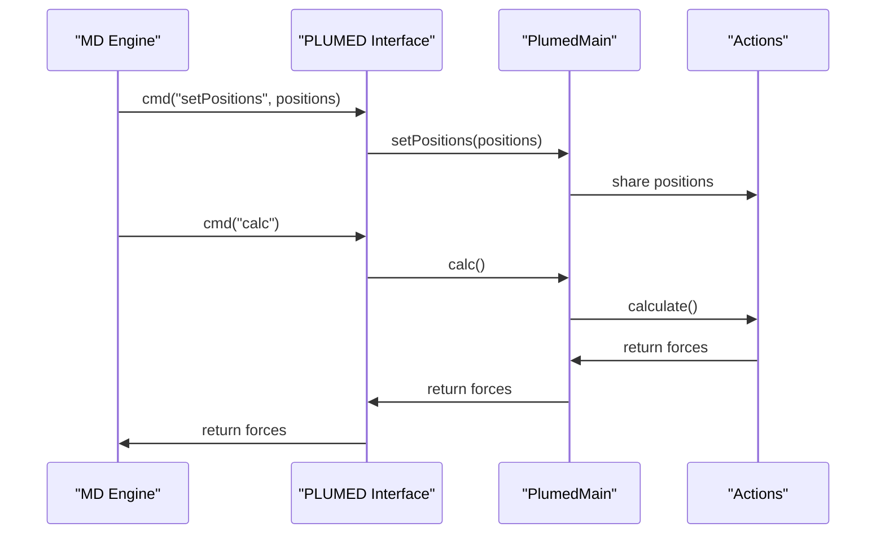

# Overview

<details>
<summary>Relevant source files</summary>

The following files were used as context for generating this wiki page:

- [.astyle.options](.astyle.options)
- [.ci/install.autoconf](.ci/install.autoconf)
- [.codecov.yml](.codecov.yml)
- [.gitignore](.gitignore)
- [CHANGES/v2.0.md](CHANGES/v2.0.md)
- [CHANGES/v2.1.md](CHANGES/v2.1.md)
- [CHANGES/v2.10.md](CHANGES/v2.10.md)
- [CHANGES/v2.11.md](CHANGES/v2.11.md)
- [CHANGES/v2.2.md](CHANGES/v2.2.md)
- [CHANGES/v2.3.md](CHANGES/v2.3.md)
- [CHANGES/v2.4.md](CHANGES/v2.4.md)
- [CHANGES/v2.5.md](CHANGES/v2.5.md)
- [CHANGES/v2.7.md](CHANGES/v2.7.md)
- [CHANGES/v2.8.md](CHANGES/v2.8.md)
- [CHANGES/v2.9.md](CHANGES/v2.9.md)
- [Makefile](Makefile)
- [Makefile.conf.in](Makefile.conf.in)
- [README.md](README.md)
- [VERSION.txt](VERSION.txt)
- [astyle/.gitignore](astyle/.gitignore)
- [astyle/Makefile](astyle/Makefile)
- [configure](configure)
- [configure.ac](configure.ac)
- [developer-doc/InstallationLayout.md](developer-doc/InstallationLayout.md)
- [docker/.gitignore](docker/.gitignore)
- [docker/Dockerfile](docker/Dockerfile)
- [src/Makefile](src/Makefile)
- [src/README](src/README)
- [src/asmjit/COPYRIGHT](src/asmjit/COPYRIGHT)
- [src/asmjit/Makefile](src/asmjit/Makefile)
- [src/asmjit/arm.h](src/asmjit/arm.h)
- [src/asmjit/asmjit.h](src/asmjit/asmjit.h)
- [src/astyle.sh](src/astyle.sh)
- [src/lib/Makefile](src/lib/Makefile)
- [src/maketools/codecheck](src/maketools/codecheck)
- [src/maketools/make.rules](src/maketools/make.rules)
- [src/maketools/plumedcheck](src/maketools/plumedcheck)
- [src/tools/Exception.cpp](src/tools/Exception.cpp)
- [src/tools/Exception.h](src/tools/Exception.h)

</details>


PLUMED is an open-source library for enhanced sampling, free-energy calculations, and analysis of collective variables in molecular dynamics (MD) simulations. This page introduces the PLUMED repository, summarizes its high-level purpose, and provides a technical overview of its main architectural components and their relationships.

## Purpose

PLUMED is designed to be linked or interfaced with a wide range of MD engines (e.g., GROMACS, NAMD, LAMMPS, Quantum ESPRESSO). Its main roles are:

- Calculating complex collective variables (CVs) during MD simulations
- Applying biasing methods to enhance sampling of rare events
- Analyzing simulation trajectories and computing free-energy surfaces
- Integrating experimental data with simulations

PLUMED is modular, extensible, and supports both in-simulation and post-processing workflows.

Sources: [README.md:14-43](), [CHANGES/v2.8.md:1-30](), [CHANGES/v2.9.md:1-20]()

## High-Level System Architecture

**Diagram: PLUMED Core System Overview**

```mermaid
flowchart TD
    subgraph "Build&QualitySystem"
        BuildSys["Build System (configure, Makefile, codecheck)"]
    end
    subgraph "CoreLibrary"
        CoreLib["libplumedKernel (src/lib/), Actions, CVs"]
        Wrapper["External Interface (src/wrapper/Plumed.h)"]
    end
    subgraph "Modules"
        Modules["Modules (Bias, Colvar, Function, Tools, etc.)"]
    end
    subgraph "CommandLineTools"
        CLTools["CLTools (driver, sum_hills, pesmd, etc.)"]
    end
    subgraph "Documentation"
        Docs["Documentation System (user-doc/, Doxygen)"]
    end
    subgraph "CI&Packaging"
        CI["CI & Packaging (GitHub Actions, Conda, Docker, MacPorts)"]
    end
    subgraph "PythonInterface"
        PyAPI["Python Interface (python/plumed.pyx)"]
    end

    BuildSys --> CoreLib
    CoreLib --> Wrapper
    CoreLib --> Modules
    Modules --> CLTools
    Wrapper --> CLTools
    CLTools --> Docs
    Docs --> CI
    CoreLib --> PyAPI
    PyAPI --> CI
    BuildSys --> CI
    BuildSys --> Docs
    CI -->|builds/tests| CoreLib
    CI -->|builds/tests| PyAPI
    CI -->|builds/tests| CLTools
```

This diagram shows the main subsystems and their dependencies. The build system orchestrates configuration, compilation, and quality checks. The core library implements simulation logic and APIs. Modules extend the core with additional features. Command-line tools and the Python interface provide user-facing utilities. Documentation and CI systems ensure quality and usability.

Sources: [configure:1-78](), [configure.ac:1-120](), [src/lib/Makefile:1-35](), [README.md:61-109]()

## Main Architectural Components

PLUMED is organized into several key systems:

| System                | Description                                                                                 | Main Code Entities / Files                |
|-----------------------|---------------------------------------------------------------------------------------------|-------------------------------------------|
| Build & Quality       | Configuration, compilation, code quality checks                                             | `configure`, `configure.ac`, `Makefile`   |
| Core Library          | Main simulation logic, action framework, collective variables, biasing methods              | `src/lib/`, `src/core/`, `src/tools/`     |
| Modules               | Extensions for enhanced sampling, analysis, and specialized features                        | `src/*/` (e.g., `src/bias/`, `src/colvar/`) |
| External Interfaces   | APIs for C, C++, Fortran, Python; integration with MD codes                                 | `src/wrapper/Plumed.h`, `python/`         |
| Command-Line Tools    | User-facing utilities for analysis, patching, and more                                      | `src/cltools/`, `src/main/`               |
| Documentation         | Automated extraction and generation of user/developer documentation                         | `user-doc/`, `developer-doc/`, `Doxyfile` |
| CI & Packaging        | Continuous integration, testing, and packaging for distribution                            | `.github/`, `macports/`, `docker/`        |

### Bridging System Names to Code Entities

**Diagram: Core Library, Modules, and Interface Entities**

```mermaid
flowchart TD
    "PlumedMain(src/core/PlumedMain.h)" --> "Action(src/core/Action.h)"
    "Action(src/core/Action.h)" --> "Modules(src/bias/, src/colvar/, ...)"
    "PlumedMain(src/core/PlumedMain.h)" --> "TypesafePtr(src/core/TypesafePtr.h)"
    "Plumed.h(src/wrapper/Plumed.h)" --> "PlumedMain(src/core/PlumedMain.h)"
    "MDCode(GROMACS, LAMMPS, ...)" --> "Plumed.h(src/wrapper/Plumed.h)"
    "Modules(src/bias/, ...)" --> "Plumed.h(src/wrapper/Plumed.h)"
```

Sources: [src/core/PlumedMain.h:1-100](), [src/core/Action.h:1-100](), [src/wrapper/Plumed.h:1-200]()

### Interface Layer

The main entry point for MD engines is the C/C++/Fortran interface in `src/wrapper/Plumed.h`. This interface provides the `cmd` function for communication, and is designed to be language-agnostic.

**Diagram: Interface Layer Code Entities**

```mermaid
classDiagram
    class "plumed" {
        +cmd(const char* key, const void* val)
        +finalize()
    }
    class "PLMD::Plumed" {
        +cmd(std::string_view key, const T& val)
        +finalize()
    }
    class "PLUMED_F_CMD" {
        +PLUMED_F_CMD(p, key, val)
        +PLUMED_F_FINALIZE(p)
    }
    "plumed" -- "PLMD::Plumed" : C++ Interface
    "plumed" -- "PLUMED_F_CMD" : Fortran Interface
```

Sources: [src/wrapper/Plumed.h:62-78](), [src/wrapper/Plumed.h:226-262]()

### Core Engine: PlumedMain

The `PlumedMain` class is the central orchestrator. It receives commands from the interface, manages the lifecycle of actions, and coordinates data flow.

**Diagram: PlumedMain and Action Execution**

```mermaid
flowchart TD
    "cmd()" --> "PlumedMain"
    "PlumedMain" --> "parseCommand()"
    "PlumedMain" --> "executeActions()"
    "PlumedMain" --> "updateActions()"
    "PlumedMain" --> "ActionSet"
    "ActionSet" --> "Action1"
    "ActionSet" --> "Action2"
    "ActionSet" --> "ActionN"
```

Sources: [src/core/PlumedMain.cpp:313-627](), [src/core/PlumedMain.h:81-86]()

### Action Framework

Actions are the modular units of computation in PLUMED. The base class is `Action`, with specialized subclasses for atomistic operations, collective variables, biases, and analysis.

**Diagram: Action Class Hierarchy**

```mermaid
classDiagram
    class "Action" {
        +prepare()
        +calculate()
        +apply()
        +update()
    }
    class "ActionAtomistic" {
        +requestAtoms()
        +retrieveAtoms()
    }
    class "ActionWithValue" {
        +setValue()
        +getValue()
    }
    class "ActionPilot" {
        +getStride()
    }
    class "Colvar"
    class "Bias"
    Action <|-- ActionAtomistic
    Action <|-- ActionWithValue
    Action <|-- ActionPilot
    ActionAtomistic <|-- Colvar
    ActionWithValue <|-- Bias
```

Sources: [src/core/Action.h:30-47](), [src/core/ActionAtomistic.h:30-42]()

Key action types:
- **Colvar**: Compute collective variables
- **Bias**: Apply biasing forces
- **Analysis**: Record/process simulation data


## Integration with MD Engines

PLUMED is typically loaded as a shared library or linked at build time with an MD engine. The main integration point is the `cmd` function in `src/wrapper/Plumed.h`, which is called by the MD engine to exchange data and trigger calculations.

**Diagram: MD Engine ↔ PLUMED Data Flow**



Typical commands:
- `setPositions`: Provide atomic positions
- `setBox`: Set simulation box
- `setForces`: Provide forces
- `calc`: Calculate CVs and biases
- `update`: Update state

Sources: [src/wrapper/Plumed.h:105-109](), [src/core/PlumedMain.cpp:342-423]()

## Command-Line Tools

PLUMED provides several command-line tools for trajectory analysis, free-energy surface reconstruction, and other utilities. These tools reuse the core library and action framework.

**Diagram: Command-Line Tools and Core Library**

```mermaid
flowchart TD
    "driver(src/cltools/driver.cpp)" --> "CLToolMain(src/core/CLToolMain.cpp)"
    "sum_hills(src/cltools/sum_hills.cpp)" --> "CLToolMain(src/core/CLToolMain.cpp)"
    "pesmd(src/cltools/pesmd.cpp)" --> "CLToolMain(src/core/CLToolMain.cpp)"
    "CLToolMain(src/core/CLToolMain.cpp)" --> "PlumedMain(src/core/PlumedMain.cpp)"
    "PlumedMain(src/core/PlumedMain.cpp)" --> "Actions(src/core/Action.cpp)"
```

These tools allow users to run PLUMED analyses without an MD engine.

Sources: [src/core/CLToolMain.cpp:40-107](), [src/cltools/driver.cpp:1-100]()

## Build, Configuration, and Quality System

PLUMED uses a GNU Autoconf-based build system, with modular Makefiles and integrated code quality checks.

**Diagram: Build and Quality System Flow**

```mermaid
flowchart TD
    "configure.ac" --> "configure"
    "configure" --> "Makefile.conf"
    "Makefile.conf" --> "Makefile"
    "Makefile" --> "src/lib/Makefile"
    "Makefile" --> "src/maketools/plumedcheck"
    "Makefile" --> "src/maketools/codecheck"
    "Makefile" --> "src/astyle.sh"
    "Makefile" --> "src/"
```

Key features:
- Modular configuration via `configure.ac` and `Makefile.conf`
- Optional modules can be enabled/disabled at configure time
- Code quality enforced by `plumedcheck`, `codecheck`, and `astyle`
- Cross-platform support and customizable installation layout

Sources: [configure:1-78](), [configure.ac:1-120](), [Makefile:1-100](), [src/lib/Makefile:1-100](), [src/maketools/plumedcheck:1-200](), [src/maketools/codecheck:1-100]()

## Version History (Selected Highlights)

| Version | Notable Features and Changes |
|---------|-----------------------------|
| 2.7     | OPES module, Funnel module, FISST module, improved Python interface |
| 2.8     | Typesafe C/C++/Fortran interfaces, new SASA module, improved error reporting |
| 2.9     | PyTorch module, MembraneFusion module, SANS CV, improved thread safety |
| 2.10+   | C++17 required, flexible data passing, Python CV plugin, CUDA plugin (planned) |

For detailed changes, see the `CHANGES/` directory.

Sources: [CHANGES/v2.7.md:1-110](), [CHANGES/v2.8.md:1-131](), [CHANGES/v2.9.md:1-85](), [CHANGES/v2.10.md:1-60]()

## Conclusion

PLUMED provides a flexible and powerful framework for enhancing molecular dynamics simulations. Its modular architecture allows for easy extension and integration with various MD engines, while its comprehensive set of actions enables a wide range of enhanced sampling and analysis methods.

For more detailed information about specific components, please refer to the respective wiki pages:
- For details on the core architecture, see [Core Architecture](#2)
- For information about the action framework, see [Action Framework](#2.3)
- For enhanced sampling methods, see [Enhanced Sampling Methods](#3)

---