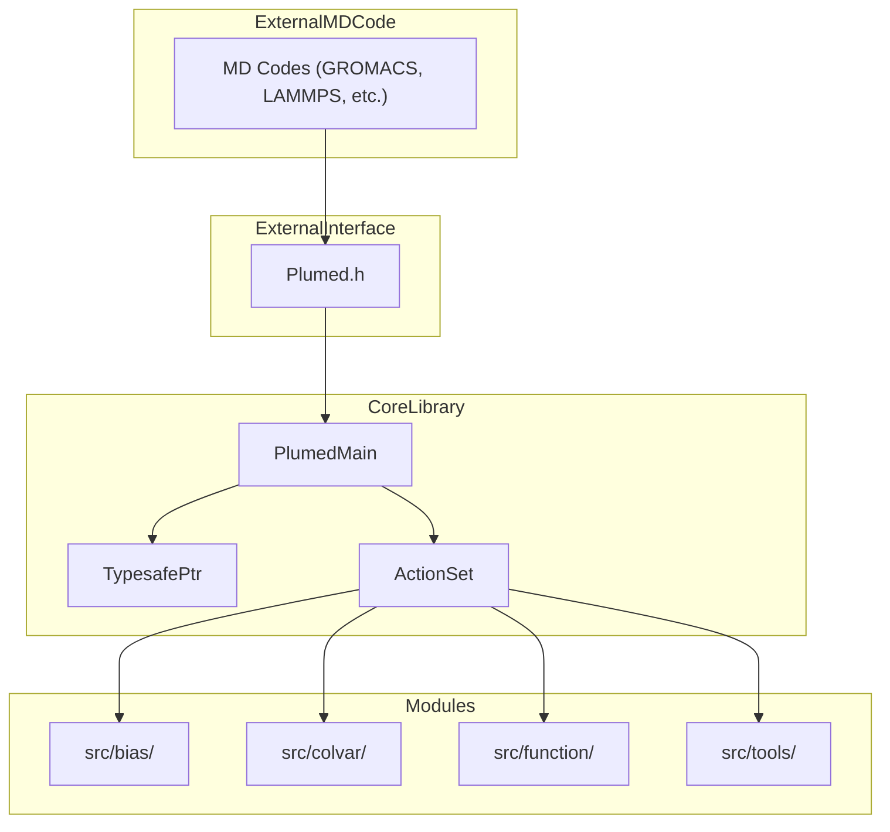
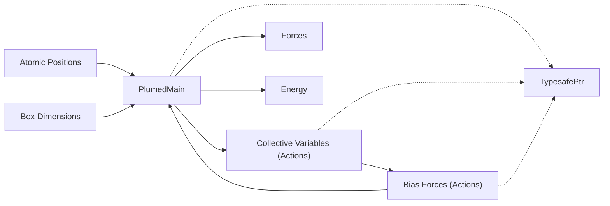
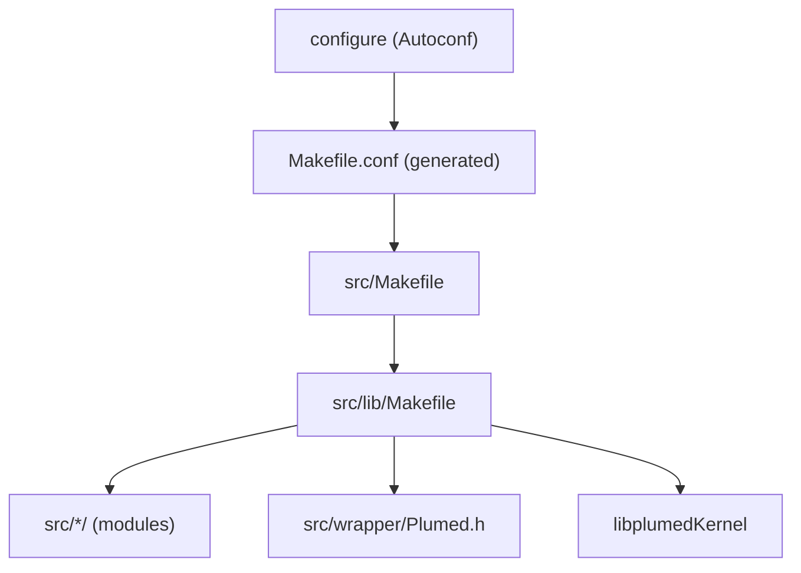
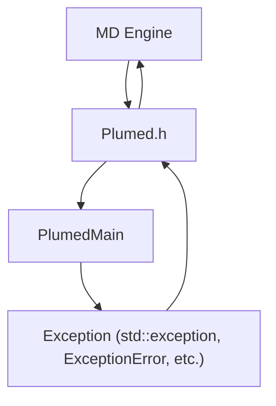
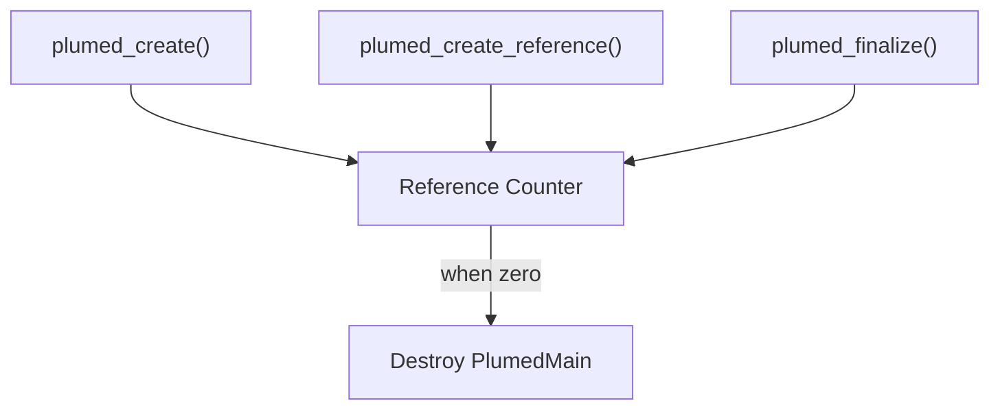
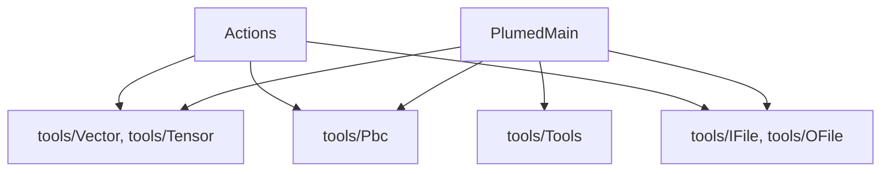

# Core Architecture

<details>
<summary>Relevant source files</summary>

The following files were used as context for generating this wiki page:

- [.astyle.options](.astyle.options)
- [.ci/install.autoconf](.ci/install.autoconf)
- [.codecov.yml](.codecov.yml)
- [.gitignore](.gitignore)
- [CHANGES/v2.0.md](CHANGES/v2.0.md)
- [CHANGES/v2.1.md](CHANGES/v2.1.md)
- [CHANGES/v2.10.md](CHANGES/v2.10.md)
- [CHANGES/v2.11.md](CHANGES/v2.11.md)
- [CHANGES/v2.2.md](CHANGES/v2.2.md)
- [CHANGES/v2.3.md](CHANGES/v2.3.md)
- [CHANGES/v2.4.md](CHANGES/v2.4.md)
- [CHANGES/v2.5.md](CHANGES/v2.5.md)
- [CHANGES/v2.7.md](CHANGES/v2.7.md)
- [CHANGES/v2.8.md](CHANGES/v2.8.md)
- [CHANGES/v2.9.md](CHANGES/v2.9.md)
- [Makefile](Makefile)
- [Makefile.conf.in](Makefile.conf.in)
- [README.md](README.md)
- [VERSION.txt](VERSION.txt)
- [astyle/.gitignore](astyle/.gitignore)
- [astyle/Makefile](astyle/Makefile)
- [configure](configure)
- [configure.ac](configure.ac)
- [developer-doc/InstallationLayout.md](developer-doc/InstallationLayout.md)
- [docker/.gitignore](docker/.gitignore)
- [docker/Dockerfile](docker/Dockerfile)
- [src/Makefile](src/Makefile)
- [src/README](src/README)
- [src/asmjit/COPYRIGHT](src/asmjit/COPYRIGHT)
- [src/asmjit/Makefile](src/asmjit/Makefile)
- [src/asmjit/arm.h](src/asmjit/arm.h)
- [src/asmjit/asmjit.h](src/asmjit/asmjit.h)
- [src/astyle.sh](src/astyle.sh)
- [src/colvar/Energy.cpp](src/colvar/Energy.cpp)
- [src/colvar/ExtraCV.cpp](src/colvar/ExtraCV.cpp)
- [src/core/Action.cpp](src/core/Action.cpp)
- [src/core/Action.h](src/core/Action.h)
- [src/core/ActionAtomistic.cpp](src/core/ActionAtomistic.cpp)
- [src/core/ActionAtomistic.h](src/core/ActionAtomistic.h)
- [src/core/ActionSet.cpp](src/core/ActionSet.cpp)
- [src/core/ActionSet.h](src/core/ActionSet.h)
- [src/core/ActionSetup.cpp](src/core/ActionSetup.cpp)
- [src/core/ActionSetup.h](src/core/ActionSetup.h)
- [src/core/ActionWithArguments.cpp](src/core/ActionWithArguments.cpp)
- [src/core/ActionWithArguments.h](src/core/ActionWithArguments.h)
- [src/core/ActionWithVirtualAtom.cpp](src/core/ActionWithVirtualAtom.cpp)
- [src/core/ActionWithVirtualAtom.h](src/core/ActionWithVirtualAtom.h)
- [src/core/CLToolMain.h](src/core/CLToolMain.h)
- [src/core/GREX.cpp](src/core/GREX.cpp)
- [src/core/GREX.h](src/core/GREX.h)
- [src/core/PlumedMain.cpp](src/core/PlumedMain.cpp)
- [src/core/PlumedMain.h](src/core/PlumedMain.h)
- [src/core/PlumedMainInitializer.cpp](src/core/PlumedMainInitializer.cpp)
- [src/core/PlumedMainInitializer.h](src/core/PlumedMainInitializer.h)
- [src/generic/DumpMassCharge.cpp](src/generic/DumpMassCharge.cpp)
- [src/lib/Makefile](src/lib/Makefile)
- [src/maketools/codecheck](src/maketools/codecheck)
- [src/maketools/make.rules](src/maketools/make.rules)
- [src/maketools/plumedcheck](src/maketools/plumedcheck)
- [src/tools/Exception.cpp](src/tools/Exception.cpp)
- [src/tools/Exception.h](src/tools/Exception.h)
- [src/tools/PlumedHandle.cpp](src/tools/PlumedHandle.cpp)
- [src/tools/PlumedHandle.h](src/tools/PlumedHandle.h)
- [src/tools/TypesafePtr.cpp](src/tools/TypesafePtr.cpp)
- [src/tools/TypesafePtr.h](src/tools/TypesafePtr.h)
- [src/vatom/Ghost.cpp](src/vatom/Ghost.cpp)
- [src/wrapper/Plumed.h](src/wrapper/Plumed.h)

</details>


This page describes the main architectural layers and design patterns of PLUMED, focusing on the relationships between the build system, core library, modules, and interfaces. For details on enhanced sampling algorithms, see [Enhanced Sampling Methods](3). For integrative modeling, see [Integrative Modeling](4).

## High-Level System Overview

PLUMED is organized into several key architectural layers:

- **Build & Quality System**: Handles configuration, compilation, and code quality.
- **Core Library**: Implements the main simulation logic and APIs.
- **Modules**: Extend the core with additional features (e.g., biases, collective variables).
- **External Interfaces**: Allow MD engines and other tools to interact with PLUMED.
- **Command-Line Tools**: User-facing utilities for analysis and setup.
- **Documentation and CI**: Automated documentation and continuous integration.

### Diagram: PLUMED Core System Overview

```mermaid
flowchart TD
    subgraph "Build&QualitySystem"
        BuildSys["configure, configure.ac, Makefile, plumedcheck"]
    end
    subgraph "CoreLibrary"
        CoreLib["libplumedKernel, PlumedMain, Actions"]
        Wrapper["Plumed.h (C/C++/Fortran API)"]
    end
    subgraph "Modules"
        Modules["src/*/ (Bias, Colvar, Function, etc.)"]
    end
    subgraph "CommandLineTools"
        CLTools["driver, sum_hills, pesmd, etc."]
    end
    subgraph "Documentation"
        Docs["user-doc/, developer-doc/, Doxygen"]
    end
    subgraph "CI&Packaging"
        CI[".github/, Conda, Docker, MacPorts"]
    end
    subgraph "PythonInterface"
        PyAPI["python/plumed.pyx, cplumed.pxd"]
    end

    BuildSys --> CoreLib
    CoreLib --> Wrapper
    CoreLib --> Modules
    Modules --> CLTools
    Wrapper --> CLTools
    CLTools --> Docs
    Docs --> CI
    CoreLib --> PyAPI
    PyAPI --> CI
    BuildSys --> CI
    BuildSys --> Docs
    CI --> CoreLib
    CI --> PyAPI
    CI --> CLTools
```

**Mapping to Code Entities:**

| System Layer         | Key Code Entities / Files                                  |
|----------------------|-----------------------------------------------------------|
| Build & Quality      | `configure`, `configure.ac`, `Makefile`, `plumedcheck`    |
| Core Library         | `src/core/PlumedMain.cpp`, `src/core/Action.cpp`          |
| Modules              | `src/bias/`, `src/colvar/`, etc.                          |
| External Interface   | `src/wrapper/Plumed.h`                                    |
| Command-Line Tools   | `src/cltools/driver.cpp`, etc.                            |
| Documentation        | `user-doc/`, `developer-doc/`, `Doxygen`                  |
| CI & Packaging       | `.github/`, `macports/`, `docker/`                        |
| Python Interface     | `python/plumed.pyx`, `python/cplumed.pxd`                 |

Sources: [configure](), [configure.ac](), [src/wrapper/Plumed.h](), [src/core/PlumedMain.cpp](), [src/core/Action.cpp](), [src/lib/Makefile](), [src/maketools/plumedcheck]()

## Core Architectural Layers and Relationships

PLUMED's architecture is layered to separate concerns and enable extensibility. The following diagram maps the main system names to code entities.

### Diagram: Layered Architecture and Code Entities



**Key Code Entities:**

| Layer              | Code Entity / File                  | Description                                 |
|--------------------|-------------------------------------|---------------------------------------------|
| External Interface | `src/wrapper/Plumed.h`              | C/C++/Fortran API for MD code integration   |
| Core Library       | `src/core/PlumedMain.cpp`           | Main orchestrator, command dispatcher       |
| Core Library       | `src/tools/TypesafePtr.h`           | Type-safe data exchange                     |
| Core Library       | `src/core/ActionSet.h`              | Manages registered actions                  |
| Modules            | `src/bias/`, `src/colvar/`, etc.    | Extend core with new features               |

Sources: [src/wrapper/Plumed.h](), [src/core/PlumedMain.cpp](), [src/core/ActionSet.h](), [src/tools/TypesafePtr.h]()

## Core Library: Main Orchestrator and Action System

### PlumedMain and ActionSet

The `PlumedMain` class is the central orchestrator of PLUMED. It receives commands from the interface, manages the simulation state, and coordinates the execution of actions.

#### Diagram: PlumedMain and ActionSet Class Relationships

```mermaid
classDiagram
    class "PlumedMain" {
        +Communicator comm
        +ActionSet actionSet
        +cmd(word, val)
        +init()
        +readInputFile(file)
        +prepareCalc()
        +performCalc()
        +update()
    }
    class "ActionSet" {
        +std::vector<Action*> actions
        +selectWithLabel()
        +selectLatest()
        +select()
    }
    class "Action" {
        <<abstract>>
    }
    PlumedMain --> ActionSet : "manages"
    ActionSet --> Action : "contains"
```

- `PlumedMain` handles the main simulation loop and command dispatch.
- `ActionSet` manages all registered actions (instances of `Action` and its subclasses).
- Actions are modular units of computation (e.g., CVs, biases, analysis).

Sources: [src/core/PlumedMain.cpp:285-304](), [src/core/PlumedMain.cpp:313-636](), [src/core/PlumedMain.h:81-205](), [src/core/ActionSet.h]()

### Simulation Step and Command Flow

PLUMED operates by receiving a sequence of commands from the MD engine at each simulation step. The `cmd()` method in `PlumedMain` is the main entry point for these commands.

#### Diagram: Simulation Step Command Flow

```mermaid
sequenceDiagram
    participant "MD Engine"
    participant "PlumedMain::cmd"
    participant "ActionSet"
    participant "Action"
    "MD Engine"->>"PlumedMain::cmd": setStep(step)
    "MD Engine"->>"PlumedMain::cmd": setPositions(pos)
    "MD Engine"->>"PlumedMain::cmd": setBox(box)
    "MD Engine"->>"PlumedMain::cmd": setForces(forces)
    "MD Engine"->>"PlumedMain::cmd": setEnergy(energy)
    "PlumedMain::cmd"->>"ActionSet": prepareDependencies()
    "ActionSet"->>"Action": prepare()
    "PlumedMain::cmd"->>"ActionSet": shareData()
    "PlumedMain::cmd"->>"ActionSet": prepareCalc()
    "ActionSet"->>"Action": prepareCalc()
    "PlumedMain::cmd"->>"ActionSet": performCalc()
    "ActionSet"->>"Action": calculate()
    "PlumedMain::cmd"->>"ActionSet": update()
    "ActionSet"->>"Action": update()
    "PlumedMain::cmd"->>"MD Engine": Return forces, energy
```

- Each command (e.g., `setStep`, `setPositions`) is handled by `PlumedMain::cmd`.
- Actions are executed in a dependency-aware order.
- Results (forces, energies) are returned to the MD engine.

Sources: [src/core/PlumedMain.cpp:313-636](), [src/core/PlumedMain.h:205-285]()

## Action Framework and Extensibility

PLUMED's functionality is implemented through a modular action system. Each action is a C++ class derived from a common base and is registered using a factory pattern.

### Diagram: Action Class Hierarchy and Registration

```mermaid
classDiagram
    class "Action" {
        <<abstract>>
    }
    class "ActionAtomistic" {
        // Atom-based actions
    }
    class "ActionWithValue" {
        // Produces values
    }
    class "ActionWithArguments" {
        // Depends on other actions
    }
    class "ActionRegister" {
        +registerAction()
    }
    ActionRegister ..> Action : "creates"
    Action <|-- ActionAtomistic
    Action <|-- ActionWithValue
    Action <|-- ActionWithArguments
```

- `ActionRegister` implements the factory pattern for dynamic action creation.
- Actions are organized in a class hierarchy for extensibility.
- New actions can be added as modules without modifying the core.

Sources: [src/core/ActionRegister.h:1-100](), [src/core/ActionRegister.cpp:1-50](), [src/core/Action.h:1-200](), [src/core/ActionAtomistic.h:1-100](), [src/core/ActionAtomistic.cpp:1-100]()

### Keyword and Input Management

Actions are configured via a keyword system, which is managed by the `Keywords` class. This system supports documentation, parsing, and validation of input parameters.

#### Diagram: Action and Keywords Relationship

```mermaid
classDiagram
    class "Keywords" {
        +add(keyword, doc)
        +addFlag(keyword, doc, default)
        +exists(keyword)
        +getKeywords()
    }
    class "Action" {
        +Keywords keywords
        +registerKeywords(Keywords&)
        +parseFlag(key, val)
        +parseVector(key, val)
    }
    Action --> Keywords : "uses"
```

- Keywords can be compulsory, optional, or flags.
- Supports scalar, vector, and atom index values.

Sources: [src/tools/Keywords.cpp:1-100](), [src/tools/Keywords.cpp:100-200]()

## Data Flow and Type Safety

PLUMED uses a type-safe pointer system (`TypesafePtr`) to exchange data between the interface, core, and actions. This ensures that data passed (such as positions, forces, energies) is checked for type and shape at runtime.

### Diagram: Data Flow and TypesafePtr



- All data passed through the interface and between actions uses `TypesafePtr` for runtime type checking.
- This mechanism is implemented in both the C++ and C interfaces.

Sources: [src/core/PlumedMain.cpp:313-636](), [src/core/ActionAtomistic.cpp:1-200](), [src/tools/TypesafePtr.h]()

## Build and Configuration System

PLUMED's build system is based on Autoconf and Makefiles, supporting modular compilation, code quality checks, and flexible installation.

### Diagram: Build System Flow



- `configure` and `configure.ac` detect system capabilities and generate `Makefile.conf`.
- Makefiles in `src/` and `src/lib/` orchestrate compilation of the core, modules, and wrapper.
- Code quality tools (e.g., `plumedcheck`) are integrated into the build.

Sources: [configure:1-500](), [configure.ac:1-200](), [src/lib/Makefile:1-100](), [Makefile:1-50](), [src/maketools/plumedcheck]()

## Exception and Error Handling

PLUMED uses C++ exceptions for error handling, with translation layers in the interface to ensure robust error reporting across C, C++, and Fortran.

### Diagram: Exception Propagation and Handling



- Exceptions thrown in `PlumedMain` are caught and translated by the interface layer.
- The interface returns error codes or messages to the MD engine, preventing crashes.

Sources: [src/wrapper/Plumed.h:278-317](), [src/core/PlumedMain.cpp:74-242]()

## Reference Counting and Object Lifetime

PLUMED manages the lifetime of its core objects using reference counting, allowing safe sharing of instances across interfaces and threads.

### Diagram: Reference Counting in Object Lifecycle



- Each `plumed_create` or `plumed_create_reference` increments the counter.
- `plumed_finalize` decrements it.
- When the counter reaches zero, the object is destroyed.

Sources: [src/wrapper/Plumed.h:211-223](), [src/core/PlumedMain.cpp:285-304]()

## Utility Layer

The utility layer provides reusable components for mathematical operations, periodic boundary conditions, file I/O, and parsing.

### Diagram: Utility Layer Usage



- Utilities are used by both the core and actions for common tasks.

Sources: [src/tools/Tools.cpp:1-200](), [src/tools/Pbc.cpp:1-200](), [src/tools/Tools.h:1-200]()

## Summary

The PLUMED core architecture is designed for flexibility, extensibility, and robustness. The separation between the interface layer and the implementation allows PLUMED to work with various MD engines while maintaining a consistent internal structure. The modular action system enables easy extension with new functionality, and the calculation lifecycle ensures proper handling of dependencies and data flow.

Sources: [src/wrapper/Plumed.h]()/[src/core/PlumedMain.cpp]()/[src/core/Action.h]()/[src/core/ActionRegister.h]()

---