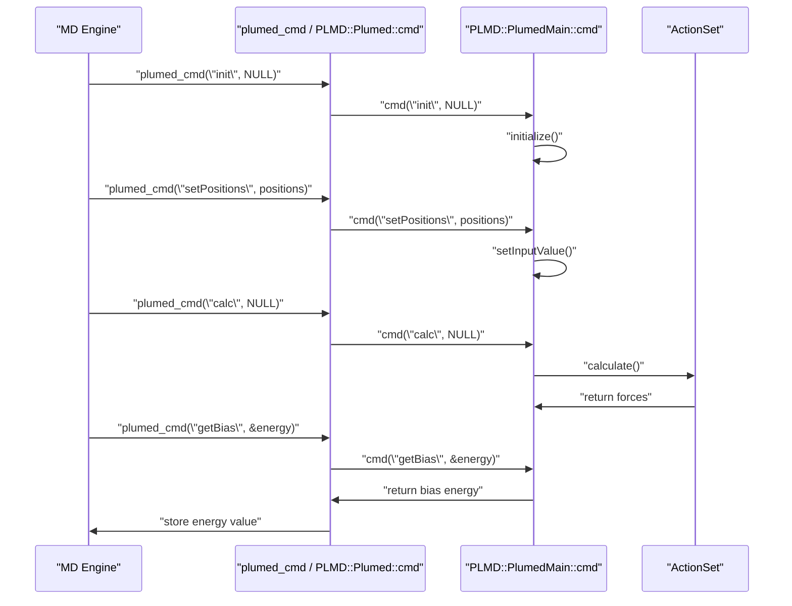

# PLUMED Interface

<details>
<summary>Relevant source files</summary>

The following files were used as context for generating this wiki page:

- [python/.gitignore](python/.gitignore)
- [python/MANIFEST.in](python/MANIFEST.in)
- [python/Makefile](python/Makefile)
- [python/README.rst](python/README.rst)
- [python/cplumed.pxd](python/cplumed.pxd)
- [python/plumed.pyx](python/plumed.pyx)
- [python/setup.py](python/setup.py)
- [python/test/HILLS_av](python/test/HILLS_av)
- [python/test/HILLS_av1.ref](python/test/HILLS_av1.ref)
- [python/test/HILLS_av2.ref](python/test/HILLS_av2.ref)
- [python/test/HILLS_av3.ref](python/test/HILLS_av3.ref)
- [python/test/HILLS_av4.ref](python/test/HILLS_av4.ref)
- [python/test/HILLS_av5.ref](python/test/HILLS_av5.ref)
- [python/test/test_hills_average.py](python/test/test_hills_average.py)
- [python/test/test_mpi.py](python/test/test_mpi.py)
- [src/colvar/Energy.cpp](src/colvar/Energy.cpp)
- [src/colvar/ExtraCV.cpp](src/colvar/ExtraCV.cpp)
- [src/core/Action.cpp](src/core/Action.cpp)
- [src/core/Action.h](src/core/Action.h)
- [src/core/ActionAtomistic.cpp](src/core/ActionAtomistic.cpp)
- [src/core/ActionAtomistic.h](src/core/ActionAtomistic.h)
- [src/core/ActionSet.cpp](src/core/ActionSet.cpp)
- [src/core/ActionSet.h](src/core/ActionSet.h)
- [src/core/ActionSetup.cpp](src/core/ActionSetup.cpp)
- [src/core/ActionSetup.h](src/core/ActionSetup.h)
- [src/core/ActionWithArguments.cpp](src/core/ActionWithArguments.cpp)
- [src/core/ActionWithArguments.h](src/core/ActionWithArguments.h)
- [src/core/ActionWithVirtualAtom.cpp](src/core/ActionWithVirtualAtom.cpp)
- [src/core/ActionWithVirtualAtom.h](src/core/ActionWithVirtualAtom.h)
- [src/core/CLToolMain.h](src/core/CLToolMain.h)
- [src/core/GREX.cpp](src/core/GREX.cpp)
- [src/core/GREX.h](src/core/GREX.h)
- [src/core/PlumedMain.cpp](src/core/PlumedMain.cpp)
- [src/core/PlumedMain.h](src/core/PlumedMain.h)
- [src/core/PlumedMainInitializer.cpp](src/core/PlumedMainInitializer.cpp)
- [src/core/PlumedMainInitializer.h](src/core/PlumedMainInitializer.h)
- [src/generic/DumpMassCharge.cpp](src/generic/DumpMassCharge.cpp)
- [src/tools/PlumedHandle.cpp](src/tools/PlumedHandle.cpp)
- [src/tools/PlumedHandle.h](src/tools/PlumedHandle.h)
- [src/tools/TypesafePtr.cpp](src/tools/TypesafePtr.cpp)
- [src/tools/TypesafePtr.h](src/tools/TypesafePtr.h)
- [src/vatom/Ghost.cpp](src/vatom/Ghost.cpp)
- [src/wrapper/Plumed.h](src/wrapper/Plumed.h)

</details>


This page documents the external interfaces of PLUMED, focusing on the C, C++, Fortran, and Python APIs that allow molecular dynamics (MD) codes and user scripts to interact with the PLUMED core. The interface is designed for stability, language interoperability, and minimal integration effort for host codes.

## System Context and Interface Role

PLUMED's interface layer is the primary entry point for external MD engines and user tools. It provides a stable API for data exchange and command invocation, abstracting the internal implementation details of the PLUMED core.

### Diagram: High-Level System Integration

```mermaid
flowchart TD
    "MDCode[\"MD Engine (e.g. GROMACS, LAMMPS)\"]" -->|"\"plumed_cmd / PLMD::Plumed::cmd / PLUMED_F_CMD\""| "Plumed_h[\"src/wrapper/Plumed.h\"]"
    "Plumed_h" -->|"\"cmd()\""| "PlumedMain[\"PLMD::PlumedMain (src/core/PlumedMain.h)\"]"
    "PlumedMain" -->|"\"ActionSet, CVs, Modules\""| "Actions[\"Action Framework\"]"
    "Python[\"python/plumed.pyx\"]" -->|"\"Plumed class, cmd()\""| "Plumed_h"
```
Sources: [src/wrapper/Plumed.h:35-47](), [src/wrapper/Plumed.h:80-92](), [python/plumed.pyx:69-287]()

**Key interface goals:**
- Language compatibility (C, C++, Fortran, Python)
- Binary and API stability
- Minimal dependencies for host codes
- Thread safety and reference counting
- Robust error and exception handling


## Interface Structure and Code Entities

The PLUMED interface is implemented as a thin wrapper object that holds a pointer to the actual core implementation. This design enables language bindings and binary compatibility.

- **C:** `struct plumed` (contains a `void*` pointer)
- **C++:** `PLMD::Plumed` class (wraps `struct plumed`)
- **Fortran:** `CHARACTER(LEN=32)` string (stores pointer as text)
- **Python:** `Plumed` class in `python/plumed.pyx` (wraps C interface)

### Diagram: Interface Object Mapping to Code Entities

```mermaid
classDiagram
    class "plumed (struct)" {
        void* p
    }
    class "PLMD::Plumed" {
        +cmd(key, val)
        +finalize()
        +valid() bool
        +dlopen(path)
        +toFortran(char*)
        +incref()
        +decref()
    }
    class "PLMD::PlumedMain" {
        -initialized: bool
        -step: long long int
        -active: bool
        +cmd(key, val)
        +init()
        +prepareCalc()
        +performCalc()
        -actionSet: ActionSet
    }
    class "python.plumed.PyPlumed" as PyPlumed {
        +cmd(key, val)
        +finalize()
        +__enter__/__exit__
    }
    "plumed" --> "PLMD::PlumedMain" : "p points to"
    "PLMD::Plumed" --> "plumed" : "wraps"
    "PyPlumed" --> "plumed" : "wraps"
```
Sources: [src/wrapper/Plumed.h:797-808](), [src/core/PlumedMain.h:81-534](), [python/plumed.pyx:69-287]()


## Command Communication Flow

The main communication mechanism is the `cmd` method (or `plumed_cmd` in C/Fortran), which takes a command string and a value pointer. This method is the entry point for all data exchange and control between the MD code and PLUMED.

### Diagram: Command Flow from MD Code to PLUMED Core


Sources: [src/core/PlumedMain.cpp:313-442](), [src/wrapper/Plumed.h:104-109]()


## Typesafe Interface and Data Validation

Starting with PLUMED 2.8, the interface performs runtime type checking to ensure safe data exchange. This includes:

- Verifying value types (integer, float, pointer, etc.)
- Checking array sizes and shapes
- Enabling or disabling type checks via environment variables

### Diagram: Typesafe Command Dispatch

```mermaid
flowchart TD
    "CXX_cmd[\"PLMD::Plumed::cmd(key, value)\"]" --> "CXX_TypeCheck[\"C++ type checking (runtime)\"]"
    "C_cmd[\"plumed_cmd(p, key, value)\"]" --> "C_TypeCheck[\"C11 _Generic type checking\"]"
    "F_cmd[\"PLUMED_F_CMD(p, key, value)\"]" --> "NoTypeCheck[\"No runtime type check\"]"
    "CXX_TypeCheck" --> "PlumedMain_cmd[\"PLMD::PlumedMain::cmd\"]"
    "C_TypeCheck" --> "PlumedMain_cmd"
    "NoTypeCheck" --> "PlumedMain_cmd"
```
Sources: [src/wrapper/Plumed.h:317-347](), [src/tools/TypesafePtr.h:108-198]()


## Object Lifecycle and Reference Counting

The PLUMED interface uses explicit object lifecycle management, with reference counting to support safe usage in multi-language and multi-threaded contexts.

### Diagram: PLUMED Object Lifecycle

```mermaid
stateDiagram-v2
    [*] --> "Created": "plumed_create()"
    "Created" --> "Initialized": "plumed_cmd(\"init\", NULL)"
    "Initialized" --> "Operating": "plumed_cmd / cmd calls"
    "Operating" --> "Finalized": "plumed_finalize()"
    "Finalized" --> [*]

    note right of "Created"
        Reference counter = 1
    end note

    note right of "Operating"
        Data exchange and calculations
    end note

    note right of "Finalized"
        Resources released when reference counter = 0
    end note
```
Sources: [src/wrapper/Plumed.h:111-141](), [src/core/PlumedMain.cpp:293-303]()


## Command Processing Workflow

When an MD code calls the PLUMED interface, the command is processed through a series of layers, ultimately invoking the appropriate logic in the core.

### Diagram: Command Processing Path

```mermaid
flowchart TD
    "MDCode[\"MD Code\"]" -->|"\"plumed_cmd(p, key, val)\""| "Wrapper[\"src/wrapper/Plumed.h\"]"
    "Wrapper" -->|"\"cmd(key, val)\""| "PlumedMain[\"PLMD::PlumedMain::cmd\"]"
    "PlumedMain" --> "ParseCommand[\"Parse command string\"]"
    "ParseCommand" --> "SwitchCase[\"Switch on command ID\"]"
    "SwitchCase" --> "ExecuteAction[\"Execute action or data exchange\"]"
    "ExecuteAction" -->|"\"Results/Status\""| "Wrapper"
    "Wrapper" -->|"\"Return values\""| "MDCode"
```
Sources: [src/core/PlumedMain.cpp:313-442](), [src/core/PlumedMain.cpp:625-676]()


## Key Interface Commands

The PLUMED interface supports a set of standardized commands for initialization, data transfer, calculation, and result retrieval.

| Command Category | Example Commands | Description |
|------------------|------------------|-------------|
| Initialization   | `init`, `setRealPrecision`, `setNatoms` | Set up PLUMED before simulation |
| Data Input       | `setPositions`, `setForces`, `setBox`, `setMasses`, `setCharges` | Pass data from MD to PLUMED |
| Calculation      | `calc`, `prepareCalc`, `performCalc` | Trigger PLUMED calculations |
| Data Output      | `getBias`, `getForces` | Retrieve results from PLUMED |
| Configuration    | `setMDEngine`, `setTimestep`, `setKbT` | Configure PLUMED parameters |
| Utility          | `getApiVersion`, `isEnergyNeeded` | Query PLUMED status |

Sources: [src/core/PlumedMain.cpp:313-901]()


## Data Exchange Between MD Codes and PLUMED

PLUMED exchanges simulation data with MD codes through the interface, including positions, forces, box dimensions, and energies.

### Diagram: Data Flow for Input and Output

```mermaid
flowchart TD
    "MD_Positions[\"setPositions\"]" --> "PLUMED"
    "MD_Forces[\"setForces\"]" --> "PLUMED"
    "MD_Masses[\"setMasses\"]" --> "PLUMED"
    "MD_Charges[\"setCharges\"]" --> "PLUMED"
    "MD_Box[\"setBox\"]" --> "PLUMED"
    "MD_Energy[\"setEnergy\"]" --> "PLUMED"
    "PLUMED" --> "PLUMED_Calc[\"Calculate CVs, Bias, Actions\"]"
    "PLUMED_Calc" --> "PLUMED"
    "PLUMED" --> "MD_BiasForces[\"getForces\"]"
    "PLUMED" --> "MD_BiasEnergy[\"getBias\"]"
    "PLUMED" --> "MD_Virial[\"getVirial\"]"
```
Sources: [src/core/PlumedMain.cpp:343-403](), [src/core/ActionAtomistic.cpp:444-500]()


## Error and Exception Handling

The PLUMED interface provides robust error handling at the language boundary. Exceptions thrown in the core are remapped or reported according to the calling language.

### Diagram: Error Handling and Exception Remapping

```mermaid
flowchart TD
    "plumed_cmd_call[\"plumed_cmd call\"]" --> "TryCatch[\"try-catch in cmd()\"]"
    "TryCatch" -->|"\"Exception occurs\""| "ExceptionThrown[\"Exception thrown\"]"
    "ExceptionThrown" --> "ExceptionCaught[\"Exception caught at interface\"]"
    "ExceptionCaught" --> "CXX_Remap[\"C++: Remap and rethrow\"]"
    "ExceptionCaught" --> "C_Fortran_Handle[\"C/Fortran: Handle error, terminate or report\"]"
    "CXX_Remap" --> "MDCode[\"MD code receives exception\"]"
```
Sources: [src/wrapper/Plumed.h:278-316](), [src/core/PlumedMainInitializer.cpp:128-565]()


## Language-Specific Interfaces

PLUMED provides tailored interfaces for C, C++, Fortran, and Python. All interfaces are built on the same underlying object and command mechanism.

### Mapping of Interface Functions

| Language | Creation         | Command Invocation         | Finalization         | File(s) |
|----------|------------------|---------------------------|----------------------|---------|
| C        | `plumed_create()`| `plumed_cmd(p, key, val)` | `plumed_finalize(p)` | [src/wrapper/Plumed.h]() |
| C++      | `PLMD::Plumed()` | `cmd(key, val)`           | Destructor           | [src/wrapper/Plumed.h]() |
| Fortran  | `PLUMED_F_CREATE`| `PLUMED_F_CMD`            | `PLUMED_F_FINALIZE`  | [src/wrapper/Plumed.h]() |
| Python   | `Plumed()`       | `cmd(key, val)`           | `finalize()`         | [python/plumed.pyx]()    |

Sources: [src/wrapper/Plumed.h:227-263](), [src/wrapper/Plumed.h:104-141](), [python/plumed.pyx:69-287]()


## Interface Version Evolution

The PLUMED interface is designed for backward compatibility, with new features added in recent versions:

| Version | Major Improvements |
|---------|-------------------|
| 2.5     | Rewritten wrappers, reference counting, improved exception handling |
| 2.8     | Runtime type checking, enhanced Fortran interface |
| 2.9     | Thread-safe reference counter, nested exception support, long integer support |

Sources: [src/wrapper/Plumed.h:348-424]()


## Using Multiple PLUMED Versions at Runtime

The interface supports loading different PLUMED kernel versions at runtime, allowing MD codes to select the desired version dynamically.

### Diagram: Runtime Kernel Selection

```mermaid
flowchart TD
    "MDCode[\"MD Code\"]" -->|"\"plumed_create()\""| "Default[\"Default Version\"]"
    "MDCode" -->|"\"plumed_create_dlopen('libplumed_2.7.so')\""| "PLUMED27[\"PLUMED 2.7\"]"
    "MDCode" -->|"\"plumed_create_dlopen('libplumed_2.8.so')\""| "PLUMED28[\"PLUMED 2.8\"]"
    "MDCode" -->|"\"plumed_create_dlopen('libplumed_2.9.so')\""| "PLUMED29[\"PLUMED 2.9\"]"
```
Sources: [src/wrapper/Plumed.h:119-126](), [src/wrapper/Plumed.h:411-415]()


## Summary

The PLUMED interface provides a robust, language-agnostic way for MD engines to incorporate PLUMED functionality. Its design emphasizes compatibility across versions, clear error handling, and minimal dependency requirements for the MD code. Recent versions have added type safety and improved thread safety, making the interface more robust while maintaining the same overall structure.

The interface is centered around a simple object and the `cmd` method, providing a unified way to access all of PLUMED's functionality from different programming languages.

---