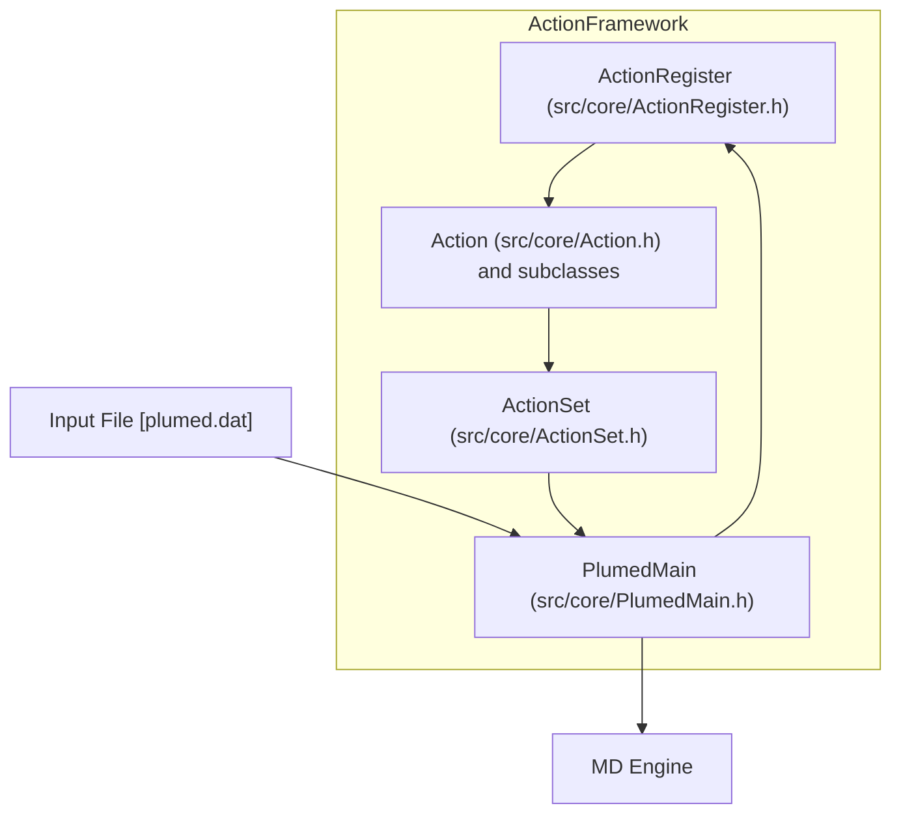
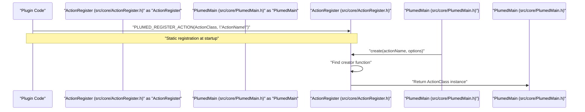
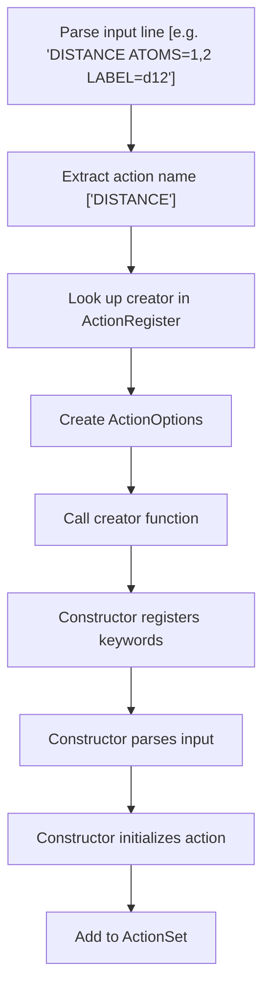
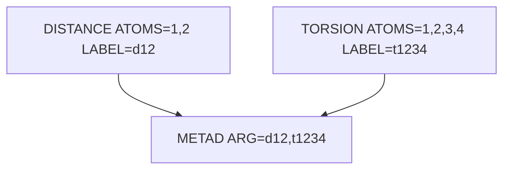
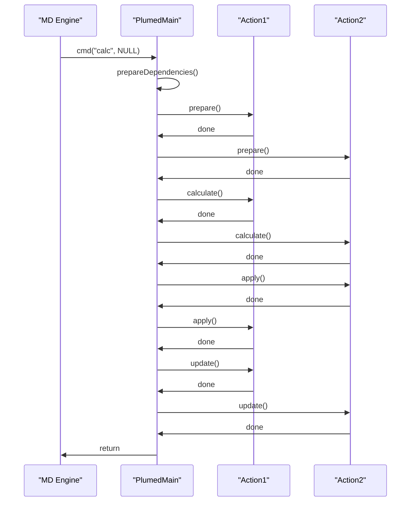
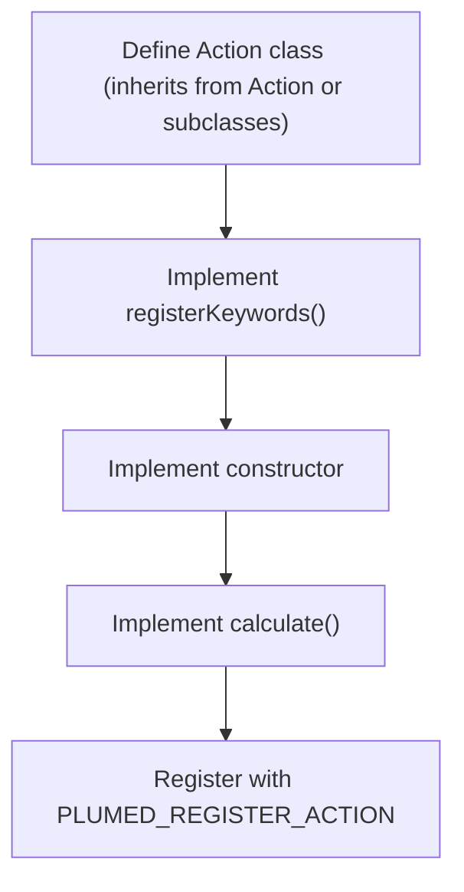

# Action Framework

<details>
<summary>Relevant source files</summary>

The following files were used as context for generating this wiki page:

- [src/adjmat/Bridge.cpp](src/adjmat/Bridge.cpp)
- [src/adjmat/BridgeMatrix.cpp](src/adjmat/BridgeMatrix.cpp)
- [src/adjmat/HbondMatrix.cpp](src/adjmat/HbondMatrix.cpp)
- [src/adjmat/Neighbors.cpp](src/adjmat/Neighbors.cpp)
- [src/adjmat/TorsionsMatrix.cpp](src/adjmat/TorsionsMatrix.cpp)
- [src/colvar/Angle.cpp](src/colvar/Angle.cpp)
- [src/colvar/ContactMap.cpp](src/colvar/ContactMap.cpp)
- [src/colvar/Coordination.cpp](src/colvar/Coordination.cpp)
- [src/colvar/CoordinationBase.cpp](src/colvar/CoordinationBase.cpp)
- [src/colvar/CoordinationBase.h](src/colvar/CoordinationBase.h)
- [src/colvar/DHEnergy.cpp](src/colvar/DHEnergy.cpp)
- [src/colvar/DihedralCorrelation.cpp](src/colvar/DihedralCorrelation.cpp)
- [src/colvar/Dipole.cpp](src/colvar/Dipole.cpp)
- [src/colvar/Distance.cpp](src/colvar/Distance.cpp)
- [src/colvar/Energy.cpp](src/colvar/Energy.cpp)
- [src/colvar/ExtraCV.cpp](src/colvar/ExtraCV.cpp)
- [src/colvar/MultiColvarTemplate.cpp](src/colvar/MultiColvarTemplate.cpp)
- [src/colvar/MultiColvarTemplate.h](src/colvar/MultiColvarTemplate.h)
- [src/colvar/Plane.cpp](src/colvar/Plane.cpp)
- [src/colvar/Position.cpp](src/colvar/Position.cpp)
- [src/colvar/RMSDVector.cpp](src/colvar/RMSDVector.cpp)
- [src/colvar/Torsion.cpp](src/colvar/Torsion.cpp)
- [src/contour/ContourFindingBase.h](src/contour/ContourFindingBase.h)
- [src/core/Action.cpp](src/core/Action.cpp)
- [src/core/Action.h](src/core/Action.h)
- [src/core/ActionAtomistic.cpp](src/core/ActionAtomistic.cpp)
- [src/core/ActionAtomistic.h](src/core/ActionAtomistic.h)
- [src/core/ActionSet.cpp](src/core/ActionSet.cpp)
- [src/core/ActionSet.h](src/core/ActionSet.h)
- [src/core/ActionSetup.cpp](src/core/ActionSetup.cpp)
- [src/core/ActionSetup.h](src/core/ActionSetup.h)
- [src/core/ActionWithArguments.cpp](src/core/ActionWithArguments.cpp)
- [src/core/ActionWithArguments.h](src/core/ActionWithArguments.h)
- [src/core/ActionWithMatrix.cpp](src/core/ActionWithMatrix.cpp)
- [src/core/ActionWithMatrix.h](src/core/ActionWithMatrix.h)
- [src/core/ActionWithVector.cpp](src/core/ActionWithVector.cpp)
- [src/core/ActionWithVector.h](src/core/ActionWithVector.h)
- [src/core/ActionWithVirtualAtom.cpp](src/core/ActionWithVirtualAtom.cpp)
- [src/core/ActionWithVirtualAtom.h](src/core/ActionWithVirtualAtom.h)
- [src/core/CLToolMain.h](src/core/CLToolMain.h)
- [src/core/GREX.cpp](src/core/GREX.cpp)
- [src/core/GREX.h](src/core/GREX.h)
- [src/core/ParallelTaskManager.h](src/core/ParallelTaskManager.h)
- [src/core/PlumedMain.cpp](src/core/PlumedMain.cpp)
- [src/core/PlumedMain.h](src/core/PlumedMain.h)
- [src/core/PlumedMainInitializer.cpp](src/core/PlumedMainInitializer.cpp)
- [src/core/PlumedMainInitializer.h](src/core/PlumedMainInitializer.h)
- [src/core/Value.cpp](src/core/Value.cpp)
- [src/core/Value.h](src/core/Value.h)
- [src/crystdistrib/Quaternion.cpp](src/crystdistrib/Quaternion.cpp)
- [src/crystdistrib/QuaternionBondProductMatrix.cpp](src/crystdistrib/QuaternionBondProductMatrix.cpp)
- [src/crystdistrib/QuaternionProductMatrix.cpp](src/crystdistrib/QuaternionProductMatrix.cpp)
- [src/dimred/ProjectPoints.cpp](src/dimred/ProjectPoints.cpp)
- [src/function/Combine.cpp](src/function/Combine.cpp)
- [src/function/Custom.cpp](src/function/Custom.cpp)
- [src/function/Ensemble.cpp](src/function/Ensemble.cpp)
- [src/function/FuncPathMSD.cpp](src/function/FuncPathMSD.cpp)
- [src/function/FunctionOfMatrix.h](src/function/FunctionOfMatrix.h)
- [src/function/FunctionOfScalar.h](src/function/FunctionOfScalar.h)
- [src/function/FunctionOfVector.h](src/function/FunctionOfVector.h)
- [src/function/FunctionSetup.h](src/function/FunctionSetup.h)
- [src/function/FunctionWithSingleArgument.h](src/function/FunctionWithSingleArgument.h)
- [src/function/LocalEnsemble.cpp](src/function/LocalEnsemble.cpp)
- [src/function/Piecewise.cpp](src/function/Piecewise.cpp)
- [src/function/Sort.cpp](src/function/Sort.cpp)
- [src/function/Stats.cpp](src/function/Stats.cpp)
- [src/generic/DumpMassCharge.cpp](src/generic/DumpMassCharge.cpp)
- [src/gridtools/FunctionOfGrid.h](src/gridtools/FunctionOfGrid.h)
- [src/gridtools/InterpolateGrid.cpp](src/gridtools/InterpolateGrid.cpp)
- [src/landmarks/CollectFrames.cpp](src/landmarks/CollectFrames.cpp)
- [src/matrixtools/MatrixTimesMatrix.cpp](src/matrixtools/MatrixTimesMatrix.cpp)
- [src/matrixtools/MatrixTimesMatrix.h](src/matrixtools/MatrixTimesMatrix.h)
- [src/matrixtools/MatrixTimesVector.cpp](src/matrixtools/MatrixTimesVector.cpp)
- [src/matrixtools/MatrixTimesVectorBase.h](src/matrixtools/MatrixTimesVectorBase.h)
- [src/matrixtools/OuterProduct.cpp](src/matrixtools/OuterProduct.cpp)
- [src/matrixtools/OuterProduct.h](src/matrixtools/OuterProduct.h)
- [src/matrixtools/Voronoi.cpp](src/matrixtools/Voronoi.cpp)
- [src/pamm/HBPammMatrix.cpp](src/pamm/HBPammMatrix.cpp)
- [src/refdist/MatrixProductDiagonal.cpp](src/refdist/MatrixProductDiagonal.cpp)
- [src/secondarystructure/SecondaryStructureBase.cpp](src/secondarystructure/SecondaryStructureBase.cpp)
- [src/secondarystructure/SecondaryStructureBase.h](src/secondarystructure/SecondaryStructureBase.h)
- [src/secondarystructure/SecondaryStructureDRMSD.cpp](src/secondarystructure/SecondaryStructureDRMSD.cpp)
- [src/symfunc/ThreeBodyGFunctions.cpp](src/symfunc/ThreeBodyGFunctions.cpp)
- [src/tools/LinkCells.cpp](src/tools/LinkCells.cpp)
- [src/tools/LinkCells.h](src/tools/LinkCells.h)
- [src/tools/OpenACC.h](src/tools/OpenACC.h)
- [src/tools/PlumedHandle.cpp](src/tools/PlumedHandle.cpp)
- [src/tools/PlumedHandle.h](src/tools/PlumedHandle.h)
- [src/tools/TypesafePtr.cpp](src/tools/TypesafePtr.cpp)
- [src/tools/TypesafePtr.h](src/tools/TypesafePtr.h)
- [src/vatom/Ghost.cpp](src/vatom/Ghost.cpp)
- [src/volumes/ActionVolume.cpp](src/volumes/ActionVolume.cpp)
- [src/volumes/ActionVolume.h](src/volumes/ActionVolume.h)
- [src/volumes/Makefile](src/volumes/Makefile)
- [src/volumes/VolumeBetweenContours.cpp](src/volumes/VolumeBetweenContours.cpp)
- [src/wrapper/Plumed.h](src/wrapper/Plumed.h)

</details>


The Action Framework is the central architectural system in PLUMED for defining, registering, instantiating, and executing modular units of computation called "Actions". Actions are the primary mechanism for implementing collective variables (CVs), biases, analysis, and other operations in a simulation.

## System Overview

The Action Framework organizes the flow from user input to simulation logic through a set of core classes and data structures. Each Action corresponds to a line in the input file (typically `plumed.dat`), and is managed by a central registry and execution engine.

**Diagram: High-Level Action Framework Data Flow**


Sources: [src/core/Action.h](), [src/core/ActionRegister.h](), [src/core/PlumedMain.h]()

This diagram shows the main code entities involved in the Action Framework and their relationships.

## Action Class Hierarchy

The Action Framework is structured as a class hierarchy, with the base class `Action` providing the core interface. Specialized subclasses add features for atomistic operations, value storage, argument parsing, and more.

**Diagram: Action Class Hierarchy and Key Methods**

```mermaid
classDiagram
    class "Action (src/core/Action.h)" {
        +name: string
        +label: string
        +plumed: PlumedMain&
        +addDependency(Action*)
        +prepare()
        +calculate()
        +apply()
        +update()
    }
    class "ActionAtomistic (src/core/ActionAtomistic.h)" {
        +requestAtoms(vector<AtomNumber>)
        +getPosition(int): Vector
        +setForces(vector<Vector>)
    }
    class "ActionWithValue (src/core/ActionWithValue.h)" {
        +getValue(string): Value*
        +addValue(string)
        +setDerivatives()
    }
    class "ActionWithArguments (src/core/ActionWithArguments.h)" {
        +parseArgumentList()
        +getArgument(int): Value*
    }
    class "ActionPilot (src/core/ActionPilot.h)" {
        +getStride(): int
        +onStep(): bool
    }

    "Action" <|-- "ActionAtomistic"
    "Action" <|-- "ActionWithValue"
    "Action" <|-- "ActionWithArguments"
    "Action" <|-- "ActionPilot"
```
Sources: [src/core/Action.h](), [src/core/ActionAtomistic.h](), [src/core/ActionWithArguments.cpp]()

This diagram maps the main Action-related classes to their code locations and highlights their main methods.

## Action Registration

Actions are registered with the framework using the `ActionRegister` singleton. Registration is typically performed at static initialization time using the `PLUMED_REGISTER_ACTION` macro, which associates an action name (as used in input files) with a C++ class.

**Diagram: Action Registration and Lookup**


Sources: [src/core/ActionRegister.cpp:39-66](), [src/core/ActionRegister.h]()

This mechanism allows PLUMED to instantiate the correct C++ class for each action specified in the input file.

## Action Creation Process

When PLUMED parses the input file, it creates Actions using the following steps:

1. Read a line from the input file.
2. Extract the action name (first word).
3. Look up the action creator in `ActionRegister`.
4. Prepare an `ActionOptions` object with the parsed line.
5. Call the creator function to instantiate the Action.
6. Add the Action to the `ActionSet`.

**Diagram: Action Instantiation from Input**


Sources: [src/core/ActionRegister.cpp:39-66](), [src/core/PlumedMain.cpp:285-604]()

This process is managed by `PlumedMain` and ensures that each input line results in a properly constructed Action object.

## Action Lifecycle

Each Action instance follows a well-defined lifecycle, coordinated by `PlumedMain`:

1. **Registration**: The Action class is registered with `ActionRegister`.
2. **Creation**: An instance is created during input parsing.
3. **Initialization**: The Action sets up internal data structures.
4. **Preparation**: The Action prepares for calculation (e.g., checks dependencies, sets up atom lists).
5. **Calculation**: The Action performs its computation.
6. **Application**: Results (such as forces) are applied to the system.
7. **Update**: The Action updates its internal state.

`PlumedMain` orchestrates these phases by calling the appropriate methods on each Action.

Sources: [src/core/PlumedMain.cpp:347-435](), [src/core/PlumedMain.h:346-361]()

## Action Dependencies

Actions can depend on the results of other Actions, forming a directed acyclic graph (DAG) of dependencies. This ensures that calculations are performed in the correct order.

**Diagram: Example of Action Dependency Graph**



Dependencies are established using the `addDependency` method in the `Action` class:

```cpp
void Action::addDependency(Action* a) {
  after.push_back(a);
}
```
Sources: [src/core/Action.cpp:140-145](), [src/core/PlumedMain.cpp:347-435]()

`PlumedMain` uses these dependencies to determine the correct execution order for all Actions.

## Execution Phases

During each simulation step, Actions are executed in a series of phases, coordinated by `PlumedMain`:

1. **prepareDependencies**: Determine which Actions are active and their dependencies.
2. **prepareCalc**: Prepare Actions for calculation.
3. **performCalc**: Execute the calculation for all active Actions.
4. **apply**: Apply results (e.g., forces) to the system.
5. **update**: Update the internal state of Actions.

**Diagram: Action Execution Sequence**


Sources: [src/core/PlumedMain.cpp:347-435](), [src/core/PlumedMain.h:346-361]()

## Keywords System

Actions define their input parameters using the `Keywords` system, which provides a structured way to declare, document, and validate input options.

**Diagram: Keywords System Entities**

```mermaid
classDiagram
    class "Keywords (src/tools/Keywords.h)" {
        +add(type, key, docstring)
        +addFlag(key, defaultValue, docstring)
        +reserve(type, key, docstring)
        +getStyle(key): string
        +getDefaultValue(key, value): bool
    }
    class "KeyType"
    class "keyInfo" {
        +type: KeyType
        +docstring: string
        +defaultValue: variant
        +allowmultiple: bool
    }

    "Keywords (src/tools/Keywords.h)" o-- "KeyType"
    "Keywords (src/tools/Keywords.h)" o-- "keyInfo"
```
Sources: [src/tools/Keywords.h](), [src/tools/Keywords.cpp:55-108]()

When registering keywords, Actions specify:
- Required parameters (compulsory)
- Optional parameters
- Flags (boolean switches)
- Default values
- Documentation strings

This system is used both for input validation and for generating user documentation.

## Implementation Pattern for Actions

To implement a new Action in PLUMED, developers follow a standard pattern:

1. Define a class inheriting from the appropriate Action base classes.
2. Register keywords using the `registerKeywords` static method.
3. Implement the constructor to parse input options.
4. Implement the `calculate` method for the computation.
5. Register the Action using `PLUMED_REGISTER_ACTION`.

**Diagram: Action Implementation Workflow**


Sources: [src/colvar/Distance.cpp](), [src/core/ActionRegister.cpp]()

This pattern ensures consistency and integration with the Action Framework.

## Integration with PlumedMain

The Action Framework is orchestrated by the `PlumedMain` class, which acts as the central coordinator for input parsing, action management, and simulation control.

**Diagram: Integration of PlumedMain, ActionSet, and Action**

```mermaid
classDiagram
    class "PlumedMain (src/core/PlumedMain.h)" {
        +actionSet: ActionSet
        +cmd(key: string, val: TypesafePtr)
        +readInputFile(file: string)
        +init()
        +prepareCalc()
        +performCalc()
        +update()
    }
    class "ActionSet (src/core/ActionSet.h)" {
        +emplace_back(Action*)
        +select<T>(): vector<T*>
        +pushBack(Action*)
        +selectWithLabel<T>(label): T*
    }
    class "Action (src/core/Action.h)" {
        +plumed: PlumedMain&
        +calculate()
        +apply()
        +update()
    }

    "PlumedMain (src/core/PlumedMain.h)" o-- "ActionSet (src/core/ActionSet.h)"
    "ActionSet (src/core/ActionSet.h)" o-- "Action (src/core/Action.h)"
    "Action (src/core/Action.h)" -- "PlumedMain (src/core/PlumedMain.h)"
```
Sources: [src/core/PlumedMain.h:74-430](), [src/core/PlumedMain.cpp:313-885]()

`PlumedMain` provides the interface between the MD engine and the Action Framework, handling:
- Input file parsing and Action creation
- The MD-PLUMED communication protocol
- Coordinating the execution of Actions
- Managing the simulation lifecycle

## TypesafePtr System

The Action Framework uses the `TypesafePtr` system to safely pass data between components, especially at the interface between PLUMED and the MD engine. This system provides runtime type checking and ensures memory safety.

**Diagram: TypesafePtr Usage in PlumedMain**

```mermaid
classDiagram
    class "TypesafePtr (src/tools/TypesafePtr.h)" {
        +get<T>(): T
        +set<T>(value: T)
        +getCString(): const char*
        +copy(): TypesafePtr
    }
    class "PlumedMain (src/core/PlumedMain.h)" {
        +cmd(key: string, val: TypesafePtr)
    }

    "PlumedMain (src/core/PlumedMain.h)" -- "TypesafePtr (src/tools/TypesafePtr.h)"
```
Sources: [src/tools/TypesafePtr.h](), [src/core/PlumedMain.cpp:313-377]()

This system ensures that data passed to and from Actions is properly typed and sized, preventing memory corruption and type errors.

## Conclusion

The Action Framework is the backbone of PLUMED, providing a flexible, extensible system for implementing a wide range of molecular simulation analyses and enhanced sampling methods. By following a standard pattern and utilizing the framework's capabilities, developers can add new functionality to PLUMED in a structured, maintainable way.

Understanding the Action Framework is essential for both using PLUMED effectively and extending it with new capabilities. The modular design allows for complex calculations to be broken down into simple, composable Actions that can be combined in various ways to implement sophisticated analysis and simulation techniques.

---