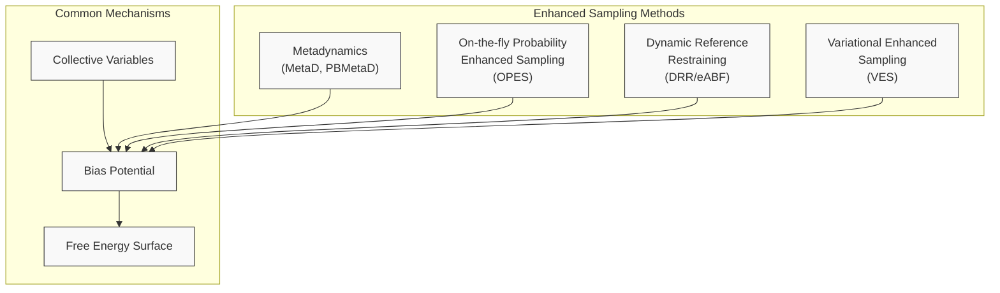
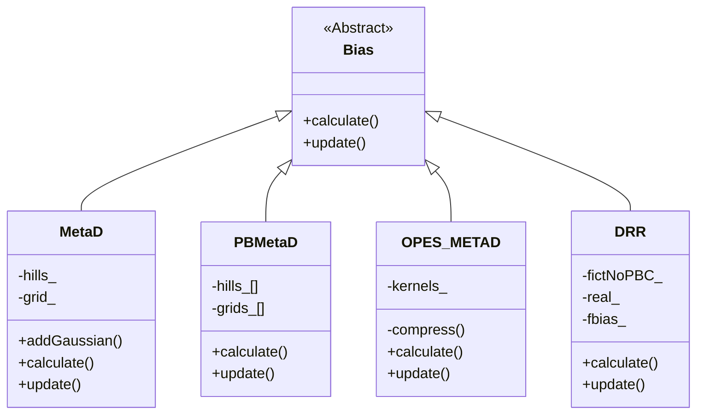
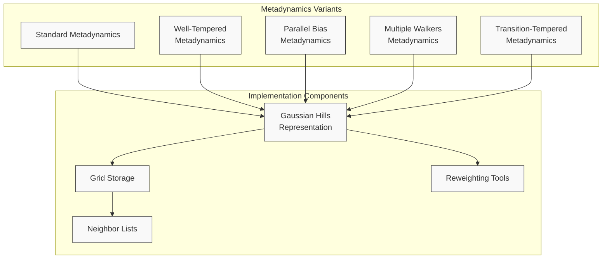
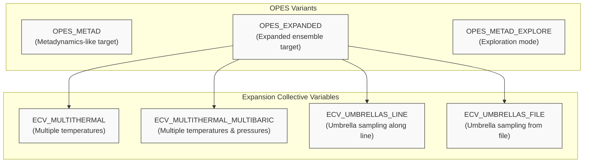
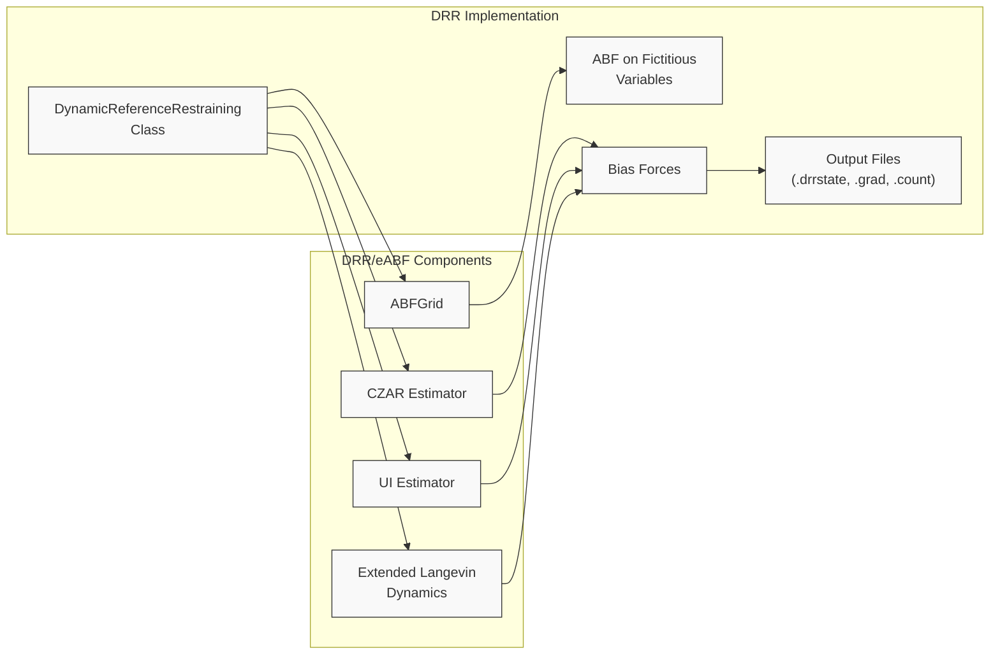
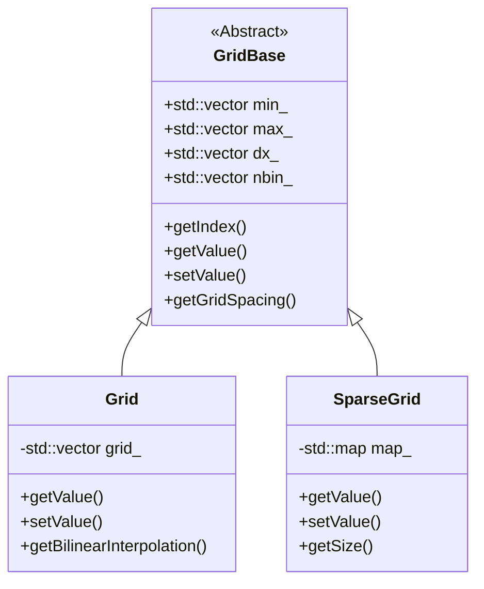
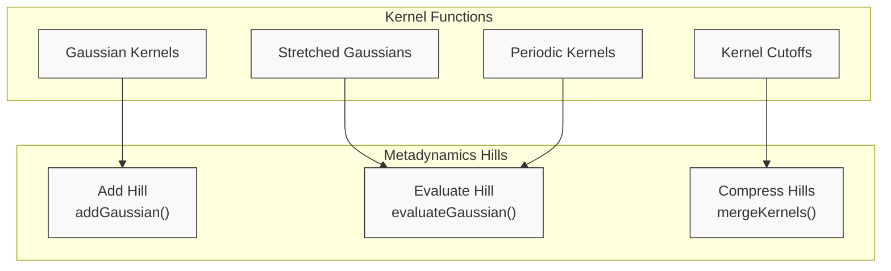

# Enhanced Sampling Methods

Relevant source files

The following files were used as context for generating this wiki page:

- [CHANGES/v2.0.md](CHANGES/v2.0.md)
- [CHANGES/v2.1.md](CHANGES/v2.1.md)
- [CHANGES/v2.10.md](CHANGES/v2.10.md)
- [CHANGES/v2.11.md](CHANGES/v2.11.md)
- [CHANGES/v2.2.md](CHANGES/v2.2.md)
- [CHANGES/v2.3.md](CHANGES/v2.3.md)
- [CHANGES/v2.4.md](CHANGES/v2.4.md)
- [CHANGES/v2.5.md](CHANGES/v2.5.md)
- [CHANGES/v2.7.md](CHANGES/v2.7.md)
- [CHANGES/v2.8.md](CHANGES/v2.8.md)
- [CHANGES/v2.9.md](CHANGES/v2.9.md)
- [README.md](README.md)
- [VERSION.txt](VERSION.txt)
- [docker/.gitignore](docker/.gitignore)
- [docker/Dockerfile](docker/Dockerfile)

This document provides a comprehensive overview of the enhanced sampling methods implemented in PLUMED. Enhanced sampling methods help overcome energy barriers in molecular dynamics simulations, allowing for more efficient exploration of the conformational space and calculation of free energies. PLUMED offers a variety of these methods with different strengths and applications.

For implementation details on specific enhanced sampling methods, see their dedicated pages:
- [Metadynamics (3.1)](#3.1)
- [OPES (3.2)](#3.2)
- [DRR and eABF (3.3)](#3.3)
- [VES (3.4)](#3.4)

## Enhanced Sampling Methods Overview

Enhanced sampling methods in PLUMED are designed to accelerate the exploration of free energy landscapes by applying bias forces to selected collective variables. These methods overcome the limitations of standard molecular dynamics simulations, which can get trapped in local energy minima for extended periods.

Sources: [src/bias/MetaD.cpp](). [src/bias/PBMetaD.cpp](). [src/opes/OPESmetad.cpp](). [src/opes/OPESexpanded.cpp](). [src/drr/DynamicReferenceRestraining.cpp]().

## Metadynamics

Metadynamics enhances sampling by adding a history-dependent bias potential composed of Gaussian functions to discourage the system from revisiting already sampled configurations. 

In standard metadynamics, the bias potential is given by:

$$V(\vec{s},t) = \sum_{ k \tau < t} W(k \tau) \exp\left(-\sum_{i=1}^{d} \frac{(s_i-s_i^{(0)}(k \tau))^2}{2\sigma_i^2}\right)$$

This bias gradually fills energy minima, pushing the system to explore new regions of the configurational space.

Sources: [src/bias/MetaD.cpp:482-633](). [src/bias/PBMetaD.cpp:238-337](). [src/opes/OPESmetad.cpp:166-250](). [src/drr/DynamicReferenceRestraining.cpp:180-243]().

### Well-Tempered Metadynamics

A popular variant of metadynamics is well-tempered metadynamics, where the height of Gaussian hills decreases with time according to:

$$W(k\tau) = W_0 e^{-V(s,k\tau)/\Delta T}$$

This ensures that the bias potential converges more smoothly to the negative of the free energy.

### Multiple Walker Metadynamics

PLUMED also supports multiple walker approaches where several simulations (walkers) contribute to the same bias potential, enhancing convergence through collaborative sampling.

Sources: [src/bias/MetaD.cpp:187-207](). [src/bias/MetaD.cpp:291-317](). [src/bias/PBMetaD.cpp:40-95](). [src/bias/PBMetaD.cpp:195-234]().

## On-the-fly Probability Enhanced Sampling (OPES)

OPES is a more recent enhanced sampling method that optimizes the bias on-the-fly through probability density estimation. Two main variants are implemented:

### OPES_METAD

This variant uses a metadynamics-like target distribution with the bias at step n given by:

$$V_n(\mathbf{s}) = (1-1/\gamma)\frac{1}{\beta}\log\left(\frac{P_n(\mathbf{s})}{Z_n}+\epsilon\right)$$

OPES_METAD aims to quickly get a coarse estimate of the full free energy surface and then refine its details. It uses a compression algorithm to limit the number of kernels.

### OPES_EXPANDED

This variant works with expanded ensembles, allowing simulation of multiple thermodynamic conditions. The bias is:

$$V_n(\mathbf{x})=-\frac{1}{\beta}\log \left(\frac{1}{N_{\{\lambda\}}}\sum_\lambda e^{-\Delta u_\lambda(\mathbf{x})+\beta\Delta F_n(\lambda)}\right)$$

This allows for sampling a range of temperatures, pressures, or other conditions within a single simulation.

Sources: [src/opes/OPESmetad.cpp:29-164](). [src/opes/OPESmetad.cpp:261-297](). [src/opes/OPESexpanded.cpp:32-113](). [src/opes/ECVmultiThermal.cpp](). [src/opes/ECVmultiThermalBaric.cpp:25-72](). [src/opes/ECVumbrellasLine.cpp](). [src/opes/ECVumbrellasFile.cpp]().

## Dynamic Reference Restraining (DRR)

DRR, also known as extended-system Adaptive Biasing Force (eABF), attaches fictitious variables to collective variables through springs. The bias force acts on the fictitious variables rather than directly on the collective variables.

For each collective variable \(ξ_i\), a fictitious variable \(λ_i\) is attached through a spring. The bias force on \(λ_i\) is the negative average spring force, enhancing the sampling of \(λ_i\):

$$F_{bias}(λ_i) = k(λ_i - \langle ξ_i \rangle_{λ_i})$$

DRR supports multiple estimators:
- Naïve (ABF) estimator: negative average spring force
- CZAR (Corrected z-averaged restraint) estimator
- UI (Umbrella Integration) estimator

Sources: [src/drr/DynamicReferenceRestraining.cpp:45-95](). [src/drr/DRR.cpp:30-48](). [src/drr/DRR.cpp:77-113](). [src/drr/DRR.h:50-163]().

## Variational Enhanced Sampling (VES)

Variational Enhanced Sampling (VES) uses a variational approach to optimize bias potentials. It minimizes a functional related to the free energy to determine the optimal bias.

## Common Utilities for Enhanced Sampling

Several utilities and tools are shared across enhanced sampling methods:

### Grid System

Grid-based storage of bias potentials is a crucial optimization in many enhanced sampling methods, as it reduces the computational cost of evaluating the bias:

Sources: [src/tools/Grid.h:91-140](). [src/tools/Grid.h:201-379](). [src/tools/Grid.cpp:22-40]().

### Hills and Kernel Functions

Gaussian hills and other kernel functions are fundamental building blocks in metadynamics and OPES:

Sources: [src/bias/MetaD.cpp:482-534](). [src/opes/OPESmetad.cpp:202-215]().

### Post-Processing Tools

The `sum_hills` and `drr_tool` utilities provide essential post-processing capabilities:

| Tool | Purpose | Key Features |
|------|---------|--------------|
| `sum_hills` | Process HILLS files from metadynamics | - Integrate bias potential - Generate free energy surface - Calculate multiple dimensionalities |
| `drr_tool` | Process DRR output files | - Extract gradients and counts - Merge windows - Calculate force field divergence |

Sources: [src/function/FuncSumHills.cpp:37-49](). [src/cltools/SumHills.cpp](). [src/drr/drrtool.cpp:40-67]().

## Summary of Enhanced Sampling Implementations

PLUMED provides a comprehensive set of enhanced sampling methods, each with unique strengths and appropriate use cases:

| Method | Key Class | Use Cases | Key Features |
|--------|-----------|-----------|--------------|
| Metadynamics | `MetaD` | - Free energy calculations - Exploring unknown landscapes | - Well-tempered variant - Multiple walkers - Grid acceleration |
| Parallel Bias MetaD | `PBMetaD` | - High-dimensional systems | - Parallel mono-dimensional biases - Partitioned families |
| OPES | `OPESmetad`, `OPESexpanded` | - Fast exploration - Multiple thermodynamic states | - Kernel compression - Multiple expanded variables |
| DRR/eABF | `DynamicReferenceRestraining` | - More direct FES estimation | - Various estimators (CZAR, UI) - Integrated with mainstream MD codes |
| VES | | - Complex target distributions | - Variational approach to bias optimization |

Sources: [src/bias/MetaD.cpp](). [src/bias/PBMetaD.cpp](). [src/opes/OPESmetad.cpp](). [src/opes/OPESexpanded.cpp](). [src/drr/DynamicReferenceRestraining.cpp]().

These enhanced sampling methods enable the efficient calculation of free energy surfaces and the exploration of complex energy landscapes in molecular systems, which would be prohibitively expensive with standard molecular dynamics.

---