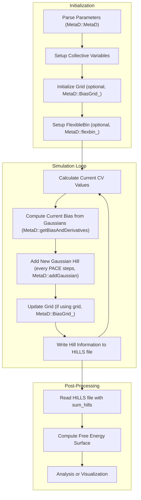
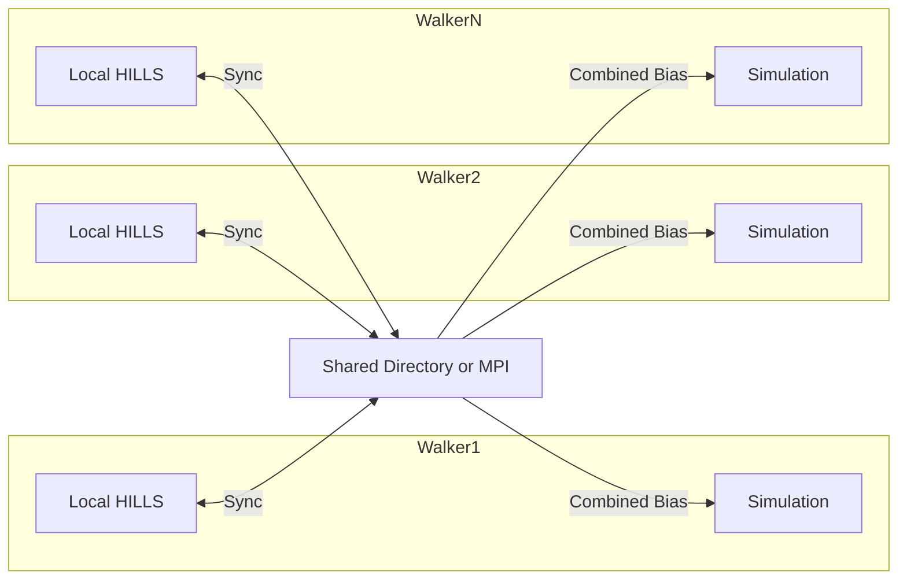
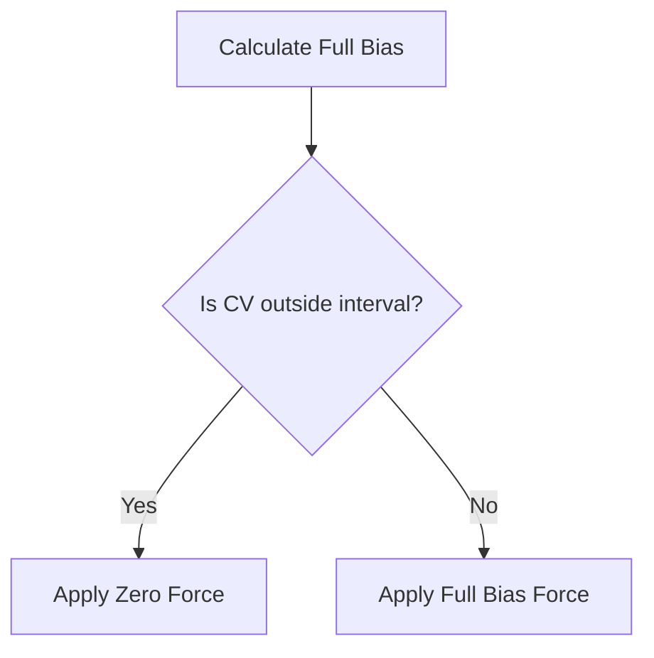
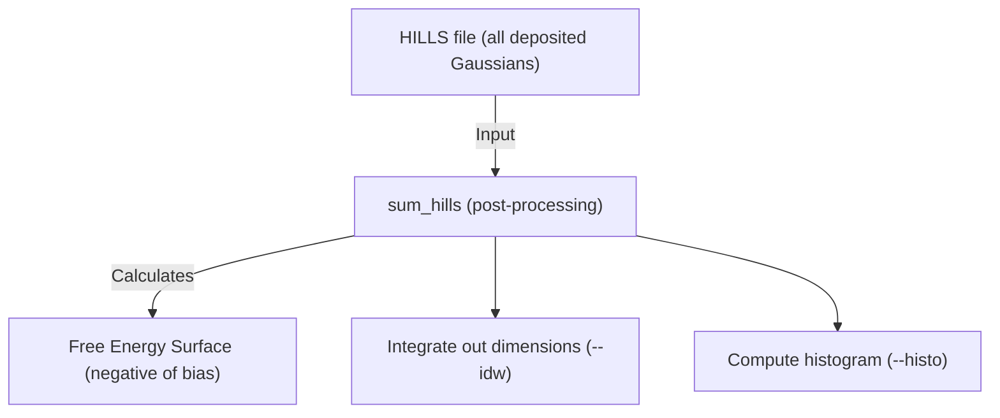
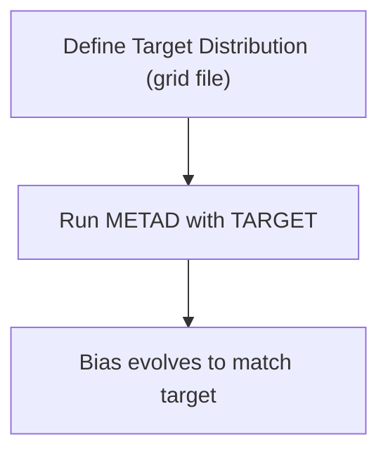
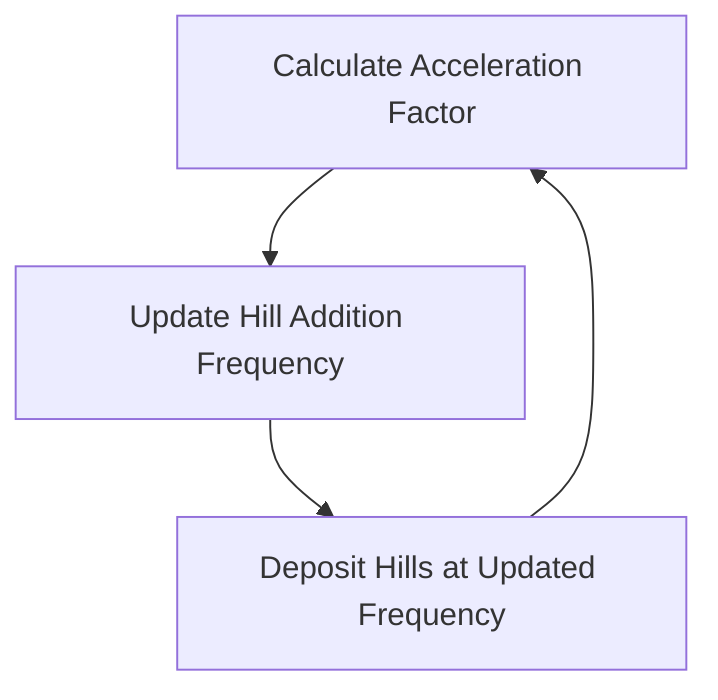
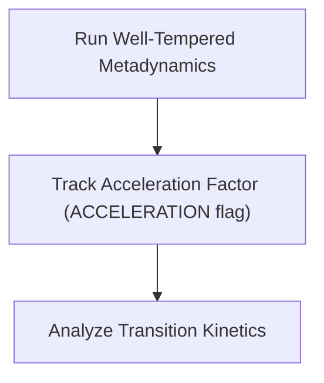

# Metadynamics

<details>
<summary>Relevant source files</summary>

The following files were used as context for generating this wiki page:

- [regtest/basic/rt-sum-hills-overflow/HILLS](regtest/basic/rt-sum-hills-overflow/HILLS)
- [regtest/basic/rt-sum-hills-overflow/Makefile](regtest/basic/rt-sum-hills-overflow/Makefile)
- [regtest/basic/rt-sum-hills-overflow/config](regtest/basic/rt-sum-hills-overflow/config)
- [regtest/basic/rt-sum-hills-overflow/fes.dat.reference](regtest/basic/rt-sum-hills-overflow/fes.dat.reference)
- [src/bias/ABMD.cpp](src/bias/ABMD.cpp)
- [src/bias/BiasValue.cpp](src/bias/BiasValue.cpp)
- [src/bias/External.cpp](src/bias/External.cpp)
- [src/bias/LWalls.cpp](src/bias/LWalls.cpp)
- [src/bias/MetaD.cpp](src/bias/MetaD.cpp)
- [src/bias/MovingRestraint.cpp](src/bias/MovingRestraint.cpp)
- [src/bias/PBMetaD.cpp](src/bias/PBMetaD.cpp)
- [src/bias/Restraint.cpp](src/bias/Restraint.cpp)
- [src/bias/UWalls.cpp](src/bias/UWalls.cpp)
- [src/cltools/SumHills.cpp](src/cltools/SumHills.cpp)
- [src/colvar/Fake.cpp](src/colvar/Fake.cpp)
- [src/core/FlexibleBin.cpp](src/core/FlexibleBin.cpp)
- [src/core/FlexibleBin.h](src/core/FlexibleBin.h)
- [src/function/FuncSumHills.cpp](src/function/FuncSumHills.cpp)
- [src/tools/BiasRepresentation.cpp](src/tools/BiasRepresentation.cpp)
- [src/tools/BiasRepresentation.h](src/tools/BiasRepresentation.h)
- [src/tools/Grid.cpp](src/tools/Grid.cpp)
- [src/tools/Grid.h](src/tools/Grid.h)

</details>


Metadynamics is an enhanced sampling method in PLUMED that accelerates rare events in molecular dynamics by adding a history-dependent bias potential. This page documents the architecture, configuration, and implementation of metadynamics (`METAD`) and related biasing methods in PLUMED.

For parallel bias metadynamics, see [3.2]. For an overview of all enhanced sampling methods, see [3].

## Theoretical Background

Metadynamics adds Gaussian-shaped bias potentials ("hills") to the free energy landscape at the positions visited by the system in collective variable (CV) space. The bias potential in standard metadynamics is:

$$
V(\vec{s},t) = \sum_{ k \tau < t} W(k \tau)
\exp\left(
-\sum_{i=1}^{d} \frac{(s_i-s_i^{(0)}(k \tau))^2}{2\sigma_i^2}
\right).
$$

Where:
- $V(\vec{s},t)$: bias at CV values $\vec{s}$ and time $t$
- $W(k \tau)$: height of the Gaussian hill at time $k \tau$
- $s_i^{(0)}(k \tau)$: value of the $i$-th CV at time $k \tau$
- $\sigma_i$: width of the Gaussian along the $i$-th CV
- $d$: number of CVs

After sufficient sampling, the bias potential $V(\vec{s})$ approximates the negative of the free energy:

$$
V(\vec{s}) = -F(\vec{s})
$$

Sources: [src/bias/MetaD.cpp:39-64]()

## Architecture and Key Classes

### Metadynamics Class Structure

```mermaid
classDiagram
    class "Bias" {
        <<Abstract>>
        +calculate()
        +update()
    }
    class "MetaD" {
        - hills_: vector<Gaussian>
        - grid_: bool
        - BiasGrid_: GridBase*
        - flexbin_: FlexibleBin*
        - adaptive_: int
        + calculate()
        + update()
        - addGaussian()
        - readGaussians()
        - writeGaussian()
        - getBiasAndDerivatives()
        - updateFrequencyAdaptiveStride()
    }
    class "PBMetaD" {
        - hills_: vector<vector<Gaussian>>
        - grid_: bool
        - BiasGrids_: vector<GridBase*>
        - flexbin_: vector<FlexibleBin>
        - adaptive_: int
        + calculate()
        + update()
        - addGaussian()
        - readGaussians()
        - writeGaussian()
        - getBiasAndDerivatives()
    }
    class "Grid" {
        - grid_: vector<double>
        - der_: vector<double>
        + getValue()
        + getValueAndDerivatives()
        + addValueAndDerivatives()
    }
    class "FlexibleBin" {
        - type: int
        - paction: ActionWithArguments*
        - sigma: double
        - variance: vector<double>
        + getMatrix()
        + getInverseMatrix()
    }
    class "KernelFunctions" {
        - center: vector<double>
        - sigma: vector<double>
        + evaluate()
        + getContinuousSupport()
    }
    "Bias" <|-- "MetaD"
    "Bias" <|-- "PBMetaD"
    "MetaD" -- "Grid"
    "MetaD" -- "KernelFunctions"
    "MetaD" -- "FlexibleBin"
    "PBMetaD" -- "Grid"
    "PBMetaD" -- "FlexibleBin"
```

- `MetaD` implements standard metadynamics.
- `PBMetaD` implements parallel bias metadynamics.
- Both inherit from `Bias`, which provides the base interface for biasing actions.
- `Grid` and `FlexibleBin` are used for efficient bias storage and adaptive Gaussian widths.

Sources: [src/bias/MetaD.cpp:482-633](), [src/bias/PBMetaD.cpp:237-337]()

## Metadynamics Workflow

### Simulation and Post-Processing Flow



- Initialization: Parameters are parsed, CVs are set up, and optional grid/flexible bin structures are initialized.
- Simulation loop: At each step, the bias is computed, and new Gaussians are added at intervals.
- Post-processing: The HILLS file is analyzed with `sum_hills` to reconstruct the free energy.

Sources: [src/bias/MetaD.cpp:724-763](), [src/bias/MetaD.cpp:627-633]()

## Key Implementation Components

### Gaussian Representation

Metadynamics accumulates Gaussian-shaped bias potentials. In PLUMED, these are represented by the `Gaussian` struct in `MetaD`:

```mermaid
classDiagram
    class "MetaD::Gaussian" {
        + bool multivariate
        + double height
        + vector<double> center
        + vector<double> sigma
        + vector<double> invsigma
    }
```

- `center`: position in CV space
- `sigma`: width along each CV
- `height`: amplitude
- `invsigma`: precomputed for efficiency
- `multivariate`: distinguishes 1D/multivariate cases

Sources: [src/bias/MetaD.cpp:485-502]()

### Grid System

For long simulations, evaluating all Gaussians at every step is expensive. PLUMED supports storing the bias on a grid:

```mermaid
flowchart TD
    "MetaD" -->|"uses"| "GridBase"
    "GridBase" <|-- "Grid"
    "GridBase" <|-- "SparseGrid"
    "MetaD" -->|"addGaussian()"| "MetaD::Gaussian"
    "MetaD::Gaussian" -->|"evaluated on"| "GridBase"
```

- `GridBase` is the abstract interface.
- `Grid` is a dense grid implementation.
- `SparseGrid` is for sparse storage.
- The grid is updated as new Gaussians are deposited.

Sources: [src/tools/Grid.h:100-357](), [src/bias/MetaD.cpp:81-106]()

### Flexible Gaussian System

PLUMED supports adaptive Gaussian widths using `FlexibleBin`:

```mermaid
classDiagram
    class "FlexibleBin" {
        + enum Type { none, geometry, diffusion }
        - ActionWithArguments* paction
        - double sigma
        - vector<double> variance
        - vector<double> average
        + getMatrix()
        + getInverseMatrix()
        + update()
    }
    "MetaD" --> "FlexibleBin" : uses
    "PBMetaD" --> "FlexibleBin" : uses
```

- **Geometry-based**: adapts width to local geometry.
- **Diffusion-based**: adapts width to time evolution.

Sources: [src/bias/MetaD.cpp:762-819](), [src/core/FlexibleBin.h:31-67]()

## Key Features

### Well-Tempered Metadynamics

Well-tempered metadynamics rescales the height of deposited Gaussians to ensure smoother convergence:

$$
W(t) = W_0 e^{-V({s}({q}(t'),t')/\Delta T}
$$

- $W_0$: initial hill height
- $\Delta T$: temperature boost
- Bias factor $\gamma = (T+\Delta T)/T$

This approach allows the bias to converge to a finite value and enables reweighting.

Sources: [src/bias/MetaD.cpp:187-214]()

### Multiple Walkers

Multiple walkers metadynamics enables parallel simulations, each contributing to the same bias:



- **MPI version**: Walkers communicate via MPI.
- **Disk version**: Walkers read/write HILLS files in a shared directory.

Sources: [src/bias/MetaD.cpp:292-333]()

### Interval Limits

The `INTERVAL` keyword restricts the bias force to a specified region in CV space:



- Outside the interval, the bias force is set to zero.
- Useful for focusing sampling on a region of interest.

Sources: [src/bias/MetaD.cpp:262-290]()

## Usage Example

A typical metadynamics setup in PLUMED:

```
d1: DISTANCE ATOMS=3,5
d2: DISTANCE ATOMS=2,4
metad: METAD ARG=d1,d2 SIGMA=0.2,0.2 HEIGHT=0.3 PACE=500 GRID_MIN=1,1 GRID_MAX=3,3 GRID_BIN=100,100
PRINT ARG=d1,d2,metad.bias STRIDE=100 FILE=COLVAR
```

- The bias is stored in the HILLS file.
- Use `plumed sum_hills` to reconstruct the free energy surface.

Sources: [src/bias/MetaD.cpp:67-79](), [src/cltools/SumHills.cpp:39-188]()

## Free Energy Reconstruction

After a metadynamics simulation, the free energy surface is reconstructed using the `sum_hills` tool:



- `sum_hills` reads the HILLS file and outputs the free energy surface.
- Optional: integrate out dimensions or compute histograms.

Sources: [src/cltools/SumHills.cpp:41-187](), [src/function/FuncSumHills.cpp:37-49]()

## Advanced Features

### Targeted Metadynamics

The `TARGET` keyword allows biasing towards a specific target distribution (e.g., from experiment):



Sources: [src/bias/MetaD.cpp:421-467]()

### Frequency Adaptive Metadynamics

The hill deposition frequency can be adapted dynamically based on the acceleration factor:



- Frequency is updated according to the instantaneous acceleration factor.

Sources: [src/bias/MetaD.cpp:388-417]()

### Infrequent Metadynamics

For kinetic analysis, infrequent metadynamics tracks the acceleration factor:



Sources: [src/bias/MetaD.cpp:363-387]()

## Summary

Metadynamics in PLUMED provides a powerful and flexible framework for enhanced sampling in molecular dynamics simulations. It offers various features like well-tempered metadynamics, multiple walkers, grid-based calculations, and flexible Gaussians to adapt to different simulation needs. The implementation is designed to be efficient, scalable, and easy to use while providing advanced options for specific research questions.

The modular design allows seamless integration with other components of PLUMED and compatibility with various molecular dynamics engines.

---