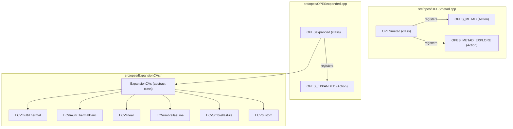
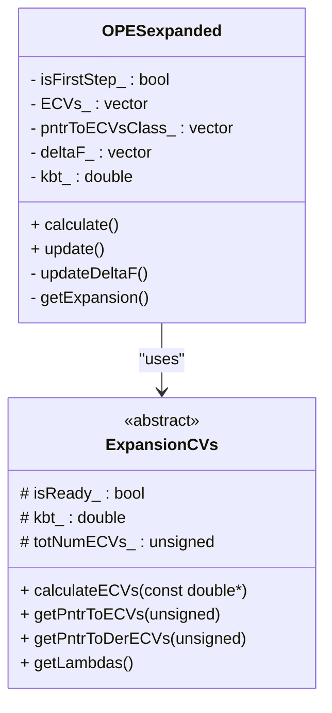
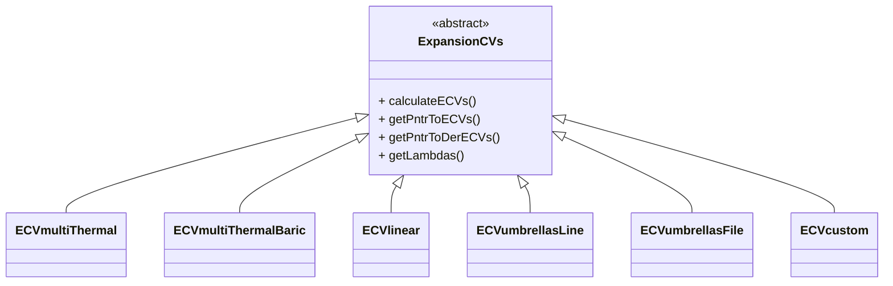
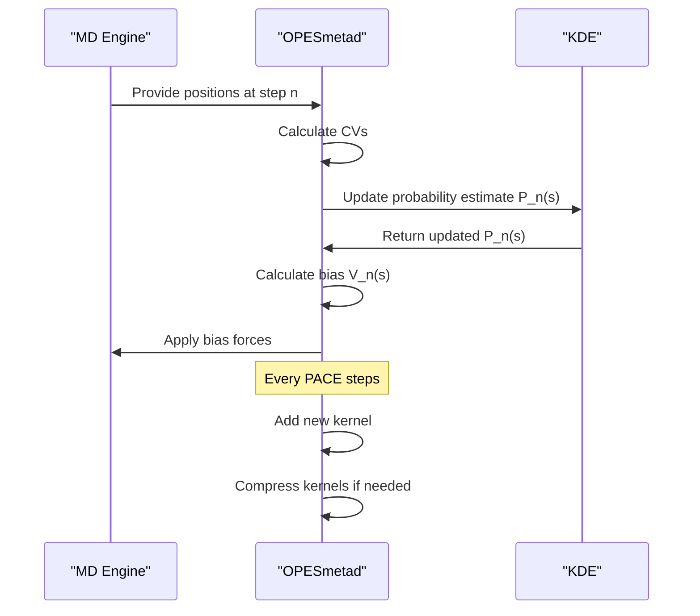
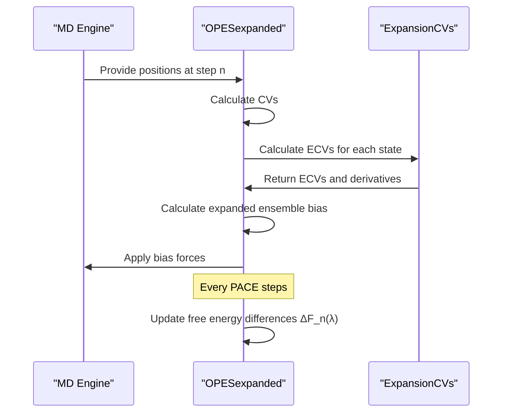

# OPES

<details>
<summary>Relevant source files</summary>

The following files were used as context for generating this wiki page:

- [src/opes/ECVcustom.cpp](src/opes/ECVcustom.cpp)
- [src/opes/ECVlinear.cpp](src/opes/ECVlinear.cpp)
- [src/opes/ECVmultiThermal.cpp](src/opes/ECVmultiThermal.cpp)
- [src/opes/ECVmultiThermalBaric.cpp](src/opes/ECVmultiThermalBaric.cpp)
- [src/opes/ECVumbrellasFile.cpp](src/opes/ECVumbrellasFile.cpp)
- [src/opes/ECVumbrellasLine.cpp](src/opes/ECVumbrellasLine.cpp)
- [src/opes/ExpansionCVs.cpp](src/opes/ExpansionCVs.cpp)
- [src/opes/ExpansionCVs.h](src/opes/ExpansionCVs.h)
- [src/opes/OPESexpanded.cpp](src/opes/OPESexpanded.cpp)
- [src/opes/OPESmetad.cpp](src/opes/OPESmetad.cpp)

</details>


OPES (On-the-fly Probability Enhanced Sampling) is a contributed module in PLUMED that implements advanced enhanced sampling algorithms for molecular dynamics (MD) simulations. OPES is designed to efficiently overcome free energy barriers and accelerate sampling by constructing a bias potential on-the-fly, based on the evolving probability distribution of selected collective variables (CVs).

OPES provides two main algorithmic approaches:
- **Metadynamics-like OPES (`OPES_METAD` and `OPES_METAD_EXPLORE`)**: Uses kernel density estimation to build a bias potential that targets a specified distribution in CV space.
- **Expanded Ensemble OPES (`OPES_EXPANDED`)**: Constructs a bias using a set of expansion collective variables (ECVs) to sample across multiple thermodynamic or biasing states.

## System and Code Structure

The OPES module is implemented as a set of PLUMED Actions and supporting classes. The main entry points are the `OPESmetad` and `OPESexpanded` classes, which are registered as PLUMED Actions. Expansion CVs are implemented as subclasses of the abstract `ExpansionCVs` class.

### Diagram: OPES System and Code Entities


Sources:
- [src/opes/OPESmetad.cpp:29-63]()
- [src/opes/OPESexpanded.cpp:32-36]()
- [src/opes/ExpansionCVs.h:35-73]()

## Main Components

### OPESmetad: Metadynamics-like OPES

The `OPESmetad` class implements the metadynamics-like OPES method. It constructs a bias potential by estimating the unbiased probability distribution in CV space using kernel density estimation (KDE). The bias is updated on-the-fly to target a specified distribution, typically the well-tempered distribution.

There are two main Action registrations:
- `OPES_METAD`: Standard OPES metadynamics, focusing on fast convergence of the reweighted free energy.
- `OPES_METAD_EXPLORE`: Exploration-focused variant, prioritizing rapid exploration of CV space.

**Bias formula:**
```
V_n(s) = (1 - 1/γ) * (1/β) * log(P_n(s)/Z_n + ε)
```
Where:
- γ: bias factor (BIASFACTOR)
- β: inverse temperature
- P_n(s): kernel density estimate of the unbiased distribution
- Z_n: normalization factor
- ε: regularization constant

#### Diagram: OPESmetad Class Structure

```mermaid
classDiagram
    class "OPESmetad<mode>" {
        - isFirstStep_ : bool
        - kernels_ : vector<kernel>
        - biasfactor_ : double
        - Zed_ : double
        - sum_weights_ : double
        - calculate()
        - update()
        - addKernel()
        - getProbAndDerivatives()
        - updateNlist()
    }
    class kernel {
        + height : double
        + center : vector<double>
        + sigma : vector<double>
    }
    "OPESmetad<mode>" --> kernel : "stores"
```
Sources:
- [src/opes/OPESmetad.cpp:164-253]()
- [src/opes/OPESmetad.cpp:169-253]()

### OPESexpanded: Expanded Ensemble OPES

The `OPESexpanded` class implements the expanded ensemble OPES method. Instead of KDE, it uses a set of expansion collective variables (ECVs) to define a grid of thermodynamic or biasing states. The bias is constructed to sample a mixture of these states, and free energy differences between them are estimated on-the-fly.

**Bias formula:**
```
V_n(x) = -(1/β) * log( (1/N_λ) ∑_λ exp(-Δu_λ(x) + βΔF_n(λ)) )
```
Where:
- β: inverse temperature
- Δu_λ(x): difference in potential energy or bias for state λ
- ΔF_n(λ): estimated free energy difference for state λ
- N_λ: number of states

#### Diagram: OPESexpanded and ExpansionCVs


Sources:
- [src/opes/OPESexpanded.cpp:114-178]()
- [src/opes/ExpansionCVs.h:35-73]()

### Expansion Collective Variables (ECVs)

Expansion CVs are used by `OPESexpanded` to define the set of states in the expanded ensemble. Each ECV is a PLUMED Action derived from the abstract `ExpansionCVs` class. ECVs can represent different thermodynamic conditions (temperature, pressure), umbrella windows, or custom states.

#### Available ECV Implementations

| ECV Class                | Description                                      | Key Formula / Notes                                 | Source |
|--------------------------|--------------------------------------------------|-----------------------------------------------------|--------|
| `ECVmultiThermal`        | Multiple temperatures (multicanonical)           | Δu_β' = (β'-β) U                                    | [src/opes/ECVmultiThermal.cpp:26-39]() |
| `ECVmultiThermalBaric`   | Multiple temperatures and pressures              | Δu_β',p' = (β'-β)E + (β'p'-βp)V                     | [src/opes/ECVmultiThermalBaric.cpp:25-46]() |
| `ECVlinear`              | Linear expansion (e.g., thermodynamic integration)| Δu_λ = βλΔU                                         | [src/opes/ECVlinear.cpp:26-37]() |
| `ECVumbrellasLine`       | Umbrella windows along a line in CV space        | Δu_si(s) = Σ_j ((s_j-si_j)²)/(2σ²)                  | [src/opes/ECVumbrellasLine.cpp:26-41]() |
| `ECVumbrellasFile`       | Umbrella windows from file                       | Δu_si(s) = Σ_j ((s_j-si_j)²)/(2σi_j²)               | [src/opes/ECVumbrellasFile.cpp:26-44]() |
| `ECVcustom`              | User-defined/custom expansion CVs                | User-specified                                     | [src/opes/ECVcustom.cpp:26-39]() |

#### Diagram: ExpansionCVs Inheritance


Sources:
- [src/opes/ExpansionCVs.h:35-73]()
- [src/opes/ECVmultiThermal.cpp:25-78]()
- [src/opes/ECVmultiThermalBaric.cpp:25-73]()
- [src/opes/ECVlinear.cpp:25-71]()
- [src/opes/ECVumbrellasLine.cpp:25-71]()
- [src/opes/ECVumbrellasFile.cpp:26-91]()
- [src/opes/ECVcustom.cpp:25-84]()

## Workflow and Operation

### OPESmetad Workflow


Sources:
- [src/opes/OPESmetad.cpp:237-249]()
- [src/opes/OPESmetad.cpp:517-560]()

### OPESexpanded Workflow


Sources:
- [src/opes/OPESexpanded.cpp:517-560]()
- [src/opes/OPESexpanded.cpp:584-681]()

## Key Parameters and Options

### OPESmetad (OPES_METAD, OPES_METAD_EXPLORE)

| Parameter              | Description                                                                 |
|------------------------|-----------------------------------------------------------------------------|
| `ARG`                  | List of collective variables to bias                                        |
| `PACE`                 | Frequency (in MD steps) for kernel deposition and bias update               |
| `SIGMA`                | Width(s) of Gaussian kernels (can be set to `ADAPTIVE`)                     |
| `BARRIER`              | Estimate of the free energy barrier to overcome                             |
| `BIASFACTOR`           | Bias factor γ (set to `inf` for uniform target)                             |
| `COMPRESSION_THRESHOLD`| Threshold for merging kernels (in units of sigma)                           |
| `KERNEL_CUTOFF`        | Truncation distance for kernels (in units of sigma)                         |
| `STATE_WFILE`/`STATE_RFILE` | Files for checkpointing/restarting the simulation state                |
| `EXTRA_BIAS`           | Additional bias potentials to include in reweighting (OPES_METAD only)      |
| `EXCLUDED_REGION`      | Region in CV space where kernels are not deposited                          |
| `WALKERS_MPI`          | Enable multiple walkers with MPI                                            |

Sources:
- [src/opes/OPESmetad.cpp:311-374]()

### OPESexpanded (OPES_EXPANDED)

| Parameter              | Description                                                                 |
|------------------------|-----------------------------------------------------------------------------|
| `ARG`                  | List of ECVs to use (can use wildcards for all components)                  |
| `PACE`                 | Frequency (in MD steps) for bias update                                     |
| `OBSERVATION_STEPS`    | Number of initial unbiased steps for ECV grid initialization                |
| `FILE`                 | File for storing free energy estimates (DELTAFS)                            |
| `PRINT_STRIDE`         | Stride for writing to DELTAFS file                                          |
| `STATE_WFILE`/`STATE_RFILE` | Files for checkpointing/restarting the simulation state                |
| `WALKERS_MPI`          | Enable multiple walkers with MPI                                            |

Sources:
- [src/opes/OPESexpanded.cpp:182-206]()

## Usage Examples

### Basic OPESmetad Example

```plumed
cv: DISTANCE ATOMS=1,2
opes: OPES_METAD ARG=cv PACE=200 BARRIER=40
PRINT STRIDE=200 FILE=COLVAR ARG=*
```

### Multi-Thermal Simulation with OPESexpanded

```plumed
ene: ENERGY
ecv: ECV_MULTITHERMAL ARG=ene TEMP=300 TEMP_MAX=800
opes: OPES_EXPANDED ARG=ecv.* PACE=500
PRINT FILE=COLVAR STRIDE=500 ARG=ene,opes.bias
```

### Multi-Thermal-Multi-Baric Simulation

```plumed
ene: ENERGY
vol: VOLUME
ecv: ECV_MULTITHERMAL_MULTIBARIC ...
  ARG=ene,vol
  TEMP=300
  TEMP_MIN=200
  TEMP_MAX=800
  PRESSURE=0.06022140857*1000 #1 kbar
  PRESSURE_MIN=0
  PRESSURE_MAX=0.06022140857*2000 #2 kbar
...
opes: OPES_EXPANDED ARG=ecv.* PACE=500 WALKERS_MPI
```

Sources:
- [src/opes/OPESmetad.cpp:94-124]()
- [src/opes/OPESexpanded.cpp:61-67]()
- [src/opes/OPESexpanded.cpp:88-110]()

## Implementation Details

### Kernel Compression in OPESmetad

To avoid unbounded growth in the number of kernels, `OPESmetad` uses a kernel compression algorithm. When a new kernel is added, it checks if an existing kernel is within a specified threshold (in CV space). If so, the kernels are merged, preserving the statistical properties.

#### Diagram: Kernel Compression Logic

```mermaid
flowchart TD
    "New kernel at s(t)" -->|"Find similar kernel within threshold"| "Merge with existing kernel"
    "New kernel at s(t)" -->|"No similar kernel"| "Add as new kernel"
    "Merge with existing kernel" --> "Update probability estimate"
    "Add as new kernel" --> "Update probability estimate"
```
Sources:
- [src/opes/OPESmetad.cpp:238-244]()

### Free Energy Estimation in OPESexpanded

`OPESexpanded` updates the free energy differences (ΔF) between states using the observed statistics during the simulation. At each PACE interval, the ECVs are evaluated for all states, and the ΔF values are updated to improve the bias estimate.

#### Diagram: Free Energy Estimation Workflow

```mermaid
flowchart TD
    "Collect CV observations for PACE steps" --> "Calculate ECVs for all states"
    "Calculate ECVs for all states" --> "Update free energy estimates ΔF(λ)"
    "Update free energy estimates ΔF(λ)" --> "Construct expanded ensemble bias"
    "Construct expanded ensemble bias" --> "Write estimates to file"
```
Sources:
- [src/opes/OPESexpanded.cpp:608-634]()

## Implementation Classes

The OPES module is implemented through several key classes:

1. `OPESmetad` - Implements the metadynamics-like OPES method
   - Template parameter `mode` determines behavior (convergence or exploration)
   - Key data members: `kernels_` (stored Gaussian kernels), `Zed_` (normalization factor), `sum_weights_` (sum of kernel weights)

2. `OPESexpanded` - Implements the expanded ensemble OPES method
   - Key data members: `ECVs_` (pointers to expansion CV values), `deltaF_` (free energy differences), `pntrToECVsClass_` (pointers to ECV objects)

3. `ExpansionCVs` - Abstract base class for expansion CVs
   - Key virtual methods: `calculateECVs()`, `getPntrToECVs()`, `getPntrToDerECVs()`, `getLambdas()`

4. Various ECV implementations (ECVmultiThermal, ECVlinear, etc.) that derive from ExpansionCVs

Sources:
- [src/opes/OPESmetad.cpp:166-250]()
- [src/opes/OPESexpanded.cpp:114-177]()
- [src/opes/ExpansionCVs.h:35-73]()

---