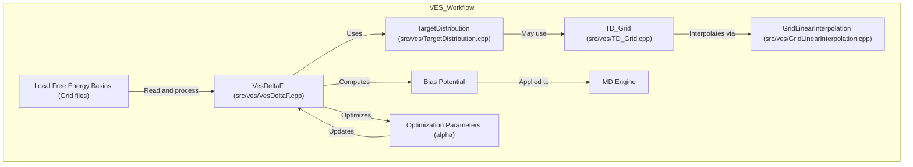
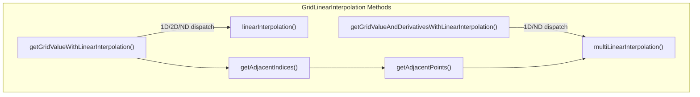
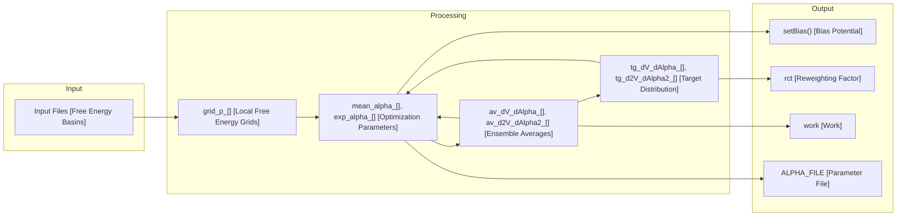

# VES

<details>
<summary>Relevant source files</summary>

The following files were used as context for generating this wiki page:

- [regtest/ves/rt-VesDeltaF-mwalkers/plumed.dat](regtest/ves/rt-VesDeltaF-mwalkers/plumed.dat)
- [regtest/ves/rt-VesDeltaF/plumed.dat](regtest/ves/rt-VesDeltaF/plumed.dat)
- [src/ves/GridLinearInterpolation.cpp](src/ves/GridLinearInterpolation.cpp)
- [src/ves/GridLinearInterpolation.h](src/ves/GridLinearInterpolation.h)
- [src/ves/TD_Grid.cpp](src/ves/TD_Grid.cpp)
- [src/ves/TargetDistribution.cpp](src/ves/TargetDistribution.cpp)
- [src/ves/VesDeltaF.cpp](src/ves/VesDeltaF.cpp)
- [src/ves/VesTools.cpp](src/ves/VesTools.cpp)
- [src/ves/VesTools.h](src/ves/VesTools.h)

</details>


## Purpose and Overview

This page documents the Variationally Enhanced Sampling (VES) module in PLUMED. VES is an enhanced sampling method that uses a variational principle to optimize bias potentials, allowing efficient exploration of free energy landscapes in molecular dynamics (MD) simulations.

The VES module in PLUMED implements VES-based algorithms, with a focus on the VES Delta F method for computing free energy differences between metastable states. This page describes the architecture, main code entities, and technical details of the VES module, including grid management, target distributions, and optimization logic.

Sources: [src/ves/VesDeltaF.cpp:34-116]()

## Core Concepts and System Overview

The VES module is structured around the following core concepts:

- **Target Distribution**: The desired probability distribution of collective variables (CVs) that the simulation should sample.
- **Free Energy Model**: In VES Delta F, the global free energy is modeled as a sum of local free energy basins, each typically obtained from separate simulations.
- **Bias Potential**: A bias is constructed to drive the system toward the target distribution.
- **Variational Optimization**: The parameters of the bias are optimized to minimize the Kullback-Leibler divergence between the sampled and target distributions.

### VES System in PLUMED Codebase



Sources: [src/ves/VesDeltaF.cpp:38-60](), [src/ves/TargetDistribution.cpp:46-103](), [src/ves/TD_Grid.cpp:38-101](), [src/ves/GridLinearInterpolation.cpp:34-184]()

## VES Delta F Method

### Mathematical Framework

VES Delta F is a VES-based method for calculating free energy differences between metastable states. The workflow is:

1. **Input**: Pre-computed local free energy basins (e.g., from METAD runs) are provided as grid files.
2. **Model Construction**: The global free energy is modeled as a weighted sum of local basins, with optimization parameters $\alpha_i$.
3. **Optimization**: The $\alpha_i$ parameters are optimized to match a target distribution.

The global free energy model is:

$$
e^{-\beta F(\mathbf{s})} \propto P(\mathbf{s}) = \sum_{i=0}^{N} P(\mathbf{s}|i)P_i
$$

where $P(\mathbf{s}|i) \propto e^{-\beta F_i(\mathbf{s})}$ and $P_i$ is the probability of basin $i$.

The bias potential is:

$$
V(\mathbf{s}) = (1-1/\gamma)\frac{1}{\beta}\log\left[e^{-\beta F_0(\mathbf{s})} + \sum_{i=1}^{N} e^{-\beta F_i(\mathbf{s})} e^{-\beta \alpha_i}\right]
$$

where:
- $\gamma$ is the bias factor (well-tempered parameter)
- $\alpha_i$ are the optimization parameters (free energy differences)
- $\beta = 1/(k_B T)$

Sources: [src/ves/VesDeltaF.cpp:47-60]()

### Implementation Details

The `VesDeltaF` class implements the VES Delta F method as a PLUMED Action. Key features include:

- **Local Basin Integration**: Reads local free energy basins from files and processes them as probability grids.
- **Optimization Algorithm**: Uses ensemble averages and gradient-based updates for the $\alpha$ parameters.
- **Multiple Walker Support**: Supports combining statistics from multiple parallel simulations (walkers).
- **Target Distribution Handling**: Supports well-tempered and flat target distributions.

#### Main Code Entities

```mermaid
classDiagram
    class "bias::Bias" {
        +calculate()
        +update()
    }
    class "PLMD::ves::VesDeltaF" {
        -grid_p_ : std::vector<Grid*>
        -prob_ : std::vector<double>
        -mean_alpha_ : std::vector<double>
        -exp_alpha_ : std::vector<double>
        -av_dV_dAlpha_ : std::vector<double>
        -tg_dV_dAlpha_ : std::vector<double>
        +calculate()
        +update()
        -update_alpha()
        -update_tg_and_rct()
    }
    "bias::Bias" <|-- "PLMD::ves::VesDeltaF"
```

Sources: [src/ves/VesDeltaF.cpp:118-177](), [src/ves/VesDeltaF.cpp:216-712]()

## Target Distributions

Target distributions define the desired sampling in VES. The VES module provides a flexible system for defining and managing target distributions.

### TargetDistribution Class Hierarchy

- `TargetDistribution` (abstract base): Provides normalization, shifting, grid integration, and marginalization.
- `TD_Grid`: Concrete implementation that reads a target distribution from an external grid file.

#### Class Relationships

```mermaid
classDiagram
    class "PLMD::Action" {
        +runFinalJobs()
        +getLabel()
    }
    class "PLMD::ves::TargetDistribution" {
        -dimension_ : unsigned int
        -targetdist_grid_pntr_ : unique_ptr<Grid>
        -log_targetdist_grid_pntr_ : unique_ptr<Grid>
        +getValue(arg : vector<double>) : double
        +updateTargetDist()
        +normalizeTargetDistGrid()
        +getTargetDistGridPntr() : Grid*
    }
    class "PLMD::ves::TD_Grid" {
        -distGrid_ : unique_ptr<GridBase>
        -minima_ : vector<double>
        -maxima_ : vector<double>
        -zero_outside_ : bool
        +getValue(arg : vector<double>) : double
    }
    "PLMD::Action" <|-- "PLMD::ves::TargetDistribution"
    "PLMD::ves::TargetDistribution" <|-- "PLMD::ves::TD_Grid"
```

Sources: [src/ves/TargetDistribution.cpp:40-103](), [src/ves/TargetDistribution.cpp:108-174](), [src/ves/TD_Grid.cpp:91-102]()

### Grid-Based Target Distribution: TD_Grid

The `TD_Grid` class allows the use of externally defined target distributions from grid files. Key features:

- **Grid File Reading**: Reads a probability distribution from a PLUMED-format grid file.
- **Interpolation**: Uses linear or bilinear interpolation for values between grid points.
- **Boundary Handling**: Options to set values outside the grid to zero or to the boundary value.

Sources: [src/ves/TD_Grid.cpp:38-101](), [src/ves/TD_Grid.cpp:130-218]()

## Grid Operations

Grid operations are central to the VES module for representing and manipulating free energy surfaces, probability distributions, and bias potentials.

### GridLinearInterpolation

The `GridLinearInterpolation` class provides static methods for interpolating values and derivatives on grids of arbitrary dimension.

- **1D**: Linear interpolation between adjacent points.
- **2D**: Bilinear interpolation.
- **N-Dimensional**: Multi-linear interpolation.

#### Key Methods and Data Flow



Sources: [src/ves/GridLinearInterpolation.h:36-51](), [src/ves/GridLinearInterpolation.cpp:34-184]()

### Grid Utilities: VesTools

The `VesTools` class provides utility functions for grid management:

- **copyGridValues**: Copy values between grids.
- **getGridFileInfo**: Extract grid metadata (labels, min/max, periodicity, bins) from files.
- **convertDbl2Str**: Convert doubles to strings with high precision.

Sources: [src/ves/VesTools.h:40-56](), [src/ves/VesTools.cpp:34-92]()

## Usage Examples

### Basic VesDeltaF Setup

A minimal configuration for VES Delta F to compute free energy differences:

```
cv: DISTANCE ATOMS=1,2
ves: VES_DELTA_F ...
  ARG=cv
  TEMP=300
  FILE_F0=fesA.data
  FILE_F1=fesB.data
  BIASFACTOR=10.0
  M_STEP=0.1
  AV_STRIDE=500
  PRINT_STRIDE=100
...
PRINT FMT=%g STRIDE=500 FILE=Colvar.data ARG=cv,ves.bias,ves.rct
```

- `cv`: Defines the collective variable.
- `FILE_F0`, `FILE_F1`: Local free energy basins.
- `BIASFACTOR`: Well-tempered bias factor.
- `M_STEP`, `AV_STRIDE`: Optimization parameters.
- `PRINT_STRIDE`: Output frequency.

Sources: [src/ves/VesDeltaF.cpp:73-89]()

### Advanced Configuration Options

`VES_DELTA_F` supports several advanced options:

| Option            | Description                                              |
|-------------------|---------------------------------------------------------|
| `NORMALIZE`       | Normalize local free energies to probability distributions |
| `NO_MINTOZERO`    | Do not shift local free energies to zero minimum        |
| `DAMPING_OFF`     | Disable adaptive step size in optimization              |
| `TAU_MEAN`        | Exponential decay for parameter averaging               |
| `MULTIPLE_WALKERS`| Use multiple parallel simulations for optimization      |
| `TG_STRIDE`       | Frequency of target distribution updates                |

Example with advanced options:

```
VES_DELTA_F ...
  ARG=psi
  TEMP=300.0
  FILE_F0=fesA.data
  FILE_F1=fesB.data
  BIASFACTOR=10
  AV_STRIDE=50
  M_STEP=1
  PRINT_STRIDE=1
  FMT=%f
  TG_STRIDE=2
  NORMALIZE
  DAMPING_OFF
  MULTIPLE_WALKERS
...
```

Sources: [regtest/ves/rt-VesDeltaF-mwalkers/plumed.dat:7-24](), [regtest/ves/rt-VesDeltaF/plumed.dat:6-19]()

## Implementation Technical Details

### Optimization Algorithm

The `VesDeltaF` optimization loop consists of:

1. **Ensemble Averages**: Accumulate averages of bias potential derivatives.
2. **Gradient Calculation**: Compute the gradient of the Kullback-Leibler divergence.
3. **Parameter Updates**: Update $\alpha$ parameters using the gradient and (optionally) Hessian.
4. **Adaptive Step Size**: Optionally use AdaGrad-like damping.
5. **Multiple Walker Integration**: Combine statistics from multiple simulations.

#### Main Functions

- `calculate()`: Computes the bias and its derivatives.
- `update()`: Accumulates statistics and triggers parameter updates.
- `update_alpha()`: Performs the optimization step.
- `update_tg_and_rct()`: Updates the target distribution and reweighting factor.

#### Optimization Sequence

```mermaid
sequenceDiagram
    participant "MD_Engine"
    participant "PLMD::ves::VesDeltaF"
    participant "PLMD::ves::TargetDistribution"

    "MD_Engine"->>"PLMD::ves::VesDeltaF": call calculate() (every step)
    "PLMD::ves::VesDeltaF"->>"MD_Engine": return bias, forces

    "MD_Engine"->>"PLMD::ves::VesDeltaF": call update() (every step)
    "PLMD::ves::VesDeltaF"->>"PLMD::ves::VesDeltaF": accumulate statistics

    Note over "PLMD::ves::VesDeltaF": Every AV_STRIDE steps
    "PLMD::ves::VesDeltaF"->>"PLMD::ves::VesDeltaF": update_alpha()

    Note over "PLMD::ves::VesDeltaF": Every TG_STRIDE * AV_STRIDE steps
    "PLMD::ves::VesDeltaF"->>"PLMD::ves::VesDeltaF": update_tg_and_rct()
    "PLMD::ves::VesDeltaF"->>"PLMD::ves::TargetDistribution": update target distribution
```

Sources: [src/ves/VesDeltaF.cpp:501-581](), [src/ves/VesDeltaF.cpp:636-704]()

### Data Flow and Grid Management

The data flow in `VesDeltaF` is organized as follows:

1. **Grid Loading**: Local free energy grids are loaded and converted to probability distributions (`grid_p_`).
2. **Parameter Management**: Optimization parameters (`mean_alpha_`, `exp_alpha_`) are initialized and updated.
3. **Statistics Tracking**: Ensemble and target averages are maintained.
4. **Output**: Bias, reweighting factor, and work are output as components.

#### Data Flow Diagram



Sources: [src/ves/VesDeltaF.cpp:216-498]()

## Summary

The VES module in PLUMED, particularly the VesDeltaF implementation, provides a powerful framework for enhanced sampling in molecular dynamics simulations. By using variational principles to optimize bias potentials, it enables efficient exploration of complex free energy landscapes and accurate calculation of free energy differences between metastable states.

The modular design with separate components for target distributions, grid operations, and optimization algorithms provides flexibility and extensibility for various applications in molecular simulation.

---