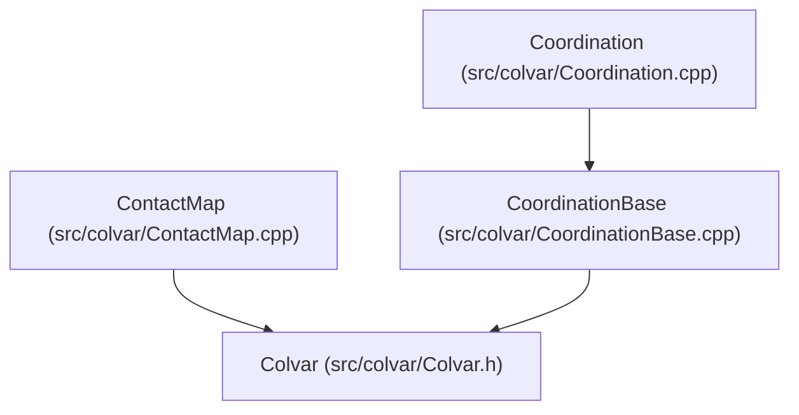
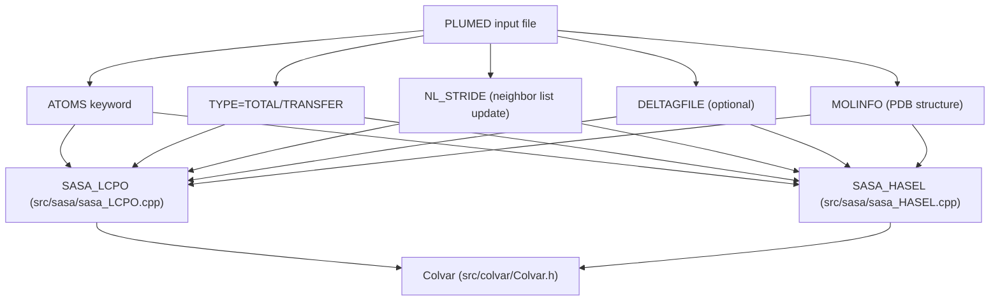

## Advanced Colvars: ContactMap and Coordination

In addition to the above modules, PLUMED provides advanced collective variables for integrative modeling and structural analysis:

- `ContactMap` ([src/colvar/ContactMap.cpp]()) computes a set of pairwise contacts between atom pairs, with support for custom switching functions, reference contact maps, and weighted sums.
- `Coordination` ([src/colvar/Coordination.cpp]()) computes the coordination number between two groups of atoms, using a smooth switching function.

These CVs are often used in combination with path-based CVs (e.g., `FuncPathMSD` in [src/function/FuncPathMSD.cpp]()) for advanced sampling and integrative modeling.

### Code Structure: ContactMap and Coordination



Sources: [src/colvar/ContactMap.cpp:1-366](), [src/colvar/Coordination.cpp:1-164](), [src/colvar/CoordinationBase.cpp:1-244](), [src/colvar/Colvar.h:1-100]()
# Specialized Modules

<details>
<summary>Relevant source files</summary>

The following files were used as context for generating this wiki page:

- [regtest/sasa/Makefile](regtest/sasa/Makefile)
- [src/colvar/ContactMap.cpp](src/colvar/ContactMap.cpp)
- [src/colvar/Coordination.cpp](src/colvar/Coordination.cpp)
- [src/colvar/CoordinationBase.cpp](src/colvar/CoordinationBase.cpp)
- [src/colvar/CoordinationBase.h](src/colvar/CoordinationBase.h)
- [src/colvar/DHEnergy.cpp](src/colvar/DHEnergy.cpp)
- [src/function/Combine.cpp](src/function/Combine.cpp)
- [src/function/Ensemble.cpp](src/function/Ensemble.cpp)
- [src/function/FuncPathMSD.cpp](src/function/FuncPathMSD.cpp)
- [src/function/LocalEnsemble.cpp](src/function/LocalEnsemble.cpp)
- [src/function/Piecewise.cpp](src/function/Piecewise.cpp)
- [src/function/Sort.cpp](src/function/Sort.cpp)
- [src/function/Stats.cpp](src/function/Stats.cpp)
- [src/membranefusion/COPYRIGHT](src/membranefusion/COPYRIGHT)
- [src/membranefusion/FusionPoreExpansionP.cpp](src/membranefusion/FusionPoreExpansionP.cpp)
- [src/membranefusion/FusionPoreNucleationP.cpp](src/membranefusion/FusionPoreNucleationP.cpp)
- [src/membranefusion/MemFusionP.cpp](src/membranefusion/MemFusionP.cpp)
- [src/sasa/Sasa.cpp](src/sasa/Sasa.cpp)
- [src/sasa/Sasa.h](src/sasa/Sasa.h)
- [src/sasa/module.type](src/sasa/module.type)
- [src/sasa/sasa_HASEL.cpp](src/sasa/sasa_HASEL.cpp)
- [src/sasa/sasa_LCPO.cpp](src/sasa/sasa_LCPO.cpp)
- [user-doc/bibliography.bib](user-doc/bibliography.bib)

</details>


This page documents specialized modules in PLUMED 2 that extend the core library with advanced or domain-specific features. These modules are typically not enabled by default and must be explicitly included during the build process.

## Overview

Specialized modules in PLUMED provide additional collective variables (CVs), biasing methods, or analysis tools for specific scientific applications. They are implemented as modular extensions to the core Action framework, and are loaded only if enabled at compile time.

### System-to-Code Mapping: Specialized Modules and Code Entities

Below is a diagram mapping the main specialized modules to their corresponding code entities (files, classes, or actions) in the PLUMED codebase.

```mermaid
flowchart TD
    subgraph "src/colvar"
        Colvar["Colvar.h/.cpp"]
        ContactMap["ContactMap.cpp"]
        Coordination["Coordination.cpp"]
        DHEnergy["DHEnergy.cpp"]
    end
    subgraph "src/function"
        Ensemble["Ensemble.cpp"]
        LocalEnsemble["LocalEnsemble.cpp"]
        Stats["Stats.cpp"]
        FuncPathMSD["FuncPathMSD.cpp"]
    end
    subgraph "src/sasa"
        SASA_LCPO["sasa_LCPO.cpp"]
        SASA_HASEL["sasa_HASEL.cpp"]
    end
    subgraph "src/membranefusion"
        MemFusionP["MemFusionP.cpp"]
        FusionPoreNucleationP["FusionPoreNucleationP.cpp"]
        FusionPoreExpansionP["FusionPoreExpansionP.cpp"]
    end

    Colvar --> ContactMap
    Colvar --> Coordination
    Colvar --> DHEnergy
    function --> Ensemble
    function --> LocalEnsemble
    function --> Stats
    function --> FuncPathMSD
    SASA_LCPO -->|Implements| "SASA_LCPO (Colvar)"
    SASA_HASEL -->|Implements| "SASA_HASEL (Colvar)"
    MemFusionP -->|Implements| "MEMFUSIONP (Colvar)"
    FusionPoreNucleationP -->|Implements| "FUSIONPORENUCLEATIONP (Colvar)"
    FusionPoreExpansionP -->|Implements| "FUSIONPOREEXPANSIONP (Colvar)"
```
Sources: [src/colvar/ContactMap.cpp:1-366](), [src/colvar/Coordination.cpp:1-164](), [src/colvar/DHEnergy.cpp:1-147](), [src/function/Ensemble.cpp:1-314](), [src/function/LocalEnsemble.cpp:1-162](), [src/function/Stats.cpp:1-262](), [src/function/FuncPathMSD.cpp:1-295](), [src/sasa/sasa_LCPO.cpp:1-424](), [src/sasa/sasa_HASEL.cpp:1-417](), [src/membranefusion/MemFusionP.cpp:1-200](), [src/membranefusion/FusionPoreNucleationP.cpp:1-200](), [src/membranefusion/FusionPoreExpansionP.cpp:1-200]()

## List of Specialized Modules

| Module Name      | Main Code Entities / Actions                | Purpose / Application Area                | Key Dependencies      |
|------------------|---------------------------------------------|-------------------------------------------|----------------------|
| SASA             | `SASA_LCPO`, `SASA_HASEL`                   | Solvent Accessible Surface Area (SASA)    | None                 |
| MEMBRANEFUSION   | `MEMFUSIONP`, `FUSIONPORENUCLEATIONP`, `FUSIONPOREEXPANSIONP` | Membrane fusion CVs                      | None                 |
| (Others, e.g. S2CM, FUNNEL, PYTORCH) | (Not detailed here; see other documentation) | NMR, ligand binding, ML, etc.            | (Varies)             |

This page focuses on the SASA and MEMBRANEFUSION modules, as well as advanced colvars such as `ContactMap` and `Coordination` that are often used in integrative modeling.

Sources: [src/sasa/sasa_LCPO.cpp:1-424](), [src/sasa/sasa_HASEL.cpp:1-417](), [src/membranefusion/MemFusionP.cpp:1-200](), [src/membranefusion/FusionPoreNucleationP.cpp:1-200](), [src/membranefusion/FusionPoreExpansionP.cpp:1-200](), [src/colvar/ContactMap.cpp:1-366](), [src/colvar/Coordination.cpp:1-164]()

## SASA Module

The SASA module provides two collective variables for calculating the solvent accessible surface area (SASA) of biomolecules:

- `SASA_LCPO`: Implements the Linear Combination of Pairwise Overlaps (LCPO) algorithm for accurate SASA calculation.
- `SASA_HASEL`: Implements the Hasel et al. algorithm for faster, approximate SASA calculation.

Both actions are implemented as subclasses of `Colvar` in [src/sasa/sasa_LCPO.cpp]() and [src/sasa/sasa_HASEL.cpp](). They require the user to specify the atoms of interest and a PDB file for atom/residue information.

### SASA Module: Code Structure and Usage



- `TYPE=TOTAL` computes the total SASA.
- `TYPE=TRANSFER` computes the free energy of transfer, optionally using a user-supplied file of transfer energies (`DELTAGFILE`).
- Both actions support neighbor list optimization via `NL_STRIDE`.

**Applications:**
- Use as a CV for enhanced sampling.
- Model transfer free energies for implicit solvent, temperature, pressure, or osmolyte effects.

Sources: [src/sasa/sasa_LCPO.cpp:1-424](), [src/sasa/sasa_HASEL.cpp:1-417]()


## MEMBRANEFUSION Module

The MEMBRANEFUSION module provides collective variables for simulating the process of membrane fusion, including stalk formation, pore nucleation, and pore expansion. The main actions are:

- `MEMFUSIONP`: Induces the formation of a hemifusion stalk.
- `FUSIONPORENUCLEATIONP`: Induces nucleation of a fusion pore from a stalk.
- `FUSIONPOREEXPANSIONP`: Induces expansion of a fusion pore.

### Membrane Fusion CVs: Process and Code Mapping

```mermaid
flowchart TD
    "InitialFlatMembranes"["Initial flat membranes"]
    "HemifusionStalk"["Hemifusion stalk"]
    "FusionPore"["Fusion pore"]
    "ExpandedPore"["Expanded pore"]

    "MEMFUSIONP (src/membranefusion/MemFusionP.cpp)" -->|Induces| "HemifusionStalk"
    "FUSIONPORENUCLEATIONP (src/membranefusion/FusionPoreNucleationP.cpp)" -->|Induces| "FusionPore"
    "FUSIONPOREEXPANSIONP (src/membranefusion/FusionPoreExpansionP.cpp)" -->|Induces| "ExpandedPore"

    "InitialFlatMembranes" --> "MEMFUSIONP (src/membranefusion/MemFusionP.cpp)"
    "HemifusionStalk" --> "FUSIONPORENUCLEATIONP (src/membranefusion/FusionPoreNucleationP.cpp)"
    "FusionPore" --> "FUSIONPOREEXPANSIONP (src/membranefusion/FusionPoreExpansionP.cpp)"
```

**Required atom groups** (as input keywords): `UMEMBRANE`, `LMEMBRANE`, `TAILS`, `WATERS`, `PHOSPHATEOXYGENS`.

These CVs are implemented as subclasses of `Colvar` and are designed for use with coarse-grained or atomistic membrane models.

Sources: [src/membranefusion/MemFusionP.cpp:1-200](), [src/membranefusion/FusionPoreNucleationP.cpp:1-200](), [src/membranefusion/FusionPoreExpansionP.cpp:1-200]()


## Enabling and Using Specialized Modules

To use specialized modules, they must be explicitly enabled during the PLUMED compilation process. This is done using the `--enable-modules` flag with the `configure` script:

```
./configure --enable-modules=sasa,funnel,pytorch
```

Some modules have additional dependencies:
- PYTORCH requires LibTorch library and must be enabled with `--enable-libtorch`

Once compiled with the appropriate modules, the new functionality can be used in PLUMED input files just like built-in actions.

## Example: Combining Multiple Specialized Modules

A complex study might combine multiple specialized modules. For example, a protein-ligand binding study using machine learning could use:

```
# Calculate SASA of binding pocket
SASA_LCPO TYPE=TOTAL ATOMS=10-45 LABEL=pocket_sasa

# Track ligand position with funnel CV
lig: COM ATOMS=100-110
fps: FUNNEL_PS REFERENCE=protein.pdb LIGAND=lig POINTS=5.3,0.7,2.4,7.3,6.7,-9.3

# Apply neural network model to combined features
model: PYTORCH_MODEL FILE=binding_model.ptc ARG=pocket_sasa,fps.lp,fps.ld

# Use model output for biasing
METAD ARG=model.node-0 SIGMA=0.1 HEIGHT=0.5 PACE=500 LABEL=meta
```

This example combines SASA calculations, funnel-metadynamics positioning, and PyTorch-based machine learning to create an advanced sampling approach.

Sources: [CHANGES/v2.6.md:1-100]()

---