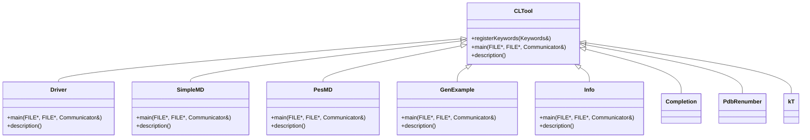
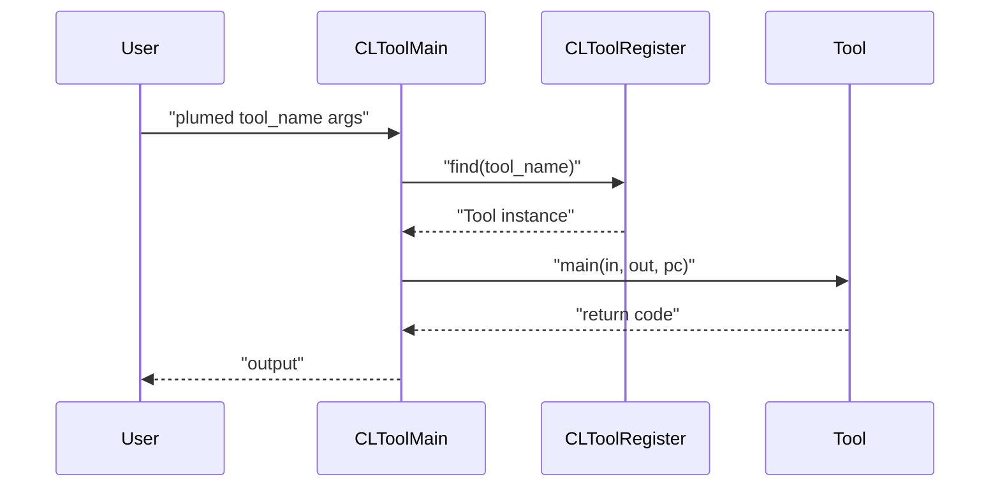
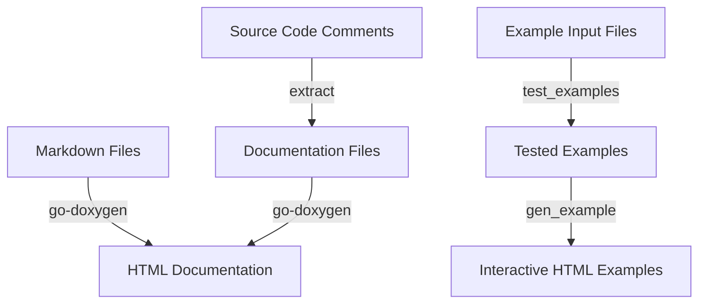
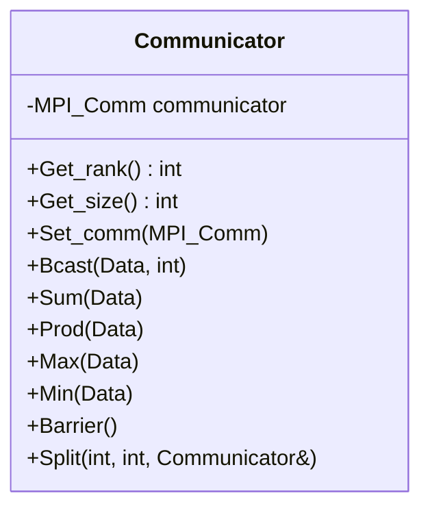
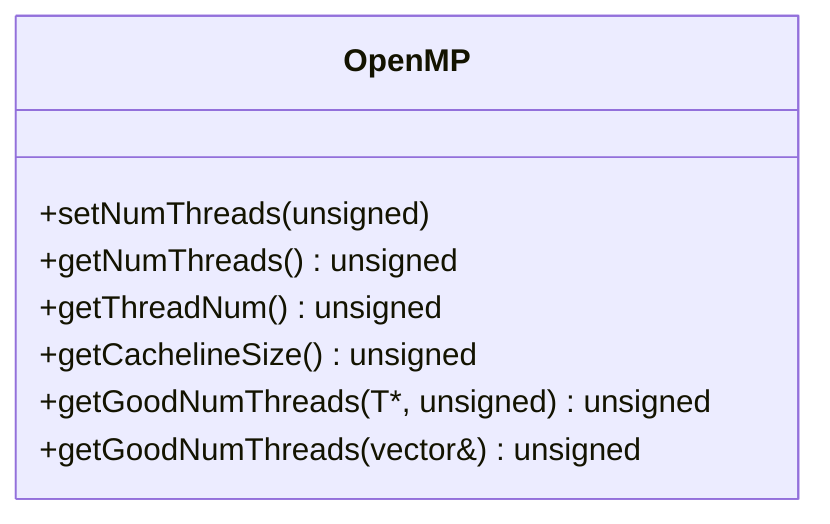
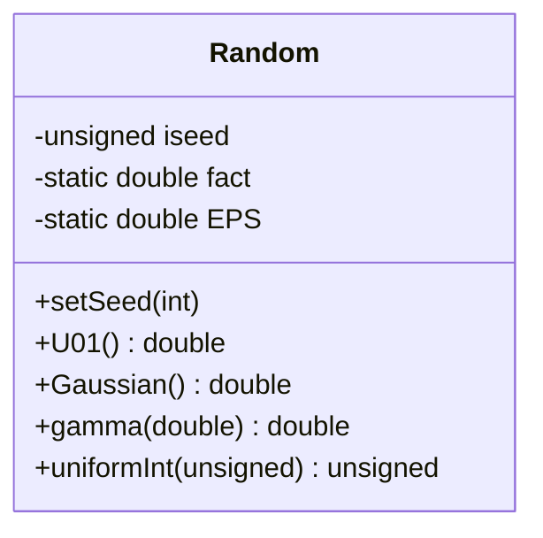

# Tools and Utilities

<details>
<summary>Relevant source files</summary>

The following files were used as context for generating this wiki page:

- [regtest/basic/rt-errormessages/Makefile](regtest/basic/rt-errormessages/Makefile)
- [regtest/basic/rt-errormessages/config](regtest/basic/rt-errormessages/config)
- [regtest/basic/rt-errormessages/output.reference](regtest/basic/rt-errormessages/output.reference)
- [regtest/basic/rt-errormessages/testWALKERS_MPI.cpp](regtest/basic/rt-errormessages/testWALKERS_MPI.cpp)
- [regtest/basic/rt42d/Makefile](regtest/basic/rt42d/Makefile)
- [regtest/basic/rt42d/colvar.reference](regtest/basic/rt42d/colvar.reference)
- [regtest/basic/rt42d/config](regtest/basic/rt42d/config)
- [regtest/basic/rt42d/ff.reference](regtest/basic/rt42d/ff.reference)
- [regtest/basic/rt42d/plumed.dat](regtest/basic/rt42d/plumed.dat)
- [regtest/basic/rt42d/trajectory.xyz](regtest/basic/rt42d/trajectory.xyz)
- [regtest/mapping/rt-adapt-alt-rmsd/out-path.pdb.reference](regtest/mapping/rt-adapt-alt-rmsd/out-path.pdb.reference)
- [regtest/mapping/rt-pathtools-1/mypath.pdb.reference](regtest/mapping/rt-pathtools-1/mypath.pdb.reference)
- [regtest/mapping/rt-pathtools-2/mypath.pdb.reference](regtest/mapping/rt-pathtools-2/mypath.pdb.reference)
- [regtest/mapping/rt-pathtools-3/path-out.pdb.reference](regtest/mapping/rt-pathtools-3/path-out.pdb.reference)
- [src/bias/MaxEnt.cpp](src/bias/MaxEnt.cpp)
- [src/cltools/Driver.cpp](src/cltools/Driver.cpp)
- [src/cltools/SimpleMD.cpp](src/cltools/SimpleMD.cpp)
- [src/cltools/pesmd.cpp](src/cltools/pesmd.cpp)
- [src/colvar/ColvarInput.cpp](src/colvar/ColvarInput.cpp)
- [src/colvar/ColvarInput.h](src/colvar/ColvarInput.h)
- [src/colvar/Dimer.cpp](src/colvar/Dimer.cpp)
- [src/core/CLTool.cpp](src/core/CLTool.cpp)
- [src/generic/DumpPDB.cpp](src/generic/DumpPDB.cpp)
- [src/gridtools/IntegrateGrid.cpp](src/gridtools/IntegrateGrid.cpp)
- [src/mapping/AdaptivePath.cpp](src/mapping/AdaptivePath.cpp)
- [src/mapping/PathReparameterization.cpp](src/mapping/PathReparameterization.cpp)
- [src/mapping/PathTools.cpp](src/mapping/PathTools.cpp)
- [src/tools/ColvarOutput.h](src/tools/ColvarOutput.h)
- [src/tools/Communicator.cpp](src/tools/Communicator.cpp)
- [src/tools/Communicator.h](src/tools/Communicator.h)
- [src/tools/Pbc.cpp](src/tools/Pbc.cpp)
- [src/tools/Pbc.h](src/tools/Pbc.h)
- [src/tools/SwitchingFunction.cpp](src/tools/SwitchingFunction.cpp)
- [src/tools/SwitchingFunction.h](src/tools/SwitchingFunction.h)
- [src/tools/Tools.cpp](src/tools/Tools.cpp)
- [src/tools/Tools.h](src/tools/Tools.h)
- [src/tools/View.cpp](src/tools/View.cpp)
- [src/tools/View2D.cpp](src/tools/View2D.cpp)
- [src/volumes/VolumeInSphere.cpp](src/volumes/VolumeInSphere.cpp)

</details>


This document describes the command-line tools and utilities provided by PLUMED for various tasks including analyzing molecular dynamics trajectories, running simulations, and generating documentation. These tools complement the core PLUMED functionality and help users perform common tasks efficiently.

## Command Line Tool Architecture

PLUMED implements a consistent architecture for all its command line tools. Each tool extends the `CLTool` base class and registers itself with the system for discovery and execution.

### Command Line Tool Class Hierarchy



Sources: [src/cltools/Driver.cpp:182-192](), [src/cltools/SimpleMD.cpp:84-124](), [src/cltools/GenExample.cpp:65-79](), [src/cltools/Info.cpp:46-54](), [src/cltools/pesmd.cpp:97-115]()

### Command Line Tool Execution Flow

When a user invokes a PLUMED command-line tool, the following sequence occurs:



Sources: [src/cltools/Driver.cpp:182-243](), [src/cltools/SimpleMD.cpp:441-445](), [src/cltools/GenExample.cpp:102-115](), [src/cltools/Info.cpp:77-115]()

## Main Command Line Tools

PLUMED provides several powerful command-line tools for different purposes:

| Tool | Description |
|------|-------------|
| driver | Post-process trajectories with PLUMED |
| driver-float | Same as driver but using single precision |
| simplemd | Run molecular dynamics on Lennard-Jones systems |
| pesmd | Do Langevin dynamics on a potential energy surface |
| gen_example | Construct examples for the manual |
| info | Get information about the PLUMED installation |
| completion | Command line completion |
| pdbrenumber | Manipulate PDB files |
| kt | Convert between temperature and energy units |

Sources: [src/cltools/Driver.cpp:47-180](), [src/cltools/SimpleMD.cpp:37-72](), [src/cltools/pesmd.cpp:33-91](), [src/cltools/GenExample.cpp:43-62](), [src/cltools/Info.cpp:32-44]()

### driver

The `driver` tool allows post-processing of trajectories with PLUMED. It reads various trajectory formats (XYZ, GRO, XTC, TRR, DCD, etc.) and applies PLUMED calculations to them.

Example usage:
```
plumed driver --plumed plumed.dat --ixyz trajectory.xyz
```

Key features:
- Supports multiple trajectory formats
- Can apply PLUMED bias forces
- Can output biased forces and energy
- Supports parallel processing with MPI
- Handles different unit systems

Sources: [src/cltools/Driver.cpp:69-180](), [src/cltools/Driver.cpp:242-505]()

### simplemd

The `simplemd` tool runs molecular dynamics simulations on systems of Lennard-Jones atoms, providing a simple test system to experiment with.

Example usage:
```
plumed simplemd < input
```

Key features:
- Performs MD on Lennard-Jones particles
- Supports NVE and NVT (Langevin) ensembles
- Outputs trajectories and energy statistics
- Handles periodic boundary conditions

Sources: [src/cltools/SimpleMD.cpp:37-72](), [src/cltools/SimpleMD.cpp:126-441]()

### pesmd

The `pesmd` tool performs Langevin dynamics on a two-dimensional potential energy surface defined in a PLUMED input file.

Example usage:
```
plumed pesmd < input
```

Key features:
- Performs Langevin dynamics on potential energy surfaces
- Can use any PLUMED-defined potential
- Useful for studying dynamics on free energy surfaces

Sources: [src/cltools/pesmd.cpp:33-91](), [src/cltools/pesmd.cpp:124-270]()

### info

The `info` tool provides information about the PLUMED installation.

Example usage:
```
plumed info --root
```

Key options:
- `--root`: Print the location of the root directory
- `--user-doc`: Print the location of the user manual
- `--version`: Print the version number
- `--include-dir`: Print the location of the include directory

Sources: [src/cltools/Info.cpp:32-44](), [src/cltools/Info.cpp:59-76]()

## Documentation System

PLUMED includes a sophisticated documentation system that extracts information from source code comments and generates comprehensive user documentation.

### Documentation Generation Flow



Sources: [user-doc/extract:1-100](), [user-doc/go-doxygen:1-50](), [user-doc/test_examples:1-50]()

### Documentation Tools

PLUMED uses several specialized tools for generating and maintaining documentation:

| Tool | Description |
|------|-------------|
| extract | Extracts documentation from source code comments |
| go-doxygen | Generates HTML documentation using Doxygen |
| test_examples | Tests PLUMED examples in documentation |
| report_errors | Reports errors found in documentation |
| go-spelling | Checks spelling in documentation files |

Sources: [user-doc/extract:1-100](), [user-doc/go-doxygen:1-50](), [user-doc/test_examples:1-50](), [user-doc/report_errors:1-30](), [user-doc/go-spelling:1-50]()

#### extract

The `extract` tool parses C++ source files to extract the documentation comments and organizes them into categories. It can identify:

- PLUMED actions and their documentation
- Keywords and their documentation
- Example usage and test inputs

```
./extract
```

This generates files in the `automatic` directory that are later used by the Doxygen system.

Sources: [user-doc/extract:1-100](), [user-doc/extract:200-300]()

#### gen_example

The `gen_example` tool creates interactive HTML examples for the user manual. These examples allow users to see both the input syntax and explanations of what each action calculates.

```
plumed gen_example --plumed example.dat --status working
```

Sources: [src/cltools/GenExample.cpp:43-62](), [src/cltools/GenExample.cpp:102-215]()

## Utility Libraries

PLUMED provides several utility libraries that support the command-line tools and the core framework.

### Communicator for MPI

The `Communicator` class provides wrappers for MPI functions, making it easier to use MPI within PLUMED:



Sources: [src/tools/Communicator.h:52-200](), [src/tools/Communicator.cpp:29-100]()

### OpenMP Parallelization

The `OpenMP` namespace provides functions for thread-based parallelization:



Sources: [src/tools/OpenMP.h:29-73](), [src/tools/OpenMP.cpp:22-50]()

### Random Number Generation

The `Random` class provides random number generation capabilities used in stochastic simulations:



Sources: [src/tools/Random.h:28-50](), [src/tools/Random.cpp:30-50]()

## Command Line Tool Implementation Pattern

PLUMED command line tools follow a consistent implementation pattern:

1. Tools derive from the `CLTool` base class
2. Tools register keywords using `registerKeywords` static method
3. Tools implement a `main` method that contains the core functionality
4. Tools register themselves using `PLUMED_REGISTER_CLTOOL`

This pattern makes it easy to add new command line tools to the PLUMED system while ensuring consistency in the interface and behavior.

Sources: [src/cltools/Driver.cpp:195-240](), [src/cltools/SimpleMD.cpp:98-140](), [src/cltools/GenExample.cpp:83-100]()

---