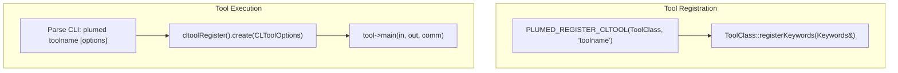
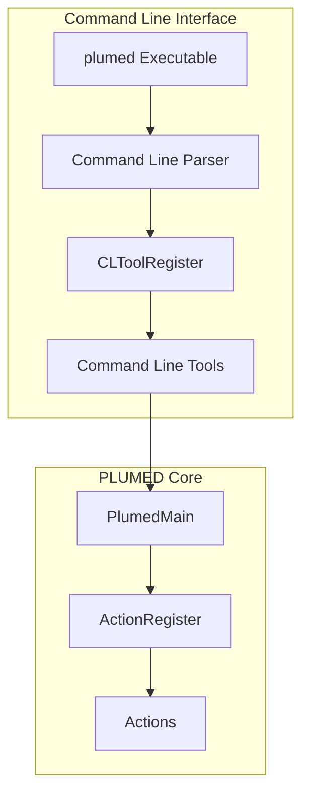
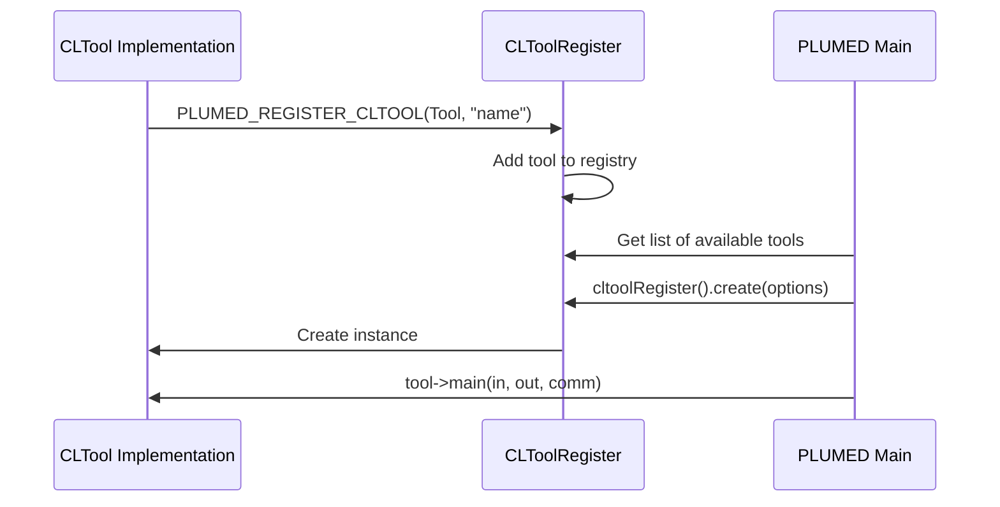
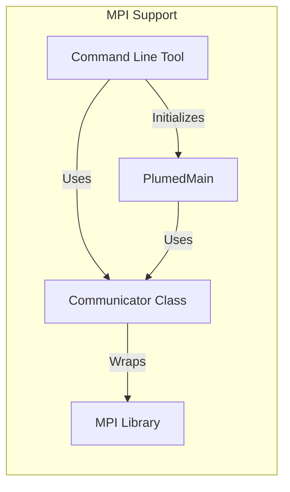

# Command Line Tools

<details>
<summary>Relevant source files</summary>

The following files were used as context for generating this wiki page:

- [regtest/basic/rt-errormessages/Makefile](regtest/basic/rt-errormessages/Makefile)
- [regtest/basic/rt-errormessages/config](regtest/basic/rt-errormessages/config)
- [regtest/basic/rt-errormessages/output.reference](regtest/basic/rt-errormessages/output.reference)
- [regtest/basic/rt-errormessages/testWALKERS_MPI.cpp](regtest/basic/rt-errormessages/testWALKERS_MPI.cpp)
- [regtest/basic/rt-sum-hills-overflow/HILLS](regtest/basic/rt-sum-hills-overflow/HILLS)
- [regtest/basic/rt-sum-hills-overflow/Makefile](regtest/basic/rt-sum-hills-overflow/Makefile)
- [regtest/basic/rt-sum-hills-overflow/config](regtest/basic/rt-sum-hills-overflow/config)
- [regtest/basic/rt-sum-hills-overflow/fes.dat.reference](regtest/basic/rt-sum-hills-overflow/fes.dat.reference)
- [regtest/mapping/rt-adapt-alt-rmsd/out-path.pdb.reference](regtest/mapping/rt-adapt-alt-rmsd/out-path.pdb.reference)
- [regtest/mapping/rt-pathtools-1/mypath.pdb.reference](regtest/mapping/rt-pathtools-1/mypath.pdb.reference)
- [regtest/mapping/rt-pathtools-2/mypath.pdb.reference](regtest/mapping/rt-pathtools-2/mypath.pdb.reference)
- [regtest/mapping/rt-pathtools-3/path-out.pdb.reference](regtest/mapping/rt-pathtools-3/path-out.pdb.reference)
- [src/bias/ABMD.cpp](src/bias/ABMD.cpp)
- [src/bias/BiasValue.cpp](src/bias/BiasValue.cpp)
- [src/bias/External.cpp](src/bias/External.cpp)
- [src/bias/LWalls.cpp](src/bias/LWalls.cpp)
- [src/bias/MaxEnt.cpp](src/bias/MaxEnt.cpp)
- [src/bias/MetaD.cpp](src/bias/MetaD.cpp)
- [src/bias/MovingRestraint.cpp](src/bias/MovingRestraint.cpp)
- [src/bias/PBMetaD.cpp](src/bias/PBMetaD.cpp)
- [src/bias/Restraint.cpp](src/bias/Restraint.cpp)
- [src/bias/UWalls.cpp](src/bias/UWalls.cpp)
- [src/cltools/Driver.cpp](src/cltools/Driver.cpp)
- [src/cltools/SimpleMD.cpp](src/cltools/SimpleMD.cpp)
- [src/cltools/SumHills.cpp](src/cltools/SumHills.cpp)
- [src/cltools/pesmd.cpp](src/cltools/pesmd.cpp)
- [src/colvar/Dimer.cpp](src/colvar/Dimer.cpp)
- [src/colvar/Fake.cpp](src/colvar/Fake.cpp)
- [src/core/CLTool.cpp](src/core/CLTool.cpp)
- [src/core/FlexibleBin.cpp](src/core/FlexibleBin.cpp)
- [src/core/FlexibleBin.h](src/core/FlexibleBin.h)
- [src/function/FuncSumHills.cpp](src/function/FuncSumHills.cpp)
- [src/generic/DumpPDB.cpp](src/generic/DumpPDB.cpp)
- [src/gridtools/IntegrateGrid.cpp](src/gridtools/IntegrateGrid.cpp)
- [src/mapping/AdaptivePath.cpp](src/mapping/AdaptivePath.cpp)
- [src/mapping/PathReparameterization.cpp](src/mapping/PathReparameterization.cpp)
- [src/mapping/PathTools.cpp](src/mapping/PathTools.cpp)
- [src/tools/BiasRepresentation.cpp](src/tools/BiasRepresentation.cpp)
- [src/tools/BiasRepresentation.h](src/tools/BiasRepresentation.h)
- [src/tools/Communicator.cpp](src/tools/Communicator.cpp)
- [src/tools/Communicator.h](src/tools/Communicator.h)
- [src/tools/Grid.cpp](src/tools/Grid.cpp)
- [src/tools/Grid.h](src/tools/Grid.h)

</details>


This page documents the command-line tools provided by PLUMED. These tools are standalone utilities invoked via the `plumed` executable, e.g., `plumed driver --plumed plumed.dat --ixyz trajectory.xyz`. They support tasks such as trajectory analysis, free energy surface reconstruction, simple MD simulations, and utility operations.

For information on using PLUMED as a library or with external MD codes, see the PLUMED Interface documentation ([2.2]()).

---

## Command Line Tool System Architecture

PLUMED command-line tools are implemented as plugins that inherit from the `CLTool` base class. Each tool registers itself with the `CLToolRegister` singleton, which manages tool discovery and instantiation.

### Diagram: Command Line Tool Class Structure

```mermaid
classDiagram
    class "CLTool" {
        <<Abstract>>
        +registerKeywords(Keywords&)
        +parse(string)
        +main(FILE*, FILE*, Communicator&)
    }
    class "CLToolRegister" {
        +cltoolRegister(): CLToolRegister&
        +create(CLToolOptions): unique_ptr<CLTool>
        +get(string): CLTool&
        +list(): vector<string>
    }
    class "Driver" {
        +registerKeywords(Keywords&)
        +main(FILE*, FILE*, Communicator&)
        +evaluateNumericalDerivatives()
    }
    class "SimpleMD" {
        +registerKeywords(Keywords&)
        +main(FILE*, FILE*, Communicator&)
    }
    class "PesMD" {
        +registerKeywords(Keywords&)
        +main(FILE*, FILE*, Communicator&)
    }
    class "SumHills" {
        +registerKeywords(Keywords&)
        +main(FILE*, FILE*, Communicator&)
    }
    class "Info" {
        +registerKeywords(Keywords&)
        +main(FILE*, FILE*, Communicator&)
    }
    Driver --|> CLTool
    SimpleMD --|> CLTool
    PesMD --|> CLTool
    SumHills --|> CLTool
    Info --|> CLTool
    CLToolRegister --o CLTool : creates
```

Sources: [src/core/CLTool.cpp:38-46](), [src/core/CLToolRegister.h:58-70](), [src/core/CLToolRegister.cpp:31-34]()

---

### Diagram: Tool Registration and Execution Flow



Sources: [src/core/CLToolRegister.cpp:44-63](), [src/core/CLTool.cpp:38-46]()

---

### Bridging System Names to Code Entities

The following diagram maps the main command-line tool names to their code entities:

```mermaid
flowchart TD
    "plumed driver" -->|"Driver"| "src/cltools/Driver.cpp"
    "plumed sum_hills" -->|"SumHills"| "src/cltools/SumHills.cpp"
    "plumed simplemd" -->|"SimpleMD"| "src/cltools/SimpleMD.cpp"
    "plumed pesmd" -->|"PesMD"| "src/cltools/pesmd.cpp"
    "plumed info" -->|"Info"| "src/cltools/Info.cpp"
    "plumed pathtools" -->|"PathTools"| "src/mapping/PathTools.cpp"
```

Sources: [src/cltools/Driver.cpp:69-180](), [src/cltools/SumHills.cpp:41-85](), [src/cltools/SimpleMD.cpp:37-72](), [src/cltools/pesmd.cpp:33-91](), [src/cltools/Info.cpp:32-44](), [src/mapping/PathTools.cpp:41-100]()

---

All command-line tools define their accepted options using the `Keywords` system, which is used for parsing and validation.

Sources: [src/core/CLTool.cpp:38-46](), [src/core/CLToolRegister.cpp:44-63]()

## Major Command Line Tools

The following table summarizes the main command-line tools provided by PLUMED, their primary purposes, and the key source files:

| Tool Name      | Purpose                                      | Key Source File(s)                |
|----------------|----------------------------------------------|-----------------------------------|
| driver         | Trajectory analysis and post-processing      | [src/cltools/Driver.cpp]()        |
| sum_hills      | Free energy surface reconstruction           | [src/cltools/SumHills.cpp]()      |
| simplemd       | Simple Lennard-Jones MD simulation           | [src/cltools/SimpleMD.cpp]()      |
| pesmd          | Langevin dynamics on arbitrary potentials    | [src/cltools/pesmd.cpp]()         |
| info           | Query PLUMED installation/configuration      | [src/cltools/Info.cpp]()          |
| pathtools      | Path construction and manipulation           | [src/mapping/PathTools.cpp]()     |

Sources: [src/cltools/Driver.cpp:47-65](), [src/cltools/SumHills.cpp:41-85](), [src/cltools/SimpleMD.cpp:37-72](), [src/cltools/pesmd.cpp:33-91](), [src/cltools/Info.cpp:32-44](), [src/mapping/PathTools.cpp:41-100]()

---

### Driver

The `driver` tool is used for post-processing molecular dynamics trajectories with PLUMED. It can compute collective variables, apply biases, and analyze trajectories after simulation.

#### Diagram: "driver" Tool Workflow

```mermaid
flowchart TD
    "ReadInput"["Read Input (--plumed plumed.dat)"]
    "ReadTraj"["Read Trajectory (--ixyz file.xyz, etc.)"]
    "InitPlumed"["Initialize PlumedMain"]
    "Loop"["Loop Over Trajectory Frames"]
    "SetPositions"["Set Atomic Positions"]
    "CalcForces"["Calculate via plumed.dat"]
    "Output"["Output Results"]

    "ReadInput" --> "InitPlumed"
    "ReadTraj" --> "Loop"
    "InitPlumed" --> "Loop"
    "Loop" --> "SetPositions"
    "SetPositions" --> "CalcForces"
    "CalcForces" --> "Output"
    "Output" --> "Loop"
```

Key features:
- Supports multiple trajectory formats (xyz, gro, xtc, trr, etc.)
- Handles units, periodic boundary conditions, and MPI parallelization
- Can restart from checkpoints and calculate numerical derivatives

Example:
```
plumed driver --plumed plumed.dat --ixyz trajectory.xyz
```

Sources: [src/cltools/Driver.cpp:69-180](), [src/cltools/Driver.cpp:242-392]()

---

### SumHills

The `sum_hills` tool reconstructs free energy surfaces from HILLS files generated by metadynamics or related methods.

#### Diagram: "sum_hills" Tool Data Flow

```mermaid
flowchart TD
    "ReadHILLS"["Read HILLS File(s)"]
    "ParseKernels"["Parse Gaussian Kernels"]
    "SetupGrid"["Setup Output Grid"]
    "SumKernels"["Sum Kernels on Grid"]
    "OutputFES"["Output Free Energy Surface (fes.dat)"]

    "ReadHILLS" --> "ParseKernels"
    "ParseKernels" --> "SetupGrid"
    "SetupGrid" --> "SumKernels"
    "SumKernels" --> "OutputFES"
```

Key features:
- Supports multiple HILLS files and flexible kernel types
- Can integrate out variables and handle periodicity
- Outputs FES in grid format

Example:
```
plumed sum_hills --hills HILLS
```

Sources: [src/cltools/SumHills.cpp:41-85](), [src/function/FuncSumHills.cpp:37-236]()

---

### SimpleMD

The `simplemd` tool is a minimal MD engine for Lennard-Jones systems, useful for testing and educational purposes.

#### Diagram: "simplemd" Tool Workflow

```mermaid
flowchart TD
    "Config"["Read Configuration (inputfile, temperature, etc.)"]
    "Init"["Initialize Positions and Velocities"]
    "MDLoop"["MD Loop"]
    "CalcForces"["Compute Forces (LJ)"]
    "Integration"["Velocity Verlet Integration"]
    "Thermostat"["Apply Langevin Thermostat"]
    "Plumed"["Apply PLUMED Biases"]
    "Output"["Write Outputs"]

    "Config" --> "Init"
    "Init" --> "MDLoop"
    "MDLoop" --> "CalcForces"
    "CalcForces" --> "Plumed"
    "Plumed" --> "Integration"
    "Integration" --> "Thermostat"
    "Thermostat" --> "Output"
    "Output" --> "MDLoop"
```

Key features:
- Lennard-Jones potential, velocity Verlet, Langevin thermostat
- Neighbor list optimization
- Trajectory/statistics output
- PLUMED bias integration

Example:
```
plumed simplemd < input
```

Sources: [src/cltools/SimpleMD.cpp:37-72](), [src/cltools/SimpleMD.cpp:98-117](), [src/cltools/SimpleMD.cpp:126-438]()

---

### PesMD

The `pesmd` tool runs Langevin dynamics on arbitrary potential energy surfaces defined via PLUMED input.

#### Diagram: "pesmd" Tool Workflow

```mermaid
flowchart TD
    "Config"["Read Input (dimension, temperature, etc.)"]
    "InitPlumed"["Initialize PlumedMain"]
    "MDLoop"["MD Loop"]
    "GetForces"["Get Forces from PLUMED"]
    "Langevin"["Apply Langevin Dynamics"]
    "Output"["Write Statistics"]

    "Config" --> "InitPlumed"
    "InitPlumed" --> "MDLoop"
    "MDLoop" --> "GetForces"
    "GetForces" --> "Langevin"
    "Langevin" --> "Output"
    "Output" --> "MDLoop"
```

Key features:
- Arbitrary potential surfaces via PLUMED input
- Langevin integrator, periodic domains, any dimension

Example:
```
plumed pesmd < input
```

Sources: [src/cltools/pesmd.cpp:33-91](), [src/cltools/pesmd.cpp:177-347]()

---

### Info

The `info` tool provides information about the PLUMED installation, such as root directory, documentation location, and build configuration.

Example:
```
plumed info --root
plumed info --user-doc
plumed info --configuration
```

Sources: [src/cltools/Info.cpp:32-44](), [src/cltools/Info.cpp:59-63]()

---

### Pathtools

The `pathtools` utility assists in constructing and manipulating path collective variables, such as reparameterizing paths or generating linear paths between frames.

Example:
```
plumed pathtools --path in_path.pdb --out final_path.pdb
```

Sources: [src/mapping/PathTools.cpp:41-100]()


## Utility Tools

PLUMED provides several utility tools for various tasks:

### Info

The `info` tool provides information about your PLUMED installation:

```
plumed info --root               # Shows PLUMED installation directory
plumed info --user-doc           # Shows location of user documentation
plumed info --configuration      # Shows build configuration
```

Sources: [src/cltools/Info.cpp:32-44](). [src/cltools/Info.cpp:59-63]().

### GenJson

This tool generates JSON files describing all available PLUMED actions and their options. It's used primarily for documentation purposes:

```
plumed --no-mpi gen_json --actions action_list > syntax.json
```

Sources: [src/cltools/GenJson.cpp:37-54](). [src/cltools/GenJson.cpp:72-75]().

### Other Utilities

PLUMED includes several other specialized utility tools:

- **PdbRenumber**: Renumbers atoms in PDB files for compatibility with PLUMED
- **kT**: Converts between temperature and energy units
- **GenTemplate**: Generates template input files for PLUMED actions
- **Completion**: Provides command-line completion for PLUMED commands

## Command Line Tool Architecture

The following diagram shows how the command line tools interact with the PLUMED core:



Sources: [src/core/CLToolRegister.cpp:44-63](). [src/core/CLTool.cpp:22-46]().

## How Command Line Tools are Registered

PLUMED uses a registration system to make command line tools available. Each tool registers itself with the `CLToolRegister` singleton:



Sources: [src/core/CLToolRegister.h:90-100](). [src/core/CLToolRegister.cpp:30-63]().

## Table of Major Command Line Tools

| Tool Name  | Primary Purpose | Key Files |
|------------|----------------|-----------|
| driver     | Process trajectory files with PLUMED | [src/cltools/Driver.cpp]() |
| driver-float | Single-precision version of driver | [src/cltools/Driver.cpp]() |
| benchmark  | Performance testing without I/O overhead | [src/cltools/Benchmark.cpp]() |
| simplemd   | Simple MD engine for Lennard-Jones systems | [src/cltools/SimpleMD.cpp]() |
| pesmd      | Langevin dynamics on analytical potentials | [src/cltools/pesmd.cpp]() |
| info       | Get information about PLUMED installation | [src/cltools/Info.cpp]() |
| gen_json   | Generate JSON documentation of actions | [src/cltools/GenJson.cpp]() |

Sources: [src/cltools/Driver.cpp:47-65](). [src/cltools/Benchmark.cpp:48-163](). [src/cltools/SimpleMD.cpp:37-72](). [src/cltools/pesmd.cpp:33-91](). [src/cltools/Info.cpp:32-44](). [src/cltools/GenJson.cpp:37-54]().

## MPI Support in Command Line Tools

Many PLUMED command line tools support MPI parallelization through the PLUMED Communicator class:



Each command line tool can use MPI differently:
- **Driver**: Can distribute frames across processes or use domain decomposition
- **Benchmark**: Can emulate domain decomposition for performance testing
- **SimpleMD**: Can parallelize force calculations with OpenMP

Sources: [src/tools/Communicator.cpp:29-46](). [src/tools/Communicator.cpp:59-77](). [src/tools/Communicator.h:50-80]().

## Summary

PLUMED's command line tools provide a diverse set of utilities for running simulations, analyzing trajectories, and working with the PLUMED framework. The architecture is based on a plugin system that allows for easy extension with new tools. The most frequently used tools are `driver` for trajectory analysis and `info` for getting information about the PLUMED installation.

---