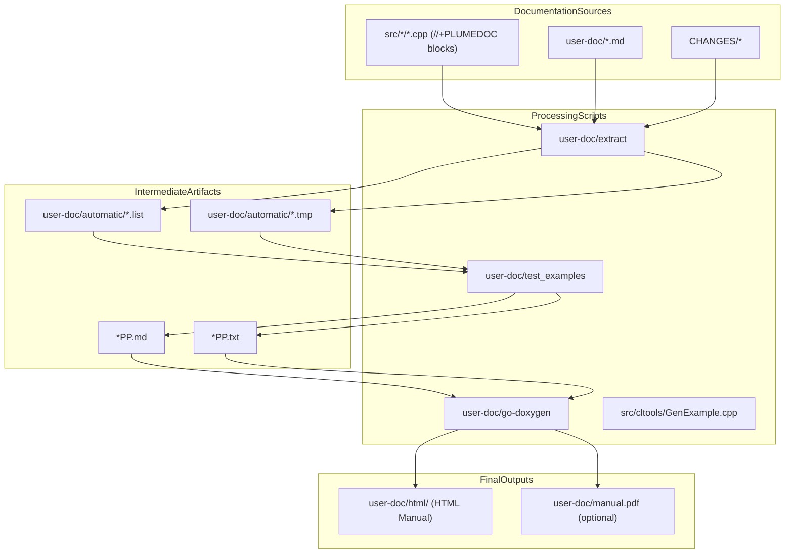
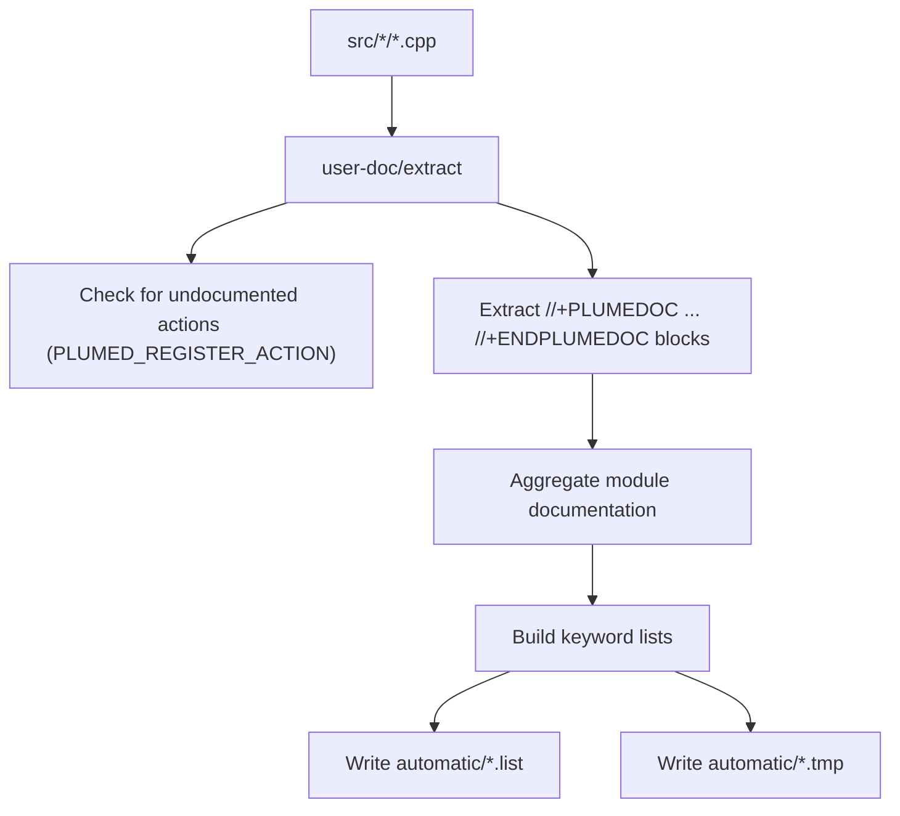
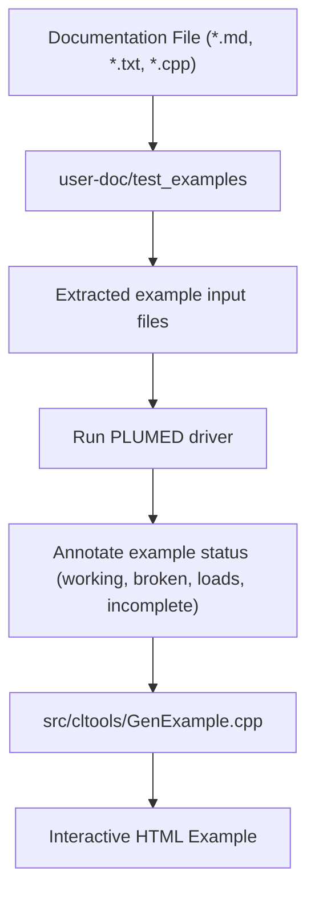
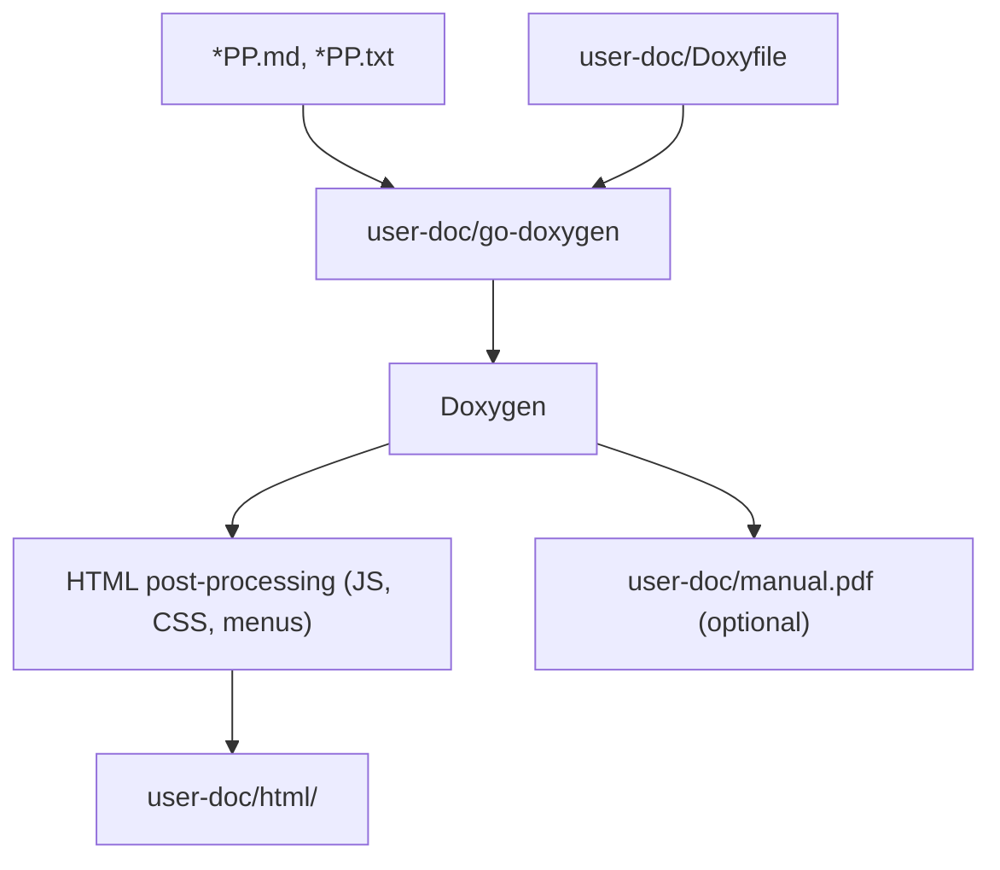
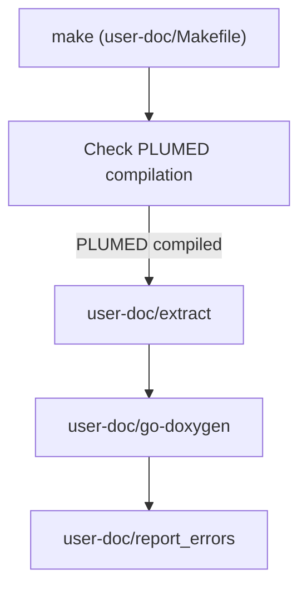

# Documentation System

<details>
<summary>Relevant source files</summary>

The following files were used as context for generating this wiki page:

- [src/cltools/GenExample.cpp](src/cltools/GenExample.cpp)
- [src/generic/EffectiveEnergyDrift.cpp](src/generic/EffectiveEnergyDrift.cpp)
- [src/tools/OpenMP.cpp](src/tools/OpenMP.cpp)
- [src/tools/OpenMP.h](src/tools/OpenMP.h)
- [src/tools/Random.cpp](src/tools/Random.cpp)
- [src/tools/Random.h](src/tools/Random.h)
- [user-doc/.gitignore](user-doc/.gitignore)
- [user-doc/Doxyfile](user-doc/Doxyfile)
- [user-doc/Makefile](user-doc/Makefile)
- [user-doc/PlumedLayout.xml](user-doc/PlumedLayout.xml)
- [user-doc/basic.list](user-doc/basic.list)
- [user-doc/extract](user-doc/extract)
- [user-doc/go-doxygen](user-doc/go-doxygen)
- [user-doc/go-spelling](user-doc/go-spelling)
- [user-doc/plumed-syntax.awk](user-doc/plumed-syntax.awk)
- [user-doc/report_errors](user-doc/report_errors)
- [user-doc/spelling_words.dict](user-doc/spelling_words.dict)
- [user-doc/test_examples](user-doc/test_examples)

</details>


## Purpose and Scope

This page documents the automated documentation system in PLUMED. It explains how documentation is extracted from source code and markdown, how examples are tested and annotated, and how the final HTML and PDF manuals are generated. The focus is on the technical pipeline and code-level integration, not on the content of the documentation itself. For user-facing tool documentation, see page 5.1.

---

## High-Level Documentation Generation Pipeline

PLUMED's documentation is generated from a combination of C++ source code comments, markdown files, and change logs. The process is orchestrated by scripts and tools that extract, test, and assemble documentation into HTML and PDF outputs using Doxygen.

**Pipeline Overview Diagram**



**Mapping of System Names to Code Entities:**

| System Component         | Code Entity / File Path                |
|-------------------------|----------------------------------------|
| Documentation Extractor | `user-doc/extract`                     |
| Example Tester          | `user-doc/test_examples`               |
| Doxygen Runner          | `user-doc/go-doxygen`                  |
| Interactive Example Gen | `src/cltools/GenExample.cpp`           |
| Doxygen Config          | `user-doc/Doxyfile`                    |
| Spelling Checker        | `user-doc/go-spelling`                 |
| Error Reporter          | `user-doc/report_errors`               |

Sources: [user-doc/extract](), [user-doc/go-doxygen](), [user-doc/test_examples](), [src/cltools/GenExample.cpp]()

## Documentation Extraction Process

The documentation extraction process is handled by the `user-doc/extract` script. This script performs the following key steps:

- Scans C++ source files for documentation blocks marked with `//+PLUMEDOC ...` and `//+ENDPLUMEDOC`.
- Extracts documentation for actions, modules, and tools.
- Checks for actions registered in code but missing documentation, reporting errors.
- Generates intermediate files in `user-doc/automatic/` for further processing.
- Aggregates keyword lists and module documentation.

**Extraction Workflow Diagram**



Sources: [user-doc/extract:10-37](), [user-doc/extract:38-169]()

### Source Code Documentation Format

PLUMED uses a structured comment format in C++ source files to mark documentation for extraction. Each documentation block:

- Begins with `//+PLUMEDOC TYPE LABEL`
- Contains a Doxygen-style comment block
- Ends with `//+ENDPLUMEDOC`

Where:
- `TYPE` is a category (e.g., `COLVAR`, `BIAS`, `TOOLS`, `GENERIC`)
- `LABEL` is the unique identifier for the action or tool

**Example:**

```cpp
//+PLUMEDOC BIAS METAD
/*
Metadynamics biasing method documentation.
...
*/
//+ENDPLUMEDOC
```

The `user-doc/extract` script parses these blocks, associates them with registered actions, and generates intermediate documentation files. It also checks for any `PLUMED_REGISTER_ACTION` macros without corresponding documentation and logs errors.

Sources: [user-doc/extract:12-22](), [user-doc/extract:85-168]()

## Example Extraction, Testing, and Interactive Generation

PLUMED documentation includes executable examples, which are automatically extracted, tested, and converted into interactive HTML.

**Example Processing Pipeline Diagram**



**Example Statuses:**
- `working`: Example runs without errors
- `broken`: Example fails to run
- `loads`: Example contains `LOAD` statements
- `incomplete`: Example contains `__FILL__` placeholders

Sources: [user-doc/test_examples](), [src/cltools/GenExample.cpp]()

### Example Extraction and Testing

The `user-doc/test_examples` script:

- Scans documentation files for example blocks delimited by `\plumedfile` and `\endplumedfile`.
- Extracts each example into a temporary input file.
- Runs each example using the PLUMED driver in parse-only mode.
- Determines the status of each example (`working`, `broken`, `loads`, `incomplete`) based on execution and content.
- Updates the documentation with the status and, if needed, error details.

Sources: [user-doc/test_examples:4-62](), [user-doc/test_examples:64-132]()

### Interactive Example Generation

The `src/cltools/GenExample.cpp` tool is used to convert tested PLUMED input examples into interactive HTML fragments. Features include:

- Syntax highlighting for PLUMED input.
- Expandable/collapsible sections for shortcut actions.
- Tooltips for keywords, using keyword metadata.
- Clickable action labels to display computed values and descriptions.
- Status badges indicating if the example is working, broken, etc.

These HTML fragments are inserted into the final documentation during Doxygen post-processing.

Sources: [src/cltools/GenExample.cpp:63-105](), [src/cltools/GenExample.cpp:162-214]()

## Documentation Generation and Post-processing

The `user-doc/go-doxygen` script orchestrates the final documentation build:

- Collects all preprocessed documentation files (`*PP.md`, `*PP.txt`).
- Runs Doxygen with the configuration in `user-doc/Doxyfile`.
- Post-processes the generated HTML to add interactive features, navigation, and versioning.
- Optionally builds a PDF manual if enabled.

**Doxygen Generation Pipeline Diagram**



Sources: [user-doc/go-doxygen:11-59](), [user-doc/go-doxygen:120-137]()

### Doxygen Configuration

The `user-doc/Doxyfile` file configures Doxygen for PLUMED's documentation build. Key settings include:

- Project name, version, and logo.
- Input file patterns and directories.
- Output language, format, and style.
- Markdown support and custom aliases for PLUMED-specific formatting (e.g., `\hidden`, `\tarball`, `\plumedfile`).
- Cross-referencing and navigation options.

These settings ensure that both code-level and user-level documentation are integrated and styled consistently.

Sources: [user-doc/Doxyfile:26-243]()

### HTML Post-processing

After Doxygen generates the HTML, `user-doc/go-doxygen` performs post-processing to:

- Inject JavaScript for interactive examples and tooltips.
- Update navigation menus and add links to tutorials and indexes.
- Insert version and branch information for CI builds.
- Merge custom CSS for PLUMED-specific styles.

This step ensures the documentation is interactive and visually consistent.

Sources: [user-doc/go-doxygen:60-119]()

## Documentation Build Process

The build process is managed by `user-doc/Makefile`. The main steps are:

1. Check if PLUMED is compiled.
2. Run `user-doc/extract` to process documentation from source and markdown.
3. Run `user-doc/go-doxygen` to generate HTML (and optionally PDF) documentation.
4. Report any errors found in documentation or examples.

**Build Orchestration Diagram**



Sources: [user-doc/Makefile:1-24]()

The build process also includes:

- Optional PDF manual generation if `make_pdfdoc` is enabled.
- Spelling checks using `user-doc/go-spelling`.
- Error reporting for documentation and example failures using `user-doc/report_errors`.

Sources: [user-doc/Makefile:26-34](), [user-doc/go-spelling](), [user-doc/report_errors]()

## Documentation System Components

| Component         | File/Entity                  | Role/Responsibility                                 |
|-------------------|-----------------------------|-----------------------------------------------------|
| Documentation Extractor | `user-doc/extract`         | Extracts documentation blocks and keywords from source and markdown files |
| Example Tester    | `user-doc/test_examples`     | Extracts, tests, and annotates example input files  |
| Interactive Example Generator | `src/cltools/GenExample.cpp` | Converts tested examples to interactive HTML         |
| Doxygen Runner    | `user-doc/go-doxygen`        | Runs Doxygen and post-processes HTML output         |
| Doxygen Config    | `user-doc/Doxyfile`          | Configures Doxygen for PLUMED documentation         |
| Spelling Checker  | `user-doc/go-spelling`       | Checks spelling in documentation and keywords       |
| Error Reporter    | `user-doc/report_errors`     | Reports errors in documentation and examples        |

Sources: [user-doc/extract](), [user-doc/go-doxygen](), [user-doc/test_examples](), [src/cltools/GenExample.cpp](), [user-doc/Doxyfile](), [user-doc/go-spelling](), [user-doc/report_errors]()

## Directory Structure and File Patterns

- `user-doc/`: Main documentation directory
  - `automatic/`: Intermediate files generated by `extract`
  - `html/`: Final HTML documentation output
  - `latex/`: LaTeX files for PDF manual
  - `*PP.md`, `*PP.txt`: Preprocessed documentation files
  - `example-check/`: Temporary directory for extracted and tested examples

Generated files and directories are excluded from version control via `user-doc/.gitignore`.

Sources: [user-doc/.gitignore]()

## Special Documentation Features

### Interactive Examples

- Interactive HTML examples allow users to expand shortcut actions, view keyword tooltips, and see computed values by clicking on action labels.
- Status badges indicate if an example is working, broken, or incomplete.

Sources: [src/cltools/GenExample.cpp:162-214](), [user-doc/go-doxygen:77-104]()

### Markdown and Doxygen Extensions

- Special tags and aliases are supported, including `\page`, `\subpage`, `\plumedfile`, `\endplumedfile`, `\hidden`, and `\endhidden`.
- These are defined in `user-doc/Doxyfile` and used throughout the documentation for structure and formatting.

Sources: [user-doc/Doxyfile:231-243]()

### Automatic Module Documentation

- The documentation system automatically generates module documentation, including default on/off status, module descriptions, and links to actions provided by each module.

Sources: [user-doc/extract:303-362]()

## Continuous Integration

The documentation system includes features for continuous integration (CI) environments:

- Special handling for Travis CI and GitHub Actions
- Version information specific to CI builds
- Error reporting for CI systems

Sources: [user-doc/extract:189-199](), [user-doc/go-doxygen:47-57](), [user-doc/report_errors:93-136]()

---