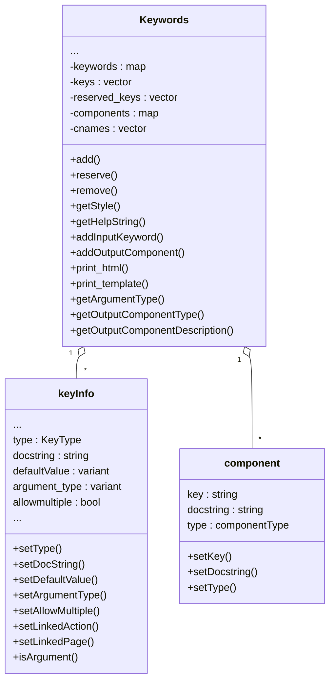

# Keyword and Input Management

<details>
<summary>Relevant source files</summary>

The following files were used as context for generating this wiki page:

- [.ci/requirements.txt](.ci/requirements.txt)
- [new-manual/README.md](new-manual/README.md)
- [new-manual/actions.md](new-manual/actions.md)
- [new-manual/assets/dropdown.css](new-manual/assets/dropdown.css)
- [new-manual/assets/pigeon.png](new-manual/assets/pigeon.png)
- [new-manual/assets/plumedManual.css](new-manual/assets/plumedManual.css)
- [new-manual/assets/tablecode.js](new-manual/assets/tablecode.js)
- [new-manual/build_manual.py](new-manual/build_manual.py)
- [new-manual/extras/AA.pdb](new-manual/extras/AA.pdb)
- [new-manual/gpu.md](new-manual/gpu.md)
- [new-manual/mkdocs.yml](new-manual/mkdocs.yml)
- [new-manual/parsing.md](new-manual/parsing.md)
- [new-manual/requirements.txt](new-manual/requirements.txt)
- [new-manual/specifying_arguments.md](new-manual/specifying_arguments.md)
- [new-manual/specifying_atoms.md](new-manual/specifying_atoms.md)
- [src/adjmat/module.yml](src/adjmat/module.yml)
- [src/annfunc/module.yml](src/annfunc/module.yml)
- [src/cltools/GenJson.cpp](src/cltools/GenJson.cpp)
- [src/clusters/ClusterWeights.cpp](src/clusters/ClusterWeights.cpp)
- [src/clusters/DFSClustering.cpp](src/clusters/DFSClustering.cpp)
- [src/clusters/module.yml](src/clusters/module.yml)
- [src/colvar/Volume.cpp](src/colvar/Volume.cpp)
- [src/colvar/module.yml](src/colvar/module.yml)
- [src/core/ActionToGetData.cpp](src/core/ActionToGetData.cpp)
- [src/logmfd/LogMFD.cpp](src/logmfd/LogMFD.cpp)
- [src/multicolvar/MFilterLess.cpp](src/multicolvar/MFilterLess.cpp)
- [src/multicolvar/MFilterMore.cpp](src/multicolvar/MFilterMore.cpp)
- [src/multicolvar/UWalls.cpp](src/multicolvar/UWalls.cpp)
- [src/pytorch/module.md](src/pytorch/module.md)
- [src/symfunc/CoordShellVectorFunction.cpp](src/symfunc/CoordShellVectorFunction.cpp)
- [src/symfunc/CoordinationNumbers.cpp](src/symfunc/CoordinationNumbers.cpp)
- [src/symfunc/LocalSteinhardt.cpp](src/symfunc/LocalSteinhardt.cpp)
- [src/symfunc/Steinhardt.cpp](src/symfunc/Steinhardt.cpp)
- [src/tools/Keywords.cpp](src/tools/Keywords.cpp)
- [src/tools/Keywords.h](src/tools/Keywords.h)
- [src/volumes/Density.cpp](src/volumes/Density.cpp)

</details>


This document describes the **keyword and input management system** in PLUMED. It covers how keywords are defined, registered, parsed, and documented, as well as how input files are processed and how keyword metadata is exported for documentation and tooling. The focus is on the code-level mechanisms and data structures that underpin keyword handling for actions, modules, and command-line tools.

- For information about the overall documentation system and how documentation is generated, see [Documentation System](#5.2).
- For details on the command-line tools themselves, see [Command Line Tools](#5.1).
- For information about the parsing of action input files and user syntax, see the user-facing [Parsing action input](parsing.md).

---

## Purpose and Scope

This page is intended for developers and advanced users who need to understand:

- How keywords are defined, categorized, and managed in the PLUMED codebase.
- The structure and use of the `Keywords` class and related types.
- How keyword metadata is used for input parsing, validation, and documentation generation (including JSON export).
- The relationship between keyword management and the broader input and documentation pipeline.

---

## Overview: Keyword Management in PLUMED

PLUMED uses a centralized system for managing the keywords that define the input interface for actions, modules, and command-line tools. The core of this system is the `PLMD::Keywords` class, which provides facilities for:

- Declaring keywords and their properties (type, documentation, default values, etc.).
- Registering keywords for actions and tools.
- Querying and exporting keyword metadata for documentation and tooling.
- Supporting advanced features such as numbered keywords, deprecated keywords, and output components.

### Diagram: High-Level Keyword Management Flow

```mermaid
flowchart TD
    "Action/CLTool Class"["Action/CLTool Class (e.g., Volume, CoordinationNumbers)"]
    "registerKeywords()"["registerKeywords(Keywords&)"]
    "Keywords"["Keywords (src/tools/Keywords.h, .cpp)"]
    "Input Parser"["Input Parser"]
    "GenJson"["GenJson (src/cltools/GenJson.cpp)"]
    "syntax.json"["syntax.json (JSON output)"]

    "Action/CLTool Class" -->|"calls"| "registerKeywords()"
    "registerKeywords()" -->|"populates"| "Keywords"
    "Keywords" -->|"used by"| "Input Parser"
    "Keywords" -->|"queried by"| "GenJson"
    "GenJson" -->|"outputs"| "syntax.json"
```
**Sources:**  
[src/tools/Keywords.h](), [src/tools/Keywords.cpp](), [src/cltools/GenJson.cpp]()

---

## The `Keywords` Class: Structure and Responsibilities

The `PLMD::Keywords` class is the central data structure for keyword management. It is responsible for:

- Storing metadata about each keyword (type, documentation, default value, argument type, etc.).
- Providing methods to add, reserve, remove, and query keywords.
- Supporting output components and linking keywords to documentation or other actions.
- Enabling export of keyword metadata for documentation and tooling.

### Table: Key Data Members of `PLMD::Keywords`

| Member Name         | Type                                   | Purpose                                                      |
|---------------------|----------------------------------------|--------------------------------------------------------------|
| `keywords`          | `std::map<std::string, keyInfo>`       | Stores metadata for each keyword                             |
| `keys`              | `std::vector<std::string>`             | Ordered list of active keywords                              |
| `reserved_keys`     | `std::vector<std::string>`             | Reserved keywords (not yet active)                           |
| `components`        | `std::map<std::string, component>`     | Output components metadata                                   |
| `cnames`            | `std::vector<std::string>`             | Ordered list of output component names                       |
| `neededActions`     | `std::vector<std::string>`             | List of required actions for this keyword set                |
| `doilist`           | `std::vector<std::string>`             | List of DOIs for documentation                               |

**Sources:**  
[src/tools/Keywords.h:90-162]()

---

### Diagram: `Keywords` Class and Related Types


**Sources:**  
[src/tools/Keywords.h:38-164]()

---

## Keyword Types and Properties

Keywords in PLUMED are categorized by their **style** and **argument type**. The main types are:

- **Compulsory**: Must be provided by the user.
- **Optional**: May be omitted; may have a default value.
- **Flag**: Boolean switch (on/off).
- **Atoms**: Specifies a list of atoms or residues.
- **Hidden**: Not shown in user documentation.
- **Deprecated**: Kept for backward compatibility.

Argument types specify the kind of value a keyword accepts (e.g., scalar, vector, matrix, grid).

### Table: Keyword Styles (`KeyType::keyStyle`)

| Style        | Description                                 |
|--------------|---------------------------------------------|
| compulsory   | Required keyword                            |
| optional     | Optional keyword                            |
| flag         | Boolean flag                                |
| atoms        | Atom/residue list                           |
| hidden       | Hidden/internal keyword                     |
| deprecated   | Deprecated/legacy keyword                   |

**Sources:**  
[src/tools/Keywords.h:41-85](), [src/tools/Keywords.cpp:191-208]()

---

## Keyword Registration and Usage in Actions

Each action or command-line tool registers its keywords by implementing a static `registerKeywords(Keywords&)` method. This method uses the `Keywords` API to declare the available keywords, their types, documentation, and other properties.

### Example: Registering Keywords in an Action

```cpp
void Volume::registerKeywords(Keywords& keys) {
  Action::registerKeywords(keys);
  ActionWithValue::registerKeywords(keys);
  ActionAtomistic::registerKeywords(keys);
  keys.setValueDescription("scalar","the volume of simulation box");
  keys.reset_style("NUMERICAL_DERIVATIVES","hidden");
}
```
**Sources:**  
[src/colvar/Volume.cpp:65-71]()

---

## Input Parsing and Validation

The `Keywords` object for each action is used by the input parser to:

- Validate that all compulsory keywords are present.
- Check that provided values match the expected argument type.
- Apply default values for optional keywords and flags.
- Support advanced features such as numbered keywords (e.g., `ATOMS1`, `ATOMS2`, ...).

**Sources:**  
[src/tools/Keywords.cpp:308-349, 495-519, 521-535]()

---

## Output Components

Some actions produce multiple output quantities (components), which can be referenced in other actions or in output. The `Keywords` class manages metadata about these components, including their names, types, and documentation.

- Components are registered using `addOutputComponent()`.
- Each component is associated with a keyword that enables its calculation.

**Sources:**  
[src/tools/Keywords.cpp:953-982](), [src/tools/Keywords.h:138-150, 272-273]()

---

## Keyword Metadata Export and Documentation

PLUMED provides tooling to export all keyword metadata to a machine-readable JSON file (`syntax.json`). This is used for:

- Automated documentation generation (e.g., HTML manual, tooltips).
- Syntax highlighting and autocompletion in editors.
- Consistency checks and coverage analysis.

The export is performed by the `GenJson` command-line tool, which queries all registered actions and tools for their keywords and outputs a structured JSON file.

### Diagram: JSON Export Pipeline

```mermaid
flowchart TD
    "GenJson (src/cltools/GenJson.cpp)"["GenJson (src/cltools/GenJson.cpp)"]
    "actionRegister().getKeywords()"["actionRegister().getKeywords()"]
    "Keywords"["Keywords"]
    "syntax.json"["syntax.json"]

    "GenJson (src/cltools/GenJson.cpp)" -->|"calls"| "actionRegister().getKeywords()"
    "actionRegister().getKeywords()" -->|"returns"| "Keywords"
    "GenJson (src/cltools/GenJson.cpp)" -->|"writes"| "syntax.json"
```
**Sources:**  
[src/cltools/GenJson.cpp:121-338]()

---

## Advanced Features

### Numbered Keywords

Some keywords can be specified multiple times with numeric suffixes (e.g., `ATOMS1`, `ATOMS2`, ...). The `Keywords` class supports this via the `allowmultiple` property and special handling in registration and parsing.

**Sources:**  
[src/tools/Keywords.cpp:39-41, 308-349, 521-528]()

### Deprecated and Reserved Keywords

- Deprecated keywords are registered for backward compatibility and are marked as such in documentation.
- Reserved keywords can be defined for future use or for internal purposes.

**Sources:**  
[src/tools/Keywords.cpp:405-419, 351-374]()

---

## Bridging Natural Language and Code: Where to Find Keyword Logic

### Diagram: Mapping User-Facing Concepts to Code Entities

```mermaid
flowchart TD
    "User Input File"["User Input File (plumed.dat)"]
    "Action::registerKeywords()"["Action::registerKeywords(Keywords&)"]
    "Keywords"["Keywords (src/tools/Keywords.h/.cpp)"]
    "Input Parser"["Input Parser"]
    "GenJson"["GenJson (src/cltools/GenJson.cpp)"]
    "Documentation System"["Documentation System (see #5.2)"]

    "User Input File" -->|"parsed by"| "Input Parser"
    "Input Parser" -->|"uses"| "Keywords"
    "Action::registerKeywords()" -->|"populates"| "Keywords"
    "GenJson" -->|"queries"| "Keywords"
    "GenJson" -->|"outputs"| "syntax.json"
    "Documentation System" -->|"reads"| "syntax.json"
```
**Sources:**  
[src/tools/Keywords.h](), [src/tools/Keywords.cpp](), [src/cltools/GenJson.cpp](), [new-manual/build_manual.py]()

---

## Summary Table: Key Functions in `Keywords`

| Function Name                | Purpose                                                      |
|------------------------------|--------------------------------------------------------------|
| `add()`                      | Add a new keyword                                            |
| `reserve()`                  | Reserve a keyword for later use                              |
| `remove()`                   | Remove a keyword                                             |
| `addFlag()`                  | Add a boolean flag keyword                                   |
| `addInputKeyword()`          | Add a keyword that takes an argument                         |
| `addOutputComponent()`       | Register an output component                                 |
| `getStyle()`                 | Get the style/type of a keyword                             |
| `getHelpString()`            | Get a formatted help string for all keywords                 |
| `print_html()`               | Output HTML documentation for keywords/components            |
| `getArgumentType()`          | Get the argument type for a keyword                          |
| `getOutputComponentType()`   | Get the type of an output component                          |
| `getOutputComponentDescription()` | Get the documentation for an output component           |

**Sources:**  
[src/tools/Keywords.h:166-341](), [src/tools/Keywords.cpp]()

---

## References

- [src/tools/Keywords.h]()
- [src/tools/Keywords.cpp]()
- [src/cltools/GenJson.cpp]()
- [new-manual/build_manual.py]()
- [parsing.md]()

---

This concludes the technical overview of the keyword and input management system in PLUMED. For further details on related systems, see the links at the top of this page.

---