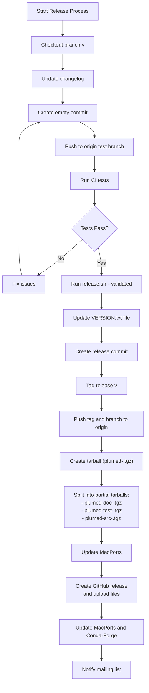
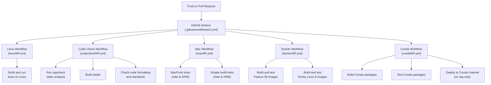
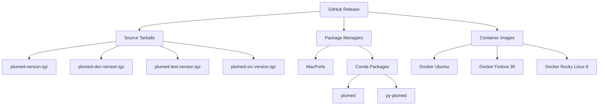
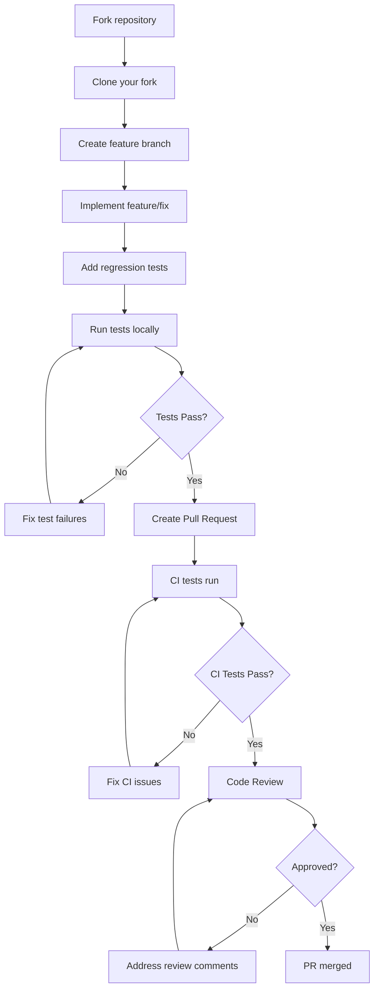

# Developer Information

<details>
<summary>Relevant source files</summary>

The following files were used as context for generating this wiki page:

- [.astyle.options](.astyle.options)
- [.ci/install.autoconf](.ci/install.autoconf)
- [.codecov.yml](.codecov.yml)
- [.gitignore](.gitignore)
- [Makefile](Makefile)
- [Makefile.conf.in](Makefile.conf.in)
- [astyle/.gitignore](astyle/.gitignore)
- [astyle/Makefile](astyle/Makefile)
- [configure](configure)
- [configure.ac](configure.ac)
- [developer-doc/InstallationLayout.md](developer-doc/InstallationLayout.md)
- [src/Makefile](src/Makefile)
- [src/README](src/README)
- [src/asmjit/COPYRIGHT](src/asmjit/COPYRIGHT)
- [src/asmjit/Makefile](src/asmjit/Makefile)
- [src/asmjit/arm.h](src/asmjit/arm.h)
- [src/asmjit/asmjit.h](src/asmjit/asmjit.h)
- [src/astyle.sh](src/astyle.sh)
- [src/lib/Makefile](src/lib/Makefile)
- [src/maketools/codecheck](src/maketools/codecheck)
- [src/maketools/make.rules](src/maketools/make.rules)
- [src/maketools/plumedcheck](src/maketools/plumedcheck)
- [src/tools/Exception.cpp](src/tools/Exception.cpp)
- [src/tools/Exception.h](src/tools/Exception.h)

</details>


This document provides essential information for developers who wish to contribute to or extend the PLUMED codebase. It covers the release process, continuous integration pipeline, packaging and distribution methods, and contribution guidelines. For information about implementing new features within the PLUMED framework, see the various documentation pages referenced in this document.

## Release Process

PLUMED follows a systematic release process that ensures proper versioning, testing, and distribution of new releases.

### Release Workflow



Sources: [release.sh](), [CHANGES/v2.4.md]()

The release process is automated by the `release.sh` script, which:

1. Determines the next version number based on the current branch
2. Updates the changelog with the release date
3. Creates a test commit and pushes it to a test branch for CI testing
4. When validated (`--validated` flag), updates `VERSION.txt`, creates a release commit, and tags the release
5. Creates distribution tarballs for the full release, documentation, tests, and source code
6. Updates MacPorts files for distribution

After the script completes, maintainers must manually:
- Upload files to the GitHub release
- Update package managers (MacPorts and Conda-Forge)
- Notify the mailing list

## Continuous Integration Pipeline

PLUMED uses GitHub Actions for continuous integration, ensuring that code changes meet quality standards before merging.



Sources: [.github/workflows/ci.yml](), [.github/workflows/codecheckWF.yml](), [.github/workflows/linuxWF.yml](), [.github/workflows/macWF.yml](), [.github/workflows/dockerWF.yml](), [.github/workflows/condaWF.yml]()

The CI system tests code changes in multiple environments:
- **Linux builds**: Standard build and test process on Ubuntu
- **Code checks**: Static analysis using cppcheck and code style verification
- **macOS builds**: Tests on both Intel and ARM architectures, with and without MacPorts
- **Docker builds**: Tests in Fedora 39 and Rocky Linux 8 containers
- **Conda packages**: Build and test Conda packages

All workflows are defined in the `.github/workflows` directory, with the main workflow (`ci.yml`) orchestrating the process.

## Distribution Methods

PLUMED is distributed through multiple channels to reach different user bases:



Sources: [docker/Makefile](), [conda/Makefile](), [macports/Portfile.in](), [conda/plumed/meta.yaml](), [conda/py-plumed/meta.yaml]()

### Source Tarballs
During the release process, several tarballs are created:
- `plumed-<version>.tgz`: Complete package with all components
- `plumed-doc-<version>.tgz`: Documentation only
- `plumed-test-<version>.tgz`: Test suite
- `plumed-src-<version>.tgz`: Source code without documentation and tests

### Docker Images
Docker images are available for multiple environments:
- Ubuntu (default)
- Fedora 39
- Rocky Linux 8

Docker images can be built using the Makefile in the `docker` directory:
```bash
make -C docker ubuntu
make -C docker fedora39
make -C docker rocky8
```

### Conda Packages
PLUMED provides two Conda packages:
- `plumed`: Core PLUMED library and tools
- `py-plumed`: Python bindings for PLUMED

Conda packages are built using:
```bash
make -C conda
```

And uploaded to the Conda channel using:
```bash
make -C conda upload
```

### MacPorts
PLUMED is available through MacPorts with:
- `plumed`: Core package
- `py-plumed`: Python bindings

The MacPorts Portfiles are generated during the release process.

## Contributing to PLUMED

The PLUMED project welcomes contributions from the community. Here's how to contribute effectively:



Sources: [.github/CONTRIBUTING.md](), [.github/PULL_REQUEST_TEMPLATE.md]()

### Contribution Guidelines

1. **Fork and clone**: Create your own fork of the repository and clone it locally
2. **Create a branch**: Work on changes in a dedicated feature branch
3. **Add regression tests**: All new features must have tests
4. **Submit a pull request**: Use the PR template provided
5. **Code review**: Address any feedback from maintainers
6. **Copyright transfer**: By contributing, you agree to transfer copyright to PLUMED developers

### Types of Contributions

PLUMED accepts three main types of contributions:
1. **Core changes**: Modifications to code maintained by PLUMED developers
2. **Module modifications**: Changes to existing modules
3. **New modules**: Additions of completely new functionality

For new modules, you must:
- Include a `COPYRIGHT` file with license information
- Use an open source license
- Run `cd src && ./header.sh mymodulename` to set up proper headers

### Pull Request Process

The `.github/PULL_REQUEST_TEMPLATE.md` file guides you through the pull request process, requiring:

1. Description of changes
2. Target release version
3. Type of contribution
4. Copyright agreement
5. Confirmation that tests have been added and pass

## Documentation Standards

PLUMED uses Doxygen for documentation, with specific requirements for documenting new features.

### Code Documentation Requirements

For new actions, documentation must include:
1. A brief introduction describing functionality
2. Detailed explanation of keywords and parameters
3. Examples of usage

Documentation is written in the C++ source files and extracted to create the manual:

```cpp
//+PLUMEDOC TYPE ACTIONNAME
/*
Brief description of the action.

Detailed explanation...

\par Examples

\plumedfile
ACTION ATOMS=1,2 PARAMETER=value
\endplumedfile
*/
```

Sources: [developer-doc/usingDoxygen.md]()

### Building Documentation

Documentation can be built from the user-doc directory:
```bash
cd user-doc
make
```

Or for developer documentation:
```bash
cd developer-doc
./go-doxygen
```

## Conclusion

This documentation provides an overview of the PLUMED development process and tools. Developers should familiarize themselves with these practices before contributing to ensure smooth integration of new features and fixes.

For more specific information about implementing new functionality in PLUMED, refer to the [Developer Documentation](https://www.plumed.org/doc-master/developer-doc/html/index.html) available online.

---