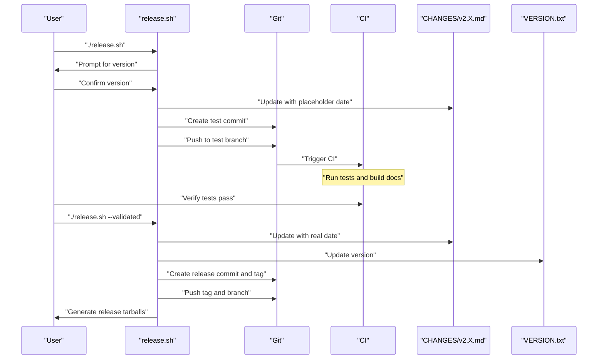

# Release Process

<details>
<summary>Relevant source files</summary>

The following files were used as context for generating this wiki page:

- [CHANGES/v2.0.md](CHANGES/v2.0.md)
- [CHANGES/v2.1.md](CHANGES/v2.1.md)
- [CHANGES/v2.10.md](CHANGES/v2.10.md)
- [CHANGES/v2.11.md](CHANGES/v2.11.md)
- [CHANGES/v2.2.md](CHANGES/v2.2.md)
- [CHANGES/v2.3.md](CHANGES/v2.3.md)
- [CHANGES/v2.4.md](CHANGES/v2.4.md)
- [CHANGES/v2.5.md](CHANGES/v2.5.md)
- [CHANGES/v2.7.md](CHANGES/v2.7.md)
- [CHANGES/v2.8.md](CHANGES/v2.8.md)
- [CHANGES/v2.9.md](CHANGES/v2.9.md)
- [README.md](README.md)
- [VERSION.txt](VERSION.txt)
- [docker/.gitignore](docker/.gitignore)
- [docker/Dockerfile](docker/Dockerfile)

</details>


This page documents the technical process for creating and publishing new releases of PLUMED. The release process is designed to ensure version consistency, changelog accuracy, correct git tagging, and standardized release artifact generation. The process is automated by the `release.sh` script and is tightly integrated with the repository's versioning and changelog files.

---

## Release Workflow Overview

**Diagram: Release Process Workflow**
```mermaid
flowchart TD
    "PrepareRelease[\"Prepare for release (update CHANGES, VERSION.txt)\"]" --> "RunTest[\"Run ./release.sh (test mode)\"]"
    "RunTest" --> "WaitCI[\"Wait for CI to pass\"]"
    "WaitCI" --> "RunValidated[\"Run ./release.sh --validated\"]"
    "RunValidated" --> "UploadArtifacts[\"Upload release artifacts to GitHub\"]"
    "UploadArtifacts" --> "UpdatePackages[\"Update package managers (MacPorts, Conda-Forge, etc.)\"]"
    "UpdatePackages" --> "NotifyList[\"Notify mailing list\"]"
```
Sources: [release.sh:1-196]()

The release process is managed by the `release.sh` script, which automates most technical steps. The process is divided into a test phase (to verify readiness) and a validation phase (to finalize and publish the release).

## Versioning Scheme

PLUMED uses a semantic versioning scheme, with version numbers managed in the `VERSION.txt` file. The format is:

```
major.minor[.patch][-dev]
```
- `major`: Major version (e.g., 2)
- `minor`: Minor version (e.g., 8)
- `patch`: Patch version (e.g., 4)
- `-dev`: Indicates a development version

**Diagram: Version Number Structure and Code Mapping**
```mermaid
graph TB
    "VERSION.txt[\"VERSION.txt\"]" --> "ReleaseScript[\"release.sh\"]"
    "ReleaseScript" --> "GitTag[\"git tag v2.X.Y\"]"
    "ReleaseScript" --> "Changelog[\"CHANGES/v2.X.md\"]"
    "VERSION.txt" --> "VersionString[\"2.X.Y-dev\"]"
    "VersionString" --> "ReleaseScript"
    "ReleaseScript" --> "RemoveDevSuffix[\"Remove -dev suffix on release\"]"
```
Sources: [VERSION.txt:1-9](), [release.sh:55-77]()

During development, the version in `VERSION.txt` ends with `-dev`. The `release.sh` script removes this suffix and updates the file for the release. The script also creates a git tag and updates the changelog.

## Preparation for Release

Before starting the release process:

- Ensure all CI tests pass on the target branch.
- Update the relevant changelog file in `CHANGES/` (e.g., `CHANGES/v2.9.md`) with all user- and developer-facing changes since the last release.
- Decide on the next version number according to the type of changes (major, minor, patch).

**Relevant Code Entities:**
- `CHANGES/v2.X.md` files
- `release.sh` script (pre-checks and prompts)

Sources: [release.sh:78-102](), [CHANGES/v2.8.md:1-13]()

## Executing the Release

The release process is performed in two main phases using the `release.sh` script.

### Phase 1: Test Mode

Run:

```
./release.sh
```

This phase will:

- Propose or prompt for the next version number.
- Update the changelog with a placeholder date ("coming soon").
- Create a test commit and push to a test branch.
- Instruct you to verify that CI tests and documentation builds pass.

Sources: [release.sh:113-137]()

### Phase 2: Validation and Finalization

After confirming that all tests pass, run:

```
./release.sh --validated
```

This phase will:

- Update the changelog with the actual release date.
- Update `VERSION.txt` with the new version.
- Create a release commit and tag (e.g., `v2.9.4`).
- Push the tag and branch to the remote repository.
- Generate release tarballs.

Sources: [release.sh:138-168]()

**Diagram: Release Script Sequence and Code Entities**

Sources: [release.sh:113-168](), [CHANGES/v2.8.md:1-13](), [VERSION.txt:1-9]()

## Post-Release Tasks

After running `./release.sh --validated`, perform the following manual steps:

1. **Upload Artifacts**: Upload the generated tarballs to GitHub Releases:
   - `plumed-X.Y.Z.tgz` (full distribution)
   - `plumed-doc-X.Y.Z.tgz` (documentation)
   - `plumed-test-X.Y.Z.tgz` (test suite)
   - `plumed-src-X.Y.Z.tgz` (source code only)

2. **Update Package Managers**:
   - Update MacPorts using the generated Portfile.
   - Update Conda-Forge and other package managers as needed.
   - Ensure Python wrappers are built for Python 3 only.

3. **Notify Users**:
   - Announce the new release on the PLUMED mailing list.

Sources: [release.sh:170-195]()

## Changelog Management

Each release must update the appropriate changelog file in the `CHANGES/` directory (e.g., `CHANGES/v2.9.md`). The `release.sh` script automates this by:

- Locating the section for the new version.
- Updating the section title with the actual release date.
- Creating a new section if needed.

**Changelog Content Requirements:**
- Version number and release date
- User-facing changes (including incompatible changes)
- New features, actions, modules, and improvements
- Bug fixes
- Developer-facing changes

**Diagram: Changelog Update Flow**
```mermaid
flowchart TD
    "release.sh[\"release.sh\"]" --> "update_changelog[\"update_changelog function\"]"
    "update_changelog" --> "CHANGES/v2.X.md[\"CHANGES/v2.X.md\"]"
    "CHANGES/v2.X.md" --> "GitCommit[\"git commit\"]"
```
Sources: [release.sh:20-34](), [CHANGES/v2.8.md:1-113](), [CHANGES/v2.7.md:1-107](), [CHANGES/v2.9.md:1-74](), [CHANGES/v2.4.md:1-261]()

## Branch and Tag Management

PLUMED uses a branch and tag structure to manage releases:

- Major/minor releases (e.g., `2.9.0`) are created by branching from `master` to `v2.9`.
- Patch releases (e.g., `2.9.1`, `2.9.2`) are created from the corresponding version branch.
- Tags are created for each release (e.g., `v2.9.4`).

**Diagram: Branch and Tag Structure with Code Entities**
```mermaid
graph LR
    "master[\"master branch\"]" -->|"Create branch"| "v2.X[\"v2.X branch\"]"
    "v2.X" -->|"Release"| "v2.X.0[\"tag v2.X.0\"]"
    "v2.X" -->|"Bugfix"| "v2.X.1[\"tag v2.X.1\"]"
    "v2.X" -->|"Bugfix"| "v2.X.2[\"tag v2.X.2\"]"
    "master" -->|"Development continues"| "future[\"future features\"]"
```
Sources: [release.sh:104-112](), [release.sh:162-167](), [README.md:14-59]()

## Exception Handling During Release

PLUMED includes a comprehensive exception handling system to identify and report errors during the release process and in general operation. If an error occurs during the execution of `release.sh` or other automated steps, exceptions are thrown and reported with detailed messages.

**Relevant Code Entities:**
- `src/tools/Exception.h`
- `src/tools/Exception.cpp`

This system ensures that problems are caught early and reported with meaningful error messages.

Sources: [src/tools/Exception.h:1-407](), [src/tools/Exception.cpp:1-157]()

## Release Artifacts Management

When a release is created, the script generates several tar files to make the software available in different formats:

| Artifact | Description |
|----------|-------------|
| plumed-X.Y.Z.tgz | Complete PLUMED distribution |
| plumed-doc-X.Y.Z.tgz | Documentation only package |
| plumed-test-X.Y.Z.tgz | Test suite package |
| plumed-src-X.Y.Z.tgz | Source code only package |

These artifacts are created by the release script and need to be manually uploaded to GitHub releases after the script completes.

Sources: [release.sh:170-178]()

---