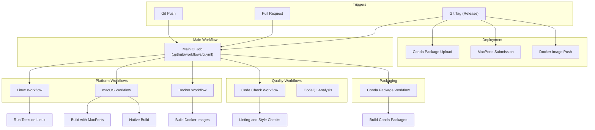
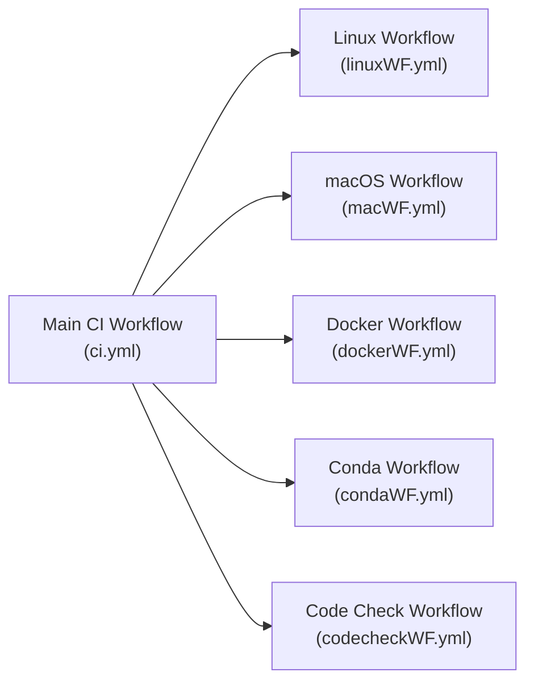
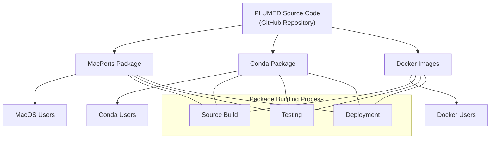
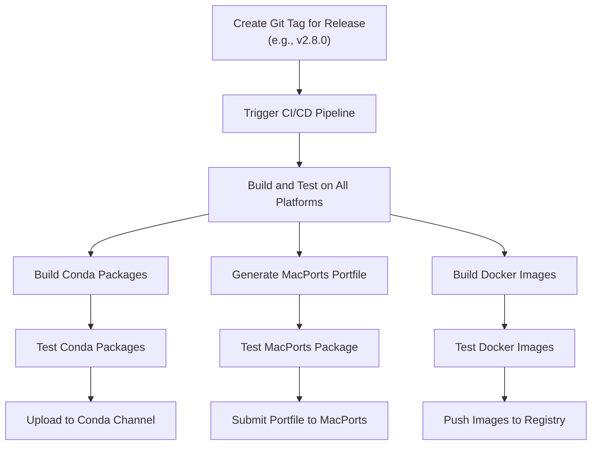

# CI/CD Pipeline

Relevant source files

The following files were used as context for generating this wiki page:

- [.github/workflows/ci.yml](.github/workflows/ci.yml)
- [.github/workflows/codecheckWF.yml](.github/workflows/codecheckWF.yml)
- [.github/workflows/codeql.yml](.github/workflows/codeql.yml)
- [.github/workflows/condaWF.yml](.github/workflows/condaWF.yml)
- [.github/workflows/dockerWF.yml](.github/workflows/dockerWF.yml)
- [.github/workflows/macWF.yml](.github/workflows/macWF.yml)
- [conda/Makefile](conda/Makefile)
- [conda/plumed/build.sh](conda/plumed/build.sh)
- [conda/plumed/conda_build_config.yaml](conda/plumed/conda_build_config.yaml)
- [conda/plumed/meta.yaml](conda/plumed/meta.yaml)
- [conda/py-plumed/build.sh](conda/py-plumed/build.sh)
- [conda/py-plumed/conda_build_config.yaml](conda/py-plumed/conda_build_config.yaml)
- [conda/py-plumed/meta.yaml](conda/py-plumed/meta.yaml)
- [conda/run-conda-build.sh](conda/run-conda-build.sh)
- [conda/run-conda-upload.sh](conda/run-conda-upload.sh)
- [docker/Makefile](docker/Makefile)
- [docker/fedora39](docker/fedora39)
- [docker/rocky8](docker/rocky8)
- [macports/Portfile.in](macports/Portfile.in)
- [macports/PortfilePython.in](macports/PortfilePython.in)
- [macports/generate-portfile.sh](macports/generate-portfile.sh)
- [python/test/Makefile](python/test/Makefile)
- [python/test/colvar.ref](python/test/colvar.ref)
- [python/test/config](python/test/config)
- [python/test/ref.pdb](python/test/ref.pdb)
- [python/test/template.pdb](python/test/template.pdb)
- [python/test/test_array.py](python/test/test_array.py)
- [python/test/test_input_builder.py](python/test/test_input_builder.py)
- [python/test/test_run.py](python/test/test_run.py)
- [src/maketools/nmcheck](src/maketools/nmcheck)

This page documents the Continuous Integration and Continuous Deployment (CI/CD) pipeline used in the PLUMED project. It covers the GitHub Actions workflows, package distribution mechanisms, and testing infrastructure that ensure code quality and streamline the release process. For information about the release process itself, see [Release Process](#6.1).

## Overview of CI/CD System

PLUMED employs a comprehensive CI/CD pipeline based on GitHub Actions. This system automatically tests code changes, builds packages for different platforms, and deploys releases to various package managers. The pipeline is triggered on every push to the repository and for all pull requests, ensuring that code quality issues are caught early in the development process.

### CI/CD Pipeline Architecture

Sources: [.github/workflows/ci.yml](), [.github/workflows/macWF.yml](), [.github/workflows/condaWF.yml](), [.github/workflows/dockerWF.yml](), [.github/workflows/codecheckWF.yml]()

## GitHub Actions Workflows

The foundation of PLUMED's CI/CD system is a set of GitHub Actions workflows defined in the `.github/workflows` directory.

### Main CI Workflow

The main workflow is defined in `ci.yml` and serves as the orchestrator for all CI/CD processes. It sets up the environment and triggers several platform-specific and task-specific workflows.

Key environment variables set in the main workflow:
- `PLUMED_STACK_TRACE=yes`: Enables stack traces for debugging 
- `PLUMED_NUM_THREADS=2`: Sets number of threads for OpenMP tests
- `CC=gcc` and `CXX=g++`: Specifies the C and C++ compilers

Sources: [.github/workflows/ci.yml]()

### Platform-Specific Workflows

#### macOS Workflow (`macWF.yml`)

The macOS workflow tests PLUMED on both Intel and ARM64 Mac platforms using two approaches:

1. **MacPorts Build**: Builds and tests PLUMED using MacPorts with different variants:
   - Standard build
   - Build with all modules enabled (`+allmodules`)

2. **Native Build**: Directly builds PLUMED from source without using MacPorts

This workflow also tests the Python bindings on multiple Python versions (3.9, 3.10).

Sources: [.github/workflows/macWF.yml]()

#### Docker Workflow (`dockerWF.yml`)

The Docker workflow builds PLUMED containers for different Linux distributions:
- Fedora 39 (with newer compiler versions)
- Rocky Linux 8 (for enterprise compatibility)

Each container is built and tested to ensure that PLUMED works correctly across different Linux environments.

Sources: [.github/workflows/dockerWF.yml](), [docker/Makefile](), [docker/fedora39](), [docker/rocky8]()

### Quality Assurance Workflows

#### Code Check Workflow (`codecheckWF.yml`)

This workflow performs code quality checks, including:
- Static code analysis with `cppcheck`
- Code style validation with `astyle`
- Verifying that there are no unique global symbols in the codebase (using `nmcheck`)

Sources: [.github/workflows/codecheckWF.yml](), [src/maketools/nmcheck]()

#### CodeQL Analysis (`codeql.yml`)

The CodeQL workflow analyzes the codebase for security vulnerabilities and code quality issues using GitHub's CodeQL engine. It analyzes three languages:
- C++
- Python
- JavaScript

Sources: [.github/workflows/codeql.yml]()

## Package Distribution System

PLUMED is distributed through multiple package managers and containerization systems, each with its own build and deployment process.

### Distribution Channels

Sources: [macports/Portfile.in](), [conda/plumed/meta.yaml](), [docker/Makefile]()

### MacPorts

The MacPorts package is defined in `macports/Portfile.in`, which is a template that gets populated with version information and other metadata by the `macports/generate-portfile.sh` script.

Key features of the MacPorts package:
- Provides variants for enabling specific modules
- Supports an `+allmodules` variant to enable all optional modules
- Handles dependencies on libraries like FFTW, GSL, zlib, and MPI
- Includes separate Python bindings package (`py-plumed`)

Build and deployment process:
1. `macports/generate-portfile.sh` generates the Portfile
2. MacPorts builds the package
3. The package is tested using `port test plumed`
4. When ready for release, the package is submitted to MacPorts

Sources: [macports/Portfile.in](), [macports/generate-portfile.sh](), [macports/PortfilePython.in]()

### Conda

PLUMED is packaged for Conda with two separate packages:
1. `plumed`: The core PLUMED library
2. `py-plumed`: Python bindings for PLUMED

The packages are defined in:
- `conda/plumed/meta.yaml` and `conda/plumed/build.sh` for the main package
- `conda/py-plumed/meta.yaml` and `conda/py-plumed/build.sh` for the Python bindings

Build and deployment process:
1. `conda/run-conda-build.sh` builds the packages
2. Tests are run to verify the packages
3. `conda/run-conda-upload.sh` uploads the packages to the Conda channel when building from a tag

Sources: [conda/plumed/meta.yaml](), [conda/plumed/build.sh](), [conda/py-plumed/meta.yaml](), [conda/py-plumed/build.sh](), [conda/run-conda-build.sh](), [conda/run-conda-upload.sh](), [conda/Makefile]()

### Docker

PLUMED is containerized using Docker with different containers for various Linux distributions. The containers are defined in the `docker/` directory:
- `docker/fedora39`: Container based on Fedora 39
- `docker/rocky8`: Container based on Rocky Linux 8 (RHEL compatible)

Build and deployment process:
1. `docker/Makefile` provides targets for building the containers
2. The containers include PLUMED built with all modules enabled
3. Tests are run inside the containers
4. The containers can be pushed to Docker Hub for distribution

Sources: [docker/Makefile](), [docker/fedora39](), [docker/rocky8]()

## Testing Infrastructure

Testing is a critical part of PLUMED's CI/CD pipeline, with tests run on all supported platforms and configurations.

### Regression Testing

PLUMED includes a comprehensive suite of regression tests that verify the correctness of calculations. These tests are run on:
- Different operating systems (Linux, macOS)
- Different hardware architectures (x86_64, ARM64)
- Different compilers and library versions

### Python Bindings Tests

The Python bindings have their own test suite in the `python/test/` directory:
- `test_run.py`: Tests core functionality by comparing calculations with reference values
- `test_array.py`: Tests the array handling interface
- `test_input_builder.py`: Tests the input builder functionality

Sources: [python/test/test_run.py](), [python/test/test_array.py](), [python/test/test_input_builder.py]()

## Release Deployment Process

When a new version of PLUMED is ready for release, the CI/CD pipeline automates much of the deployment process:

Sources: [.github/workflows/condaWF.yml]()

The key steps in the release process are:
1. Creating a Git tag for the release
2. The CI/CD pipeline automatically builds and tests packages for all platforms
3. If tests pass, packages can be deployed to their respective distribution channels
4. Conda packages are automatically uploaded to the Conda channel when building from a tag

## Summary

PLUMED's CI/CD pipeline provides a robust framework for:
- Validating code changes through automated testing
- Building and testing packages for multiple platforms
- Automating the release deployment process
- Ensuring code quality through static analysis and style checks

This infrastructure helps maintain the quality and reliability of PLUMED while streamlining the development and release process.

Sources: [.github/workflows/ci.yml](), [.github/workflows/macWF.yml](), [.github/workflows/condaWF.yml](), [.github/workflows/dockerWF.yml](), [.github/workflows/codecheckWF.yml](), [.github/workflows/codeql.yml](), [conda/plumed/meta.yaml](), [macports/Portfile.in](), [docker/Makefile]()

---