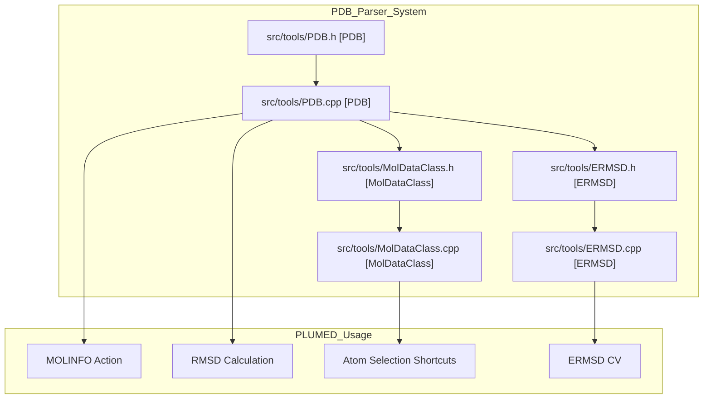

# PDB Parser and Molecular Structure

<details>
<summary>Relevant source files</summary>

The following files were used as context for generating this wiki page:

- [CHANGES/v2.6.md](CHANGES/v2.6.md)
- [regtest/basic/rt66/COLVAR.reference](regtest/basic/rt66/COLVAR.reference)
- [regtest/basic/rt66/DERIVATIVES.reference](regtest/basic/rt66/DERIVATIVES.reference)
- [regtest/basic/rt66/Makefile](regtest/basic/rt66/Makefile)
- [regtest/basic/rt66/config](regtest/basic/rt66/config)
- [regtest/basic/rt66/model.pdb](regtest/basic/rt66/model.pdb)
- [regtest/basic/rt66/plumed.dat](regtest/basic/rt66/plumed.dat)
- [regtest/basic/rt66/traj.xyz](regtest/basic/rt66/traj.xyz)
- [regtest/basic/rt66b/COLVAR.reference](regtest/basic/rt66b/COLVAR.reference)
- [regtest/basic/rt66b/Makefile](regtest/basic/rt66b/Makefile)
- [regtest/basic/rt66b/config](regtest/basic/rt66b/config)
- [regtest/basic/rt66b/plumed.dat](regtest/basic/rt66b/plumed.dat)
- [regtest/basic/rt66b/protrna.pdb](regtest/basic/rt66b/protrna.pdb)
- [regtest/basic/rt66b/traj.xyz](regtest/basic/rt66b/traj.xyz)
- [src/colvar/ERMSD.cpp](src/colvar/ERMSD.cpp)
- [src/multicolvar/DumpMultiColvar.cpp](src/multicolvar/DumpMultiColvar.cpp)
- [src/tools/ERMSD.cpp](src/tools/ERMSD.cpp)
- [src/tools/ERMSD.h](src/tools/ERMSD.h)
- [src/tools/MolDataClass.cpp](src/tools/MolDataClass.cpp)
- [src/tools/MolDataClass.h](src/tools/MolDataClass.h)
- [src/tools/PDB.cpp](src/tools/PDB.cpp)
- [src/tools/PDB.h](src/tools/PDB.h)

</details>


This page documents the PDB file parser and molecular structure representation within PLUMED. These components are essential for molecular topology handling, atom group definition, structural collective variable calculation, and molecular geometry interpretation. For information about using PDB files as reference structures in specific collective variables like RMSD or ERMSD, see the respective CV documentation.

## System Context and Code Entities

PLUMED's PDB parser system is responsible for reading and interpreting Protein Data Bank (PDB) format files, providing structured molecular information to the rest of the codebase. The system is composed of several key classes and files:

- `PDB` class: Core structure and parser ([src/tools/PDB.h](), [src/tools/PDB.cpp]())
- `MolDataClass`: Molecule type and residue logic ([src/tools/MolDataClass.h](), [src/tools/MolDataClass.cpp]())
- `ERMSD`: Specialized for RNA structure comparison ([src/tools/ERMSD.h](), [src/tools/ERMSD.cpp]())

### Diagram: System-to-Code Mapping


Sources: [src/tools/PDB.h](), [src/tools/PDB.cpp](), [src/tools/MolDataClass.h](), [src/tools/MolDataClass.cpp](), [src/tools/ERMSD.h](), [src/tools/ERMSD.cpp]()

## PDB Class and Data Representation

The `PDB` class is the central data structure for molecular structure handling in PLUMED. It stores atom positions, atom numbers, names, residue and chain information, occupancy, beta factors, and residue names. The class provides methods for:

- Reading PDB files (`read`)
- Accessing atom positions (`getPositions`, `getPosition`)
- Accessing atom and residue information (`getAtomName`, `getResidueName`, `getChainID`)
- Atom selection by residue, chain, or name
- Checking allowed residues for molecule types

### Diagram: `PDB` and `MolDataClass` Class Relationships

```mermaid
classDiagram
    class "PDB" {
        +read(string file, bool naturalUnits, double scale)
        +getPositions()
        +getPosition(AtomNumber)
        +getAtomName(AtomNumber)
        +getResidueName(AtomNumber)
        +getChainID(AtomNumber)
        +getAtomsInResidue(unsigned, string)
        +getNamedAtomFromResidueAndChain(string, unsigned, string)
        +allowedResidue(string, string)
    }
    class "MolDataClass" {
        +allowedResidue(string, string)
        +numberOfAtomsPerResidueInBackbone(string)
        +getBackboneForResidue(string, unsigned, PDB&, vector<AtomNumber>&)
        +isTerminalGroup(string, string)
        +specialSymbol(string, string, PDB&, vector<AtomNumber>&)
    }
    "PDB" -- "MolDataClass" : "structure info for"
```
Sources: [src/tools/PDB.h:42-151](), [src/tools/MolDataClass.h:36-48]()

## PDB File Format Interpretation

PLUMED's PDB parser follows the standard PDB format specification, with strict column-based parsing for ATOM and HETATM records. The parser is tolerant of real number formatting but requires columns to be in the correct positions.

| Columns | Content         | Description                                 |
|---------|----------------|---------------------------------------------|
| 1-6     | Record name    | "ATOM" or "HETATM"                          |
| 7-11    | Serial number  | Atom index (may use hybrid36 for >99999)    |
| 13-16   | Atom name      | Chemical identity of atom                   |
| 18-20   | Residue name   | 3-letter code for residue                   |
| 22      | Chain ID       | Single character chain identifier           |
| 23-26   | Residue number | Sequence number of residue                  |
| 31-38   | X coordinate   | X position (Å)                              |
| 39-46   | Y coordinate   | Y position (Å)                              |
| 47-54   | Z coordinate   | Z position (Å)                              |
| 55-60   | Occupancy      | Used as weight for alignment                |
| 61-66   | Beta factor    | Used as weight for displacement             |

PLUMED supports the hybrid36 format for atom and residue numbers, allowing systems with more than 100,000 atoms to be represented.

Sources: [src/tools/PDB.cpp:31-128](), [src/tools/PDB.cpp:101-125]()

## PDB Parsing Process

The PDB parsing process reads a PDB file line by line, interpreting each record type and extracting relevant molecular information. The parser supports ATOM, HETATM, TER, REMARK, CRYST1, END, and ENDMDL records.

### Diagram: PDB Parsing State Machine

```mermaid
flowchart TB
    "Read_PDB_File" --> "Parse_Line"
    "Parse_Line" --> "Check_Record_Type"
    "Check_Record_Type" -->|"ATOM/HETATM"| "Parse_Atom_Record"
    "Check_Record_Type" -->|"TER"| "Mark_Block_End"
    "Check_Record_Type" -->|"REMARK"| "Parse_Remark"
    "Check_Record_Type" -->|"CRYST1"| "Parse_Box_Dimensions"
    "Check_Record_Type" -->|"END/ENDMDL"| "End_Parsing"
    "Parse_Atom_Record" --> "Store_Atom_Info"
    "Store_Atom_Info" --> "Parse_Line"
    "Mark_Block_End" --> "Parse_Line"
    "Parse_Remark" --> "Parse_Line"
    "Parse_Box_Dimensions" --> "Parse_Line"
```
Sources: [src/tools/PDB.cpp:315-452]()

## Molecule Types and Residue Recognition

PLUMED recognizes molecule types and their associated residues to enable correct interpretation of molecular structure and atom selection. This is implemented in both `PDB` and `MolDataClass`.

| Molecule Type | Example Residues (not exhaustive) |
|---------------|-----------------------------------|
| Protein       | ALA, ARG, ASP, GLU, PHE, GLY, ... |
| DNA           | DA, DG, DT, DC, A, G, T, C, ...   |
| RNA           | A, G, U, C, RA, RG, RU, RC, ...   |
| Water         | SOL, WAT                          |
| Ion           | NA, CL, K, CA, MG, ZN, ...        |

Residue recognition is used for backbone/sidechain identification, atom selection shortcuts, and specialized CVs.

Sources: [src/tools/PDB.cpp:731-988](), [src/tools/MolDataClass.cpp:41-296]()

## Atom Selection and Special Symbols

The PDB parser and molecular structure system enable flexible atom selection in PLUMED. Users can select atoms by:

- Atom indices (direct numbers)
- Residue-based selection
- Backbone/sidechain selection
- Special symbols for chemical/structural features

### Diagram: Atom Selection Pathways

```mermaid
flowchart LR
    "PDB_Structure" --> "Atom_Selection"
    "Atom_Selection" --> "Direct_Selection[Direct (atom number)]"
    "Atom_Selection" --> "Residue_Selection[Residue-based]"
    "Atom_Selection" --> "Backbone_Sidechain[Backbone/Sidechain]"
    "Atom_Selection" --> "Special_Symbols[Special Symbols (@phi, @psi, ...)]"
    "Direct_Selection" -->|"e.g. 1,2,3"| "CV_Usage"
    "Residue_Selection" -->|"e.g. residue=1-10"| "CV_Usage"
    "Backbone_Sidechain" -->|"e.g. @back-1"| "CV_Usage"
    "Special_Symbols" -->|"e.g. @phi-5"| "CV_Usage"
```

#### Special Symbols

- Proteins: `@phi-N`, `@psi-N`, `@omega-N`, `@chi1-N`, `@back-N`, `@sidechain-N`
- Nucleic acids: `@chi-N`, `@alpha-N`, `@beta-N`, `@gamma-N`, `@delta-N`, `@epsilon-N`, `@zeta-N`, `@sugar-N`, `@base-N`

These are implemented in `MolDataClass::specialSymbol` and related methods.

Sources: [src/tools/MolDataClass.cpp:353-760]()

## Special Features of the PDB Parser

### Hybrid36 Format for Large Systems

PLUMED supports the hybrid36 format for atom and residue numbers, allowing representation of systems with more than 100,000 atoms. This format encodes large indices in a 5-character field, remaining compatible with standard PDB for smaller indices.

Example:
```
ATOM  99999  Ar      X   1      45.349  39.471  15.956  1.00  1.00
ATOM  A0000  Ar      X   1      45.349  38.631  16.796  1.00  1.00
ATOM  A0001  Ar      X   1      46.189  38.631  17.636  1.00  1.00
```
Sources: [src/tools/PDB.cpp:101-125](), [src/tools/PDB.cpp:396-407]()

### Occupancy and Beta Factor Interpretation

- **Occupancy**: Used as weights for alignment in structural deviation calculations (e.g., RMSD).
- **Beta factor**: Used as weights for displacement after alignment.

Setting these columns to zero excludes atoms from alignment/displacement. If all weights are zero, normalization is applied (since PLUMED 2.7).

Sources: [src/tools/PDB.cpp:71-98]()

## Integration with PLUMED Actions

The PDB parser and molecular structure system are used by several core PLUMED actions:

- **MOLINFO**: Provides structural context and enables atom selection shortcuts.
- **RMSD**: Uses PDB files as reference structures for structural deviation calculations.
- **ERMSD**: Specialized for RNA structure comparison, using PDB reference input.
- **Other CVs**: Many collective variables use PDB-based atom selection.

### Diagram: PDB Data Flow in PLUMED Actions

```mermaid
flowchart TD
    "PDB_File" --> "PDB::read"
    "PDB::read" --> "PDB_Structure"
    "PDB_Structure" --> "MOLINFO_Action"
    "PDB_Structure" --> "Reference_Structure_for_CVs"
    "MOLINFO_Action" -->|"@atom-selections"| "Atom_Group_CVs"
    "MOLINFO_Action" -->|"residue info"| "Angle/Dihedral_CVs"
    "Reference_Structure_for_CVs" --> "RMSD_Calculation"
    "Reference_Structure_for_CVs" --> "ERMSD_Calculation"
    "MOLINFO_Action" -->|"enables"| "Atom_Selection_Shortcuts"
```
Sources: [src/tools/PDB.cpp:31-128](), [src/colvar/ERMSD.cpp:38-101]()

## Examples of PDB Usage in PLUMED

Example usages of PDB files in PLUMED input:

- **Defining molecular structure for atom selection**:
  ```
  MOLINFO STRUCTURE=protein.pdb
  phi: TORSION ATOMS=@phi-5
  ```

- **Reference structure for RMSD calculation**:
  ```
  RMSD REFERENCE=reference.pdb TYPE=OPTIMAL
  ```

- **RNA structure comparison with ERMSD**:
  ```
  ERMSD REFERENCE=rna_reference.pdb ATOMS=@lcs-1,@lcs-2,@lcs-3,@lcs-4,@lcs-5,@lcs-6
  ```

Sources: [regtest/basic/rt66/plumed.dat](), [regtest/basic/rt66b/plumed.dat](), [src/colvar/ERMSD.cpp:94-97]()

## Conclusion

The PDB parser and molecular structure system in PLUMED form a critical foundation for many advanced features in the codebase. They provide:

1. Reading and interpretation of standard PDB files
2. Molecular structure representation in memory
3. Chemical and structural understanding of different molecule types
4. Powerful atom selection capabilities
5. Specialized metrics for structural comparison

These capabilities enable PLUMED's flexible and powerful collective variable definitions, essential for enhanced sampling and analysis of molecular systems.

---