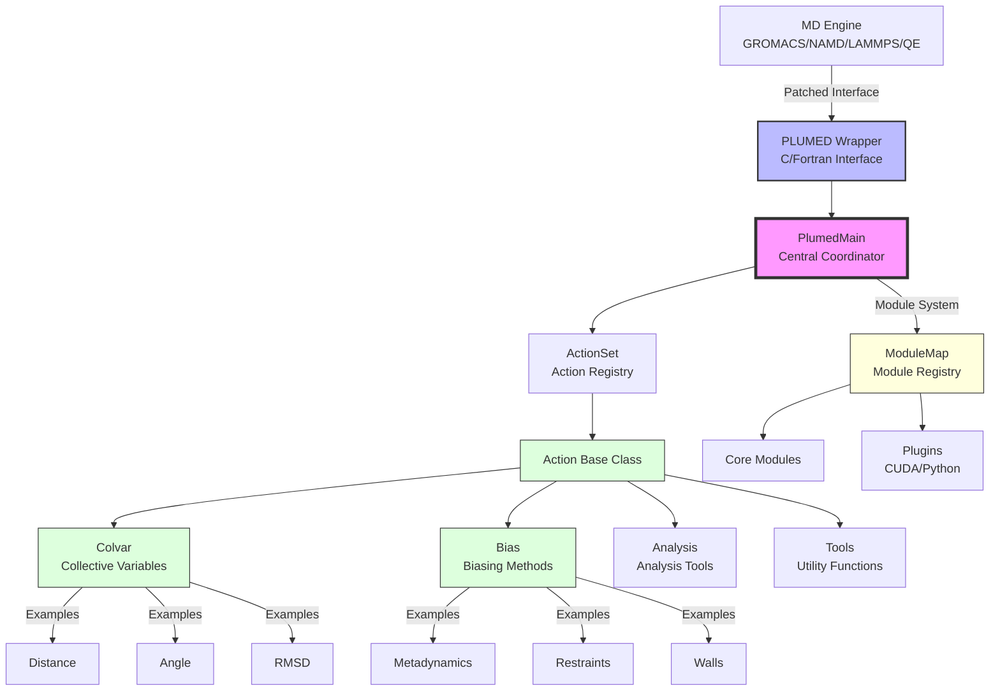
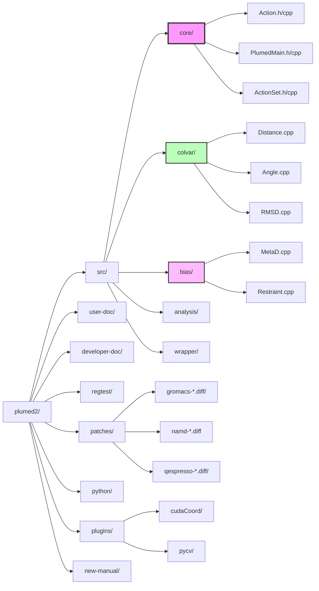

PLUMED2 is a molecular dynamics plugin system that provides collective variables and enhanced sampling methods through a modular, extensible framework. The project enables researchers to analyze and bias MD simulations by defining collective variables (CVs) that capture relevant structural and thermodynamic properties of molecular systems. Written primarily in C++ with Python bindings available, PLUMED2 integrates seamlessly with popular MD codes including GROMACS, NAMD, LAMMPS, and Quantum ESPRESSO through a patching mechanism that injects PLUMED functionality directly into these simulation engines.

Sources: [README.md](/README.md#L1-L50), [developer-doc/Intro.md](/developer-doc/Intro.md#L1-L20)

## Project Purpose and Scope

The core purpose of PLUMED2 is to bridge the gap between molecular dynamics simulations and free energy calculations by providing tools for collective variable analysis, metadynamics, umbrella sampling, and other enhanced sampling techniques. The library operates as a plugin that processes MD trajectory data on-the-fly, applying biases or performing analysis without requiring post-processing of simulation outputs. This real-time approach enables adaptive sampling strategies and immediate feedback during simulations, which is particularly valuable for studying rare events, conformational changes, and phase transitions in complex molecular systems.

PLUMED2 follows a modular design philosophy where functionality is organized into specialized modules for different types of collective variables (distances, angles, torsions, coordination numbers), biasing methods (metadynamics, restraints, walls), and analysis tools. The current stable release branch is v2.10 with active development continuing on the master branch toward version 2.11. The project maintains strict backward compatibility policies through versioned branches, ensuring that research workflows remain stable across different PLUMED releases.

Sources: [VERSION.txt](/VERSION.txt#L1-L9), [README.md](/README.md#L20-L45)

## Architecture Overview

PLUMED2 employs an **Action-based execution model** where every operation (CV calculation, bias application, analysis) is represented as an Action object that processes data at each simulation timestep. Actions are organized in a hierarchical class structure with the base `Action` class providing common functionality, while specialized classes like `Colvar` (collective variables), `Bias` (biasing methods), and various analysis tools inherit from this foundation. The `PlumedMain` class serves as the central coordinator that manages the Action registry, handles MD code communication, and orchestrates the execution sequence.

The architecture supports **multiple inheritance patterns** through specialized mixin classes (ActionAtomistic, ActionWithValue, ActionWithArguments) that can be combined to create Actions with specific capabilities. This design enables developers to implement new CVs or biasing methods by inheriting from appropriate base classes and overriding specific methods without modifying the core framework. The Action registration system uses factory patterns to dynamically load Actions from modules, allowing for runtime extensibility through shared libraries.

Sources: [src/core/Action.h](/src/core/Action.h#L60-L80), [src/core/PlumedMain.h](/src/core/PlumedMain.h#L70-L90), [src/core/ModuleMap.h](/src/core/ModuleMap.h#L1-L31)

## Repository Structure

The PLUMED2 repository follows a conventional open-source project layout with clear separation between source code, documentation, testing, and integration components. The source code is organized modularly in the `src/` directory, where each subdirectory corresponds to a functional area (core framework, collective variables, biasing methods, analysis tools). This modular organization enables developers to focus on specific functionality areas without needing to understand the entire codebase structure.

The **core module** (`src/core/`) contains the fundamental framework components including the Action hierarchy, PlumedMain coordinator, and utility classes for parallel execution, domain decomposition, and data passing. The **colvar module** (`src/colvar/`) implements various collective variables from simple geometric measurements (distance, angle, dihedral) to complex structural descriptors (RMSD, path-based CVs, coordination numbers). The **bias module** (`src/bias/`) provides enhanced sampling methods including well-tempered metadynamics, bias-exchange metadynamics, restraints, and harmonic/repulsive walls. The **wrapper module** (`src/wrapper/`) contains the C and Fortran interfaces that enable integration with external MD codes.

Sources: [README.md](/README.md#L50-L80), [src/](/src/), [src/colvar/](/src/colvar/), [src/bias/](/src/bias/)

## Key Components

### Core Framework

The core framework provides the foundation for all PLUMED2 operations through a set of interconnected classes that manage simulation state, coordinate Action execution, and handle MD code communication. The `PlumedMain` class acts as the central orchestrator, maintaining references to all registered Actions and implementing the `cmd()` interface that external MD codes use to interact with PLUMED. The `ActionSet` class manages the collection of Actions, ensuring proper initialization order and execution dependencies. Domain decomposition support enables parallel execution across multiple MPI ranks, with the `DataPassingTools` class handling communication between different simulation domains.

> [!TIP]
> The Action class hierarchy uses virtual inheritance for mixin classes (ActionAtomistic, ActionWithValue, ActionWithArguments) to prevent diamond inheritance problems when combining multiple capabilities in a single Action subclass. This design pattern enables flexible composition of features while maintaining clean object-oriented design principles.

Sources: [src/core/PlumedMain.h](/src/core/PlumedMain.h#L70-L90), [src/core/Action.h](/src/core/Action.h#L60-L80)

### Collective Variables

Collective variables (CVs) represent the computational chemistry domain language of PLUMED2, providing a rich library of structural descriptors that capture essential features of molecular systems. The CV implementation hierarchy extends from the base `Colvar` class, with specialized classes for different types of measurements. Simple geometric CVs include distances, angles, torsions, and coordination numbers, while more complex CVs include root-mean-square deviation (RMSD), path collective variables, and solvent-accessible surface area (SASA). MultiColvar classes enable calculation of CVs over multiple atom groups simultaneously, generating scalar or vector outputs that can be used directly in biasing methods or analysis operations.

| CV Category | Examples | Use Cases |
|-------------|----------|-----------|
| Geometric | Distance, Angle, Dihedral, Coordination | Bond formation, conformational analysis |
| Structural | RMSD, PathMSD, Gyration | Folding pathways, structural similarity |
| Environment | SASA, Packing, Clusters | Solvation effects, protein stability |
| Advanced | ERMSD, PCARMSD, PropertyMap | Complex structural transitions |

Sources: [src/colvar/](/src/colvar/), [src/colvar/Colvar.h](/src/colvar/Colvar.h)

### Biasing Methods

The biasing module implements enhanced sampling techniques that modify the potential energy surface to accelerate exploration of rare events and improve sampling efficiency. The well-tempered metadynamics implementation (`MetaD`) adds Gaussian bias potentials along selected CVs, with the height of the Gaussian scaled by a temperature factor to prevent divergence. Bias-exchange methods enable parallel tempering across different biasing conditions, while umbrella sampling (`Restraint`) provides harmonic restraints to sample specific regions of CV space. Walls (`Walls`, `LWalls`, `UWalls`) create repulsive potentials that constrain sampling within defined boundaries, useful for maintaining stability in enhanced sampling simulations.

> [!TIP]
> Bias classes implement both the force calculation (through derivative methods) and the energy contribution, with the bias energy automatically subtracted during reweighting calculations. This design enables automatic correction of biased distributions to recover unbiased free energy surfaces without manual intervention.

Sources: [src/bias/](/src/bias/), [src/bias/Bias.h](/src/bias/Bias.h)

## Integration with MD Codes

PLUMED2 integrates with external MD engines through a **patching system** that modifies the MD code source to include PLUMED function calls at appropriate points in the simulation loop. The `patches/` directory contains patch files and configuration scripts for multiple MD code versions (GROMACS 2022-2025, NAMD 2.12-2.14, Quantum ESPRESSO 5.0-7.2). The patching process injects PLUMED initialization at simulation startup, CV calculation and force application at each timestep, and finalization at simulation completion. The C/Fortran wrapper layer (`src/wrapper/`) provides stable interfaces that remain constant across PLUMED versions, ensuring that MD codes patched with older PLUMED versions continue to work with newer releases through careful API versioning.

| MD Code | Supported Versions | Integration Method |
|---------|-------------------|-------------------|
| GROMACS | 2022.5, 2023.5, 2024.3, 2025.0 | Source patch |
| NAMD | 2.12, 2.13, 2.14 | Source patch |
| LAMMPS | Multiple versions | USER-PLUMED package |
| Quantum ESPRESSO | 5.0.2, 6.2, 7.0, 7.2 | Source patch |

Sources: [patches/](/patches/), [src/wrapper/Plumed.h](/src/wrapper/Plumed.h)

## Documentation and Resources

PLUMED2 maintains comprehensive documentation for both users and developers through separate documentation systems. The **user documentation** (user-doc/) provides reference documentation for all collective variables, biasing methods, and tools, organized by functional area with extensive examples and tutorials. The documentation is generated using Doxygen from annotated source code, with custom layout configuration (PlumedLayout.xml) defining the navigation structure and organization. The **developer documentation** (developer-doc/) contains technical guides for contributing to PLUMED2, including instructions for adding new collective variables, implementing biasing methods, writing regression tests, and understanding the code architecture. The **new manual** (new-manual/) represents a next-generation documentation system using MkDocs with a modern web-based interface.

The regression testing framework (regtest/) provides automated validation of PLUMED2 functionality through a collection of test cases covering all major features. Each test directory contains input files, configuration settings, and reference outputs that are compared against new calculations to detect unintended changes. The testing infrastructure supports multiple backends including simplemd (a minimal MD engine for testing), driver (standalone trajectory processing), and integration with external MD codes.

Sources: [user-doc/](/user-doc/), [user-doc/PlumedLayout.xml](/user-doc/PlumedLayout.xml#L1-L50), [developer-doc/](/developer-doc/), [regtest/README](/regtest/README#L1-L50)

## Extension and Customization

PLUMED2 supports extensibility through both built-in module systems and external plugins. The **module system** enables organization of related Actions into logical groups that can be enabled or disabled at compile time through configuration options. Core modules include standard CVs, biasing methods, and analysis tools, while optional modules provide experimental features or dependencies on external libraries. The **plugin system** allows developers to create custom functionality without modifying the PLUMED2 core codebase, with plugins compiled as shared libraries that can be loaded at runtime using the `LOAD` directive.

The `plugins/` directory contains example plugins including CUDA implementations for GPU acceleration (cudaCoord/) and Python interfaces for custom CV implementation (pycv/). These plugins demonstrate the extension patterns for adding new functionality, with build systems (Makefiles, CMakeLists.txt) that integrate with the PLUMED2 build infrastructure. The Python plugin system enables researchers to implement custom CVs using Python syntax, with performance-critical sections handled through Cython compilation to C extensions.

Sources: [plugins/](/plugins/), [src/core/ModuleMap.h](/src/core/ModuleMap.h#L1-L31)

## Getting Started

For developers new to PLUMED2, the recommended learning progression starts with understanding the basic architecture and workflow before diving into specific implementations. Begin by reviewing the [Quick Start](2-quick-start) guide to set up a development environment and compile PLUMED2 from source. Once configured, explore the **Basic Collective Variables** tutorial to understand how CVs are calculated and used. Progress to the **Metadynamics Fundamentals** tutorial to learn about enhanced sampling techniques and how bias potentials modify simulation dynamics.

Developers interested in extending PLUMED2 should proceed to the **Action Framework and Execution Model** documentation to understand the core architecture, then review the **Creating New CVs** and **Creating New Bias Methods** guides for implementation details. The regression testing framework documentation provides guidance on writing tests to validate new functionality, ensuring that contributions maintain code quality and reliability across the evolving codebase.

The PLUMED2 community maintains active discussion forums where developers can ask questions, share experiences, and collaborate on new features. Contributing to PLUMED2 requires understanding the coding standards (documented in CodeFormatting.md), following the contribution guidelines, and ensuring that all changes include appropriate tests and documentation updates.
