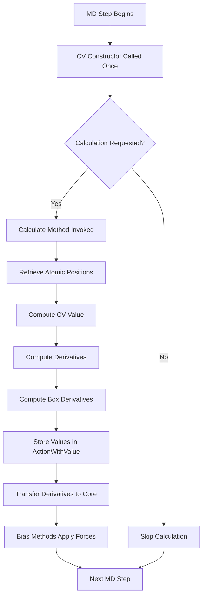
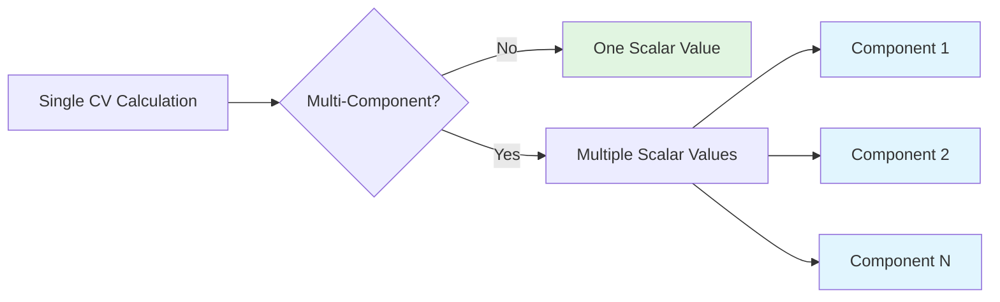

Collective Variables (CVs) serve as the foundational building blocks for enhanced sampling in molecular dynamics simulations. This page introduces you to the conceptual framework, architectural implementation, and practical usage of the most commonly employed CVs in PLUMED. Understanding these fundamentals will enable you to effectively monitor, analyze, and bias molecular processes of interest.

Sources: [module.md](src/colvar/module.md#L1-L16), [AddingAColvar.md](developer-doc/AddingAColvar.md#L1-L40)

## What Are Collective Variables?

Chemical systems contain an enormous number of atoms, which makes it effectively impossible to understand processes by monitoring atomic positions directly. Collective variables provide a solution by transforming the high-dimensional atomic configuration space into a lower-dimensional set of descriptors that capture essential features of the system's behavior. These scalar quantities describe the chemical processes you're interested in and serve as the basis for all PLUMED's enhanced sampling methods.

CVs in PLUMED are implemented as **Actions**—the fundamental units of operation in the PLUMED input language. Every CV performs three essential tasks: it reads atomic positions from the MD engine, calculates a scalar value (or set of values) based on those positions, and computes derivatives of that value with respect to atomic coordinates. These derivatives enable forces to be applied to atoms when the CV is biased.

Sources: [module.md](src/colvar/module.md#L1-L16), [actions.md](new-manual/actions.md#L1-L10)

## CV Architecture and Class Hierarchy

The architecture of CVs follows a clear inheritance hierarchy that ensures consistency across implementations and provides a framework for extension. Understanding this hierarchy is essential for both using existing CVs and creating new ones.

```mermaid
classDiagram
    Action <|-- ActionWithValue
    ActionWithValue <|-- ActionAtomistic
    ActionAtomistic <|-- Colvar
    Colvar <|-- Distance
    Colvar <|-- Angle
    Colvar <|-- Coordination
    Colvar <|-- Torsion
    Colvar <|-- Gyration
    
    Action : +actionName: string
    Action : +actionLabel: string
    Action : +checkUpdate(): bool
    Action : +addDependency(Action*)
    
    ActionWithValue : +addValueWithDerivatives()
    ActionWithValue : +setValue(double)
    ActionWithValue : +getValue(): Value*
    
    ActionAtomistic : +requestAtoms(vector)
    ActionAtomistic : +getPositions(): vector
    
    Colvar : +calculate()*
    Colvar : +registerKeywords(Keys)*
    
    Distance : +calculate()
    Angle : +calculate()
```

At the base level, the **Action** class [Action.h](src/core/Action.h#L80-L100) provides the fundamental infrastructure for all PLUMED operations, including labeling, dependency management, and update control. **ActionWithValue** extends this to handle value storage and derivative computation. **ActionAtomistic** adds atomic coordinate management capabilities. Finally, **Colvar** provides the specialized interface for collective variables, implementing the calculation interface that all CVs must override.

This hierarchical design enables code reuse and ensures that all CVs share common functionality while allowing specialization for different types of collective variables. When you use any CV in PLUMED, you're interacting with this class hierarchy.

Sources: [Action.h](src/core/Action.h#L80-L120), [Colvar.h](src/colvar/Colvar.h)

## The CV Calculation Model

Every CV in PLUMED follows a consistent calculation model that is executed at every MD timestep. This model ensures efficient computation and proper force propagation to the MD engine.



The **constructor** is called once when the CV is first created from the input file. It parses input parameters, allocates memory for values and derivatives, and requests access to the atoms it needs using `requestAtoms()` [AddingAColvar.md](developer-doc/AddingAColvar.md#L80-L100). The **calculate()** method is called at every timestep where the CV needs to be evaluated. This method must compute the CV value and all derivatives, then transfer them to the PLUMED core using the appropriate setter methods.

> [!TIP]
> The calculation method must always complete three tasks: compute the CV value, compute derivatives with respect to atomic positions, and compute box derivatives for periodic systems. Missing any of these will cause runtime errors or incorrect force application.

Sources: [AddingAColvar.md](developer-doc/AddingAColvar.md#L80-L120), [Distance.cpp](src/colvar/Distance.cpp#L250-L320)

## Periodic Boundary Conditions and CVs

Proper handling of periodic boundary conditions (PBC) is critical for accurate CV computation in periodic systems. PLUMED provides multiple mechanisms to manage PBCs appropriately.

Most CVs automatically apply PBC corrections by default, ensuring that distances and angles are calculated using the minimum image convention. The PBC handling involves making molecules "whole" before calculation and applying appropriate corrections to distances across periodic boundaries. For cases where PBC handling is not desired (e.g., when computing end-to-end distances in polymers), the `NOPBC` flag can be used to disable these corrections.

```plumed
# Distance with automatic PBC handling
d1: DISTANCE ATOMS=1,2

# Distance without PBC handling
d2: DISTANCE ATOMS=1,2 NOPBC

# Proper polymer end-to-end distance calculation
WHOLEMOLECULES ENTITY0=1-100
e2e: DISTANCE ATOMS=1,100 NOPBC
```

For CVs that output vector components, you can choose between Cartesian components (`COMPONENTS`) and scaled lattice components (`SCALED_COMPONENTS`). The scaled components maintain proper periodicity, which is essential when studying processes like molecular translocation across membranes.

Sources: [Distance.cpp](src/colvar/Distance.cpp#L55-L100), [Angle.cpp](src/colvar/Angle.cpp#L35-L60)

## Common Distance-Based CVs

Distance-based CVs represent the simplest and most widely used collective variables. They measure geometric relationships between atoms and form the building blocks for more complex CVs.

### Simple Distance

The **DISTANCE** CV calculates the distance between two atoms, optionally with components. It can output the scalar distance, Cartesian components (x, y, z), or scaled lattice components (a, b, c). The implementation handles PBC automatically and computes exact derivatives for force application.

```plumed
# Scalar distance
d1: DISTANCE ATOMS=1,2

# Cartesian components
d2: DISTANCE ATOMS=1,2 COMPONENTS
PRINT ARG=d2.x,d2.y,d2.z FILE=colvar

# Scaled lattice components with proper periodicity
d3: DISTANCE ATOMS=1,2 SCALED_COMPONENTS
PRINT ARG=d3.a,d3.b,d3.c FILE=colvar
```

**Technical Implementation**: The Distance class [Distance.cpp](src/colvar/Distance.cpp#L320-L363) computes the distance vector using `delta()` which applies PBC corrections, then extracts either the magnitude or components based on the mode. Derivatives are computed analytically—for scalar distance, ∂d/∂r₁ = -(r₂-r₁)/|r₂-r₁| and ∂d/∂r₂ = (r₂-r₁)/|r₂-r₁|.

### Multiple Distances

PLUMED can compute multiple indistinguishable distances in a single CV using vector syntax, which improves parallelization efficiency compared to defining separate CVs for each distance.

```plumed
# Three distances computed as a vector
d: DISTANCE ATOMS1=1,2 ATOMS2=3,4 ATOMS3=5,6
PRINT ARG=d FILE=colvar
```

When using MPI or OpenMP parallelization, vectorized CVs distribute calculations across processors, while separate CVs execute on the same processor. This makes vectorization essential for performance when computing many distances.

Sources: [Distance.cpp](src/colvar/Distance.cpp#L35-L95), [actions.md](new-manual/actions.md#L170-L198)

## Common Angle-Based CVs

Angle-based CVs capture angular relationships in molecular systems and are essential for studying conformational changes, bond rotations, and structural motifs.

### Angle

The **ANGLE** CV calculates the angle between vectors defined by three or four atoms. For three atoms (1-2-3), it computes the angle at atom 2 between vectors connecting to atoms 1 and 3. For four atoms (1-2-3-4), it computes the angle between vectors (2→1) and (4→3).

```plumed
# Angle at atom 2 between atoms 1, 2, 3
a1: ANGLE ATOMS=1,2,3
PRINT ARG=a1 FILE=colvar

# Angle between vectors (2→1) and (4→3)
a2: ANGLE ATOMS=1,2,3,4
PRINT ARG=a2 FILE=colvar

# Multiple angles
a3: ANGLE ATOMS1=1,2,3 ATOMS2=4,5,6 ATOMS3=7,8,9
```

The angle is computed using the arccosine of the normalized dot product: θ = arccos((r₁₂·r₃₄)/(|r₁₂||r₃₄|)). This yields values in [0, π], making angles **non-periodic** variables. The NOPBC flag can disable automatic PBC handling if needed.

Sources: [Angle.cpp](src/colvar/Angle.cpp#L35-L100)

### Dihedral/Torsion

Dihedral angles describe rotation about bonds and are crucial for studying protein backbone conformations, side-chain rotamers, and ring puckering. While detailed implementation is in Torsion.cpp, the concept extends the angle calculation to four atoms defining a torsional angle.

> [!TIP]
> Dihedral angles are periodic with period 2π. When biasing dihedrals, ensure proper periodic boundary treatment by setting appropriate domain bounds using `getValue("")->setDomain()` in custom CV implementations.

## Coordination-Based CVs

Coordination CVs measure local density or contact patterns, providing insights into solvation, binding events, and structural transitions.

### Coordination Number

The **COORDINATION** CV calculates the number of contacts between two groups of atoms using continuous switching functions to ensure differentiability:

```
CN = Σᵢ∈A Σⱼ∈B sᵢⱼ
```

where sᵢⱼ is a switching function that smoothly transitions from 1 to 0 as the distance exceeds a threshold. The default switching function is:

```
sᵢⱼ = [1 - ((rᵢⱼ-d₀)/r₀)ⁿ] / [1 - ((rᵢⱼ-d₀)/r₀)ᵐ]
```

```plumed
# Basic coordination number
c1: COORDINATION GROUPA=1-10 GROUPB=20-100 R_0=0.3

# With neighbor list for performance
c2: COORDINATION GROUPA=1-10 GROUPB=20-100 R_0=0.3 NLIST NL_CUTOFF=0.5 NL_STRIDE=100

# Self-coordination (within single group)
c3: COORDINATION GROUPA=1-20 R_0=0.3
```

**Performance Consideration**: Neighbor lists (`NLIST`) significantly improve performance for large systems by limiting distance calculations to atom pairs within `NL_CUTOFF`. The list is rebuilt every `NL_STRIDE` steps. Self-interactions (i=j) are automatically excluded to prevent counting the same contact twice.

Sources: [Coordination.cpp](src/colvar/Coordination.cpp#L25-L80)

## Size and Shape CVs

CVs describing molecular size and shape are essential for studying folding, aggregation, and conformational transitions.

### Radius of Gyration

The **GYRATION** CV calculates the radius of gyration, measuring the overall size of a molecule or group of atoms:

```
Rg² = Σᵢ mᵢ|rᵢ - rcm|² / Σᵢ mᵢ
```

where rcm is the center of mass. This CV is particularly useful for studying protein folding/unfolding transitions.

```plumed
# Radius of gyration for protein backbone
rg: GYRATION ATOMS=10-100
PRINT ARG=rg FILE=colvar

# With mass weighting (default)
rg_mass: GYRATION TYPE=MASS ATOMS=10-100

# Geometric radius (all atoms equal)
rg_geom: GYRATION TYPE=GEOMETRIC ATOMS=10-100
```

The implementation [Gyration.cpp](src/colvar/Gyration.cpp) supports both mass-weighted and geometric calculations, with mass weighting being the default. Multiple components can be computed (e.g., principal moments of inertia) for detailed shape analysis.

## Multi-Component CVs

Some CVs naturally output multiple related values. PLUMED supports this through multi-component CVs, where a single CV can output several scalar quantities.

A classic example is PATH-based CVs (detailed in [Path-Based Collective Variables](11-path-based-collective-variables)), which output both the distance along a reference path (s) and the perpendicular distance from the path (z). This allows comprehensive description of system progress relative to a predefined reaction coordinate.



Multi-component CVs are particularly valuable when components are naturally related and should be computed together for consistency. The PATH CV exemplifies this, where s and z are intrinsically connected through the path reference structure.

Sources: [AddingAColvar.md](developer-doc/AddingAColvar.md#L125-L139)

## CV Selection Guidelines

Choosing appropriate CVs is critical for successful enhanced sampling. Consider these principles when selecting CVs for your system:

| CV Type | Best Applications | Advantages | Limitations |
|---------|------------------|------------|-------------|
| **Distance** | Binding events, conformational changes | Simple, intuitive, exact derivatives | May not capture collective behavior |
| **Angle** | Bond rotations, local structure | Direct geometric meaning | Limited angular range [0,π] |
| **Coordination** | Solvation, contact formation | Captures local environment | Requires cutoff parameter tuning |
| **Rg/Shape** | Folding, aggregation | Global size descriptor | Insufficient for detailed transitions |

**Principles for CV Selection**:
- Choose CVs that **slowly vary** along the process of interest
- Ensure CVs have **clear physical interpretation**
- Avoid CVs that introduce **hidden barriers**
- Consider **orthogonality** when using multiple CVs
- Test CV behavior with short unbiased simulations first

## Performance Optimization

PLUMED provides multiple mechanisms to optimize CV calculation performance, particularly important for large systems or long simulations.

### Parallelization

PLUMED supports both MPI and OpenMP parallelization **within individual CVs**. This means that when a single CV computes multiple values (e.g., `DISTANCE ATOMS1=1,2 ATOMS2=3,4`), those calculations are distributed across processors. However, separate CVs (`d1: DISTANCE ATOMS=1,2` and `d2: DISTANCE ATOMS=3,4`) execute on the same processor.

```plumed
# Parallelized - three distances computed on different processors
d: DISTANCE ATOMS1=1,2 ATOMS2=3,4 ATOMS3=5,6

# Not parallelized - all on same processor
d1: DISTANCE ATOMS=1,2
d2: DISTANCE ATOMS=3,4
d3: DISTANCE ATOMS=5,6
```

**OpenMP Configuration**: Set `PLUMED_NUM_THREADS` to control OpenMP thread count. The optimal number may differ from MD engine threads due to cache effects. Tune `PLUMED_CACHELINE_SIZE` (default 512) for memory access optimization.

### Neighbor Lists

For coordination and distance-based CVs involving many atom pairs, neighbor lists dramatically reduce computational cost by only calculating distances for atom pairs within a cutoff:

```plumed
# Without neighbor list - O(N²) calculations
c1: COORDINATION GROUPA=1-1000 GROUPB=2000-3000 R_0=0.3

# With neighbor list - O(N) calculations
c2: COORDINATION GROUPA=1-1000 GROUPB=2000-3000 R_0=0.3 NLIST NL_CUTOFF=0.5 NL_STRIDE=100
```

Sources: [actions.md](new-manual/actions.md#L140-L198), [Coordination.cpp](src/colvar/Coordination.cpp#L35-L80)

## Next Steps

Now that you understand the fundamentals of CVs and common implementations, you can explore more advanced topics:

- **[Path-Based Collective Variables](11-path-based-collective-variables)** - Learn about PATH MSD and other CVs that describe progress along reference pathways
- **[Multi-Component CVs](12-multi-component-cvs)** - Deeper dive into CVs that output multiple related quantities
- **[Implementing Custom Collective Variables](13-implementing-custom-collective-variables)** - Create your own CVs for system-specific needs
- **[Action Framework and Execution Model](6-action-framework-and-execution-model)** - Understand the broader PLUMED architecture that CVs operate within

For practical examples of CV usage, refer to the tutorials in the [Get Started](2-quick-start) section, particularly [Basic Collective Variables](3-basic-collective-variables) which provides hands-on exercises.
