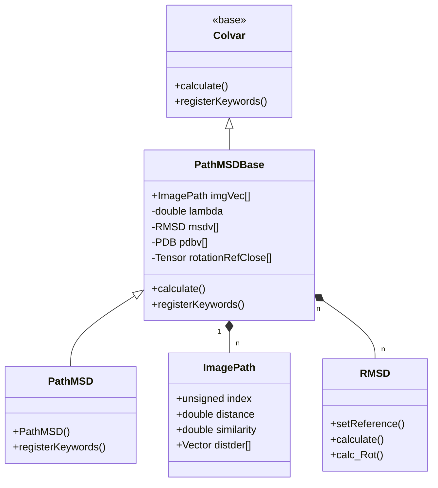
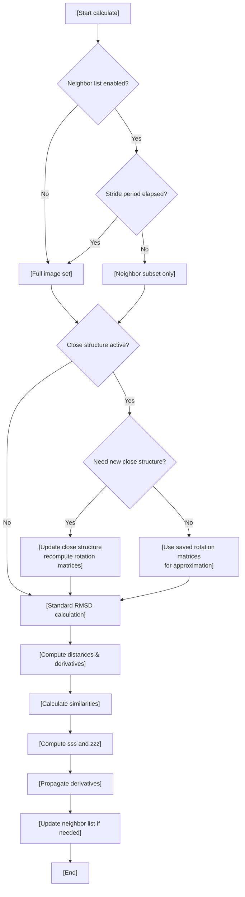

Path-based collective variables enable quantitative analysis of molecular transitions along predefined pathways in configuration space. These CVs measure the progression of a system through a series of reference structures (images) that define a reaction coordinate, providing both position along the path (sss) and perpendicular distance from the path (zzz). This approach is particularly valuable for studying conformational changes, folding pathways, and chemical reactions where the reaction coordinate is not easily captured by simple geometric descriptors.

The path-based CV framework implements the path collective variables introduced by Branduardi, Gervasio, and Parrinello, creating a curvilinear coordinate system from discrete reference configurations. Intermediate developers will find this framework highly extensible for custom pathway analysis and enhanced sampling methods.

Sources: [PathMSDBase.h](src/colvar/PathMSDBase.h#L1-L102), [PathMSD.cpp](src/colvar/PathMSD.cpp#L1-L107)

## Core Architecture

The path-based CV system is built around a hierarchical class structure that separates the computational core from specific CV implementations. At the foundation lies `PathMSDBase`, which provides the essential algorithms for path-based measurements, while `PathMSD` exposes the user-facing interface. The architecture supports both distance-based and property-based path definitions, enabling flexible pathway construction.



The `ImagePath` nested structure within `PathMSDBase` encapsulates the data for each reference image, storing the cardinal index, computed distance to the current structure, similarity metric (exponential of negative lambda-weighted distance), and derivatives with respect to atomic positions. This design enables efficient batch processing of multiple reference structures while maintaining derivative information for all atoms.

Sources: [PathMSDBase.h](src/colvar/PathMSDBase.h#L20-L42), [PathMSDBase.h](src/colvar/PathMSDBase.h#L70-L78)

## Mathematical Foundation

Path collective variables define a continuous coordinate system from discrete reference images through statistical mechanics-inspired formulations. The position along the path (sss) and distance from the path (zzz) are computed using probability-weighted averages over all reference structures.

The similarity between the current configuration and each reference image i is defined as:

```
similarity_i = exp(-λ × (d_i - d_min))
```

where λ (lambda) is a smoothing parameter controlling the sharpness of the localization, d_i is the RMSD distance to reference i, and d_min is the minimum RMSD across all references. The exponential transformation ensures that similarity values are positive and decay smoothly with distance.

The sss coordinate (progress along path) represents the probability-weighted average of image indices:

```
sss = Σ(i × similarity_i) / Σ(similarity_i)
```

This produces a continuous value ranging from 1 to nframes, with non-integer values indicating positions between reference images. The zzz coordinate (distance from path) measures the perpendicular deviation:

```
zzz = -(1/λ) × ln[Σ(similarity_i)] + d_min
```

This formulation ensures zzz is zero exactly on the path and increases smoothly with perpendicular distance, providing a natural reaction coordinate for transition path sampling.

Sources: [PathMSDBase.cpp](src/colvar/PathMSDBase.cpp#L326-L338), [PathMSD.cpp](src/colvar/PathMSD.cpp#L26-L40)

## Implementation Details

The `PathMSDBase::calculate()` method implements the core computational pipeline, executed at every MD step. This method orchestrates neighbor list updates, RMSD calculations, similarity computations, and derivative propagation.

The calculation flow begins with neighbor list management. When neighbor lists are enabled (NEIGH_SIZE > 0), the method checks if the stride period has elapsed to trigger a full recalculation. Otherwise, only the subset of nearest images in the previous step's neighbor list is processed, significantly reducing computational cost for systems with many reference structures.



The heavy computational core consists of RMSD distance calculations between the current atomic positions and each reference image. These calculations are parallelized across MPI ranks using OpenMP SIMD directives for optimal performance. For each image, the method computes the optimal rotation matrix (Kabsch algorithm) and the resulting minimized RMSD distance.

The close structure optimization (controlled by EPSILON > 0) provides substantial performance gains by caching rotation matrices. When the current structure remains within EPSILON distance of a previously identified "close structure," the method uses saved rotation matrices rather than recomputing the optimal alignment for each reference. This approximation is mathematically rigorous when the structural change is small.

Sources: [PathMSDBase.cpp](src/colvar/PathMSDBase.cpp#L203-L230), [PathMSDBase.cpp](src/colvar/PathMSDBase.cpp#L232-L268), [PathMSDBase.cpp](src/colvar/PathMSDBase.cpp#L287-L300)

## Configuration Parameters

Path-based CVs support several key parameters that control computational behavior and physical interpretation. These parameters are registered through the `registerKeywords()` method and parsed during initialization.

| Parameter | Type | Required | Default | Description |
|-----------|------|----------|---------|-------------|
| LAMBDA | double | Yes | - | Smoothing parameter (units of PLUMED). Controls localization sharpness. Higher values give sharper localization. |
| REFERENCE | string | Yes | - | PDB file containing reference structures. Each MODEL in the file represents one image along the path. |
| NEIGH_SIZE | int | Optional | -1 | Number of nearest images to include in neighbor list. When set, only these images are computed each step. |
| NEIGH_STRIDE | int | Optional | -1 | Number of MD steps between full neighbor list recalculations. Only used when NEIGH_SIZE is set. |
| EPSILON | double | Optional | -1 | Maximum distance for close structure method. Positive values enable rotation matrix caching optimization. |
| LOG_CLOSE | int | Optional | 0 | Enable logging of close structure updates when set to 1. |
| DEBUG_CLOSE | int | Optional | 0 | Enable extensive debugging of close structure method when set to 1. |
| NOPBC | flag | Optional | false | Disable automatic periodic boundary condition handling. |

The LAMBDA parameter is particularly important for system-specific tuning. Too small values lead to broad similarity distributions and poor localization, while too large values make the CV overly sensitive to small fluctuations. Values between 100-1000 are typical for atomic distances, but optimal values depend on the system size and conformational flexibility.

Sources: [PathMSDBase.cpp](src/colvar/PathMSDBase.cpp#L38-L46), [PathMSDBase.cpp](src/colvar/PathMSDBase.cpp#L48-L69)

## Performance Optimizations

Path-based CVs implement two major optimization strategies that are essential for production simulations with many reference structures: neighbor lists and the close structure method.

**Neighbor List Optimization**: The NEIGH_SIZE and NEIGH_STRIDE parameters implement a spatial pruning strategy. After each full calculation, the method sorts images by RMSD distance and retains only the NEIGH_SIZE nearest images for subsequent steps. This reduces the computational complexity from O(nframes) to O(NEIGH_SIZE) per timestep, with O(nframes) recalculation every NEIGH_STRIDE steps. The method is incompatible with replica exchange due to potential abrupt structural changes between replicas.

The neighbor list update logic efficiently determines when full recalculation is needed:

```cpp
if( int(getStep())%int(neigh_stride)==0 ) {
  imgVec.clear();  // Signal for full recalculation
}
if(imgVec.size()==nframes) {
  sort(imgVec.begin(), imgVec.end(), imgOrderByDist());
  imgVec.resize(neigh_size);
}
```

**Close Structure Method**: When EPSILON > 0, the method identifies a "close structure" (typically from the previous timestep) and caches its rotation matrices to all reference structures. For subsequent timesteps where the structure remains within EPSILON distance, the method approximates RMSD values using cached matrices rather than recomputing optimal alignments. This reduces the expensive Kabsch alignment to a single calculation per timestep.

The method includes debugging capabilities to validate the approximation accuracy:

```cpp
double withclose = tmp_distances[i];
RMSD opt;
opt.setType("OPTIMAL");
opt.setReference(msdv[imgVec[i].index].getReference());
std::vector<Vector> ders;
double withoutclose = opt.calculate(getPositions(), ders, true);
float difference = std::abs(withoutclose-withclose);
```

This validation confirms that approximation errors remain negligible for appropriate EPSILON values.

Sources: [PathMSDBase.cpp](src/colvar/PathMSDBase.cpp#L170-L175), [PathMSDBase.cpp](src/colvar/PathMSDBase.cpp#L358-L376), [PathMSDBase.cpp](src/colvar/PathMSDBase.cpp#L259-L273)

## Usage Examples

### Basic Path CV Definition

The simplest path-based CV definition uses a multi-model PDB file with lambda parameter:

```plumed
#SETTINGS INPUTFILES=regtest/basic/rt39/all.pdb
p1: PATHMSD REFERENCE=regtest/basic/rt39/all.pdb LAMBDA=500.0
PRINT ARG=p1.sss,p1.zzz STRIDE=1 FILE=colvar
```

This creates a path CV with sss (position on path) and zzz (distance from path) outputs written to colvar file.

### Optimized Path CV with Neighbor Lists

For production simulations with many reference structures, neighbor lists are strongly recommended:

```plumed
p1: PATHMSD REFERENCE=path_references.pdb LAMBDA=500.0 NEIGH_SIZE=8 NEIGH_STRIDE=4
PRINT ARG=p1.sss,p1.zzz STRIDE=10 FILE=colvar
```

This configuration computes distances to only the 8 nearest images every step, with full recalculation every 4 steps, providing excellent performance with minimal accuracy loss.

### Path CV with Close Structure Optimization

For large systems or high-throughput calculations, the close structure method provides additional acceleration:

```plumed
p1: PATHMSD REFERENCE=path_references.pdb LAMBDA=500.0 EPSILON=0.5 LOG_CLOSE=1
PRINT ARG=p1.sss,p1.zzz STRIDE=10 FILE=colvar
```

The EPSILON=0.5 activates rotation matrix caching, with logging enabled to monitor close structure updates.

Sources: [PathMSD.cpp](src/colvar/PathMSD.cpp#L26-L40)

## PIV: Pairwise Interatomic Vector Distance

The PIV module extends path-based CVs by computing pairwise interatomic vector distances rather than full RMSD alignments. This approach is particularly useful for large systems or when specific interatomic distances are more relevant than global structural alignment.

PIV distance calculations construct a vector space from all pairwise distances between selected atoms (PIVATOMS), optionally grouped by atom type (ATOMTYPES). The squared Cartesian distance between PIV vectors of the current and reference configurations provides the metric used in path calculations.

Key PIV features include:
- **Selective atom inclusion**: Use ATOMTYPES to specify which atoms participate in PIV construction
- **Block-based organization**: Separate AA, BB, CC (same-type) and AB, AC, BC (cross-type) distance blocks with independent parameters
- **Sorted distances**: Each block can be sorted to focus on nearest-neighbor interactions
- **Switching functions**: Apply smooth switching functions to distance contributions (SWITCH1-6)
- **Scaling factors**: Weight different blocks differently (SFACTOR)
- **Neighbor lists**: Independent neighbor lists for each block (NL_CUTOFF, NL_STRIDE, NL_SKIN)
- **Volume scaling**: Normalize distances by box volume (VOLUME parameter)

PIV integrates with FUNCPATHMSD to define paths in the PIV space rather than Cartesian RMSD space, providing an alternative representation that may better capture specific interaction changes.

Sources: [PIV.cpp](src/piv/PIV.cpp#L25-L130)

## Landmark Selection Methods

The landmarks module provides algorithms for selecting optimal reference structures from a trajectory, addressing the challenge of choosing representative images for path definition. Rather than manually selecting reference structures, these methods automatically identify a compact set of landmarks that span the conformational space.

The Farthest Point Sampling (FPS) algorithm iteratively selects the structure farthest from all previously selected landmarks, ensuring maximum coverage of conformational diversity. This approach is particularly useful for:

- Automated path generation from unbiased MD trajectories
- Reducing redundancy in reference structure sets
- Ensuring smooth progression along the reaction coordinate
- Optimizing the trade-off between path resolution and computational cost

Landmark selection can be integrated with path CV workflows to systematically construct reaction coordinates from simulation data without manual intervention or domain expertise.

Sources: [LandmarkSelection.cpp](src/landmarks/LandmarkSelection.cpp)

## Derivative Computation

Path-based CVs require analytic derivatives for use in enhanced sampling methods (metadynamics, umbrella sampling) and force applications. The derivative computation chain propagates atomic forces through RMSD calculations, similarity weights, and the final CV expressions.

For each reference image i, the derivative chain is:

```
∂sss/∂R = Σ_j (∂sss/∂similarity_j) × (∂similarity_j/∂d_j) × (∂d_j/∂R)
```

where:
- ∂sss/∂similarity_j involves the weighted average formula
- ∂similarity_j/∂d_j = -λ × similarity_j
- ∂d_j/∂R comes from RMSD analytic derivatives with optimal rotation

The implementation efficiently accumulates contributions across all images using SIMD vectorization:

```cpp
tmp = lambda * expval * (s_path[j] - it.property[j]) / partition;
#pragma omp simd
for(unsigned i=0; i < derivs_s.size(); i++) {
  derivs_s[i] += tmp * it.distder[i];
}
```

The zzz derivatives follow a similar pattern, with the partition function derivative contribution:

```cpp
#pragma omp simd
for(unsigned i=0; i < derivs_z.size(); i++) {
  derivs_z[i] += it.distder[i] * expval / partition;
}
```

These derivatives are propagated to all atoms in the reference structure set, enabling force application in molecular dynamics simulations.

Sources: [PathMSDBase.cpp](src/colvar/PathMSDBase.cpp#L340-L356)

## Extension Points

The path-based CV framework provides multiple extension points for developers wishing to implement custom functionality:

1. **Custom Distance Metrics**: The RMSD calculations in `PathMSDBase` can be replaced with alternative distance measures (e.g., DRMSD, property-based metrics) by overriding the distance computation methods.

2. **Custom Image Selection**: The neighbor list strategy can be extended with alternative pruning algorithms or adaptive selection criteria based on physical properties.

3. **Advanced Smoothing**: The exponential similarity function can be replaced with alternative kernels (Gaussian, tanh, custom functions) by modifying the similarity computation and corresponding derivatives.

4. **Multi-Dimensional Path Spaces**: The indexvec structure supports property vectors, enabling paths defined in high-dimensional property spaces rather than simple image indices.

Developers implementing custom path-based CVs should extend `PathMSDBase` and override the `calculate()` method, while ensuring proper registration of keywords and output components. The modularity of the framework enables focused modifications without altering the core computational infrastructure.

> [!TIP]
> When extending PathMSDBase, ensure derivative consistency by verifying that ∂CV/∂R computed analytically matches numerical finite differences. The framework provides built-in derivative validation tools in the regression test suite.

Sources: [PathMSDBase.h](src/colvar/PathMSDBase.h#L88-L92), [PathMSDBase.cpp](src/colvar/PathMSDBase.cpp#L29-L37)

## Integration with Other Modules

Path-based CVs integrate seamlessly with PLUMED's broader ecosystem of collective variables and biasing methods:

- **Metadynamics**: PATHMSD outputs can be biased using METAD or related variants to enhance sampling along the reaction coordinate
- **Umbrella Sampling**: The sss coordinate serves as an ideal reaction coordinate for umbrella windows in free energy calculations
- **Reweighting**: PATHMSD trajectories can be reweighted using PLUMED's reweighting tools to obtain free energy profiles along the path
- **Multi-dimensional CVs**: Combine sss and zzz with other CVs (distance, angle, dihedral) for multi-dimensional enhanced sampling
- **Analysis Tools**: Use time series of sss/zzz to compute transition rates, identify intermediates, and characterize mechanism

The path-based CV framework is particularly powerful when combined with [CV Fundamentals and Common CVs](10-cv-fundamentals-and-common-cvs) for multi-dimensional reaction coordinates or with [Metadynamics Variants](14-metadynamics-variants) for automated exploration of complex energy landscapes.

For developers interested in extending PLUMED with custom collective variables, see [Implementing Custom Collective Variables](13-implementing-custom-cvs) for detailed guidance on plugin development and integration patterns.