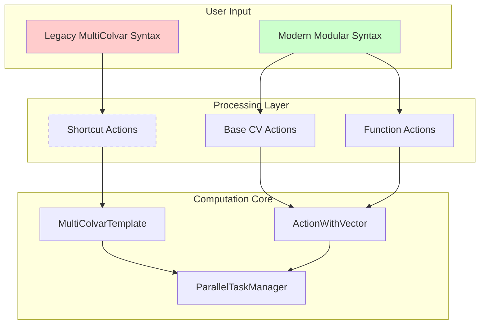

Multi-Component CVs (collective variables) extend PLUMED's capabilities from computing single values to managing **distributions of CVs** across multiple atom groups. This enables calculations like "minimum distance between protein and ligand," "number of contacts above threshold," or "average coordination number" in a concise, efficient manner. The architecture has evolved from dedicated MultiColvar actions to a more modular approach where vector CVs and function actions work together.

## Architectural Evolution

PLUMED 2 introduced a fundamental shift in Multi-Component CV architecture. Originally, specialized actions like `DISTANCES`, `ANGLES`, and `COORDINATIONNUMBER` combined CV calculation and distribution analysis in single commands. Modern PLUMED separates these concerns: **CV actions generate vector outputs**, while **function actions** like `LESS_THAN`, `MEAN`, and `HIGHEST` process those vectors. This modularity provides greater flexibility and clearer intent separation.


The core template class `MultiColvarTemplate<T>` [MultiColvarTemplate.h](src/colvar/MultiColvarTemplate.h#L48-L67) provides the foundation for multi-component operations. It extends `ActionWithVector` and leverages `ParallelTaskManager<MultiColvarTemplate<T>>` for efficient computation across multiple atom groups. The template parameter `T` typically represents the specific CV implementation (distance, angle, etc.), allowing code reuse while maintaining specialization.



> [!TIP]
> The MultiColvar module exists primarily for backward compatibility. New users should prefer the modular syntax, which provides finer-grained control and clearer code structure. The legacy shortcuts internally expand to the modern action sequences.

## Vector CV Operations

Base CV actions now support **numbered atom group specifications**, enabling efficient vector computation. Instead of repeating the same CV multiple times with different atoms, you specify all groups at once using `ATOMS1`, `ATOMS2`, `ATOMS3`, etc. The action returns a vector with one value per group, computed in a single pass through the atom data.

For example, calculating distances between multiple atom pairs:

```plumed
# Modern approach - vector distance calculation
dvec: DISTANCE ATOMS1=1,2 ATOMS2=3,4 ATOMS3=5,6 ATOMS4=7,8
PRINT ARG=dvec FILE=colvar STRIDE=100
```

This generates a 4-element vector `dvec` containing all four distances. The implementation uses `MultiColvarTemplate<Distance>` [Distance.cpp](src/colvar/Distance.cpp#L48-L80) to parallelize computation across all atom pairs efficiently. Each task calculates one distance, with the template managing task distribution and force collection.

The shortcut layer in `MultiColvarShortcuts` [MultiColvarShortcuts.h](src/multicolvar/MultiColvarShortcuts.h#L20-L45) provides helper functions for parsing atom groups. When using `GROUP` or `GROUPA`/`GROUPB` keywords, the system automatically generates all pairwise combinations:

```plumed
# Cross-group distance matrix
dmat: DISTANCE GROUPA=1-5 GROUPB=6-10
# Generates 5×5 = 25 distances automatically
```

Sources: [Distance.cpp](src/colvar/Distance.cpp#L48-L80), [Distances.cpp](src/multicolvar/Distances.cpp#L400-L472)

## Distribution Functions

Once you have a vector of CV values, function actions operate on that vector to extract meaningful statistics. These functions reside in the `function` module and extend `FunctionOfVector<T>` [FunctionOfVector.h](src/function/FunctionOfVector.h#L27-L49). Common operations include filtering, statistics, and reduction operations.

### Filtering Operations

Filtering functions identify values meeting specific criteria using switching functions for smooth differentiability:

```plumed
# Calculate all 20 distances from atom 1
dvec: DISTANCE ATOMS1=1,2 ATOMS2=1,3 ATOMS3=1,4 ... ATOMS20=1,21

# Count distances less than 1.5 nm (with smooth switching)
d_lt: LESS_THAN ARG=dvec SWITCH={RATIONAL R_0=1.5}
count: SUM ARG=d_lt

# Count distances greater than 3.0 nm
d_mt: MORE_THAN ARG=dvec SWITCH={RATIONAL R_0=3.0}
count_high: SUM ARG=d_mt

# Count distances in range [1.5, 3.0] nm
d_bt: BETWEEN ARG=dvec LOWER=1.5 UPPER=3.0 SMEAR=0.1
count_mid: SUM ARG=d_bt
```

The `LESS_THAN` [LessThan.cpp](src/function/LessThan.cpp#L1-L565) and `MORE_THAN` [MoreThan.cpp](src/function/MoreThan.cpp#L1-L270) implementations use switching functions to ensure differentiable output. The rational switching function `s(d) = 1/(1 + [(d-d₀)/d₀]⁶)` provides smooth transitions from 0 to 1 around threshold `d₀`.

Sources: [LessThan.cpp](src/function/LessThan.cpp#L1-L565), [MoreThan.cpp](src/function/MoreThan.cpp#L1-L270), [Stats.cpp](src/function/Stats.cpp#L1-L264)

### Statistical Operations

Statistical functions compute aggregate properties of the distribution:

```plumed
# All pairwise distances within a group
dvec: DISTANCE GROUP=1-20

# Mean distance
d_mean: MEAN ARG=dvec PERIODIC=NO

# Minimum distance (continuous derivatives)
d_min: MIN ARG=dvec BETA=500.0

# Alternative minimum with different formulation  
d_altmin: LOWEST ARG=dvec

# Maximum distance
d_max: MAX ARG=dvec BETA=500.0

# Standard deviation
d_std: STATS ARG=dvec MOMENTS=2
```

The smooth minimum uses the formula: d_min = β / log(∑exp(β/d_i)), providing continuous derivatives essential for biasing methods. The parameter `BETA` controls sharpness—higher values produce sharper minima but can cause numerical issues.

Sources: [Distances.cpp](src/multicolvar/Distances.cpp#L100-L200), [FunctionOfVector.h](src/function/FunctionOfVector.h#L1-L80)

## Component-Based CVs

Some CVs naturally produce multi-component outputs. For example, distances can output vector components (x, y, z) or scaled components (a, b, c along lattice vectors). These component vectors can also serve as inputs to distribution functions.

```plumed
# Vector components (x, y, z)
d: DISTANCE ATOMS=1,2 COMPONENTS

# Use x-components from multiple distances
dxvec: DISTANCE ATOMS1=1,2 ATOMS2=3,4 ATOMS3=5,6 COMPONENTS
dx_stats: STATS ARG=dxvec.x

# Scaled components (periodicity-aware)
ds: DISTANCE ATOMS=1,2 SCALED_COMPONENTS
PRINT ARG=ds.a,ds.b,ds.c FILE=scaled

# Dipole moments are inherently vector quantities
dip: DIPOLE GROUP=1-100 COMPONENTS
dip_x: MEAN ARG=dip.x PERIODIC=NO
dip_y: MEAN ARG=dip.y PERIODIC=NO
```

The regression test `rt-basic-print` [plumed.dat](regtest/multicolvar/rt-basic-print/plumed.dat#L1-L62) demonstrates component operations across distances, angles, torsions, positions, and dipoles, showing consistent patterns for accessing `.x`, `.y`, `.z`, `.a`, `.b`, `.c` components.

Sources: [rt-basic-print/plumed.dat](regtest/multicolvar/rt-basic-print/plumed.dat#L1-L62)

## Advanced Patterns

### Conditional Averaging

Compute average of CV values meeting specific criteria by combining filtering with weighted sums:

```plumed
# All distances from atom 1 to others
dvec: DISTANCE ATOMS1=1,2 ATOMS2=1,3 ... ATOMS10=1,11

# Identify short distances (< 2.0 nm)
mask: LESS_THAN ARG=dvec SWITCH={GAUSSIAN D_0=2.0 R_0=0.1}

# Compute weighted sum (sum of distances where mask is active)
weighted: MATHEVAL ARG=dvec,mask FUNC=x*y PERIODIC=NO

# Sum of mask values (count of short distances)
mask_sum: SUM ARG=mask

# Average of short distances
avg_short: MATHEVAL ARG=weighted,mask_sum FUNC=x/y PERIODIC=NO
```

This pattern appears in regression test `rt-filters` [plumed.dat](regtest/multicolvar/rt-filters/plumed.dat#L60-L85), which also demonstrates using these conditional averages in restraints.

Sources: [rt-filters/plumed.dat](regtest/multicolvar/rt-filters/plumed.dat#L60-L85)

### Multi-Property Analysis

Combine different CV types into joint analyses:

```plumed
# Distances between protein and ligand
p_lig_dist: DISTANCE GROUPA=1-100 GROUPB=101-150

# Angles in protein core  
core_angles: ANGLE ATOMS1=10,11,12 ATOMS2=20,21,22 ... ATOMS10=90,91,92

# Analyze both distributions together
dist_mean: MEAN ARG=p_lig_dist PERIODIC=NO
angle_mean: MEAN ARG=core_angles PERIODIC=NO

# Apply bias based on both properties
bi: LOWER_BIASES ARG=dist_mean,angle_mean AT=1.0,90.0 KAPPA=10.0,1.0
```

### Coordination Number Analysis

The legacy `COORDINATIONNUMBER` action demonstrates classic multi-component patterns:

```plumed
# All coordination numbers for atoms 1-50
cn: COORDINATION ATOMS=1-50 R_0=0.3

# Number of atoms with high coordination (> 6)
cn_high: MORE_THAN ARG=cn SWITCH={RATIONAL R_0=6.0}
high_count: SUM ARG=cn_high

# Average coordination number
cn_avg: MEAN ARG=cn PERIODIC=NO

# Maximum coordination (smooth)
cn_max: MAX ARG=cn BETA=100.0
```

## Legacy Syntax Compatibility

For backward compatibility, legacy MultiColvar actions like `DISTANCES`, `ANGLES`, `COORDINATIONNUMBER` remain available. These shortcuts internally expand to the modern action sequences:

```plumed
# Legacy syntax (not recommended for new users)
d1: DISTANCES GROUPA=1-10 GROUPB=11-20 LESS_THAN={RATIONAL R_0=1.0}

# Expands to (modern equivalent):
# d1: DISTANCE GROUPA=1-10 GROUPB=11-20
# d1_lt: LESS_THAN ARG=d1 SWITCH={RATIONAL R_0=1.0}
# d1_lessthan: SUM ARG=d1_lt
```

The shortcut expansion occurs in actions like `Distances::create` [Distances.cpp](src/multicolvar/Distances.cpp#L400-L472), which parses keywords and generates appropriate action sequences. While legacy syntax can be convenient for simple cases, the modular approach provides explicit control and clearer debugging.

Sources: [Distances.cpp](src/multicolvar/Distances.cpp#L400-L472), [module.md](src/multicolvar/module.md#L1-L60)

## Performance Considerations

Multi-component operations offer significant performance benefits through:

1. **Single-pass computation**: All atom groups processed together
2. **Parallel execution**: `ParallelTaskManager` distributes tasks across CPU cores [MultiColvarTemplate.h](src/colvar/MultiColvarTemplate.h#L53-L54)
3. **Shared memory access**: Minimizes redundant atom data loading
4. **Vectorized operations**: Compiler can optimize tight loops

When working with large atom groups (thousands of distances/angles), the parallel implementation provides near-linear speedup on multi-core systems. The regression tests `rt-basic-der-test` and `rt19-mpi` verify correctness in serial and parallel environments.

Sources: [MultiColvarTemplate.h](src/colvar/MultiColvarTemplate.h#L53-L54)

## Implementation Deep Dive

The MultiColvar architecture leverages templates for code reuse while maintaining type safety. The key template class:

```cpp
template <class T>
class MultiColvarTemplate : public ActionWithVector {
  PTM taskmanager;  // Parallel task manager
  unsigned mode;    // Calculation mode
  bool usepbc;      // Periodic boundary handling
  unsigned natoms_per_task;  // Atoms per calculation
};
```

The `mode` parameter determines what quantity to calculate (distance, angle, etc.), while `natoms_per_task` varies by CV type (2 for distances, 3 for angles, etc.). The static `performTask` method [MultiColvarTemplate.h](src/colvar/MultiColvarTemplate.h#L80-L86) executes individual calculations, enabling parallel dispatch.

Function actions use a similar pattern with `FunctionOfVector<T>`, where template parameter `T` specifies the function operation (less than, sum, etc.). This parallel framework extends to GPU via OpenACC pragmas when available.

> [!TIP]
> When implementing custom multi-component CVs, extend `MultiColvarTemplate<YourCV>` and implement the static `performTask` method. The framework handles parallelization, force collection, and output management automatically.

Sources: [MultiColvarTemplate.h](src/colvar/MultiColvarTemplate.h#L48-L86), [FunctionOfVector.h](src/function/FunctionOfVector.h#L27-L49)

## Next Steps

Having mastered multi-component CVs, you can explore:
- **[CV Fundamentals and Common CVs](10-cv-fundamentals-and-common-cvs)** for basic CV building blocks
- **[Metadynamics Variants](14-metadynamics-variants)** to apply biasing to these distributions
- **[Performance Optimization](30-performance-optimization)** for advanced parallel techniques
- **[Creating New CVs](24-creating-new-cvs)** to implement custom multi-component actions