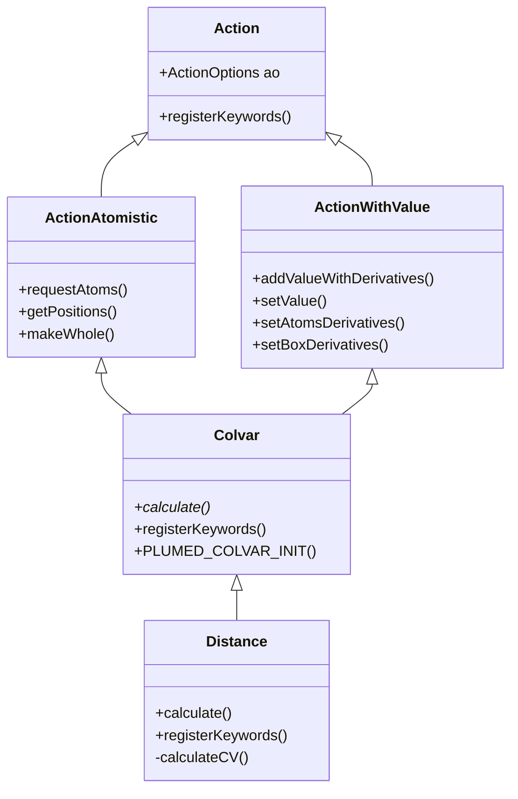
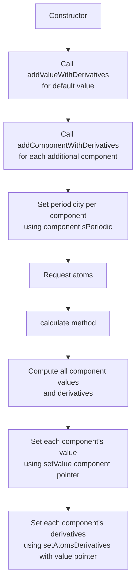
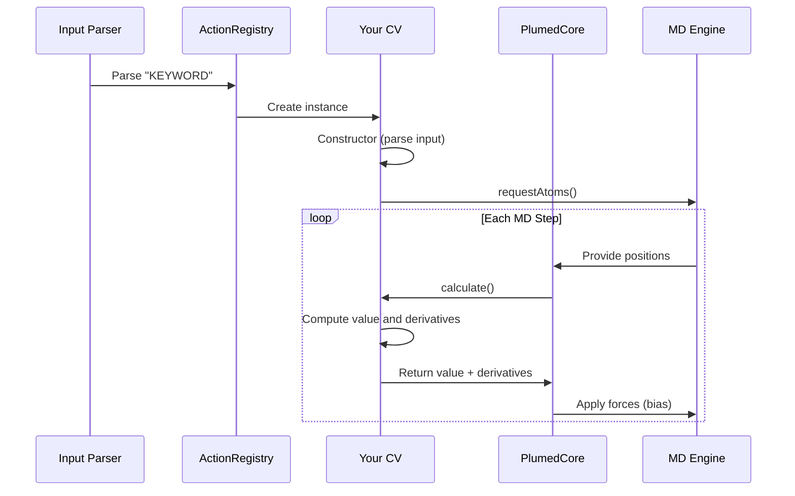

This guide provides a comprehensive framework for creating custom collective variables (CVs) in PLUMED, targeting developers who need to extend PLUMED's functionality with new collective coordinate definitions. The process leverages PLUMED's object-oriented architecture to ensure proper integration with the core system, including automatic documentation generation, input validation, and derivative calculation.

## CV Architecture Overview

Custom collective variables in PLUMED are implemented through a well-defined inheritance hierarchy that provides essential infrastructure for atom management, value storage, derivative propagation, and integration with the biasing framework. The architecture supports both scalar and multi-component CVs, with built-in mechanisms for handling periodic boundary conditions and virial contributions.



The **Colvar** base class, located in [src/core/Colvar.h](src/core/Colvar.h#L29-L116), serves as the foundation for all collective variable implementations. It inherits from **ActionAtomistic** (providing access to atomic coordinates and periodic boundary condition handling) and **ActionWithValue** (managing value storage and derivative propagation). This multiple inheritance pattern allows CVs to seamlessly integrate with both the molecular dynamics simulation environment and PLUMED's biasing machinery.

> [!TIP]
> The **PLUMED_COLVAR_INIT(ao)** macro is essential in your constructor—it properly initializes both the Action base class and the Colvar-specific infrastructure before any custom initialization occurs. Missing this macro leads to undefined behavior during simulation execution.

## Step-by-Step Implementation Process

### File Creation and Registration

Begin by creating a new source file named `ColvarName.cpp` in the `src/colvar/` directory. The naming convention uses camelCase for the class and uppercase for the directive name. PLUMED provides a template generator script at [scripts/newcv.sh](scripts/newcv.sh#L1-L27) that creates the basic boilerplate:

```bash
plumed newcv YOUR_DIRECTIVE YourClassName
```

This generates a skeletal implementation with all necessary includes, documentation markers, and registration macros. The template structure follows the pattern established in [developer-doc/AddingAColvar.md](developer-doc/AddingAColvar.md#L1-L50).

### Class Definition and Documentation

The class definition must include the PLUMED documentation block, which serves dual purposes: generating user-facing documentation and providing the implementation reference. The structure follows this template:

```cpp
#include "Colvar.h"
#include "ActionRegister.h"
#include <string>
#include <cmath>
#include <cassert>

using namespace std;

namespace PLMD {
namespace colvar {

//+PLUMEDOC COLVAR NAME
/*
Detailed description of your CV including:
- Physical meaning and mathematical formulation
- Input file syntax with examples
- PBC handling considerations
- Component descriptions (if multi-component)
*/
//+ENDPLUMEDOC

class ColvarNAME : public Colvar {
public:
  static void registerKeywords( Keywords& keys );
  explicit ColvarNAME(const ActionOptions&);
  void calculate() override;
};

PLUMED_REGISTER_ACTION(ColvarNAME,"KEYWORD")
```

The **PLUMED_REGISTER_ACTION** macro (defined in [src/core/ActionRegister.h](src/core/ActionRegister.h#L68-L99)) registers your CV with PLUMED's action registry, making it available for parsing from input files. The first argument is the class name, and the second is the keyword used in PLUMED input files.

### Keyword Registration

The `registerKeywords` method declares all input parameters and outputs for your CV, which enables automatic input validation and documentation generation:

```cpp
void ColvarNAME::registerKeywords( Keywords& keys ) {
  Colvar::registerKeys(keys);
  
  // Add compulsory parameters
  keys.add("atoms", "ATOMS", "the list of atoms involved in this CV");
  
  // Add optional flags
  keys.addFlag("NOPBC", false, "ignore periodic boundary conditions");
  
  // Add output components
  keys.addOutputComponent("x", "COMPONENTS", "x-component");
  keys.addOutputComponent("y", "COMPONENTS", "y-component");
  keys.addOutputComponent("z", "COMPONENTS", "z-component");
  
  // Set value description
  keys.setValueDescription("scalar", "the calculated CV value");
  
  // Add DOI if applicable
  keys.addDOI("10.1038/s41586-021-03819-2");
}
```

The **Keywords** class, documented in [developer-doc/usingDoxygen.md](developer-doc/usingDoxygen.md#L30-L110), supports five keyword attributes: compulsory, optional, flag, atoms, and numbered. Each keyword must be documented or the code will refuse to compile, ensuring comprehensive user-facing documentation.

### Constructor Implementation

The constructor handles parameter parsing, value setup, and atom requests:

```cpp
ColvarNAME::ColvarNAME(const ActionOptions&ao):
  PLUMED_COLVAR_INIT(ao) {
  
  // Parse input parameters
  std::vector<AtomNumber> atoms;
  parseAtomList("ATOMS", atoms);
  
  // Parse flags
  bool nopbc = false;
  parseFlag("NOPBC", nopbc);
  
  // Validate all input was read
  checkRead();
  
  // Set up value storage
  addValueWithDerivatives();
  setNotPeriodic();  // or setPeriodicity(min, max)
  
  // Request atoms from MD code
  requestAtoms(atoms);
}
```

The **parseAtomList** method handles atom number parsing with automatic validation. The **requestAtoms** call informs PLUMED which atomic coordinates are needed, triggering communication with the MD engine. The **addValueWithDerivatives** method allocates storage for the CV value and its derivatives with respect to atomic coordinates and box dimensions.

### Calculation Implementation

The `calculate` method is called each MD step to compute the CV value and its derivatives:

```cpp
void ColvarNAME::calculate() {
  // Get atom positions
  const Vector& pos0 = getPosition(0);
  const Vector& pos1 = getPosition(1);
  
  // Calculate distance with PBC handling
  Vector d = delta(pos0, pos1);
  double distance = d.modulo();
  double invdist = 1.0 / distance;
  
  // Calculate derivatives: ∂CV/∂r
  Vector deriv0 = -invdist * d;
  Vector deriv1 = +invdist * d;
  
  // Calculate virial contribution: ∂CV/∂h (box derivatives)
  Tensor boxDeriv = Tensor(deriv0, pos0) + Tensor(deriv1, pos1);
  
  // Transfer to PLUMED core
  setAtomsDerivatives(0, deriv0);
  setAtomsDerivatives(1, deriv1);
  setBoxDerivatives(boxDeriv);
  setValue(distance);
}
```

The inline helper methods from [src/core/Colvar.h](src/core/Colvar.h#L66-L90) manage derivative storage:
- **setAtomsDerivatives(int, Vector)**: stores ∂CV/∂x, ∂CV/∂y, ∂CV/∂z for a specific atom
- **setBoxDerivatives(Tensor)**: stores ∂CV/∂h₁₁ through ∂CV/∂h₃₃ for box dimensions
- **setValue(double)**: sets the scalar CV value

## Multi-Component CVs

Some CVs naturally compute multiple related values (e.g., PATH computes distance along path and distance from path). PLUMED supports this through multi-component CVs, where a single input line generates multiple output values:



The implementation pattern for multi-component CVs follows this structure:

```cpp
// Constructor setup
unsigned mode = getModeAndSetupValues(this);
if(mode==1) {  // Component mode
  addComponentWithDerivatives("x");
  componentIsNotPeriodic("x");
  addComponentWithDerivatives("y");
  componentIsNotPeriodic("y");
  addComponentWithDerivatives("z");
  componentIsNotPeriodic("z");
} else {
  addValueWithDerivatives();
  setNotPeriodic();
}

// Calculation for components
void ColvarNAME::calculate() {
  // Compute values and derivatives for all components
  std::vector<double> values(3);
  std::vector<Vector> derivs0(3), derivs1(3);
  // ... calculation code ...
  
  if(components) {
    Value* valx = getPntrToComponent("x");
    Value* valy = getPntrToComponent("y");
    Value* valz = getPntrToComponent("z");
    
    setAtomsDerivatives(valx, 0, derivs0[0]);
    setAtomsDerivatives(valx, 1, derivs1[0]);
    setBoxDerivatives(valx, boxDerivs[0]);
    valx->set(values[0]);
    
    // Repeat for y and z components
  } else {
    setValue(values[0]);
    setAtomsDerivatives(0, derivs0[0]);
    setAtomsDerivatives(1, derivs1[0]);
    setBoxDerivatives(boxDerivs[0]);
  }
}
```

The [Distance.cpp](src/colvar/Distance.cpp#L100-L250) implementation provides a concrete example of this pattern, showing how COMPONENTS and SCALED_COMPONENTS flags trigger multi-component output modes.

## Periodic Boundary Condition Handling

PLUMED provides sophisticated PBC handling through the **Pbc** class ([src/tools/Pbc.h](src/tools/Pbc.h#L28-L60)). The `delta` method automatically applies minimum image convention:

```cpp
void ColvarNAME::calculate() {
  // Optional: make atoms whole before calculation
  if(!nopbc) {
    makeWhole();
  }
  
  // Distance calculation automatically handles PBC
  Vector d = delta(getPosition(0), getPosition(1));
  double distance = d.modulo();
  
  // ... rest of calculation
}
```

For periodic CVs (e.g., angles, torsions), set the periodicity in the constructor:

```cpp
// For periodic CVs
addValueWithDerivatives();
setPeriodicity("-pi", "+pi");

// Or for specific components
addComponentWithDerivatives("theta");
componentIsPeriodic("theta", "-pi", "+pi");
```

The **makeWhole** method ensures molecules are not broken across periodic boundaries before calculation, essential for end-to-end distances or torsions involving multiple atoms.

## Modern ColvarInput/ColvarOutput Pattern

Recent PLUMED versions introduce a structured pattern using **ColvarInput** and **ColvarOutput** helper classes ([src/tools/ColvarOutput.h](src/tools/ColvarOutput.h#L23-L119)). This pattern separates calculation logic from PLUMED core integration:

```cpp
void Distance::calculate() {
  ColvarOutput cvout = ColvarOutput::createColvarOutput(value, derivs, this);
  calculateCV(ColvarInput::createColvarInput(mode, getPositions(), this), cvout);
  
  // Transfer to PLUMED core
  for(unsigned i=0; i<2; ++i) {
    setAtomsDerivatives(i, cvout.getAtomDerivatives(0, i));
  }
  setBoxDerivatives(cvout.virial[0]);
  setValue(value[0]);
}

void Distance::calculateCV(const ColvarInput& cvin, ColvarOutput& cvout) {
  Vector distance = delta(cvin.pos[0], cvin.pos[1]);
  double value = distance.modulo();
  double invvalue = 1.0/value;
  
  cvout.derivs[0][0] = -invvalue * distance;
  cvout.derivs[0][1] = +invvalue * distance;
  cvout.values[0] = value;
}
```

This pattern enables code reuse between scalar, vector, and multi-colvar implementations, as seen in the [Distance::calculateCV](src/colvar/Distance.cpp#L312-L363) method.

## Testing Your Implementation

PLUMED requires regression tests for all new CVs. The testing framework is documented in [developer-doc/AddingRegressionTests.md](developer-doc/AddingRegressionTests.md). Create a test directory in `regtest/yourcvname/` with:

- **plumed.dat**: Input file demonstrating your CV
- **reference.dat**: Expected output values
- **test script**: Validation script comparing actual vs. expected output

A minimal test validates numerical accuracy and derivative correctness:

```plumed
# plumed.dat
d: YOURCV ATOMS=1,2,3
PRINT ARG=d FILE=COLVAR STRIDE=1
```

The test framework automatically validates against known analytical results or comparisons with alternative implementations.

## Implementation Checklist

| Aspect | Requirement | Reference |
|--------|-------------|-----------|
| File placement | `src/colvar/ColvarName.cpp` | [AddingAColvar.md](developer-doc/AddingAColvar.md#L1-L10) |
| Base class | `class ColvarNAME : public Colvar` | [Colvar.h](src/core/Colvar.h#L29-L116) |
| Constructor | Use `PLUMED_COLVAR_INIT(ao)` macro | [AddingAColvar.md](developer-doc/AddingAColvar.md#L50-L60) |
| Registration | `PLUMED_REGISTER_ACTION(ColvarNAME,"KEYWORD")` | [ActionRegister.h](src/core/ActionRegister.h#L68-L99) |
| Keywords | Implement `registerKeywords` method | [usingDoxygen.md](developer-doc/usingDoxygen.md#L30-L110) |
| Calculate | Implement `calculate` override | [Distance.cpp](src/colvar/Distance.cpp#L200-L280) |
| Derivatives | Must compute analytical derivatives | [Colvar.h](src/core/Colvar.h#L66-L90) |
| Virial | Must include box derivatives if PBC used | [Colvar.h](src/core/Colvar.h#L83-L89) |
| Documentation | Complete `//+PLUMEDOC` block | [usingDoxygen.md](developer-doc/usingDoxygen.md#L1-L30) |
| Testing | Add regression test to `regtest/` | [AddingRegressionTests.md](developer-doc/AddingRegressionTests.md) |

## Common Implementation Patterns

### Distance-Based CVs

Follow the pattern in [Distance.cpp](src/colvar/Distance.cpp#L1-L100), using `delta` for PBC-aware vector calculations:

```cpp
Vector d = delta(pos0, pos1);
double distance = d.modulo();
Vector deriv = d / distance;  // normalized direction
```

### Angle-Based CVs

Reference [Angle.cpp](src/colvar/Angle.cpp#L1-L120), which uses the `tools::Angle` utility:

```cpp
#include "tools/Angle.h"
double angle = tools::Angle::compute(pos0, pos1, pos2, pbc);
```

### Coordination-Based CVs

Implement using neighbor lists for efficiency, as seen in [Coordination.cpp](src/colvar/Coordination.cpp). Consider the **LinkCells** utility from [src/tools/LinkCells.h](src/tools/LinkCells.h) for O(N) neighbor finding.

## Integration with PLUMED Core

Your CV automatically integrates with PLUMED's execution model through the Action framework:



The **ActionRegistry** ([src/core/ActionRegister.h](src/core/ActionRegister.h#L35-L68)) manages instantiation, ensuring your CV is created with proper options and integrated into the calculation chain. Your `calculate` method is called automatically each step as part of PLUMED's execution cycle.

## Next Steps

After implementing your custom CV:

1. Review [Action Framework and Execution Model](6-action-framework-and-execution-model) for deeper understanding of the execution cycle
2. Consult [Multi-Component CVs](12-multi-component-cvs) for advanced multi-value patterns
3. Explore [Creating New CVs](24-creating-new-cvs) for additional implementation details
4. Study existing implementations in `src/colvar/` for reference patterns
5. Ensure comprehensive documentation in the `//+PLUMEDOC` block
