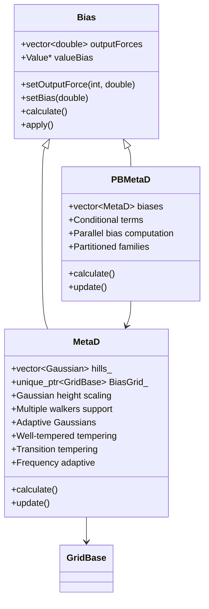
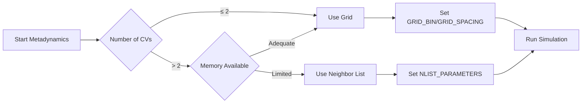

This page provides an in-depth technical examination of metadynamics variants implemented in PLUMED2. Metadynamics is an enhanced sampling algorithm that adds history-dependent bias potentials to overcome energy barriers and explore free energy landscapes. PLUMED2 implements multiple sophisticated variants extending the original metadynamics concept, each addressing specific challenges in free energy calculations.

## Architecture Overview

The metadynamics variants architecture follows a hierarchical design pattern centered on the `Bias` base class. All metadynamics implementations inherit from `Bias`, which itself extends `ActionPilot`, `ActionWithValue`, and `ActionWithArguments` to provide the fundamental action execution framework [src/bias/Bias.h](src/bias/Bias.h#L27-L43).



The core `MetaD` class handles the fundamental metadynamics algorithm with extensive variant support [src/bias/MetaD.cpp](src/bias/MetaD.cpp#L500-L699), while `PBMetaD` orchestrates multiple one-dimensional metadynamics biases for parallel bias metadynamics [src/bias/PBMetaD.cpp](src/bias/PBMetaD.cpp#L1-L150).

## Standard Metadynamics

Standard metadynamics builds a history-dependent bias potential by periodically adding Gaussian kernels at the current position in collective variable space:

$$V(\vec{s},t) = \sum_{ k \tau < t} W(k \tau) \exp\left(-\sum_{i=1}^{d} \frac{(s_i-s_i^{(0)}(k \tau))^2}{2\sigma_i^2}\right)$$

The implementation stores Gaussian kernels in a `std::vector<Gaussian> hills_` container [src/bias/MetaD.cpp](src/bias/MetaD.cpp#L520). For efficiency in long simulations, the bias can be stored on a grid (`BiasGrid_`), avoiding linear-time complexity growth with simulation length [src/bias/MetaD.cpp](src/bias/MetaD.cpp#L106-L150).

> [!TIP]
> Grid storage is essential for simulations exceeding ~10,000 steps. Without grids, computational cost scales linearly with the number of hills. The default grid spacing is 1/5 of the Gaussian width (SIGMA) unless explicitly specified via GRID_BIN or GRID_SPACING parameters.

### Grid-Based Implementation

Grid-based metadynamics provides significant computational advantages:

| Parameter | Description | Default |
|-----------|-------------|---------|
| GRID_MIN | Lower bounds for grid | Required if using grid |
| GRID_MAX | Upper bounds for grid | Required if using grid |
| GRID_BIN | Number of bins per dimension | Calculated from spacing |
| GRID_SPACING | Approximate grid spacing | σ/5 (Gaussian width/5) |
| GRID_SPARSE | Use sparse grid storage | False |
| GRID_NOSPLINE | Disable spline interpolation | False |

Example grid configuration:
```plumed
t1: TORSION ATOMS=1,2,3,4
t2: TORSION ATOMS=5,6,7,8
m: METAD ARG=t1,t2 SIGMA=0.1,0.1 HEIGHT=1.2 PACE=500 
       GRID_MIN=-pi,-pi GRID_MAX=pi,pi GRID_BIN=100,100
```

### Neighbor List Optimization

For high-dimensional CV spaces (>2 variables), neighbor lists provide an alternative to grids. The neighbor list (`nlist_`) tracks nearby Gaussian kernels and only evaluates those within a cutoff distance [src/bias/MetaD.cpp](src/bias/MetaD.cpp#L1090-L1120).

> [!TIP]
> Use NLIST with more than 2 CVs when grid memory becomes prohibitive. The default cutoff parameters (6.0 for distance cutoff, 0.5 for rebuild condition) can be tuned via NLIST_PARAMETERS, but values outside the recommended range may introduce systematic errors.

Neighbor list parameters:
- **NLIST**: Enable neighbor list optimization
- **NLIST_PARAMETERS**: Vector of two parameters (cutoff multiplier, rebuild threshold)
- **nlker**: Output component showing number of evaluated kernels
- **nlsteps**: Steps since last neighbor list update

## Well-Tempered Metadynamics

Well-tempered metadynamics improves convergence by scaling Gaussian heights based on the current bias value:

$$V(\vec{s},t)= \sum_{t'=0,\tau_G,2\tau_G,\dots}^{t'<t} W e^{-V(\vec{s}(\vec{q}(t'),t')/\Delta T} \exp\left(-\sum_{i=1}^{d} \frac{(s_i(\vec{q})-s_i(\vec{q}(t'))^2}{2\sigma_i^2}\right)$$

The implementation tracks the bias factor (`biasf_`) which determines the effective temperature increase: ΔT = (biasf_ - 1)T [src/bias/MetaD.cpp](src/bias/MetaD.cpp#L508-L509). Heights are tempered using the `temperHeight()` method that applies the exponential scaling factor.

**Configuration options**:
- **BIASFACTOR**: Bias factor γ > 1 (required for well-tempered)
- **TEMP**: System temperature (required)
- **TAU**: Alternative to HEIGHT, sets height = (k_BΔT×pace×timestep)/τ

Example:
```plumed
d1: DISTANCE ATOMS=3,5
d2: DISTANCE ATOMS=2,4
restraint: METAD ARG=d1,d2 SIGMA=0.2,0.2 HEIGHT=0.3 BIASFACTOR=10 PACE=500
```

> [!TIP]
> When using well-tempered metadynamics, the HILLS file contains the negative free-energy estimate (not the bias potential). This allows restarting simulations with different BIASFACTOR values—the applied bias automatically scales accordingly.

## Parallel Bias Metadynamics (PBMetaD)

Parallel Bias Metadynamics addresses the curse of dimensionality by applying multiple low-dimensional (one-dimensional in current implementation) bias potentials in parallel rather than a single high-dimensional bias [src/bias/PBMetaD.cpp](src/bias/PBMetaD.cpp#L1-L150).

The bias potential is defined as:

$$V_{PB}(\vec{s},t) = -k_B T \log{\sum_{i=1}^N \exp\left(- \frac{V(s_i,t)}{k_B T}\right)}$$

Each individual bias uses conditional Gaussian heights:

$$W_i(k \tau)=W_0 \frac{\exp\left(- \frac{V(s_i,k \tau)}{k_B T}\right)}{\sum_{i=1}^N \exp\left(- \frac{V(s_i,k \tau)}{k_B T}\right)}$$

### Implementation Structure

PBMetaD maintains a collection of one-dimensional metadynamics biases, each stored in a separate HILLS file (HILLS.PF0, HILLS.PF1, etc.) [regtest/basic/rt-pbmetadpf1](regtest/basic/rt-pbmetadpf1).

**Partitioned Families**: CVs can be grouped into families for more efficient handling of systems with multiple CVs sharing identical properties [src/bias/PBMetaD.cpp](src/bias/PBMetaD.cpp#L130-L140):

```plumed
# Example with partitioned families (PF keywords)
PBMETAD ...
  ARG=cv1,cv2,cv3,cv4
  SIGMA=0.1,0.2  # One set per family, not per CV
  PF1=cv1,cv2    # First family with 2 CVs
  PF2=cv3,cv4    # Second family with 2 CVs
...
```

### PBMetaD vs Standard MetaD

| Feature | Standard MetaD | PBMetaD |
|---------|---------------|---------|
| Dimensionality | Any (single bias) | Multiple 1D biases in parallel |
| CV Correlation | Captured in single bias | Limited by independence assumption |
| Grid Memory | Scales as (bins)^d | Scales as d×bins |
| Convergence | Can be slow in high dimensions | Faster for high-dimensional problems |
| HILLS Files | Single file | Multiple files (one per family) |

## Advanced Metadynamics Variants

### Transition-Tempered Metadynamics

Transition-tempered metadynamics focuses sampling on specific transition pathways rather than uniform exploration. It calculates the maximum bias along paths between predefined wells [src/bias/MetaD.cpp](src/bias/MetaD.cpp#L2570-L2599):

**Configuration**:
- **CALC_TRANSITION_BIAS**: Enable transition bias calculation
- **TRANSITIONWELLn**: Coordinates for each well (multiple instances)

Example from regression test:
```plumed
METAD ...
  ARG=psi
  SIGMA=0.20
  HEIGHT=1.20
  CALC_TRANSITION_BIAS
  TRANSITIONWELL0=1.0
  TRANSITIONWELL1=2.0
  TEMP=300.0
  PACE=500
  FILE=HILLS-transition
... METAD
```

The `getTransitionBarrierBias()` method efficiently computes the minimum transition barrier by examining paths between well pairs, using graph theory to reduce the number of path evaluations needed [src/bias/MetaD.cpp](src/bias/MetaD.cpp#L2570-L2600).

### Frequency Adaptive Metadynamics

Frequency adaptive metadynamics dynamically adjusts the hill deposition frequency based on the metadynamics acceleration factor, optimizing computational efficiency [src/bias/MetaD.cpp](src/bias/MetaD.cpp#L550-L570):

**Key parameters**:
- **FREQUENCY_ADAPTIVE**: Enable frequency adaptation
- **FA_UPDATE_FREQUENCY**: How often to update pace (default = PACE)
- **FA_MAX_PACE**: Maximum allowed pace
- **FA_MIN_ACCELERATION**: Minimum acceleration factor before increasing pace

Example:
```plumed
METAD ...
  ARG=sum_abs
  HEIGHT=0.4
  BIASFACTOR=25
  TEMP=300.0
  SIGMA=0.04
  PACE=2
  FREQUENCY_ADAPTIVE
  FA_MAX_PACE=8
  FA_UPDATE_FREQUENCY=2
  FA_MIN_ACCELERATION=2.0
  ACCELERATION
... METAD
```

The `updateFrequencyAdaptiveStride()` method monitors the acceleration factor and increases the deposition pace when sampling is sufficiently accelerated [regtest/basic/rt-fametad-1](regtest/basic/rt-fametad-1/plumed.dat#L1-L23).

### Adaptive Gaussian Kernels

Standard metadynamics uses fixed-width Gaussian kernels. Adaptive variants dynamically adjust kernel widths based on:

1. **Geometric adaptation** (`ADAPTIVE=GEOM`): Width scales to cover a fixed Cartesian distance (specified in distance units)
2. **Diffusion adaptation** (`ADAPTIVE=DIFF`): Width scales to cover CV space over a fixed time (specified in timesteps) [src/bias/MetaD.cpp](src/bias/MetaD.cpp#L530-L540)

```plumed
# Geometric adaptation - covers 0.05 nm in Cartesian space
METAD ARG=d1,d2 SIGMA=0.05 HEIGHT=0.3 PACE=500 ADAPTIVE=GEOM

# Diffusion adaptation - covers 20 time steps in CV space
METAD ARG=d1,d2 SIGMA=20 HEIGHT=0.3 PACE=500 ADAPTIVE=DIFF
```

Width bounds can be enforced with SIGMA_MIN and SIGMA_MAX to prevent excessive width variation. Note that adaptive kernels require special integration techniques when reconstructing free energies using `sum_hills`.

## Multiple Walkers Metadynamics

Multiple walkers metadynamics distributes the sampling workload across multiple simulations that share Gaussian kernels. Two implementations exist:

### File-Based Multiple Walkers
Multiple independent simulations share a directory and periodically read each other's HILLS files:

```plumed
METAD ...
  ARG=d1
  SIGMA=0.05
  HEIGHT=0.3
  PACE=500
  WALKERS_N=10
  WALKERS_ID=0
  WALKERS_DIR=./shared_hills
  WALKERS_RSTRIDE=500
... METAD
```

### MPI-Based Multiple Walkers
For better performance with many walkers, MPI communication can be used instead of file I/O [src/bias/MetaD.cpp](src/bias/MetaD.cpp#L1130-L1160):

```plumed
METAD ...
  ARG=d1
  SIGMA=0.05
  HEIGHT=0.3
  PACE=500
  WALKERS_MPI
  WALKERS_DIR=./shared_hills
... METAD
```

> [!TIP]
> MPI-based multiple walkers is significantly more efficient than file-based approaches for large walker counts (>10). However, it requires PLUMED to be compiled with MPI support and properly initialized communicators.

## Interval Metadynamics

Interval metadynamics applies bias forces only within specified CV ranges, useful when only part of CV space is of interest [src/bias/MetaD.cpp](src/bias/MetaD.cpp#L1160-L1190):

**Features**:
- Bias force = 0 outside interval
- Bias potential continues to be updated (Gaussian kernels added everywhere)
- Tails of kernels outside interval still influence bias within interval

```plumed
r2g: DISTANCE ATOMS=1,2
m2g: METAD ARG=r2g HEIGHT=0.1 PACE=500 SIGMA=1.0 INTERVAL=4,8 
       FILE=H2G GRID_MIN=0 GRID_MAX=20 GRID_BIN=100
lw: LOWER_WALLS ARG=r2g AT=4 KAPPA=100
uw: UPPER_WALLS ARG=r2g AT=8 KAPPA=100
```

> [!TIP]
> Interval metadynamics is designed for one-dimensional biases only. The boundary should be placed where the free energy derivative is small. If a free energy minimum exists outside the interval, combine with WALLS to prevent the system from falling into it.

## Variant Comparison Matrix

| Variant | Primary Benefit | Dimensionality | Key Parameters | Computational Cost |
|---------|-----------------|----------------|----------------|-------------------|
| Standard | Simple, exact | Any | HEIGHT, SIGMA, PACE | O(N) without grid |
| Well-Tempered | Better convergence | Any | BIASFACTOR, TEMP | Same as standard |
| PBMetaD | High-dimensional efficiency | High (via 1D biases) | PF1, PF2, ... | Linear in d×bins |
| Transition-Tempered | Path-specific sampling | Any | TRANSITIONWELLn | O(N) + path search |
| Frequency Adaptive | Optimal pace | Any | FREQUENCY_ADAPTIVE, FA_MAX_PACE | Variable |
| Adaptive Gaussians | Variable roughness | Any | ADAPTIVE, SIGMA_MIN/MAX | Same as standard |
| Multiple Walkers | Parallel exploration | Any | WALKERS_N, WALKERS_DIR | Distributed |
| Interval | Targeted region | 1D only | INTERVAL | Same as standard |

## Performance Optimization Strategies

### Grid vs Neighbor List Selection



**Guidelines**:
- Use grids for ≤2 CVs or when memory permits
- Use neighbor lists for >2 CVs with limited memory
- Default grid spacing (σ/5) works well for most applications
- Tune NLIST_PARAMETERS only if needed for accuracy vs. performance

### Multiple Time Stepping

The STRIDE parameter allows applying bias forces every N steps while updating bias every PACE steps, reducing computational cost for expensive CVs [src/bias/module.md](src/bias/module.md#L15-L40):

```plumed
# Standard: bias updates every 500 steps, applied every 1 step
METAD ARG=d HEIGHT=1 SIGMA=0.1 BIASFACTOR=5 PACE=500

# Optimized: bias updates every 500 steps, applied every 2 steps
# Forces scaled by factor of 2
METAD ARG=d HEIGHT=1 SIGMA=0.1 BIASFACTOR=5 PACE=500 STRIDE=2
```

> [!TIP]
> Multiply forces by STRIDE to conserve total bias impulse. This introduces a small systematic error proportional to STRIDE but can provide significant speedups (up to 2x) for expensive CV calculations involving many atoms.

## Reweighting and Analysis

### Reweighting Factor c(t)

For well-tempered metadynamics, the reweighting factor c(t) enables reconstruction of unbiased distributions:

$$c(t) = k_B T \ln\left[\frac{\int \exp(-\beta V(\vec{s},t)) d\vec{s}}{\int \exp(-\beta F(\vec{s},t)) d\vec{s}}\right]$$

Implementation via `computeReweightingFactor()` uses grid integration to compute partition function ratios [src/bias/MetaD.cpp](src/bias/MetaD.cpp#L2650-L2690):

**Configuration**:
- **CALC_RCT**: Enable reweighting factor calculation
- **RCT_USTRIDE**: Update frequency for c(t) calculation (default = 1)
- **rbias**: Output component = bias - rct (normalized bias)

### Work Calculation

The total work performed by the metadynamics bias can be accumulated for analysis [src/bias/MetaD.cpp](src/bias/MetaD.cpp#L2500-L2530):

```plumed
METAD ARG=mu1,vol SIGMA=0.1,0.2 HEIGHT=1.0 PACE=10 
       GRID_MIN=-5,20 GRID_MAX=5,40 GRID_BIN=100,100 CALC_WORK
```

Note that work calculation is expensive when not using grids.

## Implementation Details

### Gaussian Representation

The `Gaussian` struct encapsulates all kernel parameters [src/bias/MetaD.cpp](src/bias/MetaD.cpp#L480-L500):

```cpp
struct Gaussian {
  std::vector<double> center;
  std::vector<double> sigma;
  std::vector<double> invsigma;
  double height;
  std::vector<unsigned> indices;
  // Methods for evaluation
  double evaluate(const std::vector<double>& point) const;
  double evaluateWithDerivatives(const std::vector<double>& point, 
                                 std::vector<double>& derivs) const;
};
```

Hills can be multivariate (full covariance matrix) or diagonal, with backward compatibility for legacy Gaussian kernels.

### Update Cycle

The metadynamics update cycle [src/bias/MetaD.cpp](src/bias/MetaD.cpp#L2400-L2550):

1. **Check deposition condition**: `getStep() % stride_ == 0`
2. **Add new hill** (if condition met): `addGaussian()` with tempered height
3. **Multiple walkers sync**: Read hills from other walkers (file or MPI)
4. **Grid update**: Rebuild grid if using grid storage
5. **Special calculations**: Update rct, max_bias, transition_bias if requested
6. **Neighbor list update**: Rebuild if CVs moved significantly

### Force Application

Forces are applied through the `Bias::setOutputForce()` method [src/bias/Bias.h](src/bias/Bias.h#L68-L73), which stores forces and updates derivatives:

```cpp
void setOutputForce(int i, double force) {
  outputForces[i] = force;
  valueBias->addDerivative(i, -force);
}
```

## Troubleshooting Guide

| Issue | Likely Cause | Solution |
|-------|-------------|----------|
| Simulation stalls | Grid too fine, memory exhaustion | Reduce GRID_BIN or switch to NLIST |
| Poor convergence | BIASFACTOR too low or too high | Try BIASFACTOR between 10-20; monitor free energy plateau |
| Excessive force spikes | SIGMA too small | Increase SIGMA or use SIGMA_MIN with adaptive Gaussians |
| Restart fails | HILLS file format mismatch | Ensure same ADAPTIVE settings; check periodicity |
| Wrong free energy | Forgot c(t) reweighting | Use CALC_RCT and rbias output for unbiased distributions |
| Interval boundary issues | Boundary at large free energy gradient | Move INTERVAL boundaries to flatter regions |

## Next Steps

For understanding how metadynamics variants integrate with the broader PLUMED architecture:

- [Action Framework and Execution Model](6-action-framework-and-execution-model) - Learn about the Action registration system that makes METAD and PBMETAD available
- [PlumedMain and Plugin Interface](7-plumedmain-and-plugin-interface) - Understand how bias actions are loaded and executed
- [Reweighting and Free Energy Analysis](16-reweighting-and-free-energy-analysis) - Detailed methods for analyzing metadynamics trajectories

For implementing custom variants:

- [Creating New Bias Methods](25-creating-new-bias-methods) - Guide to extending the Bias class for novel metadynamics approaches
- [Module Architecture and Design](23-module-architecture-and-design) - Understanding how the bias module is structured and extended

## References and Test Cases

Comprehensive regression tests validate all metadynamics variants:
- **Standard/Well-Tempered**: `regtest/basic/rt-mpi6`, `regtest/basic/rt-mpi7`
- **PBMetaD**: `regtest/basic/rt-pbmetadpf1`, `regtest/basic/rt-pbmetadpf1-mpi`
- **Transition-Tempered**: `regtest/basic/rt-ttmetad0` with periodic/non-periodic test cases
- **Frequency Adaptive**: `regtest/basic/rt-fametad-1`
- **Multiple Walkers**: `regtest/basic/rt-fametad-2-restart`

These tests provide working examples of all configurations discussed in this documentation.
