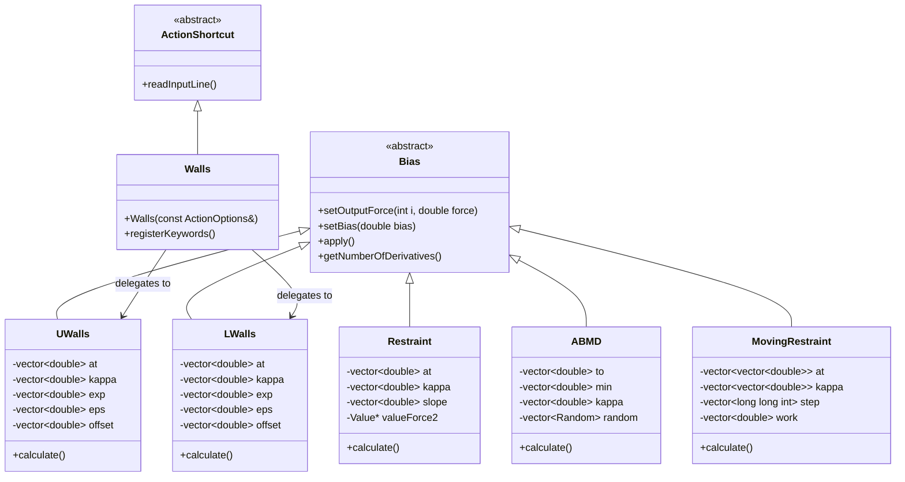
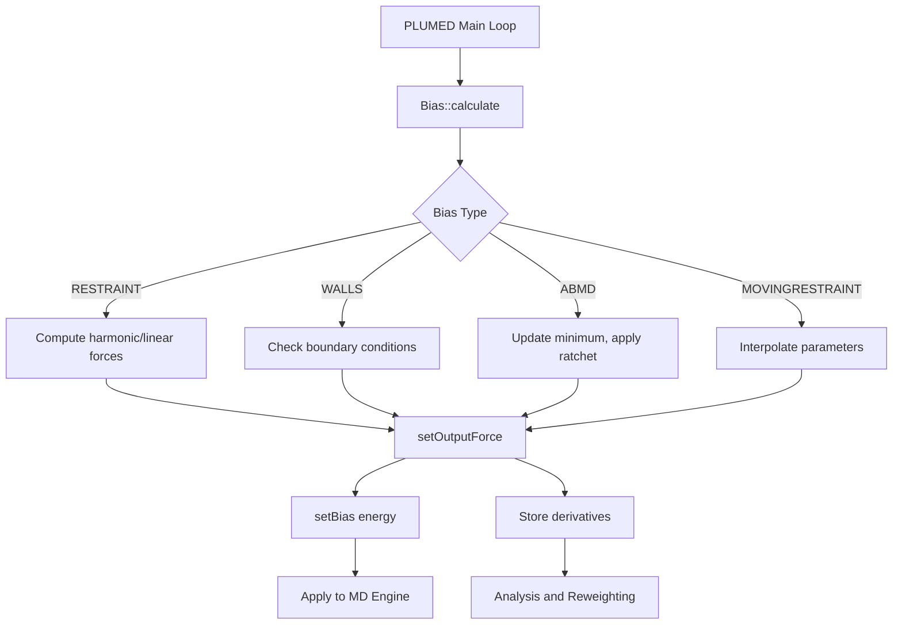

Restraints and walls form a fundamental class of bias potentials in PLUMED that enable controlled exploration of conformational space and confinement of collective variables (CVs) within specified boundaries. These methods are essential tools for directing simulations, preventing unwanted structural transitions, and enabling systematic sampling protocols. This documentation provides intermediate-level developers with architectural insights, mathematical foundations, and implementation details for understanding and extending restraint-based biasing methods in PLUMED.

## Architectural Overview

The restraint and walls functionality in PLUMED is implemented through a hierarchical class structure that leverages the `Bias` base class for force application and energy computation. The architecture distinguishes between direct bias implementations and shortcut-based composite actions that assemble complex biasing behaviors from primitive operations.



The `Bias` base class provides the fundamental interface for applying forces and storing energy contributions through the `setOutputForce()` and `setBias()` methods [src/bias/Bias.h#L63-L71]. Each concrete restraint implementation overrides the `calculate()` method to compute forces and energies according to its specific mathematical formulation.

## Mathematical Foundations and Implementations

### RESTRAINT: Harmonic and Linear Restraints

The `RESTRAINT` action implements the most fundamental biasing potential, combining harmonic and linear force contributions to restrain CVs around specified equilibrium values. For scalar CV inputs, the potential takes the form:

$$V(\mathbf{x}) = \sum_i \left[\frac{k_i}{2}(x_i - a_i)^2 + m_i(x_i - a_i)\right]$$

where $k_i$ is the harmonic force constant (`KAPPA`), $a_i$ is the equilibrium position (`AT`), and $m_i$ is the linear force constant (`SLOPE`). The implementation in `Restraint::calculate()` computes the force for each argument as $f = -(k \cdot \text{cv} + m)$ where $\text{cv}$ represents the difference between the current CV value and the equilibrium position [src/bias/Restraint.cpp#L122-L135].

For vector or matrix CV inputs, the formulation extends to:

$$V(\mathbf{x}) = \sum_i \sum_j \left[\frac{k_i}{2}(x_{ij} - a_i)^2 + m_i(x_{ij} - a_i)\right]$$

where the sum over $j$ iterates over all components of each CV argument. This design enables simultaneous restraint of multiple collective variables with independent force constants and equilibrium positions [src/bias/Restraint.cpp#L42-L57].

### UPPER_WALLS and LOWER_WALLS: Soft Constraints

Wall potentials provide one-sided constraints that become active only when CVs cross specified boundaries. These are particularly useful for preventing unphysical conformations or confining sampling to relevant regions of CV space.

**UPPER_WALLS** activates when a CV exceeds a threshold:

$$V(\mathbf{x}) = \sum_i k_i\left(\frac{x_i - a_i + o_i}{s_i}\right)^{e_i} \quad \text{for } x_i - a_i + o_i > 0$$

**LOWER_WALLS** activates when a CV falls below a threshold:

$$V(\mathbf{x}) = \sum_i k_i\left|\frac{x_i - a_i - o_i}{s_i}\right|^{e_i} \quad \text{for } x_i - a_i - o_i < 0$$

Parameters include $k_i$ (`KAPPA`), $a_i$ (`AT`), $o_i$ (`OFFSET`), $s_i$ (`EPS`), and $e_i$ (`EXP`). The implementation uses conditional checks to apply forces only when the CV violates the wall constraint, with the force calculated as $f = -(k/\epsilon) \cdot e \cdot x^{e-1}$ where $x$ is the scaled distance from the wall [src/bias/UWalls.cpp#L134-L152] [src/bias/LWalls.cpp#L136-L154].

The architecture employs a `Walls` shortcut class that dispatches to either `UPPER_WALLS_SCALAR` or `LOWER_WALLS_SCALAR` implementations based on the action name and input rank [src/bias/Walls.cpp#L41-L148]. This design pattern separates user-facing syntax from computational implementation.

### ABMD: Adaptive Biasing MD with Ratchet Mechanism

The **ABMD** (Adaptive Biasing MD) implements a ratchet-and-pawl mechanism that guides systems toward target CV values while permitting free movement in the desired direction. The biasing potential is:

$$V(\rho(t)) = \begin{cases} \frac{K}{2}[\rho(t) - \rho_m(t)]^2 & \rho(t) > \rho_m(t) \\ 0 & \rho(t) \leq \rho_m(t) \end{cases}$$

where $\rho(t) = (CV(t) - TO)^2$ and $\rho_m(t) = \min_{0 \leq \tau \leq t} \rho(\tau) + \eta(t)$. The algorithm updates $\rho_m(t)$ to track the minimum distance to the target, adding optional white noise $\eta(t)$ controlled by `NOISE` and `SEED` parameters [src/bias/ABMD.cpp#L45-L67].

The force calculation in `ABMD::calculate()` applies forces only when the CV moves away from the target, with $f = -2k(\rho - \rho_m) \cdot CV$. The minimum tracking uses conditional updates: if $\rho < \rho_m$ or $\rho_m < 0$ (initialization), $\rho_m$ is updated; otherwise, noise is added and the harmonic restraint is applied [src/bias/ABMD.cpp#L148-L172].

### MOVINGRESTRAINT: Time-Dependent Restraints for Steered MD

**MOVINGRESTRAINT** enables time-dependent harmonic restraints essential for steered molecular dynamics and Jarzynski sampling. The potential takes the form:

$$V(\mathbf{s}, t) = \frac{1}{2} \kappa(t) [\mathbf{s} - \mathbf{s}_0(t)]^2$$

Both the force constant $\kappa(t)$ and equilibrium position $\mathbf{s}_0(t)$ can vary with time through linear interpolation between specified milestones. The user defines these milestones using numbered `STEPx`, `ATx`, and `KAPPAx` keywords, where $x$ indexes the milestones [src/bias/MovingRestraint.cpp#L85-L120].

The implementation stores arrays of parameters for each milestone and computes interpolated values during each timestep. The `VERSE` parameter controls whether the restraint acts on both sides of the equilibrium value (default "B"), only above ("U" for upper wall), or only below ("L" for lower wall) [src/bias/MovingRestraint.cpp#L106-L112].

> [!TIP]
> MOVINGRESTRAINT outputs work components (`_work`) for each CV that accumulate the energy transferred during restraint movement, enabling Jarzynski equality applications. However, work computation is not accurate when KAPPA varies with time, as documented in the implementation notes.

## Component Architecture and Data Flow

Restraint implementations follow a consistent pattern for component registration and output management. All bias actions expose a `.bias` component containing the instantaneous bias energy and a `.force2` component containing the squared force magnitude, useful for monitoring the strength of applied biases [src/bias/Restraint.cpp#L95-L99] [src/bias/UWalls.cpp#L81-L85].

The force application mechanism leverages the `Bias::setOutputForce()` method, which simultaneously updates the output force vector and sets the partial derivative of the bias with respect to each argument [src/bias/Bias.h#L63-L71]. This ensures consistent force transmission to the MD engine and proper derivative computation for subsequent analysis.



## Parameter Specification and Validation

Restraint implementations use PLUMED's keyword parsing system with automatic vector size validation. The `parseVector()` method ensures that parameter arrays (`KAPPA`, `AT`, `SLOPE`, etc.) have dimensions matching the number of CV arguments, preventing mismatched parameter specifications [src/bias/Restraint.cpp#L88-L92].

For vector and matrix CV inputs, the wall implementations compute sums over all components while maintaining a single set of parameters per argument. This design allows consistent parameter specification regardless of CV rank, with the implementation handling the component-wise summation internally [src/bias/Walls.cpp#L61-L148].

> [!TIP]
> When using vector or matrix CVs with walls, remember that `KAPPA`, `AT`, `OFFSET`, `EXP`, and `EPS` arrays must have length equal to the number of arguments, not the total number of components. Each parameter applies to all components of the corresponding argument.

## Usage Patterns and Examples

### Basic Harmonic Restraint

The following example demonstrates simultaneous restraint of two distance CVs with independent equilibrium positions and force constants:

```plumed
d1: DISTANCE ATOMS=3,5
d2: DISTANCE ATOMS=2,4
restraint: RESTRAINT ARG=d1,d2 AT=1.0,1.5 KAPPA=150.0,150.0
PRINT ARG=restraint.bias
```

### Combined Upper and Lower Walls

Walls can define bounded regions in CV space, useful for confining sampling to physically relevant ranges:

```plumed
d1: DISTANCE ATOMS=3,5
d2: DISTANCE ATOMS=2,4
uwall: UPPER_WALLS ARG=d1,d2 AT=1.0,1.5 KAPPA=150.0,150.0 EXP=2,2 EPS=1,1 OFFSET=0,0
lwall: LOWER_WALLS ARG=d1,d2 AT=0.0,1.0 KAPPA=150.0,150.0 EXP=2,2 EPS=1,1 OFFSET=0,0
PRINT ARG=uwall.bias,lwall.bias
```

This configuration restricts `d1` to the range [0.0, 1.0] and `d2` to [1.0, 1.5] with harmonic walls that become increasingly stiff as the CV approaches the boundaries.

### ABMD Ratchet Guidance

The ABMD method guides CVs toward target values without forcing work when the system moves favorably:

```plumed
DISTANCE ATOMS=3,5 LABEL=d1
DISTANCE ATOMS=2,4 LABEL=d2
ABMD ARG=d1,d2 TO=1.0,1.5 KAPPA=5.0,5.0 LABEL=abmd
PRINT ARG=abmd.bias,abmd.d1_min,abmd.d2_min
```

The `_min` components output the tracked minimum distance to the target values, providing insight into the biasing process.

### Steered MD with MOVINGRESTRAINT

For controlled pulling protocols, MOVINGRESTRAINT provides time-dependent harmonic restraints:

```plumed
DISTANCE ATOMS=2,4 LABEL=d
MOVINGRESTRAINT ...
  ARG=d
  STEP0=0    AT0=1.0 KAPPA0=100.0
  STEP1=1000 AT1=2.0
  STEP2=2000 AT2=1.0
  STEP3=2500         KAPPA3=0.0
... MOVINGRESTRAINT
```

This example pulls the distance from 1.0 to 2.0 over 1000 steps, returns it to 1.0 over the next 1000 steps, then gradually releases the restraint over the final 500 steps.

## Computational Considerations

The computational overhead of restraint calculations scales linearly with the number of CV arguments and, for wall implementations, the total number of CV components. Force calculations involve elementary arithmetic operations with minimal branching, making them efficient for routine use in production simulations.

For periodic CVs, all implementations use the `difference()` method to compute properly wrapped distance measures, ensuring consistent behavior across periodic boundaries [src/bias/Restraint.cpp#L125]. This automatic handling of periodicity prevents artificial forces at periodic boundaries.

Memory requirements are minimal, typically storing only parameter arrays and output components. The implementations avoid dynamic allocation during force calculation cycles, maintaining performance-critical efficiency.

## Integration with Advanced Sampling

Restraints and walls integrate seamlessly with other PLUMED biasing methods. They can be combined with metadynamics for targeted sampling, used as reference systems for reweighting calculations, or employed as constraints in umbrella sampling protocols.

The output components (`.bias`, `.force2`, and specialized components like `_work`, `_min`, and `_cntr`) can be used directly in analysis pipelines or as inputs to other PLUMED actions, enabling sophisticated biasing protocols through action composition.

For free energy calculations using umbrella sampling, `RESTRAINT` provides the harmonic windows with explicit control over equilibrium positions and force constants. The `MOVINGRESTRAINT` work outputs enable direct application of the Jarzynski equality for non-equilibrium pulling simulations.

## Error Handling and Validation

The implementations include comprehensive parameter validation:

- Automatic checking that parameter vector sizes match argument counts
- Validation that step indices in `MOVINGRESTRAINT` are monotonically increasing
- Verification that CV arguments have consistent ranks when using composite actions
- Protection against invalid parameter combinations

Error messages provide clear diagnostic information to guide users toward correct parameter specifications, with validation occurring at action initialization to fail fast rather than during production runs.

## Next Steps

For deeper understanding of PLUMED's biasing architecture, consult [Bias Methods Overview](14-metadynamics-variants) and the [Action Framework and Execution Model](6-action-framework-and-execution-model). Developers extending restraint functionality should examine the [Module Architecture and Design](23-module-architecture-and-design) and [Creating New Bias Methods](25-creating-new-bias-methods) documentation. The regression test suite in `regtest/basic/rt-WALLS-sign/` and `regtest/basic/rt-moving-restraint-pbc/` provides practical examples of correct usage and expected behavior [regtest/basic/rt-WALLS-sign/plumed.dat#L1-L13] [regtest/basic/rt-moving-restraint-pbc/plumed.dat#L1-L11].