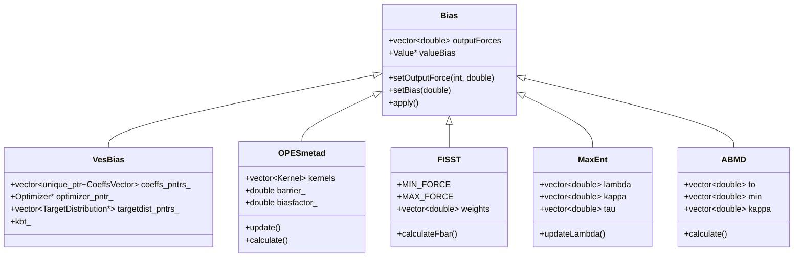

Advanced biasing techniques in PLUMED extend beyond standard metadynamics to provide sophisticated sampling strategies for complex free energy landscapes. This documentation examines the architectural patterns, implementation details, and advanced features of cutting-edge biasing methods including On-the-fly Probability Enhanced Sampling (OPES), Variationally Enhanced Sampling (VES), Infinite Switch Simulated Tempering (FISST), and specialized biasing approaches like Maximum Entropy (MaxEnt) and Adaptive Biasing with Mechanical Detachment (ABMD).

Sources: [src/bias/module.md](src/bias/module.md#L1-L55), [src/opes/module.md](src/opes/module.md#L1-L25), [src/ves/module.md](src/ves/module.md#L1-L9)

## Architecture Overview

PLUMED's advanced biasing framework is built on a modular architecture where each method inherits from the base `Bias` class while introducing specialized mechanisms for probability estimation, variational optimization, and adaptive reweighting. The architecture enables methods to target arbitrary distributions beyond Boltzmann statistics, compute free energies on-the-fly, and implement sophisticated ensemble strategies.

Sources: [src/bias/Bias.h](src/bias/Bias.h#L1-L83), [src/ves/VesBias.h](src/ves/VesBias.h#L1-L100)



## On-the-fly Probability Enhanced Sampling (OPES)

### Core Architecture

OPES implements a fundamentally different approach to enhanced sampling by building bias potentials that target specified probability distributions through on-the-fly estimation using kernel density estimation. Unlike metadynamics which fills basins incrementally, OPES rapidly constructs a coarse free energy surface and refines details, achieving quasi-static bias behavior that enables standard umbrella sampling reweighting.

Sources: [src/opes/OPESmetad.cpp](src/opes/OPESmetad.cpp#L1-L100)

The bias potential at step n is given by:

$$
V_n(\mathbf{s}) = (1-1/\gamma)\frac{1}{\beta}\log\left(\frac{P_n(\mathbf{s})}{Z_n}+\epsilon\right)
$$

where \(P_n(\mathbf{s})\) is the estimated unbiased distribution via kernel density estimation, \(Z_n\) is a normalization factor, \(\gamma\) is the bias factor, and \(\epsilon\) is a small constant for numerical stability.

Sources: [src/opes/OPESmetad.cpp](src/opes/OPESmetad.cpp#L24-L35)

### Implementation Features

**OPES_METAD** targets well-tempered distributions by default, with the capability to target uniform distributions by setting `BIASFACTOR=inf`. The implementation includes:

1. **Adaptive Kernel Compression**: Prevents linear growth of kernel count while maintaining bias accuracy
2. **Adaptive Sigma Estimation**: Automatically determines kernel widths from CV fluctuations over `ADAPTIVE_SIGMA_STRIDE` steps
3. **Excluded Regions**: Allows specification of CV-space regions where kernels are not deposited, useful for rate calculations
4. **Extra Bias Integration**: Can account for other bias potentials during internal reweighting via `EXTRA_BIAS` keyword

Sources: [src/opes/OPESmetad.cpp](src/opes/OPESmetad.cpp#L40-L80)

**Critical Implementation Detail**: OPES is more sensitive to degenerate collective variables than metadynamics. If CVs map different metastable basins to the same CV-space region, OPES will remain stuck rather than reshaping the bias. This property can be diagnostic for CV quality issues.

Sources: [src/opes/OPESmetad.cpp](src/opes/OPESmetad.cpp#L53-L62)

### Expansion Collective Variables (ECVs)

The OPES module implements Expansion Collective Variables that define expanded ensembles for sampling with OPES_EXPANDED. These ECVs transform regular CVs into components that enable replica-exchange-like sampling without requiring multiple replicas.

Sources: [src/opes/ExpansionCVs.h](src/opes/ExpansionCVs.h#L1-L80)

ECV Types:
- **ECVlinear**: Linear expansion for temperature/pressure multi-dimensional sampling
- **ECVmultiThermal**: Multi-thermal ensemble sampling
- **ECVmultiThermalBaric**: Multi-thermal and multi-baric ensemble sampling
- **ECVumbrellas**: Umbrella sampling expansion from file or line definitions
- **ECVcustom**: Custom expansion distributions

Sources: [src/opes/module.md](src/opes/module.md#L18-L25)

## Variationally Enhanced Sampling (VES)

### Mathematical Foundation

VES formulates enhanced sampling as a variational problem where the bias potential is expanded in a basis set and coefficients are optimized to minimize the difference between sampled and target distributions. The method represents the bias as:

$$
V(\mathbf{s};\mathbf{c}) = \sum_{\alpha} c_\alpha f_\alpha(\mathbf{s})
$$

where \(f_\alpha(\mathbf{s})\) are basis functions and \(\mathbf{c}\) are optimized coefficients.

Sources: [src/ves/VesBias.h](src/ves/VesBias.h#L1-L100), [src/ves/VesBias.cpp](src/ves/VesBias.cpp#L1-L150)

### Core Architecture Components

**VesBias Class**: Extends the base Bias class with specialized functionality for variational optimization:

1. **Coefficient Management**: `CoeffsVector` and `CoeffsMatrix` classes handle optimization parameters
2. **Target Distributions**: Integrated framework for specifying desired probability distributions
3. **Optimizer Interface**: Pluggable optimization algorithms (Adam, Averaged SGD, Robbins-Monro)
4. **Grid Integration**: Support for grid-based bias evaluation and projection

Sources: [src/ves/VesBias.h](src/ves/VesBias.h#L48-L75)

### Basis Functions

VES provides a comprehensive library of basis function types:

| Basis Type | Mathematical Form | Appropriate For |
|------------|------------------|-----------------|
| **Fourier** | Trigonometric series | Periodic CVs (angles) |
| **Chebyshev** | Orthogonal polynomials | Bounded non-periodic CVs |
| **Gaussian** | Radial basis functions | Localized features |
| **Legendre** | Orthogonal polynomials | Spherical CVs |
| **Cubic B-Splines** | Piecewise polynomials | Smooth, flexible representation |
| **Wavelets** | Multi-resolution basis | Multi-scale features |
| **Custom** | User-defined functions | Specialized requirements |

Sources: [src/ves/module.md](regtest/ves/README.md#L1-L10), [src/ves/VesBias.cpp](src/ves/VesBias.cpp#L90-L150)

### Target Distributions

The VES framework supports diverse target distribution types:

- **Well-Tempered**: \(p^{WT}(\mathbf{s}) \propto [P(\mathbf{s})]^{1/\gamma}\)
- **Uniform**: Flat distribution across CV space
- **Gaussian**: Target Gaussian distribution
- **Multicanonical**: Uniform in energy space
- **Multi-Thermal**: Multi-temperature ensemble
- **Custom**: User-specified distributions

Sources: [src/ves/VesBias.cpp](src/ves/VesBias.cpp#L55-L80)

### Optimization Algorithms

The `Optimizer` abstract base class provides the interface for coefficient optimization:

Sources: [src/ves/Optimizer.h](src/ves/Optimizer.h#L1-L100)

**Available Optimizers**:

| Optimizer | Algorithm | Characteristics |
|-----------|-----------|------------------|
| **OPT_AVERAGED_SGD** | Stochastic Gradient Descent with averaging | Robust convergence, noise averaging |
| **OPT_ADAM** | Adaptive Moment Estimation | Adaptive learning rates, fast convergence |
| **OPT_ROBBINS_MONRO_SGD** | Robbins-Monro stochastic approximation | Theoretical convergence guarantees |
| **OPT_DUMMY** | No optimization | Static bias coefficient evolution |

Sources: [src/ves/Optimizer.h](src/ves/Optimizer.h#L25-L50)

### VES Configuration Example

```plumed
# Fourier basis functions for periodic torsion
bf1: BF_FOURIER ORDER=5 MINIMUM=-pi MAXIMUM=pi

# Well-tempered target distribution
td1: TD_WELLTEMPERED BIASFACTOR=10

# Linear expansion bias
VES_LINEAR_EXPANSION ...
 ARG=phi
 BASIS_FUNCTIONS=bf1
 LABEL=ves1
 TEMP=300.0
 GRID_BINS=100
 TARGET_DISTRIBUTION=td1
... VES_LINEAR_EXPANSION

# Optimizer configuration
OPT_AVERAGED_SGD ...
  BIAS=ves1
  STRIDE=1000
  LABEL=o1
  STEPSIZE=1.0
  COEFFS_FILE=coeffs.data
  FES_OUTPUT=10
  BIAS_OUTPUT=10
... OPT_AVERAGED_SGD
```

Sources: [regtest/ves/rt-le-1d-welltempered/plumed.dat](regtest/ves/rt-le-1d-welltempered/plumed.dat#L1-L51)

## Infinite Switch Simulated Tempering (FISST)

### Algorithm Description

FISST implements the infinite switch limit of simulated tempering, adaptively determining weight parameters to construct a bias function representing optimal linear force coupling for conformational distribution sampling over a range of applied forces.

Sources: [src/fisst/FISST.cpp](src/fisst/FISST.cpp#L1-L100)

The bias modifies the Hamiltonian from:

$$
H(\vec{p},\vec{q}) = \sum_{j} \frac{p_j^2}{2m_j} + U(\vec{q})
$$

to:

$$
H'(\vec{p},\vec{q}) = H(\vec{p},\vec{q}) - \bar{F} Q
$$

where the coupling constant \(\bar{F}\) is determined adaptively:

$$
\bar{F}(Q)=\frac{ \int_{F_{min}}^{F_{max}} e^{\beta F Q(\vec{q})} \omega(F) F dF}{\int_{F_{min}}^{F_{max}} e^{\beta F Q(\vec{q})} \omega(F) dF}
$$

Sources: [src/fisst/FISST.cpp](src/fisst/FISST.cpp#L35-L55)

### Observable Weights and Reweighting

FISST computes observable weights \(W_F(\vec{q}_t)\) for reconstructing averages at different force values:

$$
\langle A \rangle_F = \frac{1}{T} \sum_t W_F(\vec{q}_t) A(\vec{q}_t)
$$

This enables post-processing analysis across the entire force range from a single trajectory.

Sources: [src/fisst/FISST.cpp](src/fisst/FISST.cpp#L55-L65)

### FISST Configuration Example

```plumed
UNITS LENGTH=A TIME=fs ENERGY=kcal/mol

b1: GROUP ATOMS=1
b2: GROUP ATOMS=12
dend: DISTANCE ATOMS=b1,b2

# FISST bias for force range 0-100 pN
f: FISST MIN_FORCE=0 MAX_FORCE=1.44 PERIOD=100 NINTERPOLATE=31 ARG=dend \
       OUT_RESTART=pull.restart.txt OUT_OBSERVABLE=pull.observable.txt \
       OBSERVABLE_FREQ=1000

PRINT ARG=dend,f.dend_fbar,f.bias,f.force2 FILE=pull.colvar.txt STRIDE=1000
```

Sources: [src/fisst/FISST.cpp](src/fisst/FISST.cpp#L66-L85)

## Maximum Entropy Biasing (MaxEnt)

### Principles and Implementation

MaxEnt implements linear biasing potentials satisfying the maximum entropy principle for incorporating experimental constraints or enforcing specific observable averages. The bias potential is:

$$
V_{BIAS}(\boldsymbol{x},t)=K_{B}T\sum_{i=1}^{\#arguments}f_{i}(\boldsymbol{x},t)\lambda_{i}(t)
$$

where Lagrangian multipliers \(\lambda_i\) are updated every PACE steps:

$$
\lambda_{i}=\lambda_{i}+\frac{k_{i}}{1+\frac{t}{\tau_{i}}}\left(f_{exp,i}+\xi_{i}\lambda_{i}-f_{i}(\boldsymbol{x})\right)
$$

Sources: [src/bias/MaxEnt.cpp](src/bias/MaxEnt.cpp#L1-L150)

### Error Modeling

The implementation supports different priors for experimental error modeling:

- **Gaussian prior**: \(\xi_{i}(\lambda)=-\lambda_{i}\sigma^{2}\)
- **Laplace prior**: \(\xi_{i}(\lambda)=-\frac{\lambda_{i}\sigma^{2}}{1-\frac{\lambda^{2}\sigma^{2}}{2}}\)

Setting \(\sigma=0\) enforces pure maximum entropy restraints without noise modeling.

Sources: [src/bias/MaxEnt.cpp](src/bias/MaxEnt.cpp#L35-L55)

### MaxEnt Configuration

```plumed
DISTANCE ATOMS=7,15 LABEL=d1
DISTANCE ATOMS=2,19 LABEL=d2

MAXENT ...
ARG=d1,d2
TYPE=EQUAL
AT=0.2,0.5
KAPPA=35000.0,35000.0
TAU=0.02,0.02
PACE=200
TSTART=100
TEND=500
LABEL=restraint
... MAXENT

PRINT ARG=restraint.bias FILE=restraint.bias STRIDE=200
```

Sources: [src/bias/MaxEnt.cpp](src/bias/MaxEnt.cpp#L85-L115)

## Adaptive Biasing with Mechanical Detachment (ABMD)

### Ratchet Mechanism

ABMD implements a ratchet-and-pawl like restraint that evolves systems toward target values using harmonic potentials that move with thermal fluctuations. The biasing potential is:

$$
V(\rho(t)) = \left \{ 
\begin{array}{ll} 
\frac{K}{2}\left(\rho(t)-\rho_m(t)\right)^2, &\rho(t)>\rho_m(t)\\
0, & \rho(t)\le\rho_m(t), 
\end{array} 
\right .
$$

where:

$$
\rho(t)=\left(CV(t)-TO\right)^2
$$

and:

$$
\rho_m(t)=\min_{0\le\tau\le t}\rho(\tau)+\eta(t)
$$

Sources: [src/bias/ABMD.cpp](src/bias/ABMD.cpp#L1-L100)

The key innovation is that the bias is zero when the system moves toward the target and only acts against backward fluctuations, mimicking a Brownian ratchet that doesn't perform work.

### ABMD Configuration

```plumed
DISTANCE ATOMS=3,5 LABEL=d1
DISTANCE ATOMS=2,4 LABEL=d2

ABMD ARG=d1,d2 TO=1.0,1.5 KAPPA=5.0,5.0 LABEL=abmd

PRINT ARG=abmd.bias,abmd.d1_min,abmd.d2_min FILE=abmd.out STRIDE=100
```

Sources: [src/bias/ABMD.cpp](src/bias/ABMD.cpp#L85-L100)

## Comparison of Advanced Biasing Methods

| Method | Primary Use Case | Target Distribution | Convergence | Computational Cost |
|--------|------------------|---------------------|-------------|-------------------|
| **OPES_METAD** | Free energy exploration | Well-tempered/Uniform | Fast to quasi-static | Moderate |
| **OPES_EXPANDED** | Replica-exchange sampling | Multi-ensemble | Fast with ECVs | Low to Moderate |
| **VES** | Precise FES with smooth bias | Arbitrary via basis | Iterative optimization | Higher (gradient evaluation) |
| **FISST** | Force-range sampling | Simulated tempering limit | Adaptive | Moderate |
| **MaxEnt** | Experimental restraint integration | Maximum entropy | Adaptive | Low |
| **ABMD** | Directed CV evolution | Ratchet dynamics | Linear progression | Very Low |

Sources: [src/bias/module.md](src/bias/module.md#L1-L55), [src/opes/module.md](src/opes/module.md#L1-L25)

## Integration with Parallel Execution

### Multiple Walkers Support

Advanced biasing methods support parallel execution through MPI-based walker communication:

- **OPES**: WALKERS_MPI enables sharing of kernels and bias state
- **VES**: Multiple walkers can share coefficient optimization with averaging
- **OPES_EXPANDED**: ECVs support distributed ensemble sampling

Sources: [src/opes/OPESmetad.cpp](src/opes/OPESmetad.cpp#L80-L95), [src/ves/VesBias.cpp](src/ves/VesBias.cpp#L100-L150)

### Multiple Time Stepping

The STRIDE parameter enables efficient biasing of expensive collective variables by applying bias less frequently than evaluation:

```plumed
# Multiple time stepping for expensive CVs
c1: COM ATOMS=1-1000
c2: COM ATOMS=1001-2000
d: DISTANCE ATOMS=c1,c2
METAD ARG=d HEIGHT=1 SIGMA=0.1 BIASFACTOR=5 PACE=500 STRIDE=2
```

Forces from the bias are scaled by the STRIDE factor to maintain proper thermodynamics.

Sources: [src/bias/module.md](src/bias/module.md#L20-L55)

## Checkpointing and Restart

Advanced methods provide robust checkpointing capabilities:

- **OPES**: STATE_RFILE/STATE_WFILE for exact restarts, KERNELS files for approximate restarts
- **VES**: COEFFS files store optimized coefficients for continuation
- **FISST**: OUT_RESTART enables weight distribution restart

> [!TIP]
> For production runs, always use binary state files (STATE_WFILE) rather than text-based restarts to avoid precision loss, especially with adaptive sigma parameters in OPES.

Sources: [src/opes/OPESmetad.cpp](src/opes/OPESmetad.cpp#L90-L100), [src/ves/VesBias.cpp](src/ves/VesBias.cpp#L120-L140)

## Performance Optimization Strategies

1. **Kernel Compression in OPES**: Automatic compression reduces memory footprint and computational cost
2. **Grid Binning in VES**: Optimal GRID_BINS selection balances resolution and performance
3. **Optimizer Selection**: Averaged SGD typically provides best robustness, Adam for faster initial convergence
4. **Bias Cutoff**: VES supports bias cutoff values to ignore small bias contributions, reducing evaluation cost

> [!TIP]
> When using VES with high-dimensional CV spaces, consider product combination basis functions to reduce coefficient count exponentially.

Sources: [src/ves/Optimizer.h](src/ves/Optimizer.h#L75-L100), [src/ves/VesBias.cpp](src/ves/VesBias.cpp#L140-L150)

## Next Steps

For deeper understanding of PLUMED's biasing architecture, consult:

- [Action Framework and Execution Model](6-action-framework-and-execution-model) - Understanding how biases integrate with PLUMED's action system
- [CV Fundamentals and Common CVs](10-cv-fundamentals-and-common-cvs) - Collective variable selection for advanced biasing
- [Creating New Bias Methods](25-creating-new-bias-methods) - Extending PLUMED with custom bias implementations

For practical application, explore the comprehensive regression test suites:

- OPES examples: [regtest/opes](regtest/opes) - Over 30 test cases covering OPES_METAD, OPES_EXPANDED, and ECV variants
- VES examples: [regtest/ves](regtest/ves) - Tests for basis functions, optimizers, target distributions, and multi-walker simulations
- FISST examples: [regtest/fisst](regtest/fisst) - Basic and weight distribution tests
