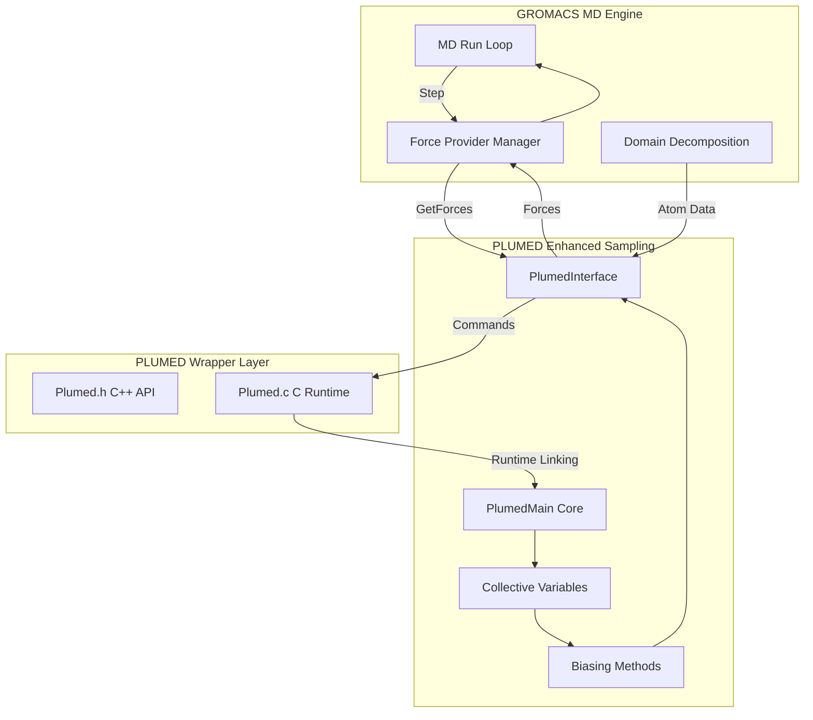
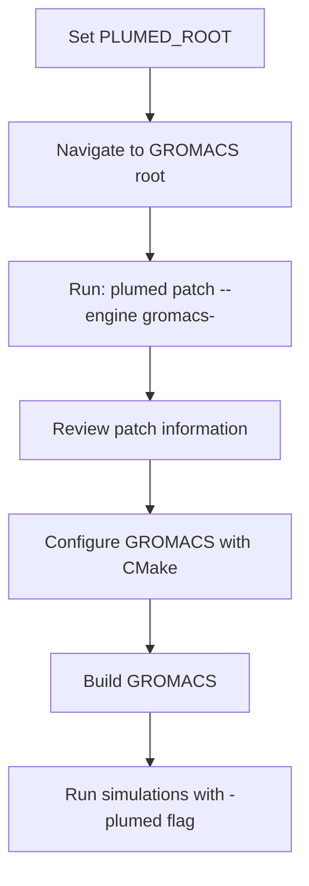
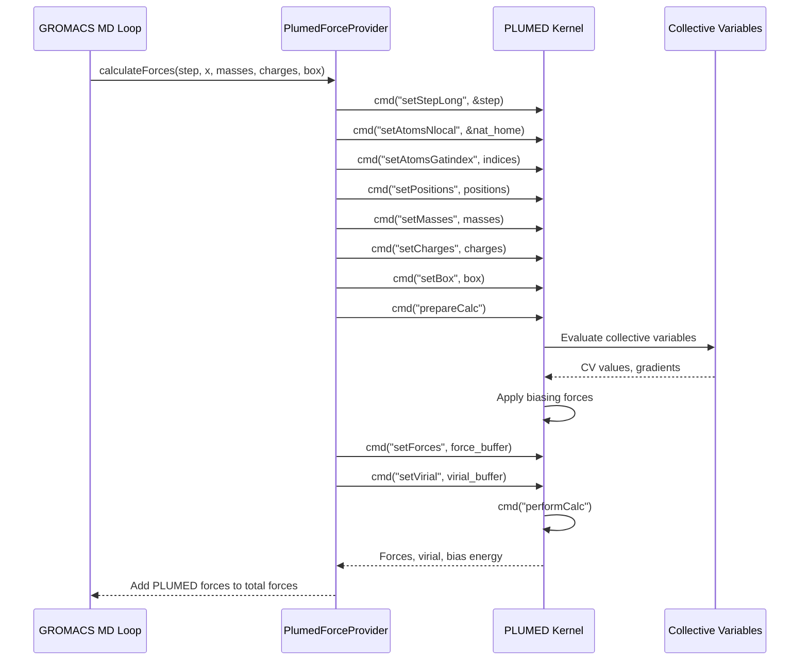

PLUMED integrates with GROMACS through a sophisticated patching mechanism that enables enhanced sampling and collective variable analysis within molecular dynamics simulations. This integration allows GROMACS users to leverage PLUMED's powerful biasing methods and analysis tools without leaving their familiar simulation environment, supporting both CPU and GPU-accelerated calculations while maintaining compatibility with GROMACS's domain decomposition and parallel execution models.

## Integration Architecture

The GROMACS-PLUMED integration follows a modular force-provider architecture that cleanly separates concerns between the MD engine and the enhanced sampling layer. The design has evolved significantly across GROMACS versions, with modern implementations (2025.0+) using a modular approach that integrates with GROMACS's new force-provider framework, while legacy versions (2022.x-2024.x) apply direct patches to the MD run loop.



The integration centers on three critical components: the patching infrastructure that modifies GROMACS source code, the wrapper interface that provides language-agnostic communication, and the force provider implementation that hooks into GROMACS's calculation cycle. Modern versions leverage GROMACS's `IForceProvider` interface, making the integration more maintainable and less invasive to GROMACS internals.

## Patching System and Version Support

PLUMED provides patches for multiple GROMACS versions, each tailored to the specific architecture of that release. The patching system is located in the `patches/` directory and follows a consistent naming convention: `gromacs-<version>.config` for configuration metadata and `gromacs-<version>.diff/` for the actual patch files.

| GROMACS Version | Integration Style | Key Features | Configuration File |
|----------------|------------------|--------------|-------------------|
| 2025.0 | Modular Force Provider | IForceProvider interface, CMake integration, native support | gromacs-2025.0.config |
| 2024.3 | Legacy Patches | Direct mdlib/mdrun modifications | gromacs-2024.3.config |
| 2023.5 | Legacy Patches | Thread MPI compatibility checks | gromacs-2023.5.config |
| 2022.5 | Legacy Patches | Basic integration, version string modification | gromacs-2022.5.config |

**Sources:** [patch.sh](/patches/patch.sh#L1-L50), [gromacs-2025.0.config](/patches/gromacs-2025.0.config#L1-L40)

The patching script (`patch.sh`) provides automated application of patches with support for multiple modes: shared (dynamic linking), static, or runtime linking. It includes sophisticated engine detection that can match approximate versions when exact matches aren't found, making the system robust to minor GROMACS release variations.

### Modern Integration (GROMACS 2025.0+)

The 2025.0 implementation represents the current best practice, integrating PLUMED through GROMACS's native `applied_forces` module:

```cpp
// PlumedForceProvider implements GROMACS's IForceProvider interface
class PlumedForceProvider final : public IForceProvider
{
public:
    PlumedForceProvider(const PlumedOptions& options);
    ~PlumedForceProvider();
    void writeCheckpointData();
    void calculateForces(const ForceProviderInput& forceProviderInput,
                         ForceProviderOutput*      forceProviderOutput) override;

private:
    std::unique_ptr<PLMD::Plumed> plumed_;
    int                           plumedAPIversion_;
    bool                          replex_;
};
```

**Sources:** [plumedforceprovider.h](/patches/gromacs-2025.0.diff/src/gromacs/applied_forces/plumed/plumedforceprovider.h#L42-L88)

The force provider receives simulation data through `ForceProviderInput`, which contains positions, masses, charges, box dimensions, and domain decomposition information. After PLUMED calculations complete, forces and virial contributions are returned via `ForceProviderOutput`. This clean separation allows PLUMED to participate in force calculations without tightly coupling to GROMACS's internal state management.

**Sources:** [plumedforceprovider.cpp](/patches/gromacs-2025.0.diff/src/gromacs/applied_forces/plumed/plumedforceprovider.cpp#L85-L215)

### Legacy Integration (GROMACS 2022.x-2024.x)

Legacy versions apply patches directly to GROMACS's MD run loop in files like `mdrun/runner.cpp`, `mdrun/md.cpp`, and `mdlib/sim_util.cpp`. The patches insert PLUMED initialization, force calculation, and cleanup calls at appropriate points in the simulation cycle. This approach, while functional, requires maintenance for each GROMACS release and is more invasive to GROMACS internals.

**Sources:** [gromacs-2022.5.config](/patches/gromacs-2022.5.config#L1-L44)

## Wrapper Interface

The PLUMED wrapper provides a language-agnostic API that isolates MD engines from PLUMED's internal implementation. The wrapper consists of two primary components: `Plumed.h` (C++ interface) and `Plumed.c` (C implementation), both located in `src/wrapper/`.

### C++ Template-Based Command System

The C++ interface uses sophisticated template metaprogramming to provide type-safe command passing:

```cpp
template<typename Key,typename T>
void cmd(Key && key,T&& val) {
    cmd_helper(std::forward<Key>(key),std::forward<T>(val));
}
```

**Sources:** [Plumed.h](/src/wrapper/Plumed.h#L3342-L3345)

The command system automatically handles type conversions, shape detection for arrays, and memory management through several specialized template overloads:

- **Arrays with size and data members** (e.g., `std::vector`): Automatically detected via `has_size_and_data` trait
- **Fixed-size custom arrays**: Handled via `custom_array_size` trait
- **Pointers**: Managed with explicit size information
- **Scalar values**: Passed directly

This template-heavy design provides compile-time type safety while maintaining runtime flexibility for different data types and array shapes.

**Sources:** [Plumed.h](/src/wrapper/Plumed.h#L3227-L3385)

### Exception Handling Integration

The wrapper implements comprehensive exception translation between PLUMED's error codes and standard C++ exceptions:

```cpp
template<typename F>
__PLUMED_WRAPPER_CXX_NORETURN static void exception_dispatch(plumed_error&h,F f) {
    const char* msg=plumed_error_what(h);
    if(h.code==1) {
        f(Plumed::Invalid(msg));
    }
    if(h.code>=10100 && h.code<10200) {
        // Logic errors (invalid_argument, domain_error, etc.)
    }
    if(h.code>=10200 && h.code<10300) {
        // Runtime errors (range_error, overflow_error, etc.)
    }
    if(h.code>=20000 && h.code<30000) {
        // PLUMED-specific exceptions
        if(h.code>=20200 && h.code<20300) {
            f(Plumed::ExceptionError(msg));
        }
        if(h.code>=20300 && h.code<20400) {
            f(Plumed::ExceptionTypeError(msg));
        }
        f(Plumed::Exception(msg));
    }
}
```

**Sources:** [Plumed.h](/src/wrapper/Plumed.h#L1940-L2174)

This exception handling bridges PLUMED's C-based error reporting with modern C++ exception semantics, allowing MD code to catch and handle PLUMED errors using standard exception handling patterns.

### Runtime Linking Support

The wrapper supports dynamic loading of PLUMED kernels at runtime through `dlopen`, enabling MD codes to be built without PLUMED dependencies and load PLUMED libraries on demand:

```c
#define __PLUMED_WRAPPER_LINK_RUNTIME 1
#define __PLUMED_WRAPPER_IMPLEMENTATION 1
#define __PLUMED_WRAPPER_FORTRAN 1
#include "Plumed.h"
```

**Sources:** [Plumed.c](/src/wrapper/Plumed.c#L20-L28)

This runtime linking capability is particularly valuable for distributions that want to support PLUMED without requiring it as a build-time dependency, allowing users to install PLUMED separately and enable it when needed.

## Build and Configuration

### CMake Integration

Modern GROMACS 2025.0+ integration uses CMake to manage PLUMED dependencies through `gmxManagePlumed.cmake`:

```cmake
gmx_option_multichoice(GMX_USE_PLUMED
    "Build the PLUMED wrapper with GROMACS"
    ON
    ON)

function(gmx_manage_plumed)
    add_library(plumedgmx INTERFACE)
    if(NOT GMX_USE_PLUMED STREQUAL "OFF")
        check_function_exists(dlopen HAVE_DLOPEN)
        if(HAVE_DLOPEN)
            set(PLUMED_DIR "${CMAKE_SOURCE_DIR}/src/external/plumed")
            target_link_libraries(plumedgmx INTERFACE ${CMAKE_DL_LIBS})
            target_include_directories(plumedgmx SYSTEM INTERFACE $<BUILD_INTERFACE:${PLUMED_DIR}>)
            set(GMX_PLUMED_ACTIVE ON CACHE INTERNAL "Cache entry for PLUMED activation")
        endif()
    endif()
endfunction()
```

**Sources:** [gmxManagePlumed.cmake](/patches/gromacs-2025.0.diff/cmake/gmxManagePlumed.cmake#L29-L83)

The CMake configuration checks for `dlopen` availability (required for runtime linking) and creates an interface library `plumedgmx` that provides the necessary include directories and link flags.

### Patch Application Procedure

The standard patching workflow for GROMACS follows these steps:



The patch command accepts several options:
- `--engine`: Specify GROMACS version (e.g., `gromacs-2025.0`)
- `--mode`: Linking mode (`static`, `shared`, `runtime`)
- `--mdroot`: GROMACS root directory
- `--force`: Force patching even if files appear modified

**Sources:** [patch.sh](/patches/patch.sh#L1-L100)

### Configuration Constraints

The GROMACS integration has important configuration constraints:

- **Thread MPI incompatibility**: PLUMED requires `-DGMX_THREAD_MPI=OFF` for proper MPI support. Use `-DGMX_MPI=ON` for parallel execution instead.
- **Windows limitation**: PLUMED is not supported on Windows platforms.
- **dlopen requirement**: Runtime linking requires `dlopen` or equivalent functionality.

**Sources:** [gromacs-2022.5.config](/patches/gromacs-2022.5.config#L15-L20), [gromacs-2025.0.config](/patches/gromacs-2025.0.diff/cmake/gmxManagePlumed.cmake#L45-L55)

## Data Flow and Communication Protocol

The communication between GROMACS and PLUMED follows a well-defined protocol during each MD step:



**Sources:** [plumedforceprovider.cpp](/patches/gromacs-2025.0.diff/src/gromacs/applied_forces/plumed/plumedforceprovider.cpp#L130-L175)

### Initialization Protocol

During force provider construction, PLUMED is initialized with simulation parameters:

```cpp
PlumedForceProvider::PlumedForceProvider(const PlumedOptions& options)
    : plumed_(std::make_unique<PLMD::Plumed>()), replex_(options.replex_)
{
    int real_precision = sizeof(real);
    plumed_->cmd("setRealPrecision", &real_precision);
    
    real energyUnits = 1.0;
    plumed_->cmd("setMDEnergyUnits", &energyUnits);
    
    real lengthUnits = 1.0;
    plumed_->cmd("setMDLengthUnits", &lengthUnits);
    
    real timeUnits = 1.0;
    plumed_->cmd("setMDTimeUnits", &timeUnits);
    
    plumed_->cmd("setPlumedDat", options.plumedFile_.c_str());
    plumed_->cmd("getApiVersion", &plumedAPIversion_);
    plumed_->cmd("setNatoms", options.natoms_);
    plumed_->cmd("setMDEngine", "gromacs");
    plumed_->cmd("setLogFile", "PLUMED.OUT");
    plumed_->cmd("setTimestep", &options.simulationTimeStep_);
    plumed_->cmd("init", nullptr);
}
```

**Sources:** [plumedforceprovider.cpp](/patches/gromacs-2025.0.diff/src/gromacs/applied_forces/plumed/plumedforceprovider.cpp#L60-L95)

The initialization communicates unit systems, precision information, and configuration files to PLUMED, ensuring consistent data interpretation throughout the simulation.

### Domain Decomposition Support

For parallel simulations using domain decomposition, PLUMED receives information about the local atom distribution:

```cpp
if (haveDDAtomOrdering(*cr)) {
    int nat_home = dd_numHomeAtoms(*cr->dd);
    plumed_->cmd("setAtomsNlocal", &nat_home);
    plumed_->cmd("setAtomsGatindex", cr->dd->globalAtomIndices.data());
}
```

**Sources:** [plumedforceprovider.cpp](/patches/gromacs-2025.0.diff/src/gromacs/applied_forces/plumed/plumedforceprovider.cpp#L138-L142)

The `globalAtomIndices` array maps local atoms to their global indices, allowing PLUMED to correctly compute collective variables that involve atoms distributed across multiple MPI ranks.

### Replica Exchange Integration

PLUMED integrates with GROMACS's replica exchange through the GREX (GROMACS-Replica-Exchange) interface:

```cpp
if (isMultiSim(options.ms_)) {
    if (MAIN(options.cr_))
        plumed_->cmd("GREX setMPIIntercomm", &options.ms_->mainRanksComm_);
    plumed_->cmd("GREX setMPIIntracomm", &options.cr_->mpi_comm_mygroup);
    plumed_->cmd("GREX init", nullptr);
}
```

**Sources:** [plumedforceprovider.cpp](/patches/gromacs-2025.0.diff/src/gromacs/applied_forces/plumed/plumedforceprovider.cpp#L80-L85)

This enables advanced techniques like replica-exchange metadynamics and Hamiltonian replica exchange, where PLUMED's biasing methods can vary across replicas.

## Usage and Execution

### Basic Execution

After patching and building GROMACS with PLUMED support, simulations are executed with the `-plumed` flag:

```bash
gmx mdrun -plumed plumed.dat -s topol.tpr -c conf.gro -deffnm output
```

The `-plumed` flag specifies the PLUMED input file containing collective variable definitions and biasing method configurations.

**Sources:** [gromacs-2025.0.config](/patches/gromacs-2025.0.config#L23-L28)

### PLUMED Input File Structure

A typical PLUMED input file for GROMACS defines collective variables, applies restraints or biasing potentials, and configures output:

```
# Load custom extensions (optional)
LOAD ../../extensions/libplumedExtensions.dylib

# Define collective variables
DISTANCE ATOMS=0,21 LABEL=C1 COMPONENTS 
VOLUME   LABEL=vol
ENERGY   LABEL=ene

# Combine CV components
COMBINE LABEL=x  ARG=C1.x,C1.y,C1.z POWERS=2,2,2
COMBINE LABEL=xx ARG=x              POWERS=0.5

# Apply restraint
RESTRAINT ARG=C1 AT=0.4 KAPPA=1000.0

# Output configuration
FLUSH STRIDE=100
PRINT ARG=C1,vol,ene,C1.x,C1.y,C1.z STRIDE=1 FILE=COLVAR
ENDPLUMED
```

**Sources:** [test1/plumed.dat](/test/gromacs/test1/plumed.dat#L1-L34)

### GPU Integration and Performance Optimization

PLUMED integrates with GROMACS's GPU acceleration through careful load balancing. When GROMACS runs in hybrid CPU/GPU mode, PLUMED execution times are incorporated into load balancing calculations, allowing GROMACS to automatically optimize the CPU/GPU workload distribution.

The optimal performance configuration depends on the simulation workload:

```bash
# Option 1: 2 MPI ranks, 2 GPUs, 2 OpenMP threads per rank
export PLUMED_NUM_THREADS=2
mpiexec -np 2 gmx_mpi mdrun -nb gpu -ntomp 2 -pin on -gpu_id 01

# Option 2: 4 MPI ranks, 2 GPUs, 1 OpenMP thread per rank
export PLUMED_NUM_THREADS=1
mpiexec -np 4 gmx_mpi mdrun -nb gpu -ntomp 1 -pin on -gpu_id 0011
```

**Sources:** [mdcodes.md](/new-manual/mdcodes.md#L60-L88)

In recent PLUMED versions (2.5+) and GROMACS versions (2018.3+), `PLUMED_NUM_THREADS` is automatically set by GROMACS's `-ntomp` option, simplifying the configuration process.

> [!TIP]
> The number of OpenMP threads used by PLUMED significantly impacts performance. For GPU-accelerated simulations, the optimal setting often differs from pure CPU simulations. Benchmark with different thread counts to find the best configuration for your specific system and hardware.

## Checkpointing and Restart

PLUMED's checkpoint integration enables exact restart capability for long simulations, including enhanced sampling methods that maintain internal state (e.g., metadynamics hills, bias history):

```cpp
void PlumedForceProvider::writeCheckpointData() {
    if (plumedAPIversion_ > 3) {
        int checkp = 1;
        plumed_->cmd("doCheckPoint", &checkp);
    }
}
```

**Sources:** [plumedforceprovider.cpp](/patches/gromacs-2025.0.diff/src/gromacs/applied_forces/plumed/plumedforceprovider.cpp#L97-L106)

The checkpoint functionality is only available when using PLUMED API version 4 or higher. Earlier versions simply ignore checkpoint requests, maintaining backward compatibility.

## Feature Comparison: Native vs. Patched Integration

| Feature | Native GROMACS 2025+ | Patched GROMACS (legacy) |
|---------|---------------------|--------------------------|
| Replica Exchange | Limited | Full support |
| ENERGY Collective Variable | Not supported | Supported |
| Lambda Dynamics | Not supported | Supported |
| IForceProvider Integration | Yes | No |
| Automatic Load Balancing | Yes | Limited |
| CMake Integration | Yes | Manual patching |

**Sources:** [mdcodes.md](/new-manual/mdcodes.md#L1-L20)

For advanced features like replica exchange with PLUMED, the patched versions of GROMACS remain necessary, as the native integration prioritizes stability and simplicity over comprehensive feature support.

## Testing and Validation

The PLUMED repository includes test suites for GROMACS integration in the `test/gromacs/` directory. These tests verify basic functionality, collective variable calculations, force application, and output generation across different GROMACS versions.

Test cases include:
- Basic distance and volume CVs
- Energy collective variable
- Restraint applications
- Output file generation and formatting

**Sources:** [test/gromacs/test1/](/test/gromacs/test1/plumed.dat), [test/gromacs/test2/](/test/gromacs/test2/md.mdp)

> [!TIP]
> When developing new PLUMED features or testing CVs, always run regression tests against multiple GROMACS versions. The PLUMED test center (plumed-testcenter.github.io) provides continuous integration testing across various MD codes and versions.

## Next Steps

- For understanding how PLUMED processes commands and coordinates action execution, see [Action Framework and Execution Model](6-action-framework-and-execution-model)
- To learn about implementing custom collective variables for GROMACS simulations, read [Implementing Custom Collective Variables](13-implementing-custom-collective-variables)
- For advanced biasing techniques applicable to GROMACS, explore [Advanced Biasing Techniques](17-advanced-biasing-techniques)
- To understand the parallel execution model underlying GROMACS-PLUMED integration, see [Domain Decomposition and Parallelism](9-domain-decomposition-and-parallelism)