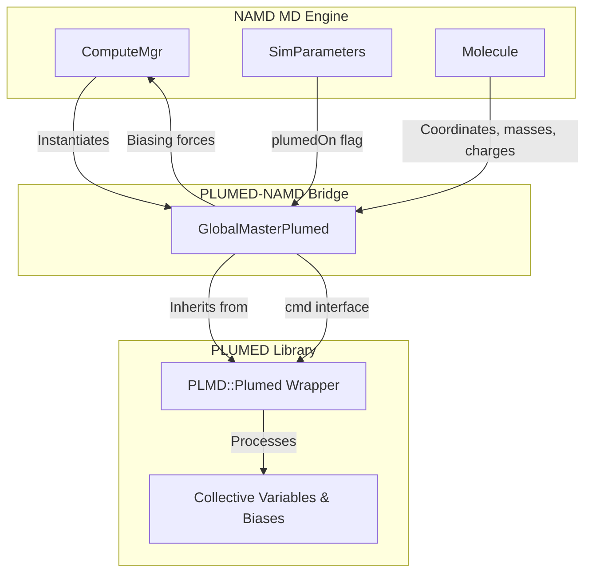

PLUMED can be integrated with NAMD through a patch-based approach that enables on-the-fly enhanced sampling and collective variable analysis during molecular dynamics simulations. This integration leverages NAMD's GlobalMaster framework and PLUMED's wrapper interface to provide seamless communication between the two systems.

## Integration Architecture

The NAMD-PLUMED integration operates through a bridge pattern where a dedicated `GlobalMasterPlumed` class translates between NAMD's internal data structures and PLUMED's wrapper interface. This architecture allows PLUMED to access atomic coordinates, apply biasing forces, and access simulation metadata while maintaining compatibility with NAMD's parallel execution model.



The integration follows NAMD's GlobalMaster pattern, where `GlobalMasterPlumed` extends both `GlobalMasterEasy` (for NAMD integration) and `PLMD::Plumed` (for PLUMED wrapper functionality). This dual inheritance enables the bridge to participate in NAMD's force computation cycle while maintaining direct access to PLUMED's command interface.

## Patch Mechanism

PLUMED provides patches for NAMD versions 2.12, 2.13, and 2.14 located in the `patches/` directory. The patch modifies three critical components of the NAMD source tree:

### Modified Files

| File | Purpose | Key Changes |
|------|---------|-------------|
| `Makefile` | Build configuration | Includes `Plumed.inc` and links PLUMED libraries via `PLUMED_LOAD2` |
| `src/ComputeMgr.C` | Force manager | Adds `GlobalMasterPlumed` class and instantiation logic |
| `src/SimParameters.C` | Configuration parser | Adds `plumedOn` and `plumedfile` parameters |
| `src/SimParameters.h` | Configuration header | Declares PLUMED-related configuration variables |

The Makefile patch integrates PLUMED by including the generated `Plumed.inc` file and linking the PLUMED shared library using platform-specific linker flags [patches/namd-2.14.diff#L426-L485](patches/namd-2.14.diff#L426-L485).

### GlobalMasterPlumed Implementation

The core integration logic resides in `GlobalMasterPlumed`, which implements the bridge between NAMD and PLUMED [patches/namd-2.14.diff#L94-L165](patches/namd-2.14.diff#L94-L165):

```cpp
class GlobalMasterPlumed:
  public  GlobalMasterEasy,
  private PLMD::Plumed
{
  std::vector<int> index;
  std::vector<double> positions;
  std::vector<double> forces;
  std::vector<double> masses;
  std::vector<double> charges;
  double box[3][3];
  // ... implementation
};
```

The bridge performs unit conversions between NAMD's internal units and PLUMED's standardized units during initialization:

- Energy units: 4.184 (kcal/mol to kJ/mol conversion factor)
- Length units: 0.1 (Angstrom to nm conversion factor)  
- Time units: 0.001 (femtosecond to picosecond conversion factor)

[patches/namd-2.14.diff#L107-L115](patches/namd-2.14.diff#L107-L115)

## Building and Patching NAMD

To enable PLUMED in NAMD, you must apply the appropriate patch and rebuild NAMD with PLUMED support.

### Prerequisites

- PLUMED source code built and installed
- NAMD source code (version matching the patch)
- C++ compiler compatible with both projects

### Patching Process

The patching process uses PLUMED's automated patching infrastructure:


1. **Prepare environment**: Source the PLUMED environment using `sourceme.sh` to set required environment variables

2. **Apply patch**: Run the PLUMED patching script with the `--runtime` flag for runtime loading capability:
   ```bash
   $PLUMED_ROOT/scripts/patch.sh --runtime /path/to/namd
   ```
   The `--runtime` flag enables runtime loading, allowing you to use different PLUMED versions without recompiling NAMD.

3. **Build NAMD**: Configure and compile NAMD using its standard build process. The patched Makefile will automatically link against the PLUMED library.

4. **Verify patch**: Check that `GlobalMasterPlumed` is properly integrated by examining the build output and confirming the PLUMED library is linked.

### Configuration Options

The `plumed_preliminary_test` function in the patch configuration verifies the patch environment, while `plumed_ignore_mpi=yes` indicates that PLUMED handles MPI internally in the NAMD context [patches/namd-2.14.config#L1-L8](patches/namd-2.14.config#L1-L8).

## Using PLUMED with NAMD

Once NAMD is patched and compiled with PLUMED support, activating PLUMED in a simulation requires simple configuration file additions.

### NAMD Configuration

Enable PLUMED by adding two lines to your NAMD configuration file:

```bash
plumed            on
plumedfile      plumed.dat
```

- `plumed on`: Activates the PLUMED module in NAMD
- `plumedfile`: Specifies the path to the PLUMED input file

A complete NAMD configuration example from the test suite [test/namd/namd_input#L1-L44](test/namd/namd_input#L1-L44):

```bash
# metadynamics 

plumed            on
plumedfile      plumed.dat

# set system
structure   ./dia2.psf
coordinates ./dia2.pdb

# additional NAMD parameters...
timestep 0.2
temperature 300.0
langevin        on
langevinDamping 5
langevinTemp    300

numsteps     1000
```

### PLUMED Input File

The PLUMED input file (`plumed.dat`) uses standard PLUMED syntax to define collective variables and biasing methods. A minimal example [test/namd/plumed.dat](test/namd/plumed.dat):

```plumed
# Simple distance collective variable
c1: DISTANCE ATOMS=1,10

PRINT ARG=c1

ENDPLUMED
```

This example defines a distance collective variable between atoms 1 and 10, and prints its value during the simulation.

### Data Flow and Execution

During each NAMD timestep, the following sequence occurs:

1. **Initialization** (once): `GlobalMasterPlumed::easy_init()` sets up PLUMED with unit conversions, reads the PLUMED input file, and initializes the computational environment [patches/namd-2.14.diff#L96-L122](patches/namd-2.14.diff#L96-L122).

2. **Atom selection** (dynamic): `share()` method queries PLUMED for required atoms using `createFullList`, requests those atoms from NAMD, and stores their indices, masses, and charges [patches/namd-2.14.diff#L124-L147](patches/namd-2.14.diff#L124-L147).

3. **Force computation** (per timestep): `easy_calc()` executes each timestep:
   - Retrieves current atomic positions from NAMD
   - Updates periodic box dimensions (if periodic boundary conditions are used)
   - Sends positions, masses, and charges to PLUMED via `setPositions`, `setMasses`, and `setCharges`
   - Calls PLUMED to compute collective variables and biasing forces
   - Retrieves computed forces from PLUMED
   - Applies forces to atoms via NAMD's `addForce` method

4. **Step advancement**: Increments the step counter and rechecks atom dependencies in case PLUMED's requirements change during the simulation [patches/namd-2.14.diff#L149-L190](patches/namd-2.14.diff#L149-L190).

## Technical Limitations and Considerations

### Virial Contributions

A critical limitation of the NAMD integration is that **virial contributions from PLUMED are not taken into account** [patches/namd-2.14.config#L16-L18](patches/namd-2.14.config#L16-L18). This restriction means that:

- **Constant volume simulations only**: PLUMED-biased NAMD simulations should use constant volume (NVT) ensembles
- **Avoid constant pressure**: Do not use PLUMED with NPT simulations, as the missing virial terms will cause incorrect pressure calculations

The `setNoVirial` command explicitly disables virial computation in the PLUMED bridge [patches/namd-2.14.diff#L120](patches/namd-2.14.diff#L120).

### Performance Considerations

The `GlobalMasterPlumed` bridge uses NAMD's GlobalMaster infrastructure, which may introduce performance overhead compared to direct integration approaches. Key considerations:

- **Atom list updates**: The `share()` method rechecks atom dependencies each step, which can be optimized for simulations with fixed atom sets
- **Data copying**: Positions and forces are copied between NAMD and PLUMED arrays on each timestep
- **Unit conversions**: Unit transformations add computational overhead during initialization and data exchange

> [!TIP]
> For optimal performance in large-scale NAMD simulations, consider using PLUMED's atom selection features (e.g., `GROUP`, `ATOMS` specifications) to minimize the number of atoms passed to PLUMED for collective variable calculation.

### Thread Safety and Parallel Execution

The PLUMED wrapper interface used by NAMD is designed for single-threaded operation in each simulation instance. For parallel NAMD simulations:

- Each MPI process runs its own PLUMED instance via the GlobalMaster framework
- Thread safety is handled internally by PLUMED when using OpenMP threading
- The `plumed_ignore_mpi=yes` configuration indicates that PLUMED manages its own parallel strategy [patches/namd-2.14.config#L28](patches/namd-2.14.config#L28)

## Advanced Configuration

### Runtime Loading

The `--runtime` flag during patching enables runtime PLUMED loading, providing flexibility:

```bash
$PLUMED_ROOT/scripts/patch.sh --runtime /path/to/namd
```

Runtime loading allows you to:

- Switch PLUMED versions without recompiling NAMD
- Use different PLUMED kernels for different simulations
- Debug PLUMED separately from NAMD

Set the `PLUMED_KERNEL` environment variable to specify which PLUMED library to load at runtime:

```bash
export PLUMED_KERNEL=/path/to/libplumedKernel.so
namd2 +p4 simulation.namd
```

### Unit Conversion Details

The GlobalMasterPlumed bridge performs explicit unit conversions that developers should understand:

| Quantity | NAMD Unit | PLUMED Unit | Conversion Factor |
|----------|-----------|-------------|-------------------|
| Energy | kcal/mol | kJ/mol | 4.184 |
| Length | Angstrom | nm | 0.1 |
| Time | femtosecond | picosecond | 0.001 |

These conversions are applied during initialization via the `setMDEnergyUnits`, `setMDLengthUnits`, and `setMDTimeUnits` commands [patches/namd-2.14.diff#L107-L115](patches/namd-2.14.diff#L107-L115).

### Debugging and Troubleshooting

Enable detailed logging using PLUMED's built-in logging capabilities:

```plumed
# In plumed.dat
PRINT STRIDE=1 FILE=COLVAR ARG=* FMT=%12.6f
```

NAMD will output PLUMED messages to stdout, which can be redirected for analysis.

Common issues include:

- **Missing atom errors**: Verify atom indices in PLUMED input match NAMD's atom numbering
- **Box dimension errors**: Ensure periodic box dimensions are properly set in NAMD configuration
- **Unit mismatch errors**: Check that all collective variable units are consistent with PLUMED's internal unit system

## Comparison with Other MD Integrations

PLUMED provides native integration support for multiple MD codes. Key differences for NAMD:

| Feature | NAMD | GROMACS | LAMMPS |
|---------|------|---------|--------|
| Integration Method | Patch-based | Native/Patch | Native |
| Virial Support | Limited | Full | Full |
| GPU Compatibility | Limited | Excellent | Excellent |
| Replica Exchange | Via NAMD infrastructure | Direct support | Via LAMMPS methods |

For simulations requiring virial contributions or GPU-accelerated PLUMED calculations, consider [GROMACS Integration](18-gromacs-integration) or [LAMMPS Integration](20-lammps-integration) as alternatives.

## Further Reading

- [Action Framework and Execution Model](6-action-framework-and-execution-model): Understand how PLUMED processes commands and computes collective variables
- [CV Fundamentals and Common CVs](10-cv-fundamentals-and-common-cvs): Learn about available collective variables for your simulations
- [Metadynamics Variants](14-metadynamics-variants): Explore advanced biasing methods compatible with NAMD
- [Patching and Building MD Codes](22-patching-and-building-md-codes): General guidance on applying PLUMED patches to MD codes

For complete details on the PLUMED wrapper interface used by NAMD integration, refer to the [Plumed.h reference documentation](src/wrapper/Plumed.h#L1-L100).