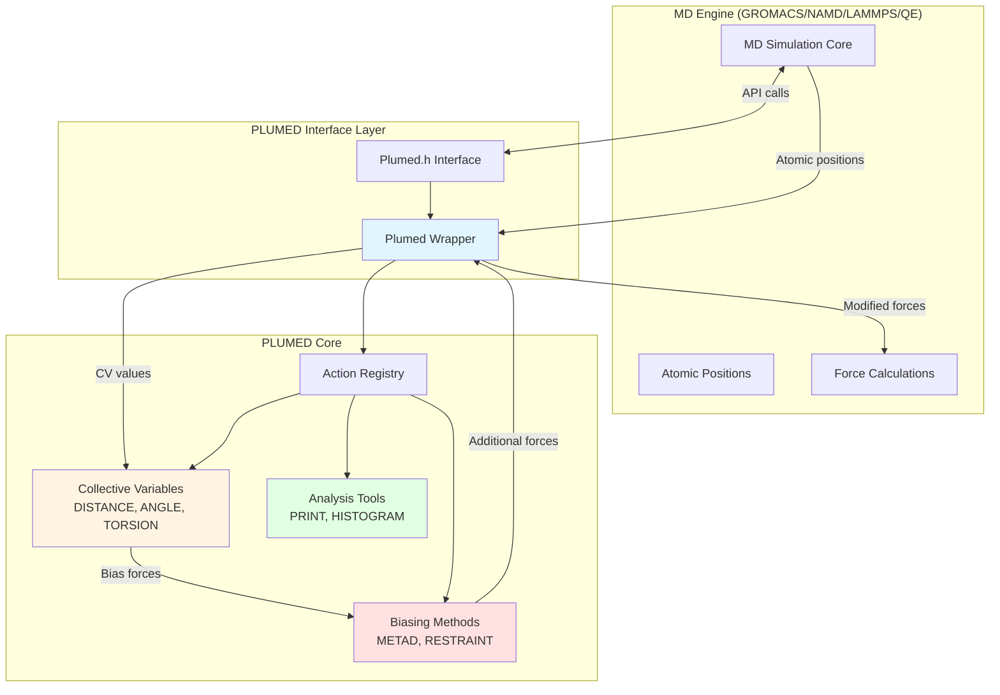
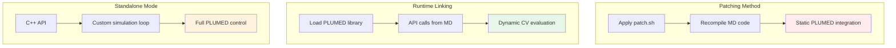

This guide provides a fast-track introduction to PLUMED2, designed to get beginners running enhanced molecular dynamics simulations within minutes. PLUMED2 is a plugin that adds advanced free energy methods and collective variable (CV) analysis to popular MD engines like GROMACS, NAMD, LAMMPS, and Quantum ESPRESSO. The current development version is **2.11.0-dev** [Sources: VERSION.txt](VERSION.txt#L1-L9).

## System Architecture

Understanding how PLUMED integrates with MD engines is fundamental to effective usage. The system operates as a **modular enhancement layer** that intercepts simulation steps to calculate CVs, apply biases, and analyze trajectories.



PLUMED follows an **action-based execution model** where each input directive creates an Action object. These actions are organized in a dependency graph and executed at appropriate simulation steps. The core architecture supports three integration modes: **static linking**, **shared library**, and **runtime loading** [Sources: developer-doc/Intro.md](developer-doc/Intro.md#L63-L95).

## Installation Methods

PLUMED offers multiple installation approaches tailored to different user needs and system configurations.

### Method 1: Source Compilation (Recommended for Developers)

Source compilation provides maximum flexibility and is the primary method for developers and users requiring custom configurations.

**Prerequisites:**
- GNU make
- C/C++ compiler with C++17 support (required as of version 2.10)
- Modern `patch` command-line tool
- Suggested libraries: auto-detected by configure script [Sources: README.md](README.md#L67-L80)

**Compilation workflow:**


**Basic commands:**

```bash
# Configure with default settings
./configure

# Compile with parallel jobs (N = number of CPU cores)
make -j 8

# Install to configured prefix (default: /usr/local)
sudo make install

# Set up environment variables
source /path/to/plumed/sourceme.sh
```

The configuration script creates `Makefile.conf` with system-specific settings including compiler flags, library paths, and module configurations [Sources: Makefile.conf.in](Makefile.conf.in#L1-L50). Advanced users can enable specific modules or MPI support using configure options.

### Method 2: Package Managers

For production environments, pre-built packages offer faster deployment with tested dependencies:

| Package Manager | Command | Notes |
|----------------|---------|-------|
| Conda | `conda install -c conda-forge plumed` | Cross-platform, includes Python interface |
| MacPorts | `sudo port install plumed` | macOS optimized [Sources: README.md](README.md#L14-L15) |
| Spack | `spack install plumed` | HPC environment friendly |

 [Sources: README.md](README.md#L1-L16)

### Method 3: Container Deployment

Docker provides reproducible environments ideal for testing and cloud deployment:

```bash
# Build from Dockerfile
cd docker
make

# Run PLUMED container
docker run -it plumed:latest bash
```

The docker directory includes configurations for multiple distributions (Fedora 39, Rocky 8) with Python CV support options [Sources: docker/Dockerfile](docker/Dockerfile).

### Installation Validation

Verify your installation with:

```bash
# Check PLUMED version
plumed info --version

# List available CVs and actions
plumed info --action-list

# Test with simple example
cd test/gromacs
# (requires GROMACS installation)
```

Sources: [README.md](README.md#L67-L80), [VERSION.txt](VERSION.txt#L1-L9)

## Your First PLUMED Input File

PLUMED uses a simple, declarative syntax where each line defines an action or calculation. The typical workflow involves defining collective variables, applying biases, and outputting results.

### Basic Syntax Example

Create a file named `plumed.dat`:

```plumed
# Define a distance CV between atoms 1 and 10
d: DISTANCE ATOMS=1,10

# Print CV value to file
PRINT ARG=d FILE=colvar.dat STRIDE=10
```

This simple input demonstrates PLUMED's core concepts:

1. **CV Definition**: `d: DISTANCE ATOMS=1,10` creates a CV named "d" calculating the distance between atoms 1 and 10
2. **Output**: `PRINT ARG=d` writes the CV value to `colvar.dat` every 10 simulation steps
3. **Naming Convention**: Labels like `d:` allow CVs to be referenced by other actions [Sources: test/gromacs/plumed.dat](test/gromacs/plumed.dat#L1-L4)

### Enhanced Example with Metadynamics

A more realistic example adds enhanced sampling:

```plumed
# CV: distance between two atoms
d: DISTANCE ATOMS=1,10

# Well-tempered metadynamics
METAD ARG=d SIGMA=0.1 HEIGHT=1.0 PACE=100 TEMP=300.0 \
      FILE=HILLS RESTART

# Output CV and bias
PRINT ARG=d,metad.bias FILE=colvar.dat STRIDE=10
```

> [!TIP]
> The METAD directive's RESTART option allows simulations to resume from previous HILLS files, crucial for long enhanced sampling runs. The bias potential is stored and can be analyzed afterward for free energy reconstruction.

**Key parameters explained:**

| Parameter | Meaning | Typical Values |
|-----------|---------|----------------|
| ARG | CV(s) to bias | Comma-separated CV labels |
| SIGMA | Gaussian width (CV units) | ~0.1-0.3 for distances |
| HEIGHT | Initial hill height | 0.5-2.0 kJ/mol |
| PACE | Steps between hills | 100-1000 |
| TEMP | Temperature (K) | Simulation temperature |
| FILE | Output file | HILLS for bias history |

Sources: [test/gromacs/plumed.dat](test/gromacs/plumed.dat#L1-L8)

## Running PLUMED with MD Engines

PLUMED integrates with MD engines through two primary approaches: **patching** (modifying MD source code) and **runtime linking** (using the MD engine's plugin interface).

### Integration Approaches



### GROMACS Integration Example

**Option 1: Patching (Recommended)**

```bash
# Navigate to PLUMED patches directory
cd /path/to/plumed/patches

# Patch GROMACS (interactive engine selection)
./patch.sh --patch --engine=gromacs

# Recompile GROMACS
cd /path/to/gromacs
mkdir build && cd build
cmake .. -DGMX_BUILD_OWN_FFTW=ON
make -j 8
```

The patch script creates symbolic links to PLUMED headers and modifies the MD code to call PLUMED at each step [Sources: patches/patch.sh](patches/patch.sh#L1-L50).

**Option 2: Runtime Linking**

```bash
# Configure PLUMED as shared library
./configure --enable-shared
make -j 8
sudo make install

# Run GROMACS with PLUMED
gmx mdrun -s topol.tpr -nsteps 100000 -plumed plumed.dat
```

### Standalone C++ Program

For maximum control, you can link PLUMED directly into custom code:

```cpp
#include "plumed/wrapper/Plumed.h"
#include <cstdio>

int main(int argc, char** argv) {
  PLMD::Plumed plumed;
  const char* input = "plumed.dat";
  
  // Configure PLUMED
  plumed.cmd("setMDEngine", "specific");
  plumed.cmd("setLog", stdout);
  
  // Set simulation details
  int natoms = 20;
  plumed.cmd("setNatoms", &natoms);
  plumed.cmd("setPlumedDat", input);
  plumed.cmd("init");
  
  // Simulation loop
  for(int step = 0; step < 1000; step++) {
    // Update atomic positions (your MD code here)
    // plumed.cmd("setStep", &step);
    // plumed.cmd("setPositions", positions);
    // plumed.cmd("setMasses", masses);
    
    // Calculate bias forces
    // plumed.cmd("calc");
    
    // Get modified forces
    // plumed.cmd("getBias", &energy);
    // plumed.cmd("getForces", forces);
  }
  
  return 0;
}
```

This approach gives you complete control over when PLUMED is called and how forces are applied [Sources: test/link/main.cpp](test/link/main.cpp#L1-L39).

Sources: [patches/patch.sh](patches/patch.sh#L1-L50), [test/link/main.cpp](test/link/main.cpp#L1-L39)

## Supported MD Engines

PLUMED provides patches and integration scripts for multiple MD codes:

| MD Engine | Patch Location | Linking Modes |
|-----------|---------------|---------------|
| GROMACS | patches/gromacs-2024.3.diff | static, shared, runtime |
| NAMD | patches/namd-2.14.diff | static |
| LAMMPS | patches directory | runtime |
| Quantum ESPRESSO | patches/qespresso-7.2.diff | static |

**List available engines:**

```bash
./patch.sh --list-engines
```

Each patch includes a `.config` file with version information and a `.diff/` directory with source modifications [Sources: patches/](patches/gromacs-2024.3.config).

## Testing Your Installation

PLUMED includes regression tests to verify correct operation:

```bash
# Run basic tests
cd test/gromacs
make test

# Run full regression suite
cd regtest
make test
```

The test directory contains example inputs for different MD codes. For GROMACS, you can try:

```bash
cd test/gromacs
# Prepare simulation
gmx grompp -f grompp.mdp -c conf.gro -p topol.top -o md.tpr

# Run with PLUMED
gmx mdrun -s md.tpr -plumed plumed.dat

# Analyze output
# colvar.dat contains CV values over time
```

The regression tests verify that CVs and biases produce correct results across supported engines [Sources: test/Makefile](test/Makefile), [regtest/README](regtest/README).

## Common Troubleshooting

**Issue**: "undefined reference to `plumed_*`"

**Solution**: Ensure PLUMED is compiled as a shared library (`./configure --enable-shared`) and the library path is in `LD_LIBRARY_PATH` [Sources: Makefile.conf.in](Makefile.conf.in#L25-L28).

**Issue**: "Action DISTANCE not found"

**Solution**: Verify PLUMED is properly initialized with `plumed.cmd("init")` after setting all parameters [Sources: test/link/main.cpp](test/link/main.cpp#L22-L25).

**Issue**: Patch fails with "cannot apply patch"

**Solution**: Check MD engine version matches patch version. Use `./patch.sh --info --engine=gromacs` to see supported versions [Sources: patches/patch.sh](patches/patch.sh#L1-L50).

## Next Steps

Now that you have PLUMED running, explore these learning paths:

**For immediate practical skills:**
- **[Basic Collective Variables](3-basic-collective-variables)**: Learn distance, angle, and torsion CVs with hands-on examples
- **[Metadynamics Fundamentals](4-metadynamics-fundamentals)**: Master well-tempered metadynamics and free energy reconstruction

**For deeper architectural understanding:**
- **[Action Framework and Execution Model](6-action-framework-and-execution-model)**: Understand how PLUMED processes actions and manages dependencies
- **[PlumedMain and Plugin Interface](7-plumedmain-and-plugin-interface)**: Explore the core plugin architecture for extending functionality

**For integration with specific codes:**
- **[GROMACS Integration](18-gromacs-integration)**: Detailed guide for GROMACS users
- **[Patching and Building MD Codes](22-patching-and-building-md-codes)**: Advanced patching techniques for developers

The tutorial directory contains additional examples from PLUMED workshops covering advanced topics like path CVs, bias-exchange, and VES [Sources: user-doc/tutorials/](user-doc/tutorials/).
