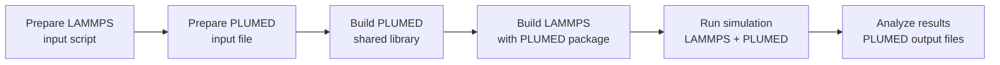

PLUMED provides native integration with LAMMPS since November 2018, enabling collective variable computation and biasing capabilities directly within LAMMPS simulations without requiring external patching. This integration allows researchers to apply enhanced sampling techniques like metadynamics, umbrella sampling, and restraints to molecular dynamics simulations performed with LAMMPS. The native support simplifies the workflow compared to codes requiring patching, as PLUMED functionality becomes accessible through LAMMPS's standard fix interface.

Sources: [mdcodes.md](new-manual/mdcodes.md#L18-L44)

## Architecture Overview

The PLUMED-LAMMPS integration follows a library-based architecture where PLUMED operates as an embedded library within the LAMMPS simulation process. Communication between LAMMPS and PLUMED occurs through a well-defined command interface, with PLUMED's core `PlumedMain` class handling the collective variable calculations and bias forces while LAMMPS manages the molecular dynamics propagation and atom updates.

The integration leverages PLUMED's wrapper interface, which provides a C-compatible API that can be called from C++ code like LAMMPS. The wrapper layer handles type conversion and exception safety, allowing seamless bidirectional communication between the two codebases.

Sources: [Plumed.h](src/wrapper/Plumed.h#L3325-L3345), [PlumedMain.h](src/core/PlumedMain.h#L55-L70)

```mermaid
flowchart TB
    subgraph LAMMPS["LAMMPS Simulation Engine"]
        FixPLUMED[fix plumed<br/>LAMMPS Fix Module]
        Integrator[Velocity Verlet<br/>Integrator]
        ForceCalc[Force Calculator]
    end
    
    subgraph PLUMED["PLUMED Library"]
        Wrapper[Wrapper Interface<br/>Plumed.c]
        PlumedMain[PlumedMain Core<br/>cmd() Interface]
        CVEngine[CV & Bias<br/>Calculations]
    end
    
    FixPLUMED <-->|Commands & Data| Wrapper
    Wrapper <-->|API Calls| PlumedMain
    PlumedMain <-->|CV Values & Forces| CVEngine
    Integrator -->|Atomic Positions| FixPLUMED
    FixPLUMED -->|Bias Forces| ForceCalc
    ForceCalc -->|Total Forces| Integrator
```

## Building PLUMED with LAMMPS Support

The integration requires both PLUMED and LAMMPS to be built with compatible configurations. Unlike other MD codes that require patching, LAMMPS can link directly to the PLUMED shared library during compilation. This approach enables dynamic loading and easier version management between the two codes.

The build process involves compiling PLUMED as a shared library that LAMMPS can link against at compile-time or load dynamically at runtime. The wrapper layer ensures compatibility between PLUMED's C++ internals and LAMMPS's C++ codebase through a carefully managed C interface.

Sources: [Plumed.c](src/wrapper/Plumed.c#L26-L42)

### Compilation Steps

1. **Build PLUMED Library**: Compile PLUMED with shared library support enabled
2. **Configure LAMMPS**: Enable PLUMED package in LAMMPS build configuration
3. **Link**: Link LAMMPS against the PLUMED shared library during compilation
4. **Runtime**: Ensure PLUMED library is accessible in the runtime path

The PLUMED wrapper is configured to link at runtime rather than compile-time, which provides flexibility in library version management. This approach is particularly useful for HPC environments where different simulation runs may require different PLUMED versions.

Sources: [Plumed.c](src/wrapper/Plumed.c#L14-L20)

> [!TIP]
> When building PLUMED for LAMMPS integration, ensure you use the same compiler and compiler flags for both PLUMED and LAMMPS to maintain ABI compatibility, particularly regarding C++ standard library versions and floating-point precision settings.

## LAMMPS Fix Interface

LAMMPS exposes PLUMED functionality through its standard fix mechanism, typically accessed via the `fix plumed` command in the LAMMPS input file. This fix acts as the bridge between LAMMPS's integration loop and PLUMED's collective variable calculations, passing atomic coordinates, box dimensions, and other simulation state information to PLUMED at each timestep.

The fix interface handles the synchronization of simulation data between LAMMPS and PLUMED, including atomic positions, masses, box vectors, and periodic boundary conditions. It retrieves bias forces computed by PLUMED and applies them to the atoms in the LAMMPS simulation, ensuring proper force accumulation and energy bookkeeping.

Sources: [PlumedMain.h](src/core/PlumedMain.h#L75-L95)

### Basic Usage Pattern

The typical workflow involves setting up the fix in the LAMMPS input script, providing a PLUMED input file that defines collective variables and biasing methods, and allowing the fix to communicate with PLUMED during each MD step:

```lammps
# LAMMPS input script example
fix 1 all plumed plumedfile plumed.dat
run 100000
```

The fix processes commands through PLUMED's `cmd()` interface, which accepts key-value pairs and data arrays. This command-based architecture provides flexibility while maintaining a stable API contract between LAMMPS and PLUMED.

Sources: [Plumed.h](src/wrapper/Plumed.h#L3331-L3369)

## Data Exchange Protocol

Communication between LAMMPS and PLUMED follows a structured command protocol where LAMMPS sends simulation state data and PLUMED responds with bias forces and collective variable values. The protocol supports various data types including scalars, vectors, and multidimensional arrays, with the wrapper layer handling type conversion and memory management.

Key commands include initialization, coordinate updates, force retrieval, and finalization. Each command passes through the wrapper's type-safe interface, which converts C++ types to the C-compatible representation expected by the PLUMED core library.

Sources: [Plumed.h](src/wrapper/Plumed.h#L3227-L3280)

### Command Examples

The wrapper interface provides template methods for sending commands with various data types:

- **init**: Initialize PLUMED with the input file
- **setStep**: Set the current simulation timestep
- **setAtomsN**: Set the number of atoms
- **setBox**: Set simulation box dimensions
- **setPositions**: Pass atomic coordinates
- **setMasses**: Pass atomic masses
- **setForces**: Retrieve bias forces
- **update**: Execute CV calculations and bias application

Sources: [Plumed.h](src/wrapper/Plumed.h#L3325-L3345)

> [!TIP]
> When passing arrays from LAMMPS to PLUMED, use the shape-aware command variants to properly communicate array dimensions. This is particularly important for multidimensional data like coordinate arrays where the shape (natoms, 3) must be explicitly specified.

## Parallel Execution

The integration supports parallel execution through MPI, with both LAMMPS and PLUMED designed to run in distributed memory environments. PLUMED can operate in different parallel modes, including serial PLUMED with parallel LAMMPS or fully parallel PLUMED that distributes collective variable calculations across multiple processes.

Domain decomposition in LAMMPS must be coordinated with PLUMED's parallel strategy to ensure efficient data exchange. The wrapper interface handles the communication patterns, allowing PLUMED to gather necessary atom data from distributed domains and return bias forces to the appropriate processes.

Sources: [mdcodes.md](new-manual/mdcodes.md#L55-L72)

## Performance Considerations

The computational overhead introduced by PLUMED depends on the complexity of collective variables and biasing methods. Simple distance-based CVs add minimal overhead, while complex path-based CVs or grid-based biasing can significantly impact performance. The integration includes timing instrumentation to help identify bottlenecks.

Load balancing between CPU and GPU resources requires careful tuning when using GPU-accelerated LAMMPS with PLUMED. Since PLUMED calculations typically run on the CPU, the optimal configuration may differ from pure LAMMPS GPU runs and requires empirical testing.

Sources: [mdcodes.md](new-manual/mdcodes.md#L47-L72)

## Troubleshooting Common Issues

| Issue | Symptoms | Resolution |
|-------|----------|------------|
| Library not found | Runtime error loading PLUMED library | Set `LD_LIBRARY_PATH` to include PLUMED lib directory |
| Version mismatch | Segmentation faults or incorrect results | Rebuild both codes with same compiler settings |
| Force inconsistencies | Energy drift or unphysical behavior | Verify PLUMED force units match LAMMPS energy units |
| Parallel errors | Deadlocks or incorrect CV values | Ensure consistent MPI rank count between codes |

## Example Workflow

A complete LAMMPS-PLUMED simulation involves preparing both the LAMMPS input script and the PLUMED input file, then executing the combined simulation:



The PLUMED input file defines collective variables and biasing methods using the standard PLUMED syntax, completely independent of LAMMPS. This modularity allows reuse of PLUMED input files across different MD codes.

## Advanced Features

Beyond basic collective variable calculation and biasing, the integration supports advanced features including:

- **Multiple walkers**: Replicated simulations sharing bias information
- **Restart capability**: Saving and restoring PLUMED state for long simulations
- **Custom CVs**: User-defined collective variables through the PLUMED plugin system
- **Grid-based biasing**: Efficient metadynamics on predefined CV grids
- **Analysis tools**: On-the-fly CV tracking and trajectory analysis

These features leverage PLUMED's full functionality while maintaining integration with LAMMPS's simulation infrastructure.

## Further Reading

For deeper understanding of the integration architecture and capabilities:

- [Action Framework and Execution Model](6-action-framework-and-execution-model) - Learn how PLUMED processes actions internally
- [PlumedMain and Plugin Interface](7-plumedmain-and-plugin-interface) - Understand the core PLUMED engine
- [Data Passing and Communication](8-data-passing-and-communication) - Detailed protocol documentation
- [CV Fundamentals and Common CVs](10-cv-fundamentals-and-common-cvs) - Collective variable implementations
- [Patching and Building MD Codes](22-patching-and-building-md-codes) - Comparison with patch-based integrations