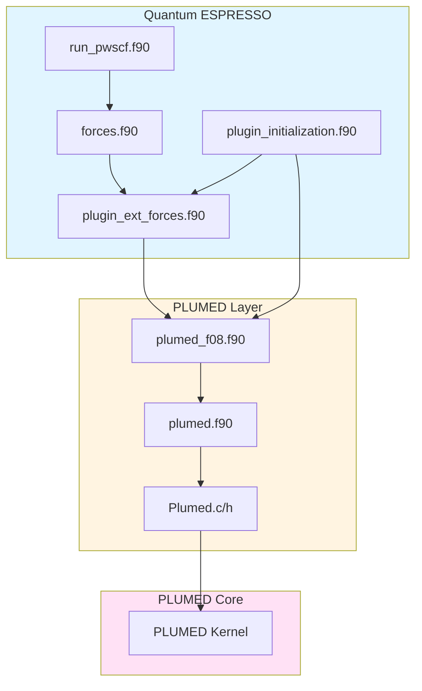

The PLUMED integration with Quantum ESPRESSO enables enhanced sampling and free energy calculations for ab initio molecular dynamics (AIMD) simulations. This integration allows you to apply PLUMED's extensive collective variable library and biasing methods to quantum-mechanical systems, bridging the gap between electronic structure calculations and advanced sampling techniques. The integration operates through a patching system that modifies Quantum ESPRESSO source code to inject PLUMED calls at strategic points in the MD workflow.

## Architecture Overview

The Quantum ESPRESSO integration follows a modular architecture where PLUMED is embedded directly into the pw.x executable through source code patches. The system uses a Fortran-to-C interface layer that enables communication between Quantum ESPRESSO's Fortran codebase and PLUMED's C core. At runtime, PLUMED intercepts MD steps to calculate collective variables, apply biases, and return modified forces to Quantum ESPRESSO.



The integration architecture demonstrates three distinct layers: the Quantum ESPRESSO application layer containing the patched source files, the PLUMED Fortran interface layer providing type-safe bindings, and the core PLUMED library implementing collective variables and biasing methods. This layered design maintains separation of concerns while enabling tight coupling between the two codebases.

Sources: [fortran/plumed_f08.f90](/fortran/plumed_f08.f90#L1-L100), [fortran/plumed.f90](/fortran/plumed.f90#L1-L200), [patches/qespresso-7.2.diff/PW/src/plugin_initialization.f90](/patches/qespresso-7.2.diff/PW/src/plugin_initialization.f90#L1-L65)

## Patching System

The patching system automates the integration process by applying modifications to Quantum ESPRESSO source files. PLUMED provides patches for multiple Quantum ESPRESSO versions (5.0.2, 6.2, 7.0, and 7.2), each stored in the `patches/` directory as version-specific diff files. The patching tool (`patches/patch.sh`) handles detection, application, and reversion of patches, along with configuration management specific to each Quantum ESPRESSO version.

**Table: Available Quantum ESPRESSO Patch Versions**

| Version | Patch Location | Status | Features |
|---------|---------------|--------|----------|
| 5.0.2 | `patches/qespresso-5.0..diff/` | Legacy | Basic MD support |
| 6.2 | `patches/qespresso-6.2.diff/` | Stable | Enhanced force handling |
| 7.0 | `patches/qespresso-7.0.diff/` | Stable | Modern API support |
| 7.2 | `patches/qespresso-7.2.diff/` | Current | Latest features |

The patch system for Quantum ESPRESSO 7.2 uses an on-the-fly diff approach with `.preplumed` files rather than traditional unified diff files. This method stores both the original and modified versions of each file, enabling precise bidirectional patching. The patch modifies three key files in the PW/src directory: `plugin_initialization.f90`, `plugin_ext_forces.f90`, and `forces.f90`.

Sources: [patches/qespresso-7.2.config](/patches/qespresso-7.2.config#L1-L29), [patches/patch.sh](/patches/patch.sh#L1-L200), [patches/qespresso-7.2.diff/PW/src/](/patches/qespresso-7.2.diff/PW/src/)

## Integration Mechanisms

The PLUMED-Quantum ESPRESSO integration operates through two primary insertion points in the MD workflow: initialization and force calculation. These insertion points are implemented as plugin functions that Quantum ESPRESSO calls during MD execution, providing PLUMED with access to atomic coordinates, forces, energies, and system metadata.

### Initialization Phase

The `plugin_initialization()` subroutine establishes the PLUMED instance and configures unit conversions. During initialization, PLUMED checks availability via `plumed_f_installed()`, creates a global instance using `plumed_f_gcreate()`, and sets critical parameters including real precision (8-byte), unit conversions for energy (Rydberg to kJ/mol), length (Bohr to nm), and time (atomic units to ps). The initialization also sets the number of atoms, timestep, and identifies the MD engine as "qespresso".

```fortran
CALL plumed_f_gcmd("setRealPrecision"//char(0),8)
energyUnits=1312.75  ! Ry to kjoule mol
lengthUnits=0.0529177249 ! bohr to nm
timeUnits=2*au_ps ! internal time to ps
call plumed_f_gcmd("setMDEnergyUnits"//char(0),energyUnits)
call plumed_f_gcmd("setMDLengthUnits"//char(0),lengthUnits)
call plumed_f_gcmd("setMDTimeUnits"//char(0),timeUnits)
```

The initialization occurs only on the ionode (MPI rank 0), ensuring that PLUMED maintains a single authoritative instance in parallel simulations. The input file is fixed to "plumed.dat" and output is directed to "PLUMED.OUT" by default.

Sources: [patches/qespresso-7.2.diff/PW/src/plugin_initialization.f90](/patches/qespresso-7.2.diff/PW/src/plugin_initialization.f90#L1-L65)

### Force Calculation Phase

The `plugin_ext_forces()` subroutine executes at each MD step to exchange data with PLUMED. This routine handles coordinate transformations, mass assignment, virial calculation, and force modification. Atomic positions are converted from Bohr to nm by multiplying by the lattice constant, and the virial tensor is computed from the stress tensor and volume. The system uses MPI broadcasting to distribute force modifications from the ionode to all ranks.


The force modification workflow demonstrates critical synchronization points where ionode performs PLUMED calculations and broadcasts results to all MPI ranks. This ensures consistent forces across the parallel simulation while maintaining computational efficiency by limiting PLUMED operations to a single process.

Sources: [patches/qespresso-7.2.diff/PW/src/plugin_ext_forces.f90](/patches/qespresso-7.2.diff/PW/src/plugin_ext_forces.f90#L1-L75), [patches/qespresso-7.2.diff/PW/src/forces.f90](/patches/qespresso-7.2.diff/PW/src/forces.f90#L1-L100)

## Building and Installation

Building Quantum ESPRESSO with PLUMED support requires a specific sequence: configure Quantum ESPRESSO first, then apply the PLUMED patch, and finally recompile. The patching system handles creation of symbolic links to PLUMED header files and modification of the make.inc file to include PLUMED libraries.

### Patch Application Process

The patch application follows these steps:

1. Verify Quantum ESPRESSO has been configured (make.inc exists)
2. Backup original make.inc to make.inc.plumedbck
3. Create symbolic links to Plumed.h, Plumed.inc, and Plumed.cmake
4. Apply version-specific patches using diff files
5. Modify make.inc to include PLUMED_LOAD variable in QELIBS

The patch system supports three linking modes: static, shared, and runtime. Runtime mode requires the PLUMED_KERNEL environment variable to point to the appropriate PLUMED library at execution time.

Sources: [patches/patch.sh](/patches/patch.sh#L200-L399), [patches/qespresso-7.2.config](/patches/qespresso-7.2.config#L1-L29)

### Compilation Flags

Quantum ESPRESSO must be configured with PLUMED awareness. The `use_plumed` flag in the plugin_flags module controls whether PLUMED integration is active. When enabled, the code conditionally calls PLUMED functions during MD execution. The integration detects MPI support in PLUMED and issues warnings if mismatched with Quantum ESPRESSO's MPI configuration.

> [!TIP]
> When using parallel Quantum ESPRESSO, ensure PLUMED is compiled with MPI support. The patch system checks for `D__PLUMED_HAS_MPI=1` in PLUMED's compile options and warns if mismatched. Mismatched MPI configurations can lead to hanging or incorrect behavior in parallel simulations.

Sources: [patches/patch.sh](/patches/patch.sh#L320-L340)

## Configuration and Usage

After patching and recompiling, Quantum ESPRESSO with PLUMED support is invoked using the `-plumed` flag with pw.x. The PLUMED input file must be named `plumed.dat` and reside in the working directory. Quantum ESPRESSO passes atomic positions, forces, energies, and virial information to PLUMED at each MD step.

### Quantum ESPRESSO Input Configuration

Quantum ESPRESSO requires standard MD input parameters with the calculation type set to 'md'. The timestep (`dt`), number of steps (`nstep`), ion temperature control, and other MD parameters are specified in the Quantum ESPRESSO input file.

```fortran
&control
   calculation='md'
   dt=20
   nstep=5000
   ion_temperature='berendsen'
   tempw=300.
/
```

The MD integration uses PLUMED's collective variables and biases while maintaining Quantum ESPRESSO's electronic structure solver at each step. This enables ab initio enhanced sampling with methods like metadynamics, umbrella sampling, or bias-exchange metadynamics.

Sources: [test/qespresso/PW/test1/bo.in](/test/qespresso/PW/test1/bo.in#L1-L51)

### PLUMED Input File

The plumed.dat file defines collective variables and biasing methods using standard PLUMED syntax. Quantum ESPRESSO integration supports the full PLUMED action repertoire. A typical PLUMED input for a molecular steering simulation might include distance calculations, mathematical operations, and moving restraints.

```plumed
d1: DISTANCE ATOMS=1,3
d2: DISTANCE ATOMS=2,3
diff: MATHEVAL ARG=d1,d2 VAR=x1,x2 FUNC=x1-x2 PERIODIC=NO
steer: MOVINGRESTRAINT ARG=diff STEP0=0 AT0=-0.124808 KAPPA0=200000.0
PRINT FILE=COLVAR ARG=d1,d2,d3,diff,steer.diff_cntr STRIDE=1
```

This example calculates distances between atom pairs, computes their difference, applies a moving restraint to steer the difference coordinate, and outputs collective variables to a file at each step.

Sources: [test/qespresso/PW/test1/plumed.dat](/test/qespresso/PW/test1/plumed.dat#L1-L23)

## Unit Conversions

Accurate unit conversion is critical for Quantum ESPRESSO integration due to different unit systems. PLUMED internally uses kJ/mol, nm, and ps, while Quantum ESPRESSO uses Rydberg, Bohr, and atomic units of time. The initialization phase establishes these conversions:

**Table: Unit Conversion Constants**

| Quantity | Quantum ESPRESSO | PLUMED | Conversion Factor |
|----------|------------------|--------|-------------------|
| Energy | Rydberg | kJ/mol | 1312.75 |
| Length | Bohr | nm | 0.0529177249 |
| Time | atomic units | ps | 2 × au_ps |

The conversion factors are applied during the initialization phase via `setMDEnergyUnits`, `setMDLengthUnits`, and `setMDTimeUnits` commands. PLUMED then handles all subsequent conversions transparently, allowing you to work with consistent units in the PLUMED input file.

Sources: [patches/qespresso-7.2.diff/PW/src/plugin_initialization.f90](/patches/qespresso-7.2.diff/PW/src/plugin_initialization.f90#L33-L38)

## Parallel Execution

Parallel execution requires careful coordination between Quantum ESPRESSO's MPI parallelism and PLUMED's execution model. The integration performs all PLUMED operations on the ionode (rank 0) and broadcasts modified forces to all ranks using MPI communication. This approach ensures that PLUMED calculations occur once per step while maintaining force consistency across the parallel simulation.

The force modification workflow uses `mp_bcast` to distribute force arrays and the stress tensor from ionode to all ranks. The virial tensor is computed from the stress tensor and volume before being passed to PLUMED, then the modified stress is redistributed. This design enables efficient parallel scaling while maintaining numerical consistency.

> [!TIP]
> For large parallel simulations, the ionode can become a bottleneck if PLUMED calculations are computationally expensive. Consider using lightweight collective variables or reducing PLUMED calculation frequency by adjusting bias parameters or using fewer complex functions.

Sources: [patches/qespresso-7.2.diff/PW/src/plugin_ext_forces.f90](/patches/qespresso-7.2.diff/PW/src/plugin_ext_forces.f90#L70-L74)

## Testing and Validation

PLUMED includes test cases for Quantum ESPRESSO integration in the `test/qespresso/` directory. These tests verify correct patching, execution, and force modification. The test directory contains example inputs for CH3Cl molecular dynamics with PLUMED restraints, including pseudopotential files, Quantum ESPRESSO input (bo.in), and PLUMED input (plumed.dat).

Running the test suite validates that:
1. Patching applies correctly
2. PLUMED initializes with proper unit conversions
3. Forces are modified appropriately
4. Collective variables compute correctly
5. Output files contain expected results

The tests serve as both integration validation and examples for users developing their own PLUMED-enhanced Quantum ESPRESSO simulations.

Sources: [test/qespresso/PW/test1/](/test/qespresso/PW/test1/)

## Troubleshooting

Common issues in Quantum ESPRESSO integration include:

1. **Patching failures**: Ensure Quantum ESPRESSO has been configured (make.inc exists) before patching. Use the `-f` flag only if you're certain about patching an unmodified codebase.

2. **PLUMED not found**: Check LD_LIBRARY_PATH includes PLUMED libraries. The error message "YOU ARE LOOKING FOR PLUMED BUT LOOKS LIKE IT IS NOT AVAILABLE" indicates this issue.

3. **MPI mismatch**: Verify both Quantum ESPRESSO and PLUMED are compiled with consistent MPI support. The patch system checks and warns about this condition.

4. **Static library conflicts**: When using shared mode, avoid running `make clean` on PLUMED after patching, as this removes required shared libraries.

Sources: [patches/qespresso-7.2.diff/PW/src/plugin_initialization.f90](/patches/qespresso-7.2.diff/PW/src/plugin_initialization.f90#L20-L25), [patches/patch.sh](/patches/patch.sh#L340-L350)

## Next Steps

To deepen your understanding of PLUMED integration with Quantum ESPRESSO and other MD codes, explore these related topics:

- [GROMACS Integration](18-gromacs-integration) - Compare integration patterns across different MD engines
- [Action Framework and Execution Model](6-action-framework-and-execution-model) - Understand how PLUMED actions process data at each step
- [Metadynamics Variants](14-metadynamics-variants) - Learn about biasing methods suitable for AIMD simulations
- [Patching and Building MD Codes](22-patching-and-building-md-codes) - Gain detailed knowledge of the patching system architecture

The Quantum ESPRESSO integration demonstrates PLUMED's flexibility in working with diverse computational chemistry codes, enabling enhanced sampling across multiple levels of theory from classical force fields to ab initio quantum mechanics.