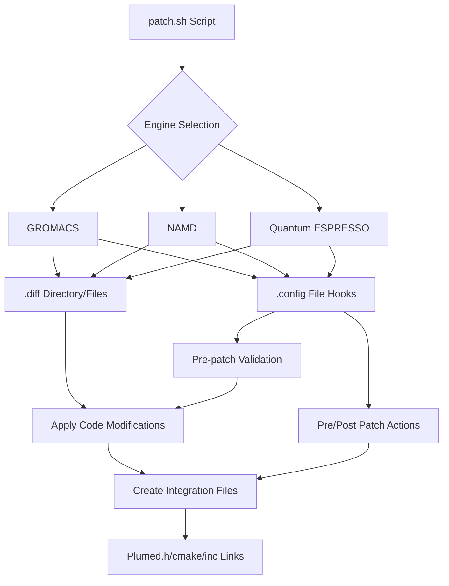
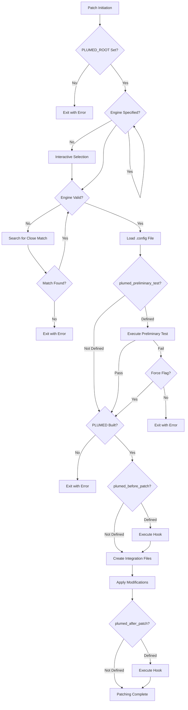

This page provides advanced developers with comprehensive guidance on integrating PLUMED into molecular dynamics (MD) simulation codes through patching mechanisms. The PLUMED distribution includes a sophisticated patching framework that enables on-the-fly modification of MD codes to incorporate collective variable analysis and enhanced sampling methods.

## Patching System Architecture

PLUMED employs a modular patching infrastructure centered around the `patches/` directory structure. Each supported MD code maintains its own patch package containing configuration files, differential patches, and integration hooks. The system supports both traditional diff-based patching and a more sophisticated on-the-fly approach using `.preplumed` files that store original code versions alongside modifications.



The master patching script at `scripts/patch.sh` serves as a proxy to the core implementation in `patches/patch.sh`. This script accepts engine selection through interactive prompts or command-line arguments and coordinates the entire patching workflow through configurable modes.

Sources: [scripts/patch.sh](/scripts/patch.sh#L1-L5), [patches/patch.sh](/patches/patch.sh#L1-L80)

## Supported MD Engines and Patching Status

PLUMED supports integration with multiple MD codes through different mechanisms—some require patching, while others include PLUMED support natively. Understanding the distinction is critical for proper deployment.

| MD Code | Integration Method | Version Support | Special Features/Notes |
|---------|------------------|-----------------|----------------------|
| GROMACS | Native (limited) + Patch (full) | 2022.5, 2023.5, 2024.3, 2025.0 | Native integration in 2025 lacks replica exchange and ENERGY CV; patch provides full support |
| NAMD | Patch only | 2.12, 2.13, 2.14 | **Warning**: No virial contribution from PLUMED; constant volume only |
| Quantum ESPRESSO | Patch only | 5.0.2, 6.2, 7.0, 7.2 | Requires configure workflow; CMake not supported |
| LAMMPS | Native | Since Nov 2018 | No patching required |
| Amber | Native | pmemd since v20, sander since v15 | No patching required |
| CP2K | Native | Since Feb 2015 | No patching required |

The patching infrastructure supports both directory-based patches (containing `.preplumed` files) and script-based diff files. Directory-based patches are preferred for modern integrations as they maintain original file versions for easier updates and license compliance.

Sources: [new-manual/mdcodes.md](/new-manual/mdcodes.md#L1-L50), [patches/gromacs-2025.0.config](/patches/gromacs-2025.0.config#L1-L40)

## Linking Modes and Configuration

PLUMED provides three distinct linking modes, each with specific trade-offs between flexibility, performance, and deployment complexity. The mode must be specified during patching and must match the PLUMED build configuration.

### Linking Mode Comparison

| Mode | Integration Method | Runtime Flexibility | Distribution | Use Case |
|------|------------------|---------------------|--------------|----------|
| **Shared** | Dynamic linking to libplumed.so | Medium | Easier (ships library) | Production HPC environments, multiple codes sharing library |
| **Static** | PLUMED code embedded in MD binary | Low | Harder (larger binaries) | Portable deployments, version-locked simulations |
| **Runtime** | Runtime loading via PLUMED_KERNEL env var | High | Medium (PLUMED separate) | Development, testing, switching PLUMED versions without recompilation |

The linking mode is controlled through the `--mode` option and must correspond to the available PLUMED library files. The patching script validates that the appropriate `Plumed.cmake.$mode` file exists before proceeding.

```bash
# Example: Patch GROMACS in shared mode (default)
$PLUMED_ROOT/scrips/patch.sh -p -e gromacs-2025.0 --mode shared

# Example: Patch in runtime mode
$PLUMED_ROOT/scripts/patch.sh -p -e gromacs-2025.0 --runtime
```

> [!TIP]
> Runtime mode requires the PLUMED_KERNEL environment variable to point to the appropriate libplumedKernel.so file at execution time. This provides maximum flexibility but adds deployment complexity.

Sources: [patches/patch.sh](/patches/patch.sh#L280-L290), [src/lib/Makefile](/src/lib/Makefile#L40-L80)

## Patching Workflow

The complete patching process follows a structured sequence with validation checks, hook execution, and file modification. Understanding each phase enables troubleshooting and custom patch development.



### Configuration File Hooks

Each patch can define optional hook functions in its `.config` file to customize the patching process:

- **`plumed_preliminary_test()`**: Validates that the target directory contains the expected MD code. Returns 0 for success.
- **`plumed_before_patch()`**: Executes before applying patches for custom pre-processing.
- **`plumed_after_patch()`**: Executes after applying patches for post-processing steps.
- **`plumed_before_revert()`**: Executes before reverting patches.
- **`plumed_after_revert()`**: Executes after reverting patches.
- **`plumed_patch_info()`**: Displays MD code-specific information when using `--info` flag.

Special configuration variables include:
- **`PLUMED_PATCH_NO_INCLUDE`**: Set to `true` for codes with embedded PLUMED integration that don't need Plumed.h/inc/cmake files
- **`plumed_ignore_mpi`**: Set to `yes` to skip MPI compatibility warnings

The GROMACS 2025.0 patch demonstrates these hooks:

Sources: [patches/patch.sh](/patches/patch.sh#L290-L350), [patches/gromacs-2025.0.config](/patches/gromacs-2025.0.config#L1-L40)

## MD Code-Specific Patching Details

### GROMACS Integration

GROMACS 2025.0 includes a basic PLUMED interface natively, but the provided patch enables advanced features including replica exchange, ENERGY collective variable support, and lambda dynamics. The patch must be applied **before** invoking the CMake configuration command.

**Patching Process**:
```bash
# Navigate to GROMACS root directory
cd /path/to/gromacs-2025.0

# Apply PLUMED patch
$PLUMED_ROOT/scripts/patch.sh -p -e gromacs-2025.0

# Configure with recommended settings
cmake -DGMX_THREAD_MPI=OFF -DGMX_MPI=ON [other options]

# Build
make -j
```

**Running Patched GROMACS**:
```bash
gmx mdrun -plumed plumed.dat -s topol.tpr
```

The patch adds CMake integration through `gmxManagePlumed.cmake` which creates an interface library and configures include directories. The implementation leverages `dlopen` for dynamic library loading when available.

**GPU Configuration**: For optimal performance with GPU acceleration, carefully tune MPI/OpenMP thread counts. Since PLUMED 2.5 and GROMACS 2018.3, OpenMP threads can be automatically managed by GROMACS through the `-ntomp` flag, eliminating the need for explicit `PLUMED_NUM_THREADS` setting.

Sources: [patches/gromacs-2025.0.config](/patches/gromacs-2025.0.config#L1-L40), [patches/gromacs-2025.0.diff/cmake/gmxManagePlumed.cmake.preplumed](/patches/gromacs-2025.0.diff/cmake/gmxManagePlumed.cmake.preplumbed#L1-L83), [new-manual/mdcodes.md](/new-manual/mdcodes.md#L52-L88)

### NAMD Integration

NAMD requires patching for PLUMED integration. The NAMD patch provides a straightforward interface but carries important limitations regarding virial contributions.

**Patching Process**:
```bash
cd /path/to/namd-2.14
$PLUMED_ROOT/scripts/patch.sh -p -e namd-2.14
```

**Running Patched NAMD**:
Configuration file (`.namd` or `.conf`):
```
plumed on
plumedfile plumed.dat
```

**Critical Limitation**: NAMD does not account for PLUMED's virial contributions. **Only constant volume (NVT) simulations are supported**—isobaric (NPT) simulations with pressure coupling will produce incorrect results.

Sources: [patches/namd-2.14.config](/patches/namd-2.14.config#L1-L31)

### Quantum ESPRESSO Integration

Quantum ESPRESSO requires patching before compilation and uses a specific configuration workflow. The CMake-based installation is **not** currently supported—use the traditional configure approach.

**Patching Process**:
```bash
cd /path/to/qe-7.2
# Configure Quantum ESPRESSO first
./configure

# Then apply PLUMED patch
$PLUMED_ROOT/scripts/patch.sh -p -e qespresso-7.2

# Build
make pw
```

**Running Patched Quantum ESPRESSO**:
```bash
pw.x -plumed < md.in > md.out
```

The patch expects a fixed PLUMED input filename `plumed.dat`. The configuration file (`make.inc`) is automatically modified to include PLUMED's `Plumed.inc` makefile fragment. A backup of the original `make.inc` is preserved as `make.inc.plumedbck` for reverting purposes.

Sources: [patches/qespresso-7.2.config](/patches/qespresso-7.2.config#L1-L29)

## Reverting Patches

The patching system provides complete rollback capabilities, essential for testing different configurations or removing PLUMED integration.

```bash
# Revert a patch
$PLUMED_ROOT/scripts/patch.sh -r -e <engine-name>
```

The revert process executes `plumed_before_revert()` and `plumed_after_revert()` hooks if defined, removes the integration files (Plumed.h, Plumed.inc, Plumed.cmake), and restores all modified files from their `.preplumed` backups. Files that weren't modified remain unchanged.

For directory-based patches, the `.preplumed` files serve as backups containing the original code content before modification. These are moved back to their original filenames and touched to update timestamps.

Sources: [patches/patch.sh](/patches/patch.sh#L450-L501)

## Building PLUMED for Patching

Before patching any MD code, PLUMED must be compiled to generate the required integration files. The build system produces multiple library variants and integration scaffolding.

**Core Build Targets**:

- **`libplumedKernel.so`**: The core PLUMED library containing all collective variables and biasing methods
- **`libplumed.so`**: Combined library (kernel + wrapper) for dynamic linking
- **`libplumedWrapper.a`**: Static wrapper library (when available)
- **`plumed`**: Main executable in shared linking mode
- **`plumed-static`**: Statically linked executable
- **`plumed-runtime`**: Runtime-loading executable

**Build Process**:
```bash
# Configure PLUMED (choose your mode)
./configure --enable-module=all --enable-mpi

# Build libraries
make -j

# Verify integration files exist
ls src/lib/Plumed.inc.shared
ls src/lib/Plumed.cmake.shared
```

> [!TIP]
> When building PLUMED for shared mode patching, avoid running `make clean` on PLUMED after patching. The patched MD code relies on the shared library at its built location; cleaning PLUMED will break the integration unless you re-patch or use installed PLUMED.

The library build process automatically discovers all PLUMED modules through the `find_modules.sh` script and compiles them into the kernel. The makefile in `src/lib/` coordinates the complex linking process across multiple source directories.

Sources: [Makefile](/Makefile#L20-L50), [src/lib/Makefile](/src/lib/Makefile#L1-L100)

## Developer Guide: Creating New Patches

For developers extending PLUMED to support additional MD codes, the patching framework provides mechanisms for creating and testing new patches.

### Creating a New Patch Skeleton

```bash
# Create empty patch files
$PLUMED_ROOT/scripts/patch.sh --new mymdengine-1.0

# This creates:
# - patches/mymdengine-1.0.diff (empty)
# - Recommended: patches/mymdengine-1.0.config (create manually)
```

### Patch Development Workflow

1. **Create .config file**: Define hooks for validation and customization
2. **Implement patch logic**: Choose between directory format (with `.preplumed` files) or diff script
3. **Test interactively**: Use `--save` to capture changes as you work
4. **Validate**: Test with multiple configurations and MPI/no-MPI builds

### Directory Format vs. Diff Format

**Directory Format** (recommended for new patches):
```
patches/engine-1.0.diff/
├── src/
│   └── engine/
│       ├── file1.cpp.preplumed  # Original version
│       └── file1.cpp            # Modified version
```

**Diff Format** (legacy):
```bash
patches/engine-1.0.diff  # Shell script applying patches
```

The directory format offers better maintainability, license compliance (by keeping originals), and easier version control. The patching script automatically applies differences between `.preplumed` files and modified versions using `patch -u`.

### Saving Development Changes

Use the `--save` action to capture modifications while developing a patch:

```bash
# After making manual changes to the MD code
$PLUMED_ROOT/scripts/patch.sh --save -e mymdengine-1.0
```

This generates the patch files from your modifications, storing either the directory format (with originals) or a single diff script based on your choice.

Sources: [patches/patch.sh](/patches/patch.sh#L350-L450), [patches/patch.sh](/patches/patch.sh#L30-L40)

## Troubleshooting and Best Practices

### Common Issues

**Issue**: `ERROR: I cannot find Plumed.h, Plumed.inc, and Plumed.cmake files`
- **Cause**: Integration files missing or patch not applied
- **Resolution**: Ensure you're in the MD code root directory and re-apply the patch

**Issue**: `ERROR: Preliminary test not passed`
- **Cause**: Wrong directory or MD code version mismatch
- **Resolution**: Verify you're in the correct directory and using the appropriate patch version. Use `-f` to force if certain.

**Issue**: PLUMED not found at runtime
- **Cause**: Library path not configured for shared mode
- **Resolution**: Set `LD_LIBRARY_PATH` to include PLUMED's `src/lib` or installation path, or use runtime mode

### GPU Performance Tuning

When using PLUMED with GROMACS on GPU-accelerated systems, experiment with thread/process distribution:

```bash
# 4 cores, 2 GPUs: Option 1 (2 MPI / 2 GPU / 2 OPENMP per MPI)
export PLUMED_NUM_THREADS=2
mpiexec -np 2 gmx_mpi mdrun -nb gpu -ntomp 2 -pin on -gpu_id 01

# 4 cores, 2 GPUs: Option 2 (4 MPI / 2 GPU)
export PLUMED_NUM_THREADS=1
mpiexec -np 4 gmx_mpi mdrun -nb gpu -ntomp 1 -pin on -gpu_id 0011
```

The optimal configuration depends on the specific hardware and simulation characteristics. PLUMED's CPU load is accounted for in GROMACS's load balancing, but manual tuning may still yield performance improvements.

### MPI Configuration

The patching script automatically detects PLUMED's MPI configuration and issues warnings:
- If PLUMED compiled **with** MPI: MD code can be configured with MPI
- If PLUMED compiled **without** MPI: MD code must be configured **without** MPI

Set `plumed_ignore_mpi=yes` in the config file to suppress these warnings for codes that handle MPI independently.

Sources: [new-manual/mdcodes.md](/new-manual/mdcodes.md#L52-L88), [patches/patch.sh](/patches/patch.sh#L340-L350)

## Testing and Validation

PLUMED maintains a test suite in the `test/` directory for validating integrations. Each patched MD code has test cases demonstrating proper configuration and execution.

**GROMACS Tests** ([test/gromacs/](/test/gromacs/)):
- Basic integration tests
- Configuration examples for common scenarios
- Sample PLUMED input files

**Test Directory Structure**:
```
test/
├── gromacs/         # GROMACS integration tests
├── namd/            # NAMD integration tests
├── qespresso/       # Quantum ESPRESSO integration tests
└── link/            # General linking tests
```

Refer to the [PLUMED Test Center](https://plumed-testcenter.github.io) for comprehensive integration status and build examples across different MD codes and configurations.

Sources: [test/](/test/), [new-manual/mdcodes.md](/new-manual/mdcodes.md#L45-L48)

## Next Steps

- For detailed information on individual MD code integrations and runtime configuration, refer to specific integration guides:
  - [GROMACS Integration](18-gromacs-integration)
  - [NAMD Integration](19-namd-integration)
  - [LAMMPS Integration](20-lammps-integration)
  - [Quantum ESPRESSO Integration](21-quantum-espresso-integration)

- For understanding how PLUMED communicates with MD codes through its API, see [PlumedMain and Plugin Interface](7-plumedmain-and-plugin-interface)

- For insights into the action framework executed within patched MD codes, see [Action Framework and Execution Model](6-action-framework-and-execution-model)

- For extending PLUMED with custom collective variables or biasing methods, see [Module Architecture and Design](23-module-architecture-and-design)