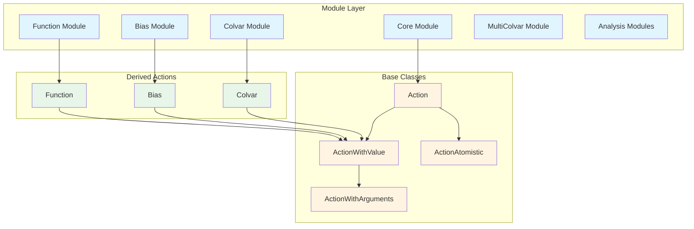
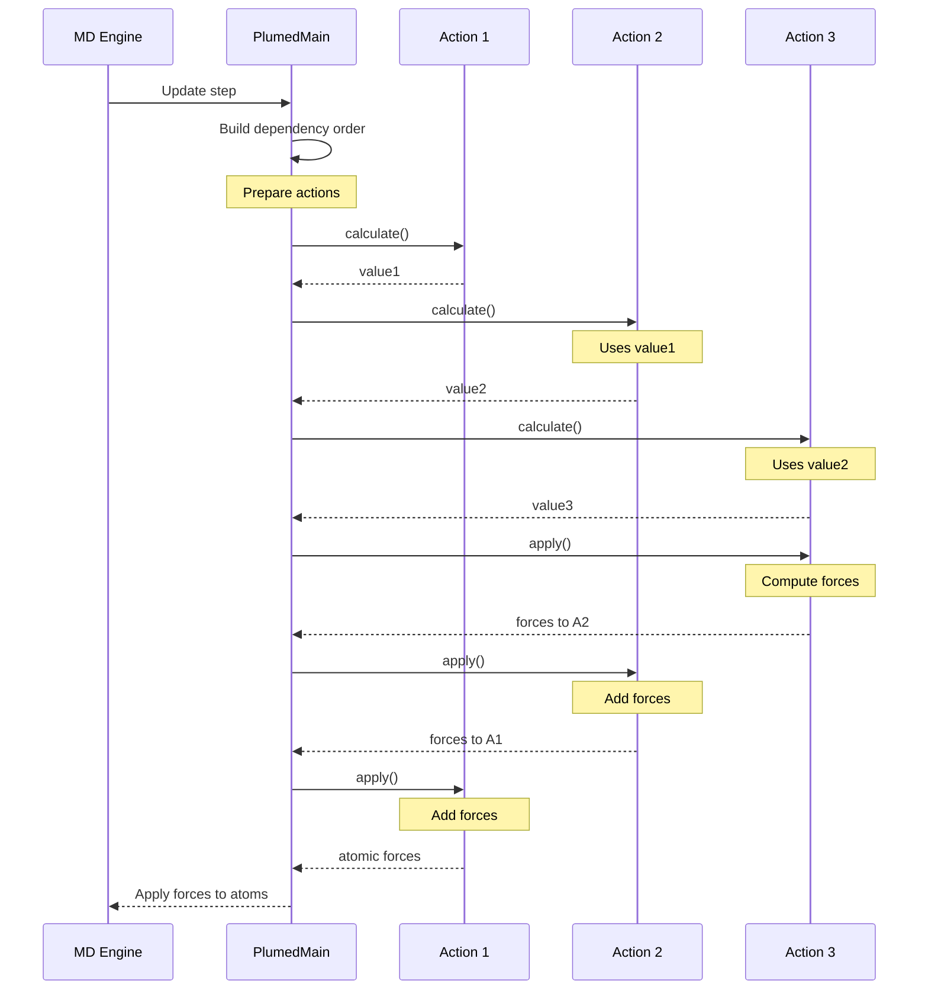
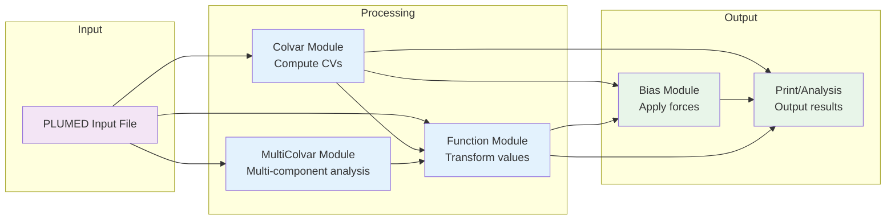

This documentation explores PLUMED2's modular architecture, examining how the system organizes collective variables, biasing methods, and analysis tools into distinct modules. Understanding this architecture is essential for developers seeking to extend PLUMED with new functionality or optimize existing implementations.

## Architectural Foundations

PLUMED2's module system provides a clean separation of concerns, enabling independent development and maintenance of different computational methods. The architecture centers on a plugin-based registration system where modules self-register their capabilities during initialization. Each module resides in its own directory under `src/` and contains related implementations, with metadata files describing the module's purpose and capabilities.

The core module ([`src/core/`](src/core/)) provides fundamental abstractions that all other modules inherit from. This includes the `Action` base class—the foundational building block for all PLUMED operations—and the registration infrastructure that enables dynamic discovery of actions at runtime. The core module also houses interfaces for communication with MD codes, data passing utilities, and parallel execution support.



The modular design enables several critical capabilities: selective compilation of only needed functionality, dynamic loading of additional modules via plugins, and clear dependency management between computational components. Each module defines its own namespace and can be compiled independently while sharing the common infrastructure provided by the core module.

Sources: [src/core/module.md](src/core/module.md), [src/core/Action.h](src/core/Action.h), [src/colvar/module.yml](src/colvar/module.yml)

## Module Organization and Structure

Every PLUMED2 module follows a consistent organizational pattern that facilitates maintenance and extensibility. At the minimum, each module directory contains source files (.cpp and .h), a Makefile for compilation, and metadata files (`module.yml`, `module.md`, `module.type`). This standardization simplifies navigation and enables automated tooling for documentation generation and module discovery.

The `module.yml` file serves as the primary metadata descriptor, containing fields such as module name, authors, description, and relevant DOIs for citation. For example, the core module is described as "PLUMED's core functionalities for interfacing with MD codes and building actions" with the key DOI 10.1016/j.cpc.2013.09.018. Similarly, the colvar module describes itself as "various core collective variables that can be used to analyse or bias simulations." This metadata enables automatic documentation generation and proper attribution when methods are used in publications.

| Module | Purpose | Key Classes | Dependencies |
|--------|---------|-------------|--------------|
| **core** | Base classes, registration, MD interfaces | Action, ActionRegister, PlumedMain, Value | None (foundation) |
| **colvar** | Collective variable implementations | Colvar, Distance, RMSD, Gyration | core |
| **bias** | Biasing potential implementations | Bias, MetaD, Restraint, ReweightBase | core, colvar |
| **function** | Mathematical and analytical functions | Function, Custom, Combine | core |
| **multicolvar** | Multi-component collective variables | MultiColvarTemplate, Coordination | core, colvar |
| **tools** | Utility classes and helper functions | Pbc, RMSD, SwitchingFunction, Communicator | None |

The ModuleMap ([`src/core/ModuleMap.h`](src/core/ModuleMap.h)) provides the central registry mapping action directives to their implementing modules. This mapping enables PLUMED to direct input directives to the appropriate module during parsing and to provide users with information about which module provides a particular action. The map is built during initialization as each module registers its actions.

Sources: [src/core/ModuleMap.h](src/core/ModuleMap.h), [src/colvar/module.yml](src/colvar/module.yml), [src/bias/module.yml](src/bias/module.yml)

## The Action Framework

At the heart of PLUMED's module architecture lies the Action framework, a hierarchical class system that defines the execution model for all computational operations. The `Action` class ([`src/core/Action.h`](src/core/Action.h)) serves as the abstract base, providing common functionality such as keyword parsing, timestep management, and dependency tracking. All concrete implementations—whether they compute a collective variable, apply a bias, or perform analysis—must inherit from Action and implement its core virtual methods.

The Action class defines two critical lifecycle methods that all actions must implement: `calculate()` and `apply()`. The `calculate()` method performs the actual computation—evaluating a CV value, computing bias forces, or transforming data—and is called in forward order through the action chain. The `apply()` method applies results to the simulation state—typically by adding forces to atoms—and is called in backward order. This two-phase execution enables complex dependencies where later actions can use results from earlier ones, while forces are properly propagated through the dependency graph.



The `ActionWithValue` class ([`src/core/ActionWithValue.h`](src/core/ActionWithValue.h)) extends Action to provide functionality for storing computed quantities and managing their derivatives. This intermediate class is used by actions that produce output values—collective variables, biases, and functions. It handles value storage, periodic boundary conditions, and derivative propagation, freeing concrete implementations from managing these common concerns. Actions can produce either scalar values or vectorial components, and can optionally include derivatives for force computation.

Sources: [src/core/Action.h](src/core/Action.h#L200-L250), [src/core/ActionWithValue.h](src/core/ActionWithValue.h)

## Registration and Plugin System

PLUMED's registration system ([`src/core/ActionRegister.h`](src/core/ActionRegister.h)) implements a plugin architecture that enables automatic discovery of actions at runtime. The `ActionRegister` class maintains a mapping from directive strings (the keywords used in PLUMED input files) to factory functions that create action instances. This registry is populated during program initialization through a clever use of static objects and template metaprogramming.

The registration mechanism relies on the `PLUMED_REGISTER_ACTION` macro, which should be placed in the source file of each action implementation. This macro instantiates a static `ActionRegistration` template object that registers the action class with its directive name upon program startup. The registration happens automatically through static initialization, requiring no explicit registration code. The macro also includes a `static_assert` ensuring that only classes inheriting from Action can be registered, providing compile-time type safety.

```cpp
// Example from Distance collective variable
namespace PLMD {
namespace colvar {

class Distance : public Colvar {
public:
  static void registerKeywords( Keywords& keys );
  explicit Distance( const ActionOptions& );
  void calculate() override;
};

// Registration in .cpp file
PLUMED_REGISTER_ACTION(Distance,"DISTANCE")

} // namespace colvar
} // namespace PLMD
```

The `RegisterBase` class ([`src/core/RegisterBase.h`](src/core/RegisterBase.h)) provides the generic registration infrastructure used by ActionRegister, CLToolRegister, and other registries. It implements sophisticated features including thread-safe registration with mutex protection, support for dynamic library loading (dlopen), and image-based registration tracking. This enables PLUMED to load additional modules as shared libraries at runtime, with proper cleanup when libraries are unloaded. The registration system uses a "staging" approach during dynamic loading to prevent incomplete registrations from corrupting the global registry.

> [!TIP]
> The registration system's support for dynamic loading enables external plugins to extend PLUMED without modifying the core codebase. Plugin modules can be compiled independently and loaded at runtime, with the registry handling automatic discovery and cleanup of the plugin's actions.

Sources: [src/core/ActionRegister.h](src/core/ActionRegister.h), [src/core/RegisterBase.h](src/core/RegisterBase.h), [src/colvar/Distance.cpp](src/colvar/Distance.cpp)

## Module Types and Specialization

PLUMED2 modules can be categorized by their purpose and the type of actions they provide. Understanding these categories helps in navigating the codebase and determining where new functionality should be added.

**Core Computational Modules** implement the primary scientific functionality of PLUMED. The colvar module ([`src/colvar/`](src/colvar/)) contains collective variable implementations like Distance, RMSD, Coordination, and Gyration. The bias module ([`src/bias/`](src/bias/)) provides biasing methods including Metadynamics (MetaD), restraints, umbrella sampling walls, and reweighting utilities. These modules directly compute physical quantities and apply forces to the simulation.

**Transformation Modules** modify or combine values from other actions without directly accessing atomic coordinates. The function module ([`src/function/`](src/function/)) implements mathematical operations including custom expressions, combinations, statistical operations, and path-based functions. These operations enable sophisticated analysis workflows by composing simpler building blocks.

**Specialized Analysis Modules** implement domain-specific analysis techniques. Examples include the multicolvar module for computing properties across multiple atom groups, the secondarystructure module for protein structural analysis, and the clusters module for identifying molecular clusters. These modules often combine core functionality with domain-specific algorithms.



**Infrastructure Modules** provide supporting functionality without implementing user-facing actions. The tools module ([`src/tools/`](src/tools/)) contains utility classes for mathematical operations, file I/O, parallel communication, and data structures. The config module manages build configuration, while modules like gridtools and matrixtools provide specialized computational kernels.

Sources: [src/colvar/](src/colvar/), [src/bias/](src/bias/), [src/function/](src/function/), [src/tools/](src/tools/)

## Implementing New Module Functionality

When extending PLUMED with new functionality, developers must decide which module to place their implementation in. This decision should be based on the nature of the functionality and its dependencies on existing code. The developer documentation provides templates and guidelines for adding collective variables ([`developer-doc/AddingAColvar.md`](developer-doc/AddingAColvar.md)) and command-line tools ([`developer-doc/AddingACLTool.md`](developer-doc/AddingACLTool.md)).

For new collective variables, the implementation should typically go in the colvar module or a domain-specific analysis module if the CV is specialized for a particular application domain. The template shows that a new CV requires: (1) a class inheriting from Colvar, (2) a static `registerKeywords()` method to declare input parameters, (3) a constructor that parses input, and (4) a `calculate()` method that computes the CV value and derivatives. The `PLUMED_REGISTER_ACTION` macro ensures automatic registration.

New bias methods should be placed in the bias module, inheriting from the Bias base class. Bias implementations need to compute the bias potential and its derivatives with respect to collective variables, then apply forces through the apply() method. The bias module includes helper classes for common patterns like restraints and reweighting.

New mathematical transformations should go in the function module, inheriting from appropriate base classes depending on whether they operate on scalars, vectors, or matrices. The function module provides several base classes (FunctionOfScalar, FunctionOfVector, FunctionOfMatrix) that handle argument parsing and result storage.

> [!TIP]
> When adding new functionality, always include proper documentation in the source file using the PLUMEDDOC comment format. This documentation is automatically extracted to generate the user manual, ensuring that new features are discoverable and properly documented.

Sources: [developer-doc/AddingAColvar.md](developer-doc/AddingAColvar.md), [developer-doc/AddingACLTool.md](developer-doc/AddingACLTool.md)

## Inter-Module Dependencies and Communication

Modules in PLUMED communicate through well-defined interfaces, maintaining loose coupling while enabling complex workflows. The primary communication mechanism is through Value objects, which encapsulate computed quantities and their derivatives. When an action needs data from another action, it uses the ActionWithArguments mechanism to declare dependencies and access values.

The dependency system ([`src/core/Action.h`](src/core/Action.h)) ensures actions are executed in the correct order. Each action can declare dependencies on other actions through `addDependency()`, and the ActionSet determines the evaluation order based on these dependencies. This topological sorting ensures that when an action's calculate() method is called, all values it depends on have already been computed.

For inter-module communication in parallel simulations, PLUMED provides the Communicator class ([`src/tools/Communicator.h`](src/tools/Communicator.h)) which abstracts MPI communication. This enables collective operations, reductions, and data exchange across MPI ranks in a consistent manner across different MD codes. The DomainDecomposition class ([`src/core/DomainDecomposition.h`](src/core/DomainDecomposition.h)) handles atom distribution across ranks for parallel simulations.

The module architecture also supports data exchange with external codes and scripts through the data passing framework. Actions can expose values for output to MD codes or external analysis tools, and can receive data from external sources. This enables integration with visualization tools, real-time analysis pipelines, and custom post-processing workflows.

Sources: [src/core/Action.h](src/core/Action.h#L100-L200), [src/tools/Communicator.h](src/tools/Communicator.h), [src/core/DomainDecomposition.h](src/core/DomainDecomposition.h)

## Next Steps

Understanding PLUMED's module architecture is essential preparation for several key development tasks:

- For implementing new collective variables, proceed to [Creating New CVs](24-creating-new-cvs) which provides detailed guidance on CV implementation patterns and best practices
- For developing biasing methods, continue to [Creating New Bias Methods](25-creating-new-bias-methods) which covers the Bias class interface and force application mechanisms
- To understand how actions execute and interact, review [Action Framework and Execution Model](6-action-framework-and-execution-model) for deeper insight into the calculation/apply cycle
- For module-level testing, see [Regression Testing Framework](27-regression-testing-framework) which explains how to validate new module functionality