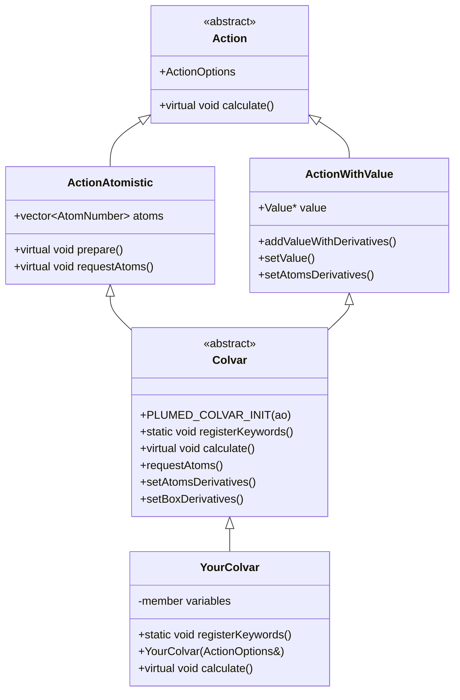
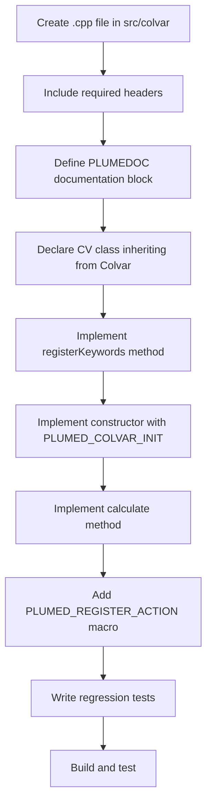

This guide provides comprehensive documentation for developers creating new collective variables (CVs) in PLUMED 2. It covers the architectural patterns, implementation details, and best practices required to extend PLUMED's CV library with custom functionality.

## CV Architecture Overview

PLUMED employs an **action-based framework** where collective variables are implemented as actions that inherit from a well-defined class hierarchy. This design ensures seamless integration with the core framework while maintaining flexibility for custom implementations.



The `Colvar` base class provides essential infrastructure including atom management, derivative storage, and periodic boundary condition handling through its inheritance from `ActionAtomistic` and `ActionWithValue` [Colvar.h](src/core/Colvar.h#L1-L116). This dual inheritance enables CVs to access atomic coordinates and store computed values with derivatives in a unified framework.

Sources: [developer-doc/AddingAColvar.md](developer-doc/AddingAColvar.md#L1-L139), [Colvar.h](src/core/Colvar.h#L1-L116)

## Implementation Workflow

Creating a new CV follows a structured workflow that ensures proper integration with PLUMED's registration system and documentation generation.



Each step in this workflow is essential for proper integration. The registration macro at the end is particularly critical as it creates the linkage between your CV class and its keyword in the input file parser.

Sources: [developer-doc/AddingAColvar.md](developer-doc/AddingAColvar.md#L1-L60)

## Essential CV Structure

Every CV implementation follows a consistent structure consisting of four required components: documentation block, class declaration, keyword registration, and calculation implementation.

### File Organization

CVs must be implemented as single `.cpp` files placed in the `src/colvar` directory. The filename should correspond to the CV name (e.g., `Distance.cpp` for the DISTANCE CV) [AddingAColvar.md](developer-doc/AddingAColvar.md#L5-L10).

### Required Includes

Every CV must include the core headers for access to the base classes and registration system:

```cpp
#include "Colvar.h"
#include "ActionRegister.h"
#include <string>
#include <cmath>
#include <cassert>

using namespace std;
```

### Documentation Block

PLUMED uses embedded documentation markers to automatically generate user manuals. The documentation block must appear before the class declaration:

```cpp
//+PLUMEDOC COLVAR KEYWORD
/*
Detailed description of your collective variable explaining its physical meaning,
mathematical formulation, and typical use cases.

\par Examples

Here provide example input demonstrating typical usage:

\plumedfile
d: YOURCV ATOMS=1,2 PARAMETER=value
PRINT ARG=d FILE=colvar
\plumedfile

Additional sections can include:
- Description of periodicity
- Information about derivatives
- Computational considerations
*/
//+ENDPLUMEDOC
```

The documentation format is critical—CVs without proper documentation cannot be merged into the main codebase [AddingAColvar.md](developer-doc/AddingAColvar.md#L16-L28).

Sources: [AddingAColvar.md](developer-doc/AddingAColvar.md#L16-L28), [Distance.cpp](src/colvar/Distance.cpp#L26-L98)

## Class Declaration and Registration

### Base Class Inheritance

Your CV class must inherit from the `Colvar` base class, which provides access to atom management, value storage, and derivative handling capabilities:

```cpp
class YourColvar : public Colvar {
private:
    // Private member variables for your CV parameters
    double parameter;
    std::vector<int> atoms;
    bool use_pbc;

public:
    // Static method to register keywords for this CV
    static void registerKeywords(Keywords& keys);
    
    // Constructor that reads input parameters
    explicit YourColvar(const ActionOptions& ao);
    
    // Virtual method that performs the CV calculation
    void calculate() override;
};
```

The `calculate()` method is pure virtual in the action framework and must be implemented for your CV to compile correctly [AddingAColvar.md](developer-doc/AddingAColvar.md#L29-L50).

### Action Registration

The registration macro at the bottom of your file creates the linkage between your class and its keyword:

```cpp
PLUMED_REGISTER_ACTION(YourColvar, "YOURCV")
```

This macro takes two arguments: the class name and the keyword string used in PLUMED input files. Multiple registration statements can support different variants of the same CV [Distance.cpp](src/colvar/Distance.cpp#L158-L161):

```cpp
typedef ColvarShortcut<Distance> DistanceShortcut;
PLUMED_REGISTER_ACTION(DistanceShortcut,"DISTANCE")
PLUMED_REGISTER_ACTION(Distance,"DISTANCE_SCALAR")
```

Sources: [AddingAColvar.md](developer-doc/AddingAColvar.md#L51-L58), [Distance.cpp](src/colvar/Distance.cpp#L158-L161)

## Keyword Registration

The `registerKeywords()` method defines all input parameters your CV accepts and enables automatic validation and documentation generation:

```cpp
void YourColvar::registerKeywords(Keywords& keys) {
    Colvar::registerKeywords(keys);  // Inherit base class keywords
    
    // Add atom specifications
    keys.add("atoms", "ATOMS", "the atoms involved in the CV");
    
    // Add numerical parameters
    keys.add("compulsory", "PARAMETER", "default", "description of parameter");
    
    // Add boolean flags
    keys.addFlag("NOPBC", false, "ignore periodic boundary conditions");
    
    // Add output components for multi-component CVs
    keys.addOutputComponent("x", "COMPONENTS", "the x component of the vector");
    keys.addOutputComponent("y", "COMPONENTS", "the y component of the vector");
    
    // Set value description
    keys.setValueDescription("scalar", "the value of your CV");
    
    // Add DOI reference if applicable
    keys.addDOI("10.1234/your.citation");
}
```

The `Keywords` API supports multiple registration types:

| Keyword Type | Method | Description |
|--------------|--------|-------------|
| Atom specifications | `keys.add("atoms", ...)` | Required atoms or atom groups |
| Compulsory parameters | `keys.add("compulsory", ...)` | Required numeric or string parameters |
| Optional parameters | `keys.add("optional", ...)` | Parameters with defaults |
| Boolean flags | `keys.addFlag(..., false, ...)` | Boolean switches (second parameter sets default) |
| Output components | `keys.addOutputComponent(...)` | Named components for multi-value CVs |

Sources: [Distance.cpp](src/colvar/Distance.cpp#L163-L186), [AddingAColvar.md](developer-doc/AddingAColvar.md#L59-L72)

## Constructor Implementation

The constructor initializes your CV by reading input parameters and setting up required data structures:

```cpp
YourColvar::YourColvar(const ActionOptions& ao):
    PLUMED_COLVAR_INIT(ao),  // Initialize base classes
    parameter(0.0),
    use_pbc(true) {
    
    // Parse atom list
    parseAtomList("ATOMS", -1, atoms);
    
    // Parse numerical parameters
    parse("PARAMETER", parameter);
    
    // Parse boolean flags
    parseFlag("NOPBC", use_pbc);
    
    // Validate that all input was consumed
    checkRead();
    
    // Request atom positions from the core
    std::vector<AtomNumber> atom_numbers;
    for(unsigned i=0; i<atoms.size(); ++i) {
        atom_numbers.push_back(AtomNumber::index(atoms[i]));
    }
    requestAtoms(atom_numbers);
    
    // Set up value storage with derivatives
    addValueWithDerivatives("");
    
    // Configure periodicity if applicable
    if(use_pbc) {
        getValue("")->setPeriodicity(true);
        getValue("")->setDomain(min_value, max_value);
    } else {
        getValue("")->setNotPeriodic();
    }
}
```

Key initialization steps include:

1. **Base class initialization**: The `PLUMED_COLVAR_INIT(ao)` macro initializes both `Action` and `Colvar` base classes properly [Distance.cpp](src/colvar/Distance.cpp#L188-L189).

2. **Input parsing**: Use the inherited parsing methods to read parameters. The `checkRead()` call ensures no unrecognized input remains, catching user errors early.

3. **Atom requests**: `requestAtoms()` informs the framework which atoms your CV needs, enabling efficient data retrieval during calculation [Colvar.h](src/core/Colvar.h#L47-L48).

4. **Value setup**: `addValueWithDerivatives()` allocates storage for the CV value and its derivatives with respect to atomic coordinates and box parameters.

5. **Periodicity configuration**: Proper periodicity specification is crucial for free energy calculations involving periodic CVs.

Sources: [Distance.cpp](src/colvar/Distance.cpp#L188-L222), [AddingAColvar.md](developer-doc/AddingAColvar.md#L73-L100)

## Calculate Method Implementation

The `calculate()` method is called during each MD step and must compute the CV value, atomic derivatives, and box derivatives:

```cpp
void YourColvar::calculate() {
    // Handle periodic boundary conditions if needed
    if(use_pbc) {
        makeWhole();  // Ensure molecules are not split across PBC
    }
    
    // Retrieve atomic positions
    const Vector& p0 = getPosition(0);
    const Vector& p1 = getPosition(1);
    
    // Compute the CV value
    double cv_value;
    Tensor box_derivatives;
    std::vector<Vector> atom_derivatives(atoms.size());
    
    // YOUR CALCULATION LOGIC HERE
    // Example: distance calculation
    Vector d = delta(p0, p1);
    cv_value = d.modulo();
    Vector d_unit = d / cv_value;
    
    // Compute atomic derivatives (chain rule)
    atom_derivatives[0] = -d_unit;  // Derivative with respect to first atom
    atom_derivatives[1] = d_unit;   // Derivative with respect to second atom
    
    // Compute box derivatives for PBC calculations
    box_derivatives = Tensor::zero();
    // ... box derivative calculation based on your CV ...
    
    // Transfer results to PLUMED core
    setValue(cv_value);
    for(unsigned i=0; i<atoms.size(); ++i) {
        setAtomsDerivatives(i, atom_derivatives[i]);
    }
    setBoxDerivatives(box_derivatives);
}
```

The calculation must always provide three types of output:

1. **CV value**: The scalar or vector value of your collective variable
2. **Atomic derivatives**: Gradients with respect to each atomic coordinate (∂CV/∂xᵢ)
3. **Box derivatives**: Gradients with respect to box parameters (virial contribution) for PBC-aware calculations

> [!TIP]
> Always use the `delta()` function (inherited from `ActionAtomistic`) when computing distance vectors between atoms. This function properly handles periodic boundary conditions and minimum image conventions, ensuring correct derivatives across PBC boundaries.

Sources: [Distance.cpp](src/colvar/Distance.cpp#L257-L316), [Colvar.h](src/core/Colvar.h#L50-L65)

## Multi-Component CVs

Some CVs naturally produce multiple related values (e.g., path collective variables provide both distance along path `s` and distance from path `z`). PLUMED supports efficient multi-component CVs through a single action that outputs multiple named values.

### Component Setup

In the constructor, create additional value objects for each component:

```cpp
void MultiCV::MultiCV(const ActionOptions& ao):
    PLUMED_COLVAR_INIT(ao) {
    // ... parsing code ...
    
    // Primary component (often the scalar CV)
    addValueWithDerivatives("");
    getValue("")->setNotPeriodic();
    
    // Secondary components
    addValueWithDerivatives("component1");
    getValue("component1")->setPeriodicity(true);
    getValue("component1")->setDomain(min1, max1);
    
    addValueWithDerivatives("component2");
    getValue("component2")->setNotPeriodic();
}
```

### Component Calculation

In `calculate()`, compute values and derivatives for all components, then transfer them using component-specific calls:

```cpp
void MultiCV::calculate() {
    // Calculate all CV values
    double primary_value, component1_value, component2_value;
    std::vector<Vector> primary_derivs, comp1_derivs, comp2_derivs;
    Tensor primary_box, comp1_box, comp2_box;
    
    // ... calculation logic for all components ...
    
    // Transfer primary component
    setValue(primary_value);
    for(unsigned i=0; i<atoms.size(); ++i) {
        setAtomsDerivatives(i, primary_derivs[i]);
    }
    setBoxDerivatives(primary_box);
    
    // Transfer component1
    Value* comp1 = getPntrToComponent("component1");
    comp1->set(component1_value);
    for(unsigned i=0; i<atoms.size(); ++i) {
        setAtomsDerivatives(comp1, i, comp1_derivs[i]);
    }
    setBoxDerivatives(comp1, comp1_box);
    
    // Transfer component2
    Value* comp2 = getPntrToComponent("component2");
    comp2->set(component2_value);
    for(unsigned i=0; i<atoms.size(); ++i) {
        setAtomsDerivatives(comp2, i, comp2_derivs[i]);
    }
    setBoxDerivatives(comp2, comp2_box);
}
```

The overloaded `setAtomsDerivatives(Value*, int, Vector)` and `setBoxDerivatives(Value*, Tensor)` methods handle component-specific data transfer [Colvar.h](src/core/Colvar.h#L54-L61).

Sources: [AddingAColvar.md](developer-doc/AddingAColvar.md#L103-L139), [Distance.cpp](src/colvar/Distance.cpp#L262-L290), [Colvar.h](src/core/Colvar.h#L54-L61)

## Complete Example: Simple Distance CV

Here is a complete, minimal implementation of a distance CV illustrating all required elements:

```cpp
#include "Colvar.h"
#include "ActionRegister.h"

using namespace std;

namespace PLMD {
namespace colvar {

//+PLUMEDOC COLVAR SIMPLE_DISTANCE
/*
Calculate the distance between two atoms.

This CV computes the Euclidean distance between a pair of atoms,
taking periodic boundary conditions into account.

\par Examples

\plumedfile
d: SIMPLE_DISTANCE ATOMS=1,2
PRINT ARG=d FILE=colvar
\plumedfile
*/
//+ENDPLUMEDOC

class SimpleDistance : public Colvar {
private:
    bool use_pbc;

public:
    static void registerKeywords(Keywords& keys);
    explicit SimpleDistance(const ActionOptions& ao);
    void calculate() override;
};

PLUMED_REGISTER_ACTION(SimpleDistance, "SIMPLE_DISTANCE")

void SimpleDistance::registerKeywords(Keywords& keys) {
    Colvar::registerKeywords(keys);
    keys.add("atoms", "ATOMS", "pair of atoms");
    keys.addFlag("NOPBC", false, "ignore periodic boundary conditions");
}

SimpleDistance::SimpleDistance(const ActionOptions& ao):
    PLUMED_COLVAR_INIT(ao),
    use_pbc(true) {
    
    vector<AtomNumber> atoms;
    parseAtomList("ATOMS", -1, atoms);
    
    if(atoms.size() != 2) {
        error("SIMPLE_DISTANCE requires exactly 2 atoms");
    }
    
    bool nopbc = false;
    parseFlag("NOPBC", nopbc);
    use_pbc = !nopbc;
    
    checkRead();
    requestAtoms(atoms);
    
    addValueWithDerivatives("");
    getValue("")->setNotPeriodic();
}

void SimpleDistance::calculate() {
    Vector d = delta(getPosition(0), getPosition(1));
    double dist = d.modulo();
    Vector d_unit = d / dist;
    
    setValue(dist);
    setAtomsDerivatives(0, -d_unit);
    setAtomsDerivatives(1, d_unit);
    setBoxDerivatives(Tensor::zero());
}

} // namespace colvar
} // namespace PLMD
```

Sources: [Distance.cpp](src/colvar/Distance.cpp#L1-L363), [AddingAColvar.md](developer-doc/AddingAColvar.md#L1-L139)

## Advanced Patterns and Best Practices

### Vector CVs with ColvarInput/ColvarOutput

Modern PLUMED CVs often use the `ColvarInput` and `ColvarOutput` helper classes to implement efficient vectorized calculations that can compute multiple CVs in a single pass. The `Distance` CV demonstrates this pattern [Distance.cpp](src/colvar/Distance.cpp#L148-L157):

```cpp
class Distance : public Colvar {
public:
    static void calculateCV(const ColvarInput& cvin, ColvarOutput& cvout);
    // ...
};

void Distance::calculateCV(const ColvarInput& cvin, ColvarOutput& cvout) {
    Vector distance = delta(cvin.pos[0], cvin.pos[1]);
    const double value = distance.modulo();
    const double invvalue = 1.0 / value;
    
    cvout.values[0] = value;
    cvout.derivs[0][0] = -invvalue * distance;
    cvout.derivs[0][1] = invvalue * distance;
    // ...
}
```

This pattern enables the same calculation logic to be reused for single CVs, vector CVs, and multi-component CVs.

### Periodicity Handling

Proper periodicity specification is crucial for CVs that will be used in free energy calculations. Use the appropriate methods based on your CV's properties:

| CV Type | Method Call | Description |
|---------|-------------|-------------|
| Non-periodic | `getValue("")->setNotPeriodic()` | CV has no periodic boundaries |
| Periodic | `getValue("")->setPeriodicity(true)` + `getValue("")->setDomain(min, max)` | CV is periodic within specified range |

For PBC-aware calculations, always use `makeWhole()` before computing interatomic distances to ensure atoms are not split across periodic boundaries [Distance.cpp](src/colvar/Distance.cpp#L258-L259).

### Performance Considerations

- **Minimize allocations**: Reuse vectors and objects rather than creating them in `calculate()`
- **Use PLUMED utilities**: Functions like `delta()`, `modulo()`, and matrix operations are optimized
- **Vectorize where possible**: The `ColvarInput`/`ColvarOutput` pattern enables efficient batch processing
- **Profile your CV**: Use PLUMED's built-in timing to identify bottlenecks in complex calculations

> [!TIP]
> For CVs that involve complex mathematical operations, consider implementing analytical derivatives rather than relying on numerical differentiation. Analytical derivatives are more accurate and typically faster. The core framework provides utility functions for common mathematical operations in the `tools/` directory.

Sources: [Distance.cpp](src/colvar/Distance.cpp#L250-L350), [AddingAColvar.md](developer-doc/AddingAColvar.md#L118-L139)

## Testing and Validation

### Regression Tests

Every CV must include at least one regression test to verify correctness and prevent regressions. Tests are placed in the `regtest/` directory organized by CV type. See [AddingRegressionTests.md](developer-doc/AddingRegressionTests.md) for comprehensive guidance on test creation.

### Build Integration

After implementing your CV:

1. Add your `.cpp` file to `src/colvar/Makefile`
2. Ensure proper compilation with `make`
3. Run relevant regression tests: `make test`
4. Verify documentation generation: `make doc`

### Code Style

PLUMED enforces consistent code formatting using ASTYLE. Apply the formatter before committing:

```bash
cd src/colvar
../../astyle/src/astyle YourColvar.cpp
```

Sources: [AddingAColvar.md](developer-doc/AddingAColvar.md#L1-L10), [repository structure](src/colvar)

## Next Steps

After implementing your CV, continue exploring the framework with these resources:

- **[Action Framework and Execution Model](6-action-framework-and-execution-model)**: Deep dive into how actions are scheduled and executed
- **[CV Fundamentals and Common CVs](10-cv-fundamentals-and-common-cvs)**: Understand built-in CV implementations and patterns
- **[Writing Regression Tests](28-writing-regression-tests)**: Comprehensive guide to test development
- **[Module Architecture and Design](23-module-architecture-and-design)**: Learn how CVs integrate into PLUMED's modular architecture