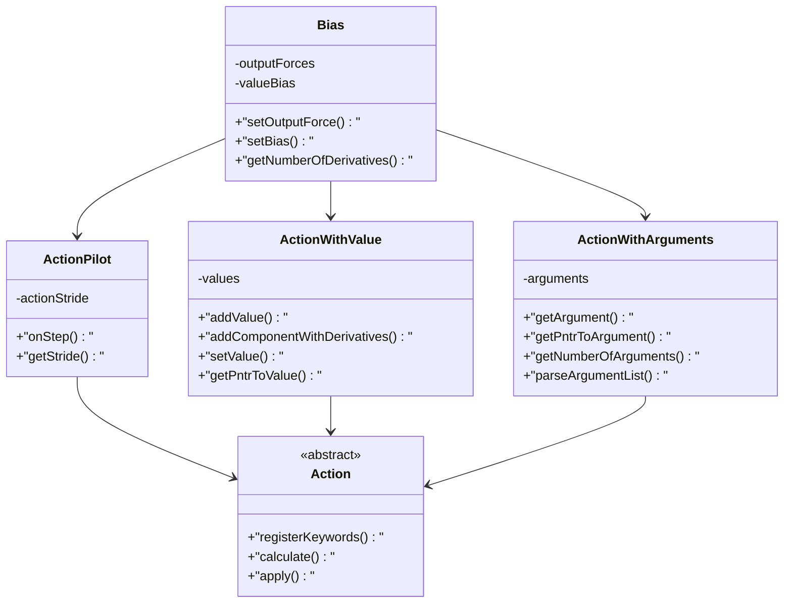
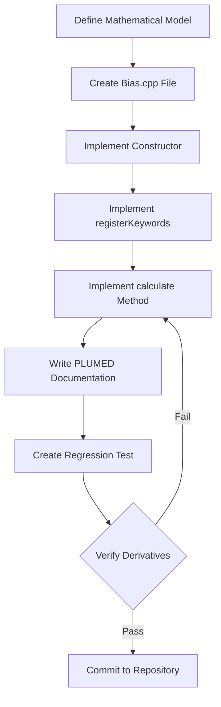

This page provides a comprehensive guide for advanced developers seeking to implement new biasing potentials in PLUMED. Bias methods are the computational engines behind enhanced sampling algorithms, enabling exploration of rare events and free energy landscape reconstruction. This documentation covers the architectural foundations, implementation patterns, and practical considerations for creating production-ready bias components.

## Bias Architecture Overview

The PLUMED bias system employs a **multiple inheritance architecture** that combines three critical base classes, each responsible for distinct aspects of bias functionality. This design promotes code reuse and enforces a consistent interface across all bias implementations.
Sources: [src/bias/Bias.h](src/bias/Bias.h#L30-L50)

### Core Inheritance Structure

Every bias method inherits from three base classes that collectively provide:

- **ActionPilot**: Manages execution timing through the STRIDE parameter, enabling multiple time stepping for computational efficiency. This allows biases to be applied less frequently than every MD step when appropriate.
Sources: [src/core/ActionPilot.h](src/core/ActionPilot.h#L20-L30)

- **ActionWithValue**: Provides infrastructure for storing scalar or vector output values with optional derivative support. This is essential for bias potentials that compute both the energy and forces (∂V/∂CV).
Sources: [src/core/ActionWithValue.h](src/core/ActionWithValue.h#L30-L60)

- **ActionWithArguments**: Handles input collective variable dependencies, enabling biases to operate on previously computed CVs. This facilitates the composition of complex biasing hierarchies.
Sources: [src/core/ActionWithArguments.h](src/core/ActionWithArguments.h#L30-L50)



### Bias Lifecycle

The execution model for biases follows a well-defined sequence integrated into the MD timestep:

1. **Registration Phase**: During initialization, biases register their keywords and requirements through the ActionRegister mechanism.
Sources: [src/core/ActionRegister.h](src/core/ActionRegister.h#L30-L50)

2. **Calculation Phase**: On active timesteps (determined by STRIDE), the `calculate()` method computes the bias potential and forces. The base Bias class automatically handles derivative accumulation and force scaling.
Sources: [src/bias/Bias.cpp](src/bias/Bias.cpp#L50-L80)

3. **Application Phase**: The `apply()` method propagates forces to the underlying collective variables, with automatic scaling when STRIDE > 1 to preserve proper time averaging.
Sources: [src/bias/Bias.cpp](src/bias/Bias.cpp#L50-L110)

## Implementation Framework

Creating a new bias method requires implementing a specific interface and following established conventions. The implementation template below demonstrates the minimal required components.

### File Structure and Basic Template

Bias implementations reside in `src/bias/` as single `.cpp` files. Each file must include the registration macro and implement three core components:

```cpp
#include "Bias.h"
#include "core/ActionRegister.h"

namespace PLMD {
namespace bias {

//+PLUMEDOC BIAS MYBIAS
/*
Documentation string describing your bias method. Include mathematical formulation,
explanation of parameters, and practical usage examples.
*/
//+ENDPLUMEDOC

class MyBias : public Bias {
  // Member variables to store parameters and state
public:
  explicit MyBias(const ActionOptions&);
  void calculate() override;
  static void registerKeywords(Keywords& keys);
};

PLUMED_REGISTER_ACTION(MyBias,"MYBIAS")
```

### Constructor Implementation

The constructor serves three critical purposes: parameter parsing, state initialization, and component registration.
Sources: [src/bias/Restraint.cpp](src/bias/Restraint.cpp#L60-L90)

```cpp
MyBias::MyBias(const ActionOptions& ao):
  PLUMED_BIAS_INIT(ao),
  // Initialize member variables
  parameter1(getNumberOfArguments()),
  parameter2(getNumberOfArguments(),0.0) {
  
  // Parse input keywords
  parseVector("PARAMETER1",parameter1);
  parseVector("PARAMETER2",parameter2);
  checkRead();  // Ensure all input was consumed
  
  // Log parsed values for verification
  log.printf("  parameter1 values:");
  for(unsigned i=0; i<parameter1.size(); i++) {
    log.printf(" %f",parameter1[i]);
  }
  log.printf("\n");
  
  // Add optional output components
  addComponent("force2");
  componentIsNotPeriodic("force2");
  valueForce2 = getPntrToComponent("force2");
}
```

> [!TIP]
> Always use `checkRead()` after parsing to catch typos and undefined parameters early in the development cycle. This prevents silent failures where critical parameters are silently ignored.

### Keyword Registration

The `registerKeywords` method defines all input parameters and documentation strings. Inheritance from Bias automatically registers standard keywords like ARG and STRIDE.
Sources: [src/bias/Bias.cpp](src/bias/Bias.cpp#L38-L48)

```cpp
void MyBias::registerKeywords(Keywords& keys) {
  Bias::registerKeywords(keys);
  
  // Define compulsory parameters
  keys.add("compulsory","PARAMETER1","description of required parameter");
  
  // Define optional parameters with defaults
  keys.add("optional","PARAMETER2","0.0","description of optional parameter");
  
  // Define output components
  keys.addOutputComponent("force2","default","scalar","description of force squared output");
}
```

### Calculate Method

The `calculate()` method implements the core physics: computing the bias potential and forces. This is called every active timestep.
Sources: [src/bias/Restraint.cpp](src/bias/Restraint.cpp#L110-L146)

```cpp
void MyBias::calculate() {
  double energy = 0.0;
  
  // Loop over all collective variables (arguments)
  for(unsigned i=0; i<getNumberOfArguments(); ++i) {
    // Get current CV value with proper periodicity handling
    const double cv = difference(i, target[i], getArgument(i));
    
    // Compute force: F = -∂V/∂CV
    const double force = -computeForce(cv, parameter1[i], parameter2[i]);
    
    // Accumulate energy contribution
    energy += computeEnergy(cv, parameter1[i], parameter2[i]);
    
    // Set force on CV (automatically sets derivative = -force)
    setOutputForce(i, force);
  }
  
  // Set the bias potential value
  setBias(energy);
  
  // Update optional output components
  valueForce2->set(computeForceSquared());
}
```

## Implementation Patterns by Complexity

Different bias implementations require varying levels of complexity. Understanding these patterns helps select the appropriate architecture for your use case.

### Simple Time-Independent Biases

The **Restraint** class exemplifies simple harmonic and linear restraints. These biases maintain no internal state between timesteps and compute forces based solely on current CV values.
Sources: [src/bias/Restraint.cpp](src/bias/Restraint.cpp#L1-L146)

**Key characteristics**:
- Stateless calculation (no history dependence)
- Direct force computation from CV displacement
- Single output component (bias potential)

**Mathematical formulation**:
```
V(x) = Σᵢ [κᵢ/2 × (xᵢ - aᵢ)² + mᵢ × (xᵢ - aᵢ)]
Fᵢ = -∂V/∂xᵢ = -[κᵢ × (xᵢ - aᵢ) + mᵢ]
```

### History-Dependent Biases

The **ABMD** (Adaptive Biasing Molecular Dynamics) class demonstrates moderate complexity with time-dependent bias minima. This method implements a ratchet-like potential that evolves based on CV history.
Sources: [src/bias/ABMD.cpp](src/bias/ABMD.cpp#L40-L100)

**State management requirements**:
- Store historical minimum values: `std::vector<double> min`
- Track random number generators for noise: `std::vector<Random> random`
- Update state each timestep based on current CV values

**Complexity considerations**:
- Need persistent state between calculate() calls
- Potential dependency on step count or simulation time
- May require file I/O for restart capabilities

### Complex History-Dependent Biases

**Metadynamics** represents the most complex bias type, requiring Gaussian kernel accumulation, grid storage/lookup, and extensive file I/O. The implementation spans over 2800 lines.
Sources: [src/bias/MetaD.cpp](src/bias/MetaD.cpp#L1-L2809)

**Advanced features**:
- Multiple kernel storage strategies (direct evaluation, neighbor lists, grids)
- Hill file I/O for restart capability
- Well-Tempered Metadynamics with adaptive height scaling
- Parallel communication for MPI runs

> [!TIP]
> For complex biases, consider separating concerns into private helper methods. The MetaD implementation uses numerous private methods for initialization, hill management, and grid operations to maintain code readability.

### Pattern Comparison

| Pattern | State Required | File I/O | Typical LOC | Examples |
|---------|---------------|----------|-------------|----------|
| Time-independent | None | Rarely | 50-150 | RESTRAINT, WALLS |
| State-dependent | Internal state | Optional | 150-500 | ABMD, MovingRestraint |
| Complex | Grids, history | Essential | 500-2800+ | METAD, PBMetaD, MaxEnt |

## Force Application and Derivative Handling

The Bias base class provides automatic force application infrastructure that developers must understand to correctly implement bias methods.

### OutputForce Mechanism

The `setOutputForce(i, force)` method performs two critical operations: Sources: [src/bias/Bias.h](src/bias/Bias.h#L60-L70)

1. Stores the force in the internal `outputForces` vector
2. Automatically sets the derivative of the bias with respect to CV i to `-force`

This enforces the thermodynamic relationship: `Fᵢ = -∂V/∂xᵢ`

```cpp
inline void Bias::setOutputForce(int i, double force) {
  outputForces[i] = force;
  valueBias->addDerivative(i, -force);
}
```

### Multiple Time Stepping Considerations

When STRIDE > 1, forces are automatically scaled by the stride value to preserve proper time averaging. This enables computational efficiency without biasing the physics.
Sources: [src/bias/Bias.cpp](src/bias/Bias.cpp#L50-L65)

```cpp
void Bias::apply() {
  const unsigned noa = getNumberOfArguments();
  
  if(onStep()) {
    double gstr = static_cast<double>(getStride());
    for(unsigned i=0; i<noa; ++i) {
      // Force is scaled by stride
      getPntrToArgument(i)->addForce(gstr * outputForces[i]);
    }
  }
  // ... rest of application logic
}
```

The documentation for STRIDE usage emphasizes that this technique can significantly speed up simulations when biasing expensive CVs.
Sources: [src/bias/module.md](src/bias/module.md#L30-L55)

### Periodic Boundaries

When computing CV displacements, always use the `difference()` method instead of simple subtraction. This ensures proper handling of periodic CVs through the minimum image convention.
Sources: [src/bias/Restraint.cpp](src/bias/Restraint.cpp#L115-L120)

```cpp
// CORRECT: Handles periodicity properly
const double cv = difference(i, at[i], getArgument(i));

// INCORRECT: Fails for periodic CVs
const double cv = getArgument(i) - at[i];
```

## Registration and Integration

The PLUMED registration system automatically integrates new bias methods into the framework through compile-time registration.

### Action Registration Macro

The `PLUMED_REGISTER_ACTION` macro performs registration at program initialization: Sources: [src/core/ActionRegister.h](src/core/ActionRegister.h#L70-L80)

```cpp
PLUMED_REGISTER_ACTION(MyBias,"MYBIAS")
```

This macro expands to code that:
1. Creates a static object whose constructor runs before main()
2. Registers the class creator and keyword function in the global ActionRegister
3. Makes "MYBIAS" available as a keyword in PLUMED input files

### Documentation Integration

The `+PLUMEDOC` and `+ENDPLUMEDOC` markers define the documentation block that is automatically extracted for the user manual.
Sources: [developer-doc/AddingAColvar.md](developer-doc/AddingAColvar.md#L20-L40)

Best practices for bias documentation:
- Provide clear mathematical formulation using LaTeX
- Include at least one complete working example
- Explain physical interpretation of all parameters
- Reference relevant publications when applicable
- Document any known limitations or performance considerations

## Testing Strategy

Comprehensive testing is essential for bias method reliability. PLUMED provides a regression testing framework that should be leveraged for all new biases.
Sources: [developer-doc/AddingRegressionTests.md](developer-doc/AddingRegressionTests.md#L1-L200)

### Regression Test Structure

Each regression test resides in `regtest/` with a specific naming convention: `rt-something`. The test directory must contain: Sources: [developer-doc/AddingRegressionTests.md](developer-doc/AddingRegressionTests.md#L30-L60)

1. **config**: Configuration file specifying test parameters
2. **Makefile**: Standard makefile (usually copied from existing tests)
3. **plumed.dat**: PLUMED input file testing the bias
4. **Reference files**: `.reference` files for output verification

### Config File Example

```bash
type=driver
plumed_modules=bias
arg="--plumed plumed.dat --trajectory-stride 50 --timestep 0.005 --ixyz trajectory.xyz --dump-forces forces --dump-forces-fmt=%8.4f"
extra_files="../../trajectories/trajectory.xyz"
```

### Testing Force Derivatives

For biases with analytical derivatives, verify correctness by comparing with numerical derivatives: Sources: [developer-doc/AddingRegressionTests.md](developer-doc/AddingRegressionTests.md#L120-L170)

```plumed
d1: DISTANCE ATOMS=1,2
bias: MYBIAS ARG=d1 PARAM1=1.0 PARAM2=2.0
bias_n: MYBIAS ARG=d1 PARAM1=1.0 PARAM2=2.0 NUMERICAL_DERIVATIVES

DUMPDERIVATIVES ARG=bias,bias_n FILE=derivatives FMT=%8.4f
```

**Verification approach**:
- Compare analytical derivatives (column 3) with numerical derivatives (column 4)
- Differences should be within numerical precision
- Store only analytical derivatives in reference files (numerical values vary across architectures)

### Test Execution

Run regression tests with:
```bash
cd regtest/your_test_directory
make
```

This executes the test and compares output against `.reference` files.
Sources: [developer-doc/AddingRegressionTests.md](developer-doc/AddingRegressionTests.md#L80-L100)

## Common Patterns and Utilities

PLUMED provides numerous utility classes and patterns that simplify bias implementation.

### Grid Storage

For biases that require storing multidimensional potentials (like metadynamics), the Grid class provides efficient storage and interpolation.
Sources: [src/tools/Grid.h](src/tools/Grid.h#L1-L50)

```cpp
#include "tools/Grid.h"

// Create grid with specified boundaries and binning
Grid myGrid(grid_min, grid_max, grid_bin, true, true);

// Set value at grid point
myGrid.setValue(indices, value);

// Get value at arbitrary position with interpolation
double value = myGrid.getValueAndDerivatives(position, derivatives);
```

### Random Number Generation

The Random class provides cross-platform reproducible random numbers essential for stochastic bias methods.
Sources: [src/bias/ABMD.cpp](src/bias/ABMD.cpp#L85-L95)

```cpp
#include "tools/Random.h"

Random random(seed);

// Gaussian-distributed random number
double gaussian = random.Gaussian();

// Uniform random in [0,1)
double uniform = random.RandU01();
```

### File I/O

PLUMED provides OFile and IFile classes for formatted input/output:

```cpp
#include "tools/OFile.h"

OFile ofile;
ofile.link(*this);
ofile.open("output.dat");

// Write formatted output
ofile.printf("%f %f %f\n", x, y, z);
```

## Performance Optimization Strategies

Bias methods can significantly impact simulation performance, especially when operating on expensive CVs.

### Computational Efficiency

**Avoid redundant calculations**:
- Cache expensive operations in member variables
- Precompute constants in the constructor
- Use appropriate data structures (vectors vs. maps)

**Optimize CV evaluation**:
- Use STRIDE > 1 for very expensive CVs
- Consider neighbor lists for grid-based biases
- Minimize memory allocations in calculate()

### Memory Efficiency

For complex biases like metadynamics: Sources: [src/bias/MetaD.cpp](src/bias/MetaD.cpp#L80-L120)

- Choose appropriate grid spacing (default: σ/5)
- Use sparse storage when possible
- Consider multiple timesteps to reduce evaluation frequency

### Parallel Execution

For MPI-parallel simulations:
- Ensure proper synchronization of bias state
- Communicate necessary data across ranks
- Test with different numbers of MPI ranks

## Step-by-Step Implementation Workflow

Follow this systematic approach when implementing a new bias method:



### Detailed Implementation Steps

1. **Mathematical formulation**: Precisely define the bias potential V(x) and force F(x) = -∇V(x). Consider periodicity, boundary conditions, and state requirements.

2. **File creation**: Copy the template structure from existing bias implementations. Ensure proper include files are present.

3. **Constructor**: Parse all input parameters, initialize member variables, and register any additional output components.

4. **Keyword registration**: Define all input parameters with appropriate defaults and documentation. Use appropriate flag types (compulsory, optional, hidden).

5. **Calculate method**: Implement the core physics. Loop over CVs, compute displacements using `difference()`, calculate forces with proper sign, and set bias value.

6. **Documentation**: Write comprehensive user documentation including mathematical background, parameter descriptions, and working examples.

7. **Testing**: Create regression tests that verify:
   - Correct bias potential calculation
   - Accurate force derivatives
   - Proper restart behavior (if applicable)
   - Boundary condition handling

8. **Verification**: Run regression tests across different configurations (serial/MPI, different compiler flags).

## Next Steps

After mastering bias method implementation, consider exploring related advanced topics:

- **Creating Custom CVs**: Learn to implement new collective variables that your biases can operate on. See [Creating New CVs](24-creating-new-cvs) for the complementary development path.

- **Advanced Biasing Techniques**: Study complex bias methods like OPES, variational approaches, and maximum entropy methods. Refer to [Advanced Biasing Techniques](17-advanced-biasing-techniques) for architectural patterns.

- **Testing Framework**: Deepen understanding of PLUMED's regression testing infrastructure. See [Regression Testing Framework](27-regression-testing-framework) for comprehensive test design principles.

- **Performance Optimization**: Explore advanced optimization techniques for bias methods. See [Performance Optimization](30-performance-optimization) for systematic performance tuning approaches.

The bias method architecture provides a powerful framework for implementing virtually any enhanced sampling algorithm. By following the patterns and best practices outlined here, you can create robust, efficient, and maintainable bias methods that integrate seamlessly with the broader PLUMED ecosystem.