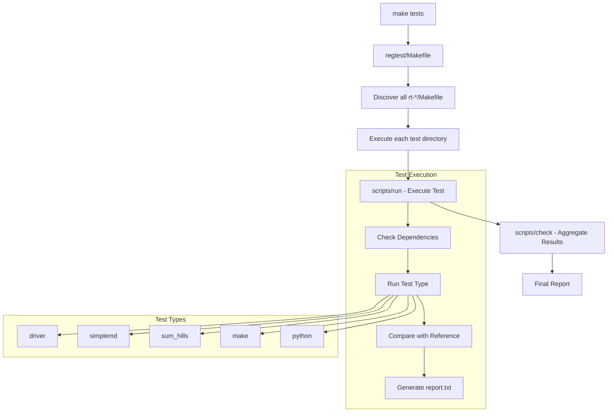
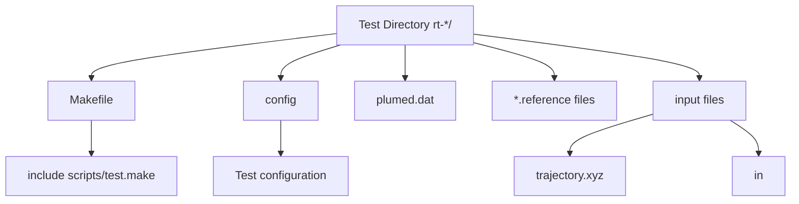
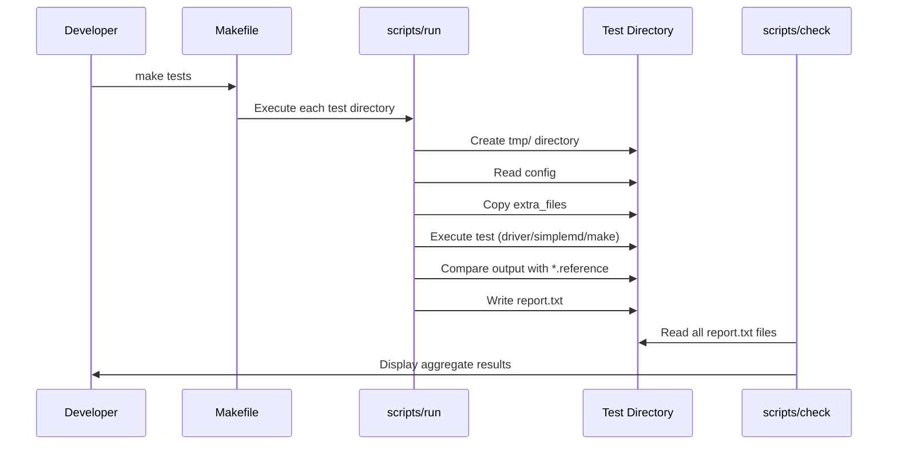

The regression testing framework is a critical quality assurance system that ensures PLUMED's functionality remains stable across development. The framework automatically tests all code features and runs on every commit through continuous integration, making it an essential component of PLUMED's development workflow. Tests are organized by module and must be included for any new features to be considered for merging.

## Framework Architecture

The testing system follows a modular design that mirrors PLUMED's own module structure, with tests categorized by functionality rather than being in a monolithic collection.



The framework operates through a hierarchical Makefile system. The top-level `regtest/Makefile` [regtest/Makefile#L1-L38](regtest/Makefile#L1-L38) discovers all test directories by locating `Makefile` files within `rt-*` directories, then executes each test. Results are aggregated and reported by scripts that examine the generated `report.txt` files in each test directory.

**Module Organization**: Tests are organized in subdirectories corresponding to PLUMED's modules:
- `basic/` - Core functionality tests
- `multicolvar/`, `bias/`, `colvar/` - Feature-specific tests
- `adjmat/`, `opes/`, `ves/` - Optional module tests
- `unittest/` - Unit tests for internal components

Sources: [regtest/README](regtest/README#L1-L59), [developer-doc/AddingRegressionTests.md](developer-doc/AddingRegressionTests.md#L1-L200)

## Test Structure

Each regression test resides in its own directory following the naming convention `rt-*` and contains a standardized set of files.



**Directory Contents**:
- `Makefile` - Single line including `../../scripts/test.make` [regtest/basic/rt0/Makefile#L1-L2](regtest/basic/rt0/Makefile#L1-L2)
- `config` - Configuration file defining test behavior
- `plumed.dat` - PLUMED input script for the test
- `*.reference` - Expected output files for comparison
- Input files (trajectories, coordinates, etc.)
- Generated files (report.txt, tmp/) are git-ignored

**Test Discovery**: The framework automatically identifies test directories by searching for `Makefile` files within directories matching the `rt-*` pattern [regtest/Makefile#L2](regtest/Makefile#L2). This convention allows new tests to be added without modifying the main Makefile.

Sources: [regtest/README](regtest/README#L1-L59), [regtest/scripts/test.make](regtest/scripts/test.make#L1-L18)

## Configuration System

The `config` file controls test execution through key-value pairs that define test type, requirements, and execution parameters.

| Parameter | Purpose | Example |
|-----------|---------|---------|
| `type` | Test execution mode | `driver`, `simplemd`, `sum_hills`, `make`, `python` |
| `arg` | Command-line arguments | `"--plumed plumed.dat --timestep 0.05 trajectory.xyz"` |
| `mpiprocs` | MPI process count | `2` (defaults to 1 if not specified) |
| `plumed_modules` | Required optional modules | `adjmat`, `opes`, `ves` |
| `plumed_needs` | Required dependencies | `molfile`, `xdrfile` |
| `extra_files` | Files to copy from shared locations | `../../trajectories/trajectory.xyz` |

**Example Configuration** [regtest/basic/rt0/config#L1-L5](regtest/basic/rt0/config#L1-L5):
```bash
type=driver
arg="--plumed plumed.dat --trajectory-stride 10 --timestep 0.005 --ixyz trajectory.xyz --dump-forces forces --dump-forces-fmt=%8.4f --restart"
extra_files="../../trajectories/trajectory.xyz"
```

**MPI Configuration**: Tests requiring MPI specify `mpiprocs=N`. The framework automatically detects if MPI is available and marks tests as `NOT_APPLICABLE` if MPI is not installed, preventing CI failures on configurations without MPI [regtest/scripts/run#L50-L70](regtest/scripts/run#L50-L70).

Sources: [developer-doc/AddingRegressionTests.md](developer-doc/AddingRegressionTests.md#L1-L200), [regtest/scripts/run](regtest/scripts/run#L1-L355)

## Test Types

The framework supports multiple execution modes tailored to different testing scenarios.

### Driver Tests
Uses `plumed driver` to analyze pre-computed trajectories. This is the most common test type for collective variables and biases.

**Execution**: `plumed driver --plumed plumed.dat --trajectory-stride N --timestep T --ixyz trajectory.xyz`

**Use Cases**:
- Testing collective variable calculations
- Validating bias methods on known trajectories
- Checking restart functionality

**Example** [regtest/basic/rt0/config](regtest/basic/rt0/config#L1-L5):
```bash
type=driver
arg="--plumed plumed.dat --trajectory-stride 10 --timestep 0.005 --ixyz trajectory.xyz --dump-forces forces --dump-forces-fmt=%8.4f"
```

### SimpleMD Tests
Runs Lennard-Jones molecular dynamics using PLUMED's built-in `simplemd` tool.

**Execution**: `plumed simplemd < in > out`

**Use Cases**:
- Testing integration with MD engines
- Validating forces and energy calculations
- End-to-end testing of PLUMED-in- workflows

**Example** [regtest/basic/rt-simplemd0/config](regtest/basic/rt-simplemd0/config#L1-L3):
```bash
type=simplemd
```

### Sum Hills Tests
Tests the `sum_hills` utility for processing metadynamics bias files.

**Use Cases**:
- Validating HILLS file processing
- Testing free energy reconstruction
- Checking bias grid operations

### Make Tests
Compiles and runs custom C++, Fortran, or C test programs linked against the PLUMED library. This mode supports multiple language variants and compilation configurations.

**Execution Flow** [regtest/scripts/run#L206-L254](regtest/scripts/run#L206-L254):
1. Generate Makefile with PLUMED configuration
2. Compile test program with appropriate flags
3. Execute compiled program with specified arguments

**Language Support**:
- C++ (default, C++98, C++11, C++14)
- Fortran (F77, F2008)
- C (C11)

**Use Cases**:
- Testing PLUMED API/Plugin interface
- Validating internal library functions
- Testing language bindings (Fortran, Python)

### Python Tests
Executes Python-based tests using the PLUMED Python module.

**Use Cases**:
- Testing Python interface
- Validating PLUMED operations from Python
- PyTorch integration tests

Sources: [regtest/scripts/run](regtest/scripts/run#L1-L355), [developer-doc/AddingRegressionTests.md](developer-doc/AddingRegressionTests.md#L1-L200)

## Test Execution Flow

The test execution process involves multiple stages managed by scripts.



**Execution Stages** [regtest/scripts/run](regtest/scripts/run#L1-L355):

1. **Initialization**: Create `tmp/` directory and copy test files
2. **Dependency Checking**: Verify required modules and dependencies are available
3. **Test Execution**: Run the appropriate command based on `type`
4. **Output Comparison**: Compare generated files with `*.reference` files
5. **Report Generation**: Write results to `report.txt`

**Result Comparison** [regtest/scripts/run#L294-L332](regtest/scripts/run#L294-L332):
- Uses `diff` to compare output files with references
- Applies zero normalization via `fixzeroes.sh` script to handle minor numerical differences
- Marked as `FAILURE` if differences exceed tolerance
- Special handling for PLUMED field files (starting with `#! FIELDS`)

**Floating Point Tolerance**: The framework handles cross-platform numerical differences through:
- Explicit format specification in PLUMED inputs (`FMT=%8.4f`)
- Zero normalization (`-0.00` → ` 0.00`)
- NaN normalization (`-nan` → `nan`)

Sources: [regtest/scripts/run](regtest/scripts/run#L1-L355), [regtest/scripts/fixzeroes.sh](regtest/scripts/fixzeroes.sh#L1-L14)

## Result Aggregation

After all tests execute, the `scripts/check` script aggregates results across all test directories.

**Checking Process** [regtest/scripts/check](regtest/scripts/check#L1-L87):
- Scans all `*/rt*/report.txt` files
- Categorizes results:
  - `OK` - Test passed
  - `FAILURE` - Test failed
  - `NOT_APPLICABLE` - Test skipped due to missing dependencies
- Generates summary report

**Output Format**:
```
+++++++++++++++++++++++++++++++++++++++++++++++++++++
+ Test session ended at [timestamp]
+ 500 tests performed, 5 tests not applicable
+ 0 errors found
+ Well done!!
+++++++++++++++++++++++++++++++++++++++++++++++++++++
```

**Continuous Integration**: Tests run automatically on every commit via Travis-CI/GitHub Actions across multiple architectures. The framework treats missing optional modules as non-fatal by marking relevant tests as `NOT_APPLICABLE` rather than failures.

**Coverage Reporting**: The `scripts/what` tool identifies PLUMED actions without corresponding tests by scanning registered actions and comparing against test inputs [regtest/scripts/what](regtest/scripts/what#L1-L22).

Sources: [regtest/scripts/check](regtest/scripts/check#L1-L87), [developer-doc/AddingRegressionTests.md](developer-doc/AddingRegressionTests.md#L1-L200)

## Creating Tests

New regression tests must follow established conventions and be included with new features.

**Step-by-Step Process** [regtest/README](regtest/README#L1-L59):

1. **Create Test Directory**:
   ```bash
   mkdir regtest/module/rt-testname
   cd regtest/module/rt-testname
   ```

2. **Create Makefile**:
   ```bash
   echo "include ../../scripts/test.make" > Makefile
   ```

3. **Create config File** with appropriate parameters

4. **Add Input Files** (plumed.dat, trajectories)

5. **Run Test**:
   ```bash
   make
   ```

6. **Create Reference Files**:
   ```bash
   cp tmp/outputfile outputfile.reference
   ```

7. **Add to Git** (excluding tmp/ and report.txt):
   ```bash
   git add .
   git commit
   ```

**Best Practices**:
- Tests should complete in a few seconds
- Output files should be small
- Use explicit formatting (`FMT=%8.4f`) to ensure cross-platform consistency
- Test analytical derivatives against numerical derivatives during development, but commit only analytical derivatives to reference files
- Use shared trajectories from `regtest/trajectories/` to avoid duplication

> [!TIP]
> When testing new collective variables inheriting from PLMD::Colvar, PLMD::function::Function, or PLMD::multicolvar::MultiColvarBase, use the DUMPDERIVATIVES action to compare analytical and numerical derivatives during development. However, only commit the analytical derivatives to reference files, as numerical derivatives vary across architectures.

**Testing Pattern for CVs** [developer-doc/AddingRegressionTests.md](developer-doc/AddingRegressionTests.md#L130-L150):
```plumed
d1: DISTANCE ATOMS=1,2
d1n: DISTANCE ATOMS=1,2 NUMERICAL_DERIVATIVES
PRINT ARG=d1 FILE=colvar FMT=%8.4f
DUMPDERIVATIVES ARG=d1,d1n FILE=deriv FMT=%8.4f
```

Sources: [regtest/README](regtest/README#L1-L59), [developer-doc/AddingRegressionTests.md](developer-doc/AddingRegressionTests.md#L1-L200)

## Test Maintenance

Tests require periodic updates when behavior changes or numerical tolerances shift.

**Updating References**:
```bash
cd regtest/module/rt-testname
make reset
```

The `make reset` command [regtest/scripts/reset](regtest/scripts/reset#L1-L9) automatically copies current output files to replace reference files when intentional changes have been made to functionality.

**Debugging Failed Tests**:
1. Check `report.txt` in the test directory for detailed error messages
2. Examine `tmp/` directory for actual output
3. Review diff output showing differences
4. Verify test configuration (type, dependencies, arguments)
5. Check if all required modules are installed

**Valgrind Testing**:
```bash
make valgrind
```

Runs tests with Valgrind memory checking to detect leaks and memory errors. Note that MPI tests cannot be run with Valgrind [regtest/scripts/run#L72-L85](regtest/scripts/run#L72-L85).

Sources: [regtest/scripts/reset](regtest/scripts/reset#L1-L9), [regtest/scripts/valgrind](regtest/scripts/test.make#L11-L14)

## Shared Resources

The framework provides shared resources to avoid duplication and maintain consistency.

**Trajectory Repository** [regtest/trajectories/](regtest/trajectories/):
- Common trajectory files used across multiple tests
- Includes various formats (xyz, xtc, trr, gro)
- Organized by use case (pca/, rmsd/, path_msd/)

**Configuration Files**:
- PLUMED module configuration checks dependencies
- Module availability validation before test execution

**Custom Skip Logic**:
Tests can define `plumed_custom_skip()` functions in their config to implement custom skipping logic for specific conditions.

Sources: [regtest/trajectories/](regtest/trajectories/), [regtest/scripts/run](regtest/scripts/run#L120-L145)

## Continuous Integration

The regression test suite is integrated with automated CI systems.

**CI Platforms**:
- Travis-CI: Continuous testing on commit
- GitHub Actions: Modern CI integration
- Multiple architectures tested simultaneously

**CI Behavior** [regtest/scripts/run](regtest/scripts/run#L55-L85):
- Tests requiring unavailable dependencies are marked `NOT_APPLICABLE`
- MPI tests skip gracefully on non-MPI configurations
- Valgrind testing excluded for MPI tests
- Environment variable `PLUMED_ALLOW_SKIP_ON_TRAVIS` can override strict checking

**Quality Policy**: PLUMED developers take testing seriously and will not merge contributions without appropriate regression tests [developer-doc/AddingRegressionTests.md](developer-doc/AddingRegressionTests.md#L10-L12).

Sources: [developer-doc/AddingRegressionTests.md](developer-doc/AddingRegressionTests.md#L1-L200), [regtest/scripts/run](regtest/scripts/run#L1-L355)

The regression testing framework provides a robust, modular system for ensuring PLUMED's stability and correctness. By understanding its architecture, test types, and conventions, developers can effectively contribute new tests and maintain existing ones, ensuring PLUMED remains reliable across platforms and versions.

For detailed guidance on writing specific types of tests, continue to [Writing Regression Tests](28-writing-regression-tests). To understand how the testing framework integrates with broader quality assurance practices, see [Continuous Integration and Code Coverage](29-continuous-integration-and-code-coverage).