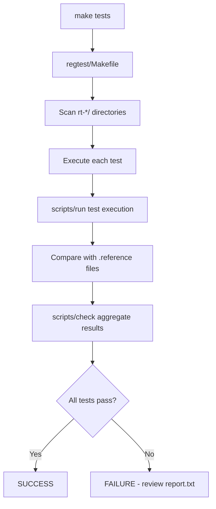
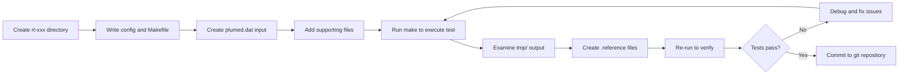

Regression tests are the foundation of PLUMED's quality assurance system, ensuring that new code contributions don't break existing functionality while validating that new features work correctly across different architectures and configurations. The testing framework is designed for automated execution during development and continuous integration, with tests running on multiple platforms whenever code is pushed to the repository.

Sources: [developer-doc/AddingRegressionTests.md](developer-doc/AddingRegressionTests.md#L1-L20), [regtest/README](regtest/README#L1-L10)

## Test Framework Architecture

The PLUMED regression testing system operates as a hierarchical framework where individual test modules execute independently under a unified management layer. Tests are organized into directories that roughly correspond to PLUMED's functional modules, with each test directory containing everything needed for execution and validation.



The test runner script handles all aspects of test execution including environment setup, dependency checking, MPI configuration, and output comparison. When you execute `make tests` from the regtest directory, the system automatically discovers all test directories matching the `rt-*` pattern and runs them sequentially or in parallel depending on your build configuration.

Sources: [regtest/Makefile](regtest/Makefile#L1-L38), [regtest/scripts/run](regtest/scripts/run#L1-L50), [regtest/scripts/check](regtest/scripts/check#L1-L30)

## Creating a New Regression Test

### Test Directory Structure

Every regression test requires a dedicated directory named with the `rt-*` prefix, where the wildcard portion should provide a descriptive indication of what feature is being tested. The naming convention is mandatory as the build system uses pattern matching to identify test directories.

The complete test directory structure requires:
- `config` - Configuration file defining test parameters
- `Makefile` - Standard test execution script
- `plumed.dat` - PLUMED input file
- `[filename].reference` - Reference output files for comparison
- Supporting files (trajectories, PDB files, etc.)

Sources: [developer-doc/AddingRegressionTests.md](developer-doc/AddingRegressionTests.md#L30-L40), [regtest/README](regtest/README#L15-L25)

### Configuration File Options

The `config` file controls how your test executes and what dependencies it requires. Configuration parameters are simple key-value pairs that define test behavior:

| Parameter | Description | Required | Example |
|-----------|-------------|----------|---------|
| `type` | Test execution mode | Yes | `driver`, `simplemd`, `sum_hills`, `make` |
| `arg` | Command line arguments | For driver type | `"--plumed=plumed.dat --timestep=0.05 trajectory.xyz"` |
| `mpiprocs` | Number of MPI processes | Optional, defaults to 1 | `2`, `4`, `8` |
| `plumed_modules` | Required PLUMED modules | For optional features | `adjmat`, `colvar` |
| `plumed_needs` | Required dependencies | For external features | `xdrfile`, `molfile` |
| `extra_files` | Files to copy from shared locations | Optional | `"../../trajectories/trajectory.xyz"` |

Sources: [developer-doc/AddingRegressionTests.md](developer-doc/AddingRegressionTests.md#L45-L75), [regtest/README](regtest/README#L15-L25)

### Test Types and Their Use Cases

The framework supports four primary test types, each suited for different testing scenarios:

| Type | Use Case | Input Files | Execution Method |
|------|----------|-------------|------------------|
| `driver` | Trajectory analysis and CV calculation | `plumed.dat`, trajectory file | `plumed driver` command |
| `simplemd` | Full molecular dynamics simulation | `in`, `input.xyz`, `plumed.dat` | Built-in LJ MD engine |
| `sum_hills` | Hills file processing and free energy reconstruction | `plumed.dat`, hills files | `plumed sum_hills` utility |
| `make` | Custom C++/Fortran test programs | `main.cpp`, `plumed.dat` | Compile and link to PLUMED library |

The `driver` type is most common as it allows testing collective variables and biases by analyzing pre-computed trajectories without the computational cost of running MD simulations. The `simplemd` type is useful when you need to verify that your CV or bias works correctly in a dynamic simulation context.

Sources: [developer-doc/AddingRegressionTests.md](developer-doc/AddingRegressionTests.md#L55-L70), [regtest/scripts/run](regtest/scripts/run#L200-L230)

## Test Execution Workflow

### Step-by-Step Process

Creating and validating a regression test follows a systematic workflow:



The execution process creates a temporary `tmp` directory containing all generated output files. This separation ensures clean test runs and prevents reference file contamination. After successful execution, you copy output files from `tmp/` to the test directory with `.reference` appended to the filename.

Sources: [regtest/README](regtest/README#L30-L45), [regtest/scripts/run](regtest/scripts/run#L260-L355)

### Creating Reference Files

Reference files serve as the gold standard for test validation. The comparison system performs exact byte-by-byte matching with some tolerance for minor numerical variations. When creating reference files:

1. Run the test once with `make` inside your test directory
2. Examine the output in the `tmp/` directory
3. Copy relevant output files to the parent directory with `.reference` suffix
4. Example: `cp tmp/COLVAR COLVAR.reference`

The testing framework automatically compares each generated file against its reference counterpart. Any difference beyond the normal numerical tolerance results in a test failure. The system uses a `fixzeroes.sh` script to normalize floating-point representations, handling differences like `-0.0` versus `0.0`.

Sources: [regtest/README](regtest/README#L40-L50), [regtest/scripts/run](regtest/scripts/run#L320-L355), [developer-doc/AddingRegressionTests.md](developer-doc/AddingRegressionTests.md#L80-L95)

## Testing Collective Variables and Derivatives

### Analytical vs. Numerical Derivatives

For collective variables that inherit from `PLMD::Colvar`, `PLMD::function::Function`, or `PLMD::multicolvar::MultiColvarBase`, validate derivative correctness by comparing analytical and numerical derivatives during test development:

```plumed
# Test analytical derivatives
d1: DISTANCE ATOMS=1,2

# Test numerical derivatives (for validation only)
d1n: DISTANCE ATOMS=1,2 NUMERICAL_DERIVATIVES

# Output both for comparison during development
DUMPDERIVATIVES ARG=d1,d1n FILE=deriv FMT=%8.4f

PRINT ARG=d1 FILE=colvar FMT=%8.4f
```

During initial development, compare columns 3 (analytical) and 4 (numerical) of the derivative file using `awk '{print $3-$4}' tmp/deriv`. Once you've verified they match, **commit only the analytical derivatives** to the repository. This approach avoids cross-platform numerical instability issues while ensuring derivative correctness.

Sources: [developer-doc/AddingRegressionTests.md](developer-doc/AddingRegressionTests.md#L100-L145)

> [!TIP]
> Always use explicit `FMT` specifications when outputting floating-point numbers in tests. Different compilers and architectures produce slightly different floating-point representations, and explicit formatting ensures consistent output across platforms. Use formats like `FMT=%8.4f` rather than default formatting.

### Complex Features with Bias Forces

For more complex features involving custom apply methods or multi-step CV calculations, validate force correctness using the `--debug-forces` option:

```bash
plumed driver --ixyz trajectory.xyz --debug-forces forces.num
```

This generates a three-column file: atom index, analytical forces, and numerically computed forces. The numerical calculation is computationally expensive and **should not be included in committed tests**. Instead, commit only the analytical forces using the standard `--dump-forces` option:

```bash
plumed driver --ixyz trajectory.xyz --dump-forces forces --dump-forces-fmt %8.4f
```

Sources: [developer-doc/AddingRegressionTests.md](developer-doc/AddingRegressionTests.md#L150-L190)

## Advanced Test Configuration

### MPI Testing

For parallel features, configure MPI execution using the `mpiprocs` parameter:

```config
mpiprocs=4
type=driver
arg="--plumed=plumed.dat --timestep=0.05 --ixyz trajectory.xyz"
extra_files="../../trajectories/trajectory.xyz"
```

The test framework automatically handles MPI detection and will skip the test gracefully if MPI is not available. This ensures tests don't fail on systems without MPI support while still validating parallel functionality where available.

Sources: [regtest/basic/rt-mpi0/config](regtest/basic/rt-mpi0/config#L1-L6), [regtest/scripts/run](regtest/scripts/run#L70-L100)

### Module-Specific Tests

When testing features from optional modules, specify module dependencies:

```config
type=driver
plumed_modules=adjmat
arg="--plumed plumed.dat --trajectory-stride 50 --timestep 0.005 --ixyz diala_traj_nm.xyz"
extra_files="../../trajectories/diala_traj_nm.xyz"
```

The framework checks module availability before execution and marks tests as "NOT_APPLICABLE" if required modules aren't installed. This prevents false test failures in minimal builds.

Sources: [developer-doc/AddingRegressionTests.md](developer-doc/AddingRegressionTests.md#L60-L75), [regtest/scripts/run](regtest/scripts/run#L100-L120)

## File Sharing and Organization

### Shared Trajectories

To minimize repository size, PLUMED maintains a shared trajectory directory at `regtest/trajectories/`. Reference these files using relative paths in your config:

```config
extra_files="../../trajectories/trajectory.xyz"
```

The test runner automatically copies these files to the temporary execution directory before running the test. This approach allows multiple tests to use the same trajectory without duplication.

Sources: [regtest/trajectories/](regtest/trajectories/), [regtest/scripts/run](regtest/scripts/run#L50-L60)

### Test Organization by Module

Organize tests logically within the regtest hierarchy:
- `regtest/basic/` - Core functionality tests
- `regtest/adjmat/` - Adjacency matrix module tests
- `regtest/colvar/` - Collective variable specific tests
- `regtest/bias/` - Bias method tests
- Module-specific directories for optional features

This organization makes tests easier to locate and maintain, while allowing targeted test execution during development.

Sources: [developer-doc/AddingRegressionTests.md](developer-doc/AddingRegressionTests.md#L25-L35)

## Running and Debugging Tests

### Executing Individual Tests

Run specific tests during development:

```bash
cd regtest/basic/rt-mytest
make
```

This executes just your test and creates a `report.txt` file with detailed results. Examine the `tmp/` directory to inspect output files and identify issues.

Sources: [regtest/README](regtest/README#L30-L35), [regtest/scripts/test.make](regtest/scripts/test.make#L1-L10)

### Updating Reference Files

When you need to update reference files after legitimate code changes:

```bash
cd regtest/basic/rt-mytest
make reset
```

This command regenerates all `.reference` files from the current test output. Commit the updated references after verifying they are correct.

Sources: [regtest/README](regtest/README#L52-L55), [regtest/scripts/reset](regtest/scripts/test.make#L3-L4)

### Full Test Suite Execution

Run the complete regression test suite:

```bash
cd regtest
make tests              # Run all tests sequentially
make -j 4 tests         # Run 4 tests in parallel
make valgrind           # Run with memory leak detection
```

The `scripts/check` script aggregates results from all tests and provides a summary report showing the number of passed, failed, and skipped tests.

Sources: [regtest/README](regtest/README#L10-L15), [regtest/Makefile](regtest/Makefile#L1-L20), [regtest/scripts/check](regtest/scripts/check#L40-L80)

## Best Practices and Common Pitfalls

> [!TIP]
> Keep tests fast and small. Tests should complete in seconds rather than minutes. Use short trajectory files (10-100 frames) and minimize the number of collective variables calculated. This keeps the development cycle efficient and ensures CI systems run quickly.

### Essential Guidelines

1. **Always use FMT specifications** for numerical output to ensure cross-platform consistency
2. **Commit only analytical derivatives** - numerical derivatives are for validation only
3. **Keep tests focused** - test one feature or concept per test directory
4. **Use shared trajectories** when possible to reduce repository size
5. **Check module dependencies** - specify `plumed_modules` for optional features
6. **Validate on multiple architectures** - tests should pass on different compilers and platforms

Sources: [developer-doc/AddingRegressionTests.md](developer-doc/AddingRegressionTests.md#L1-L20), [regtest/basic/rt0/plumed.dat](regtest/basic/rt0/plumed.dat#L1-L41)

### Common Issues and Solutions

| Issue | Cause | Solution |
|-------|-------|----------|
| Test passes locally but fails on CI | Platform-specific numerical differences | Use explicit FMT formatting, reduce precision requirements |
| Reference file changes unexpectedly | Floating point representation variations | Run `make reset` on the target platform |
| MPI tests skip unnecessarily | MPI not detected in CI environment | Check CI configuration, ensure MPI is available |
| Module tests marked NOT_APPLICABLE | Module not enabled in build | Verify `plumed_modules` specification, rebuild with module |

Sources: [regtest/scripts/run](regtest/scripts/run#L70-L140), [regtest/scripts/check](regtest/scripts/check#L50-L80)

## Integration with Development Workflow

Regression tests are mandatory for code contributions. The development team considers code without appropriate tests incomplete and will not merge contributions without test coverage. Tests run automatically on every push to the main repository through continuous integration systems.

After creating your feature and corresponding test:

```bash
cd regtest
git add rt-mynewtest
git commit -m "Add regression test for new feature"
```

This ensures your test becomes part of the permanent test suite, protecting your feature from future regressions and providing documentation of expected behavior.

Sources: [developer-doc/AddingRegressionTests.md](developer-doc/AddingRegressionTests.md#L1-L20), [regtest/README](regtest/README#L45-L55)

## Next Steps

Now that you understand how to write regression tests, explore these related topics:

- [Regression Testing Framework](27-regression-testing-framework) - Learn about the system architecture and continuous integration
- [Continuous Integration and Code Coverage](29-continuous-integration-and-code-coverage) - Understand how tests run in CI and coverage reporting
- [Creating New CVs](24-creating-new-cvs) - Apply testing knowledge to custom collective variable development
- [Creating New Bias Methods](25-creating-new-bias-methods) - Test bias method implementations properly