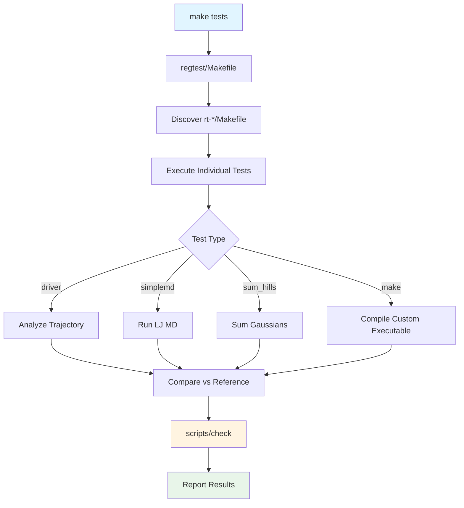
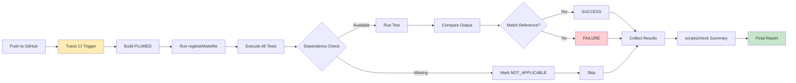
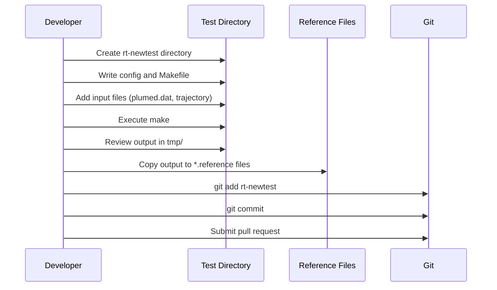

This page documents PLUMED's comprehensive testing infrastructure, regression testing framework, and code coverage strategies. As a scientific computing library requiring precision across multiple platforms and compiler configurations, PLUMED maintains rigorous continuous integration practices to ensure code quality and numerical stability. The testing framework supports automated execution across diverse architectures, including MPI parallel environments, with detailed coverage analysis tracking.

## Regression Testing Architecture

PLUMED implements a distributed regression testing system organized around module-based test suites. The framework resides in the `regtest/` directory, with over 200+ individual tests categorized by functional modules such as basic, multicolvar, bias, and analysis components. Each test operates as an independent validation unit that can execute in isolation or within the full test suite.



The test execution flow demonstrates the framework's modular design. Tests are automatically discovered through `Makefile` patterns in directories matching the `rt-*` naming convention [regtest/Makefile](regtest/Makefile#L1-L10). The central `scripts/check` script aggregates results from all test directories, categorizing outcomes as SUCCESS, FAILURE, or NOT_APPLICABLE based on dependency availability [regtest/scripts/check](regtest/scripts/check#L10-L42).

## Test Configuration and Organization

Each regression test resides in a self-contained directory with standardized structure. The `config` file defines test parameters and execution requirements:

| Parameter | Purpose | Example |
|-----------|---------|---------|
| `mpiprocs` | Number of MPI processes | `mpiprocs=2` |
| `type` | Test execution mode | `type=driver` |
| `plumed_modules` | Required optional modules | `plumed_modules=adjmat` |
| `arg` | Command line arguments | `arg="--plumed plumed.dat --timestep 0.05 trajectory.xyz"` |
| `extra_files` | External dependencies | `extra_files="../trajectories/diala_traj_nm.xyz"` |

Sources: [developer-doc/AddingRegressionTests.md](developer-doc/AddingRegressionTests.md#L30-L58)

The test execution script `regtest/scripts/run` implements sophisticated dependency checking. Before test execution, it verifies module availability, MPI support, and optional dependencies using the `plumed config -q` interface [regtest/scripts/run](regtest/scripts/run#L90-L125). Tests automatically mark as NOT_APPLICABLE when dependencies are unavailable, preventing false failures on minimal build configurations.

> [!TIP]
> The framework intelligently handles missing dependencies by checking `TRAVIS` and `GITHUB_ACTIONS` environment variables. This allows selective test execution in CI environments while maintaining full coverage on complete build configurations.

## Test Types and Execution Modes

PLUMED supports multiple test execution modes, each validating different aspects of the codebase:

### Driver Tests (`type=driver`)

Analyzes trajectory files using PLUMED's driver tool, the most common test type. Validates CV calculations, bias forces, and output generation. The `config` file specifies trajectory and PLUMED input files:

```bash
type=driver
arg="--plumed plumed.dat --trajectory-stride 50 --timestep 0.005 --ixyz diala_traj_nm.xyz --dump-forces forces --dump-forces-fmt=%10.6f"
```

Sources: [regtest/README](regtest/README#L18-L21)

### SimpleMD Tests (`type=simplemd`)

Runs Lennard Jones molecular dynamics for validation of integration schemes and force calculations. Tests include `input.xyz` configuration and `plumed.dat` bias specification [regtest/README](regtest/README#L15-L16).

### Sum Hills Tests (`type=sum_hills`)

Validates free energy surface reconstruction through Gaussian summation. Ensures correct handling of bias deposition and HILLS file processing.

### Make Tests (`type=make`)

Compiles custom C/C++/Fortran programs linked against PLUMED library. Tests internal APIs, matrix classes, and tool functionality through dedicated `main.cpp` implementations. Supports multiple language modes including `c++11`, `c++14`, `c11`, `fortran`, and `fortran08` [regtest/scripts/run](regtest/scripts/run#L201-L270).

## Continuous Integration Infrastructure

PLUMED leverages Travis CI for automated testing across multiple architectures and compiler configurations. The CI system executes the full regression test suite on every commit to the main repository, providing immediate feedback on code quality.

Sources: [developer-doc/AddingRegressionTests.md](developer-doc/AddingRegressionTests.md#L10-L20)

The testing framework integrates with CI through environment variable detection:



The `scripts/check` script generates comprehensive reports showing total tests performed, not applicable tests, and errors found. When errors occur, developers can reset reference files using `make reset` within individual test directories [regtest/scripts/test.make](regtest/scripts/test.make#L3-L4).

Sources: [regtest/scripts/check](regtest/scripts/check#L50-L85)

## Code Coverage and Documentation

PLUMED integrates code coverage analysis into its developer documentation. The Doxyfile configuration enables coverage tracking, with results published to dedicated coverage repositories for each branch.

Sources: [developer-doc/Intro.md](developer-doc/Intro.md#L80-L92)

Coverage information links to separate repositories following the pattern `github.com/plumed/coverage-branchname`, allowing detailed per-branch analysis without polluting the main repository with coverage data. This approach maintains clean separation between code and test metrics while providing comprehensive visibility into tested code paths.

## Numerical Precision and Reference File Management

Testing numerical code requires careful handling of floating-point precision across different architectures and compiler optimizations. PLUMED addresses this through:

1. **Explicit formatting**: Use `FMT` keywords in PLUMED input to specify output precision, ensuring consistent rounding across platforms [developer-doc/AddingRegressionTests.md](developer-doc/AddingRegressionTests.md#L130-L140).

2. **Derivative validation**: New CVs and functions should validate analytical derivatives against numerical derivatives during development, but commit only analytical derivatives to avoid architecture-dependent numerical variations.

3. **Zero normalization**: The `fixzeroes.sh` script normalizes negative zero values before comparison, preventing false failures from sign bit differences [regtest/scripts/run](regtest/scripts/run#L318-L322).

4. **Force validation**: Complex features can test force consistency using `--debug-forces` flag in driver, comparing analytical and numerically computed forces [developer-doc/AddingRegressionTests.md](developer-doc/AddingRegressionTests.md#L167-L183).

> [!TIP]
> When creating derivative tests, use `awk '{print $3-$4}'` to compare analytical and numerical derivatives from `DUMPDERIVATIVES` output. Verify agreement locally, but commit only analytical derivatives with explicit FMT formatting.

## Parallel Testing and Performance

The regression test framework supports parallel execution using standard make job control:

```bash
make -j 4  # Run 4 tests concurrently
```

Sources: [regtest/README](regtest/README#L6-L7)

MPI-specific tests configure processor count through the `mpiprocs` parameter. The test execution framework automatically handles MPI launcher detection using `plumed config mpiexec` or falls back to `mpirun` when available [regtest/scripts/run](regtest/scripts/run#L60-L78). Tests requiring MPI but running in environments without MPI support are automatically marked NOT_APPLICABLE.

Valgrind memory checking integration supports leak detection through the `valgrind` target in test Makefiles [regtest/scripts/test.make](regtest/scripts/test.make#L7-L8). However, MPI tests skip valgrind execution due to compatibility constraints [regtest/scripts/run](regtest/scripts/run#L78-L90).

## Test Development Workflow

Developers contributing to PLUMED must provide regression tests for all new functionality. The established workflow ensures quality while maintaining developer efficiency:



Sources: [developer-doc/HowToContributeToPlumed.md](developer-doc/HowToContributeToPlumed.md#L120-L150)

Key requirements for test development include:

- **Naming convention**: Test directories must start with `rt-` prefix for automatic discovery [developer-doc/AddingRegressionTests.md](developer-doc/AddingRegressionTests.md#L25-L28).
- **Execution speed**: Tests should complete in seconds, not minutes, to enable rapid iteration [developer-doc/AddingRegressionTests.md](developer-doc/AddingRegressionTests.md#L95-L96).
- **Minimal output**: Keep reference files small to maintain repository efficiency [developer-doc/AddingRegressionTests.md](developer-doc/AddingRegressionTests.md#L95-L96).
- **Module organization**: Place tests in module-specific subdirectories matching the source code structure [developer-doc/HowToContributeToPlumed.md](developer-doc/HowToContributeToPlumed.md#L140-L150).

## Quality Assurance Requirements

PLUMED enforces strict testing standards as a condition for code acceptance:

1. **Mandatory coverage**: All new features must include appropriate regression tests. Core developers will not merge contributions without adequate test coverage [developer-doc/AddingRegressionTests.md](developer-doc/AddingRegressionTests.md#L15-L20).

2. **Portability maintenance**: Tests must work across supported architectures and compiler configurations. Use explicit formatting and avoid architecture-dependent numerical computations in reference files [developer-doc/HowToContributeToPlumed.md](developer-doc/HowToContributeToPlumed.md#L90-L100).

3. **Module isolation**: Tests should validate specific functionality without requiring extensive setup. Shared trajectory files in `regtest/trajectories/` enable efficient reuse [developer-doc/AddingRegressionTests.md](developer-doc/AddingRegressionTests.md#L60-L70).

4. **Documentation correlation**: Test input files often serve as documentation examples. Ensure test cases demonstrate typical usage patterns with clear comments.

## Integration with Development Workflow

The testing framework integrates seamlessly with PLUMED's development process. The `Makefile` at the repository root provides high-level targets:

```bash
make tests      # Execute all regression tests
make checkfail  # Exit with error if any test fails
make valgrind   # Run tests with valgrind memory checking
```

Sources: [regtest/Makefile](regtest/Makefile#L5-L12)

These targets coordinate across all test modules, executing tests in parallel where possible and aggregating results. The `checkfail` target is particularly useful for CI pipelines, providing non-zero exit codes for failure detection in automated workflows.

The `copytodoc` target extracts test cases for documentation generation, ensuring that user-facing examples remain synchronized with regression test suites [regtest/Makefile](regtest/Makefile#L7).

## Advanced Testing Patterns

Beyond basic functionality validation, PLUMED employs sophisticated testing techniques for complex scenarios:

### Restart Testing

Tests like `rt10-restart` validate state serialization and recovery. These tests execute calculations, restart from saved state, and verify that results match the original continuous execution. This pattern ensures that checkpoint/restart functionality works correctly across different simulation types.

### Multi-CPU Synchronization

MPI tests (`rt*mpi*`) validate parallel execution correctness. Tests verify that results are independent of processor count and that domain decomposition produces equivalent results to serial execution. MPI tests also validate synchronization of bias deposition and collective variable communication [regtest/scripts/run](regtest/scripts/run#L60-L78).

### Backward Compatibility

Tests like `rt-commit-1`, `rt-cregex-backward-compatibility`, and `rt-old-torsion-syntax` ensure that deprecated syntax continues to work with appropriate warnings. This pattern supports smooth migration paths for users upgrading from older versions.

### Error Handling

Tests in `rt-errormessages` validate that appropriate error messages are generated for invalid inputs. These tests verify that error handling produces clear, actionable messages without crashing.

## Next Steps

Understanding PLUMED's testing framework is essential for effective development. To deepen your knowledge:

- Explore [Regression Testing Framework](27-regression-testing-framework) for detailed architectural patterns
- Review [Writing Regression Tests](28-writing-regression-tests) for specific implementation techniques
- Study [Performance Optimization](30-performance-optimization) for testing strategies related to computational efficiency
- Examine existing test cases in `regtest/basic/` for practical examples of common testing patterns

The testing infrastructure serves as both quality assurance mechanism and documentation system. Well-designed tests validate functionality while demonstrating correct usage patterns for future developers.