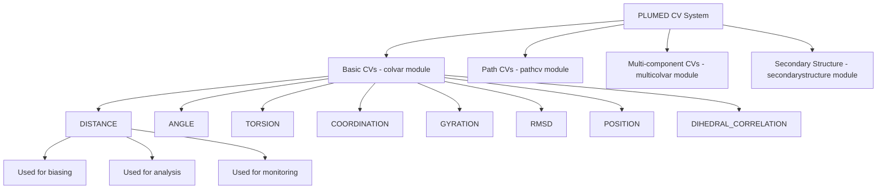
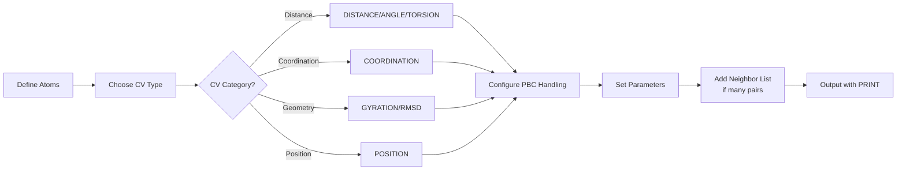

This page introduces the fundamental collective variables (CVs) in PLUMED that enable you to reduce the complexity of molecular systems from thousands of atomic coordinates to a handful of meaningful descriptors. These basic CVs serve as building blocks for understanding chemical processes and implementing enhanced sampling techniques.

## Understanding Collective Variables


Molecular systems contain an enormous number of atoms, making it impossible to understand anything by monitoring atom positions directly. Collective variables (CVs) describe the chemical processes we're interested in and allow us to monitor these simpler quantities instead. CVs are used throughout PLUMED—monitoring them with `PRINT`, calculating functions using the `function` module, analyzing with tools like `dimred` and `gridtools`, or biasing using the `bias` module. Before any of these operations, you must first tell PLUMED how to calculate these variables.

Sources: [module.md](src/colvar/module.md#L1-L16), [GettingStartedPP.md](user-doc/basic.list#L4)

## CV Architecture and Design

The collective variable module provides implementations of the simplest CVs that take a set of atomic positions and output one or multiple scalar CV values. However, the `colvar` module does not contain implementations of all collective variables available in PLUMED—many other modules contain additional CV implementations.



The basic CVs all inherit from the `Colvar` base class and are registered through the Action framework, which allows them to be called directly from PLUMED input files using their registered keywords.

Sources: [module.md](src/colvar/module.md#L1-L16), [Colvar.h](src/colvar/Colvar.h#L1-L33)

## Distance-based Collective Variables

### DISTANCE

The `DISTANCE` CV calculates distances between pairs of atoms. This is one of the most fundamental CVs and serves as a building block for many analyses.

**Basic Usage**:
```plumed
d: DISTANCE ATOMS=1,2
PRINT ARG=d FILE=colvar
```

**Key Features**:

| Feature | Description | Example Syntax |
|---------|-------------|----------------|
| PBC Handling | Accounts for periodic boundaries by default | Use `NOPBC` to disable |
| Vector Components | Output x,y,z components of the distance vector | `COMPONENTS` flag |
| Scaled Components | Project on lattice vectors with proper periodicity | `SCALED_COMPONENTS` flag |
| Multiple Pairs | Calculate multiple distances in one command | `ATOMS1=`, `ATOMS2=`, etc. |

**Advanced Examples**:

Calculate multiple indistinguishable distances:
```plumed
d: DISTANCE ATOMS1=1,2 ATOMS2=3,4 ATOMS3=5,6 ATOMS4=7,8
PRINT ARG=d FILE=colvar
```

Calculate vector components:
```plumed
d: DISTANCE ATOMS=1,2 COMPONENTS
PRINT ARG=d.x,d.y,d.z FILE=colvar
```

Use scaled components for membrane transport studies (ensures proper periodicity):
```plumed
d: DISTANCE ATOMS=1,2 SCALED_COMPONENTS
PRINT ARG=d.a,d.b,d.c FILE=colvar
```

Sources: [Distance.cpp](src/colvar/Distance.cpp#L35-L100), [Distance.cpp](src/colvar/Distance.cpp#L89-L100), [regtest rt1](regtest/basic/rt1/plumed.dat#L1-L8)

### ANGLE

The `ANGLE` CV calculates angles between vectors. This can involve three atoms (angle at vertex) or four atoms (angle between two vectors).

**Mathematical Definition**:
For three atoms (i, j, k):
$$\theta=\arccos\left(\frac{ r_{ij}\cdot r_{jk}}{| r_{ij}| | r_{jk}|}\right)$$

For four atoms (i, j, k, l):
$$\theta=\arccos\left(\frac{ r_{ji}\cdot r_{kl}}{| r_{ji}| | r_{kl}|}\right)$$

**Basic Usage**:
```plumed
a1: ANGLE ATOMS=1,2,3
PRINT ARG=a1 FILE=colvar
```

**Important Notes**: Angles are non-periodic variables with values between 0 and π. By default, PLUMED ensures atom sets are not broken by periodic boundaries using a procedure similar to `WHOLEMOLECULES`.

**Multiple Angles**:
```plumed
a3: ANGLE ATOMS1=1,2,3 ATOMS2=4,5,6 ATOMS3=7,8,9
PRINT ARG=a3 FILE=colvar
```

Sources: [Angle.cpp](src/colvar/Angle.cpp#L34-L98)

### TORSION

The `TORSION` CV calculates torsional (dihedral) angles involving four atoms, which are essential for studying protein backbone conformations and molecular rotations.

**Standard Usage**:
```plumed
t: TORSION ATOMS=1,2,3,4
PRINT ARG=t FILE=COLVAR
```

**Vector-Plane Projection Syntax**:
```plumed
t: TORSION VECTORA=2,1 AXIS=2,3 VECTORB=3,4 COSINE
PRINT ARG=t FILE=COLVAR
```

This calculates the cosine of the torsion angle, which can be useful in certain applications.

**Protein Structure Integration**: When working with proteins, you can specify special named torsion angles (φ, ψ, ω, χ₁) using the `MOLINFO` command:

```plumed
MOLINFO MOLTYPE=protein STRUCTURE=helix.pdb
t1: TORSION ATOMS=@phi-3
t2: TORSION ATOMS=@psi-4
PRINT ARG=t1,t2 FILE=colvar STRIDE=10
```

Here, `@phi-3` calculates the φ angle in residue 3, and `@psi-4` calculates the ψ angle in residue 4.

**Multiple Torsions**:
```plumed
MOLINFO MOLTYPE=protein STRUCTURE=helix.pdb
t1: TORSION ATOMS1=@phi-3 ATOMS2=@phi-4 ATOMS3=@phi-5 ATOMS4=@phi-6 ATOMS5=@phi-7
PRINT ARG=t1 FILE=colvar STRIDE=10
```

Sources: [Torsion.cpp](src/colvar/Torsion.cpp#L35-L100), [regtest rt32](regtest/basic/rt32/plumed.dat#L1-L5)

### DIHEDRAL_CORRELATION

This CV measures the correlation between pairs of dihedral angles, useful for studying coupled motions in biomolecules.

**Mathematical Definition**:
$$s = \frac{1}{2} \left[ 1 + \cos( \phi - \psi ) \right]$$

**Usage**:
```plumed
d: DIHEDRAL_CORRELATION ATOMS=1,2,3,4,5,6,7,8
PRINT ARG=d FILE=colvar
```

This calculates the correlation between the dihedral involving atoms 1-4 (φ) and atoms 5-8 (ψ). The output ranges from 0 (completely uncorrelated) to 1 (perfectly correlated).

**Multiple Pairs**:
```plumed
d: DIHEDRAL_CORRELATION ...
  ATOMS1=1,2,3,4,5,6,7,8
  ATOMS2=9,10,11,12,13,14,15,16
...
PRINT ARG=d FILE=colvar
```

Sources: [DihedralCorrelation.cpp](src/colvar/DihedralCorrelation.cpp#L37-L80)

## Coordination and Geometry-based CVs

### COORDINATION

The `COORDINATION` CV calculates the number of contacts between two groups of atoms, which is fundamental for studying solvation, binding, and structural transitions.

**Mathematical Definition**:
$$\sum_{i\in A} \sum_{j\in B} s_{ij}$$

Where $s_{ij}$ is a switching function that provides continuous derivatives:
$$s_{ij} = \frac{ 1 - \left(\frac{r_{ij}-d_0}{r_0}\right)^n } { 1 - \left(\frac{r_{ij}-d_0}{r_0}\right)^m }$$

**Basic Usage**:
```plumed
COORDINATION GROUPA=1-10 GROUPB=20-100 R_0=0.3 NLIST NL_CUTOFF=0.5 NL_STRIDE=100
```

**Key Parameters**:

| Parameter | Description |
|-----------|-------------|
| `R_0` | Distance cutoff for coordination |
| `NLIST` | Use neighbor list for efficiency |
| `NL_CUTOFF` | Neighbor list cutoff |
| `NL_STRIDE` | Neighbor list update frequency |
| `SWITCH` | Custom switching function |

**Single Group Optimization**: If `GROUPB` is empty, coordination is calculated within `GROUPA`, computing only $\frac{N(N-1)}{2}$ unique pairs rather than $N^2$, doubling the calculation speed.

**Self-interaction Handling**: Since PLUMED 2.1, self-interactions (when GROUPA and GROUPB share atoms) are automatically skipped to count as zero.

Sources: [Coordination.cpp](src/colvar/Coordination.cpp#L29-L96)

### GYRATION

The `GYRATION` CV calculates the radius of gyration, which describes the overall size and compactness of a molecular structure.

**Mathematical Definition**:
$$s_{\rm Gyr}=\Big ( \frac{\sum_i^{n} w_i \vert {r}_i -{r}_{\rm COM} \vert ^2 }{\sum_i^{n} w_i} \Big)^{1/2}$$

With the center of mass position:
$${r}_{\rm COM}=\frac{\sum_i^{n} {r}_i\ w_i }{\sum_i^{n} w_i}$$

**Basic Usage**:
```plumed
g: GYRATION ATOMS=1-5 TYPE=RADIUS
PRINT ARG=g FILE=colvar
```

**Mass-Weighted Calculation**:
```plumed
g: GYRATION ATOMS=1-5 TYPE=RADIUS MASS_WEIGHTED
# Equivalent forms:
g2: GYRATION ATOMS=1-5 TYPE=RADIUS WEIGHTS=@Masses
g3: GYRATION ATOMS=1-5 TYPE=RADIUS MASS
```

**Custom Weights**:
```plumed
w: CONSTANT VALUES=1,2,2,3,4
g: GYRATION ATOMS=1-5 TYPE=RADIUS WEIGHTS=w
PRINT ARG=g FILE=colvar
```

**Tensor Properties**: You can also compute the trace of the gyration tensor:
```plumed
w: CONSTANT VALUES=1,2,2,3,4
g: GYRATION ATOMS=1-5 TYPE=TRACE WEIGHTS=w
PRINT ARG=g FILE=colvar
```

**Advanced Application**: Calculate radius of gyration for the largest cluster in a contact map:
```plumed
c1: CONTACT_MATRIX GROUP=1-100 SWITCH={RATIONAL R_0=0.1 D_MAX=0.5}
dfs: DFSCLUSTERING ARG=c1
w: CLUSTER_WEIGHTS CLUSTERS=dfs CLUSTER=1
g: GYRATION ATOMS=1-100 WEIGHTS=w TYPE=RADIUS
```

Sources: [Gyration.cpp](src/colvar/Gyration.cpp#L29-L100)

## Structural Comparison CVs

### RMSD

The `RMSD` (Root-Mean-Square Deviation) CV measures structural similarity between the current configuration and a reference structure, essential for studying folding, conformational transitions, and structural stability.

**Mathematical Concept**:
$$d(X,X') = \vert X-X' \vert$$

Where $X$ is the instantaneous atomic positions and $X'$ is the reference structure.

**Two Alignment Methods**:

1. **Simple Alignment** (`TYPE=SIMPLE`): Aligns geometric centers
$$d(X,X') = \sqrt{ \sum_i \sum_\alpha^{x,y,z}  \frac{w_i}{\sum_j w_j} ( X _{i,\alpha}-com _\alpha(X)-{X'} _{i,\alpha}+com _\alpha(X') )^2 }$$

2. **Optimal Alignment** (`TYPE=OPTIMAL`): Performs rotational alignment using Kabsch algorithm

**Basic Usage**:
```plumed
rmsd0: RMSD TYPE=SIMPLE REFERENCE=test0.pdb
PRINT ARG=rmsd0 FILE=colvar
```

**Optimal Alignment**:
```plumed
rmsd0: RMSD TYPE=OPTIMAL REFERENCE=test0.pdb NOPBC
PRINT ARG=rmsd0 FILE=colvar
```

> [!TIP]
> Use `TYPE=OPTIMAL` for studying protein folding where internal motions matter more than overall translation/rotation. Use `TYPE=SIMPLE` when you want to include overall structural displacement.

**Multiple Reference Comparison**:
```plumed
rmsd0: RMSD TYPE=OPTIMAL REFERENCE=test0.pdb NOPBC
rmsd1: RMSD TYPE=OPTIMAL REFERENCE=test1.pdb NOPBC
rmsd2: RMSD TYPE=OPTIMAL REFERENCE=test2.pdb NOPBC
sum: COMBINE ARG=* PERIODIC=NO
RESTRAINT ARG=sum AT=20.0 KAPPA=1.0
```

This example combines deviations from multiple reference structures, which is useful for analyzing multi-state systems.

Sources: [RMSD.cpp](src/colvar/RMSD.cpp#L43-L100), [regtest rt0](regtest/basic/rt0/plumed.dat#L3-L18)

### POSITION

The `POSITION` CV extracts coordinate components of individual atoms or groups of atoms, useful for tracking specific particles or calculating custom geometric descriptors.

**Basic Usage**:
```plumed
p: POSITION ATOM=1
PRINT ARG=p.x,p.y,p.z FILE=colvar
```

**Multiple Atoms**:
```plumed
p: POSITION ATOMS=1-4
PRINT ARG=p.x,p.y,p.z FILE=colvar
```

**PBC Handling**:
- **Scaled Components** (recommended for PBC systems): Output coordinates in -0.5 to 0.5 domain
```plumed
p: POSITION ATOM=1 SCALED_COMPONENTS
PRINT ARG=p.a,p.b,p.c FILE=colvar
```

- **Absolute Position** (use with caution): Requires fixed reference frame
```plumed
# First align to template to fix reference frame
p: POSITION ATOM=1 NOPBC
PRINT ARG=p.x,p.y,p.z FILE=colvar
```

> [!TIP]
> Never use `NOPBC` with POSITION unless you have explicitly fixed the reference frame using `FIT_TO_TEMPLATE` and have position restraints or other absolute constraints in your system.

**WHOLEMOLECULES Option**: Ensures molecules are reassembled if broken by periodic boundaries:
```plumed
p: POSITION ATOMS=1-4 WHOLEMOLECULES
PRINT ARG=p.x,p.y,p.z FILE=colvar
```

Sources: [Position.cpp](src/colvar/Position.cpp#L34-L100)

## Common Features Across Basic CVs

All basic collective variables share several important features:

### Periodic Boundary Condition Handling

| CV | Default Behavior | NOPBC Flag Available |
|----|------------------|---------------------|
| DISTANCE | Accounts for PBC | Yes |
| ANGLE | Handles broken molecules | Yes |
| TORSION | Handles broken molecules | Yes |
| COORDINATION | PBC-aware | Yes |
| GYRATION | PBC-aware | Yes |
| RMSD | Optional | Yes |
| POSITION | Scaled components | Yes |

### Atom Selection Syntax

PLUMED provides flexible atom selection methods:

```plumed
# Single atom
ATOM=1

# Range
ATOMS=1-10

# Multiple atoms
ATOMS=1,5,10,15

# Using GROUP definitions
g: GROUP ATOMS=1-100
d: DISTANCE ATOMS=g,50

# Using index files (GROMACS format)
g: GROUP NDX_FILE=groups.ndx NDX_GROUP=Protein
```

### Neighbor List Optimization

For CVs involving many pairwise calculations (like COORDINATION), neighbor lists dramatically improve performance:

```plumed
COORDINATION GROUPA=1-1000 GROUPB=2001-3000 R_0=0.3 
  NLIST NL_CUTOFF=0.5 NL_STRIDE=100
```

The neighbor list is updated every 100 steps and includes all atoms within 0.5 nm, ensuring all contacts within 0.3 nm are correctly identified.

Sources: [Coordination.cpp](src/colvar/Coordination.cpp#L52-L56)

## Practical Workflow Guide



## Best Practices for Beginners

1. **Start Simple**: Begin with a single CV (e.g., DISTANCE or ANGLE) to understand the system's behavior before adding complexity.

2. **Visualize First**: Use `PRINT` with high frequency to output CV values and plot them to understand the dynamics before adding bias.

3. **Check Periodicity**: Always verify whether your CV should be periodic. Most distance-based CVs should handle PBCs automatically.

4. **Test Derivatives**: Use regression test patterns to verify CV derivatives:
```plumed
d: DISTANCE ATOMS=1,2
dn: DISTANCE ATOMS=1,2 NUMERICAL_DERIVATIVES
DUMPDERIVATIVES ARG={d dn} FILE=check
```

5. **Use Groups**: Define atom groups with the `GROUP` action for cleaner, more maintainable input files.

Sources: [regtest rt1](regtest/basic/rt1/plumed.dat#L9-L16), [regtest rt2](regtest/basic/rt2/plumed.dat#L1-L9)

## Next Steps

Now that you understand the basic collective variables, you're ready to explore more advanced topics:

- Learn about **[Metadynamics Fundamentals](4-metadynamics-fundamentals)** to understand how to bias these CVs and explore free energy landscapes
- Explore **[CV Fundamentals and Common CVs](10-cv-fundamentals-and-common-cvs)** for deeper insights into CV theory and advanced implementations
- Study the **[Action Framework and Execution Model](6-action-framework-and-execution-model)** to understand how PLUMED processes CV calculations
- Review **[Path-Based Collective Variables](11-path-based-collective-variables)** for techniques like PATHMSD that track progress along reaction coordinates
- Discover **[Multi-Component CVs](12-multi-component-cvs)** for working with groups of similar CVs simultaneously

By mastering these basic collective variables, you've built the foundation for implementing sophisticated enhanced sampling techniques and analyzing complex molecular systems.