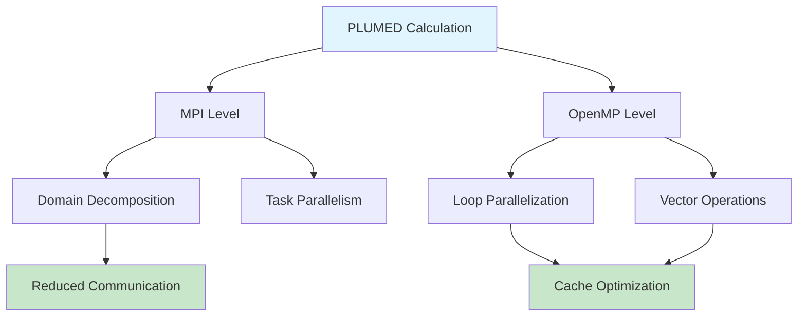
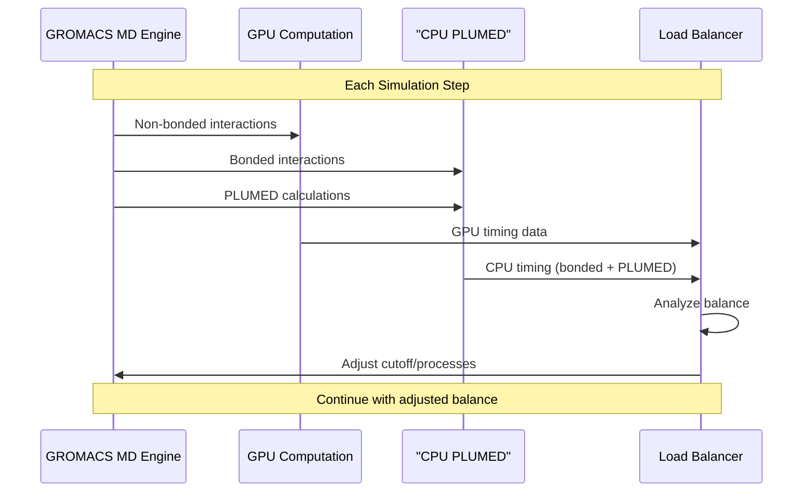
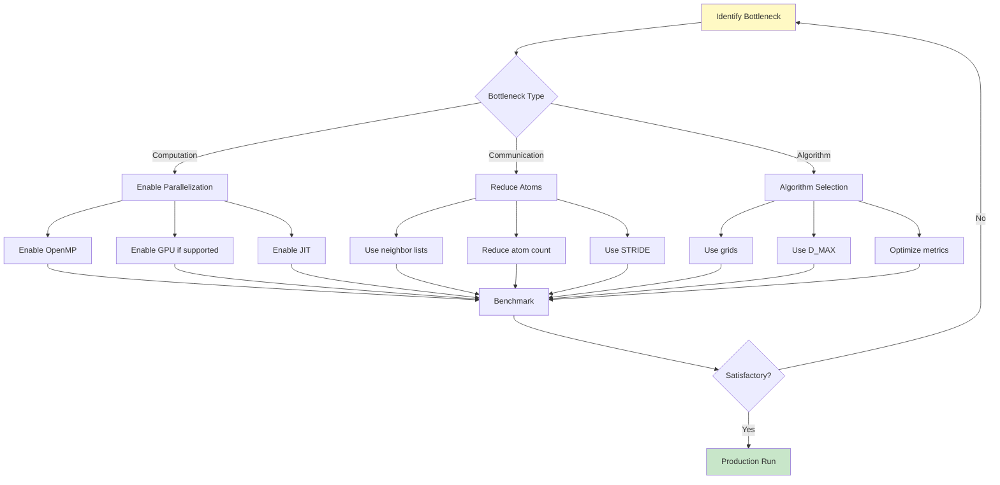

Performance optimization in PLUMED requires a systematic approach that considers the entire computational pipeline—from compilation and parallelization to communication patterns and algorithm selection. This guide provides intermediate-level developers with proven strategies to accelerate PLUMED calculations across different use cases.


## Understanding Performance Bottlenecks

PLUMED performs diverse tasks—collective variable calculations, biasing, on-the-fly analysis—across multiple molecular dynamics codes. This versatility means no single optimization strategy fits all scenarios. The key is identifying your specific bottleneck: computation overhead, communication latency, or algorithmic inefficiency.

The execution model reveals critical optimization points: PLUMED collects atomic positions from the MD engine, performs calculations, and returns forces. Each data transfer incurs overhead, making **minimizing the number of atoms used by PLUMED at every step** a fundamental optimization principle [user-doc/Performances.md#L1-L20](/user-doc/Performances.md#L1-L20).

## Parallelization Strategies

### Multi-Level Parallelism

PLUMED leverages both MPI and OpenMP for parallel computation. Always compile with these features enabled for optimal performance. The OpenMP implementation manages thread configuration through environment variables and runtime settings [src/tools/OpenMP.cpp#L35-L83](/src/tools/OpenMP.cpp#L35-L83).



**OpenMP Configuration**:
- `PLUMED_NUM_THREADS`: Controls the number of OpenMP threads (default: 1)
- `PLUMED_CACHELINE_SIZE`: Tunable cache line size for memory alignment

For hybrid MPI/OpenMP execution with GROMACS, consider these tested configurations [user-doc/Performances.md#L35-L60](/user-doc/Performances.md#L35-L60):

| MPI Ranks | GPUs | OpenMP Threads | Command Example |
|-----------|------|----------------|-----------------|
| 2 | 2 | 2 | `mpiexec -np 2 gmx_mpi mdrun -nb gpu -ntomp 2 -pin on -gpu_id 01` |
| 4 | 2 | 1 | `mpiexec -np 4 gmx_mpi mdrun -nb gpu -ntomp 1 -pin on -gpu_id 0011` |

Since PLUMED 2.5 and GROMACS 2018.3, GROMACS automatically propagates OpenMP thread settings to PLUMED, eliminating the need for manual `PLUMED_NUM_THREADS` configuration [user-doc/Performances.md#L55-L60](/user-doc/Performances.md#L55-L60).

> [!TIP]
> The optimal thread configuration depends on your specific hardware, system size, and CV calculations. Always benchmark multiple configurations with realistic workloads before settling on a setup.

### Compilation Optimization

Modern compilers with proper optimization flags can dramatically boost performance. When compiling PLUMED, ensure:

- **Compiler version**: Use recent GCC, Clang, or Intel compilers with C++17 support
- **Optimization flags**: Enable `-O2` or `-O3` optimizations
- **Target-specific flags**: Use architecture-specific flags (e.g., `-march=native`)
- **Link-time optimization**: Consider `-flto` for better optimization across translation units

## Communication Optimization

### Minimizing Atom Transfer

The most impactful optimization reduces communication overhead between PLUMED and the MD engine by **minimizing the number of atoms requested at each step** [user-doc/Performances.md#L15-L20](/user-doc/Performances.md#L15-L20).

Strategies include:

1. **Selective atom specification**: Define only necessary atoms in your PLUMED input
2. **Neighbor list utilization**: For coordination calculations, neighbor lists limit requests to nearby atoms
3. **Virtual atom optimization**: Use virtual atoms judiciously as they require additional communication

### GROMACS Load Balancing

GROMACS patched with PLUMED integrates PLUMED timings into its load-balancing algorithm, automatically optimizing CPU/GPU balance by treating PLUMED overhead alongside bonded and long-range interactions [user-doc/Performances.md#L30-L34](/user-doc/Performances.md#L30-L34).



## Grid-Based Calculations

### Metadynamics Acceleration

Grid-based metadynamics provides substantial performance gains, especially for long simulations. Use `GRID_MIN` and `GRID_MAX` keywords in `METAD` and `PBMETAD` to activate grids [user-doc/Performances.md#L64-L77](/user-doc/Performances.md#L64-L77).

| Aspect | Without Grid | With Grid |
|--------|--------------|-----------|
| Hill addition | Fast | Slower (Gaussian evaluated at many points) |
| Potential evaluation | Slow (sum all hills) | Fast (grid interpolation) |
| Typical hill frequency | Every ~500 steps | Every ~500 steps |
| Evaluation frequency | Every step | Every step |
| Net performance impact | — | **Significant speedup** |

> [!TIP]
> The initial cost of evaluating hills on the grid is amortized over thousands of steps. For simulations with fewer than ~1000 hills, grids may not provide benefits.

### Grid Persistence and Restarts

Since PLUMED 2.3, you can store grids on disk and read them upon restart, avoiding the expensive operation of re-adding thousands of hills. This is particularly valuable for simulations requiring frequent restarts or with large hill collections [user-doc/Performances.md#L78-L82](/user-doc/Performances.md#L78-L82).

## Multiple Time Stepping

The `STRIDE` parameter enables multiple time stepping by controlling how frequently an action is calculated. This technique can dramatically speed up simulations using expensive collective variables [user-doc/Performances.md#L86-L115](/user-doc/Performances.md#L86-L115).

**Example: Center of Mass Distance Calculation**

Before optimization (STRIDE=1 by default):
```plumed
c1: COM ATOMS=1-1000
c2: COM ATOMS=1001-2000
d:  DISTANCE ATOMS=c1,c2
METAD ARG=d HEIGHT=1 SIGMA=0.1 BIASFACTOR=5 PACE=500
```

After optimization (STRIDE=2):
```plumed
c1: COM ATOMS=1-1000
c2: COM ATOMS=1001-2000
d:  DISTANCE ATOMS=c1,c2
METAD ARG=d HEIGHT=1 SIGMA=0.1 BIASFACTOR=5 PACE=500 STRIDE=2
```

In the optimized version, forces from the bias potential are scaled by `STRIDE` (factor of 2) to maintain the correct average force. This introduces a **negligible systematic error** while potentially doubling performance [user-doc/Performances.md#L106-L115](/user-doc/Performances.md#L106-L115).

**Important**: Variables are only computed when necessary. If a CV only appears in a `PRINT` statement with `STRIDE=10`, it will be computed every 10 steps regardless of the calculation's intrinsic STRIDE setting.

## Neighbor List Optimization

Certain collective variables support neighbor lists for significant performance improvements [user-doc/Performances.md#L119-L133](/user-doc/Performances.md#L119-L133):

- `COORDINATION`
- `DHENERGY`
- `PATHMSD`

The `NeighborList` class implements efficient distance-based atom selection using configurable cutoff distances and update frequencies [src/tools/NeighborList.cpp#L39-L75](/src/tools/NeighborList.cpp#L39-L75).

**Benefits**:
1. **Reduced computation**: Only calculate distances for nearby atom pairs
2. **Fewer atom requests**: Request only relevant atoms from MD engine (e.g., water near a ligand)
3. **Tunable accuracy/performance**: Adjust cutoff and stride parameters

This optimization is particularly effective when calculating coordination of a small group of atoms against many atoms (e.g., ligand coordination in water).

## Multicolvar Optimization

For multicolvar actions using switching functions, the `D_MAX` parameter provides **colossal speedup** by enabling linked-list algorithms [user-doc/Performances.md#L135-L144](/user-doc/Performances.md#L135-L144).

```plumed
COORDINATIONNUMBER SPECIES=1-100 SWITCH={RATIONAL R_0=1. D_MAX=3.0} MORE_THAN={RATIONAL R_0=6.0 NN=6 MM=12 D_0=0}
```

**How it works**:
- `D_MAX` informs PLUMED that switching functions are zero beyond this distance
- PLUMED uses linked lists instead of exhaustive O(n²) calculations
- Dramatically reduces terms in large sums

Without `D_MAX`: PLUMED must evaluate every pair (potentially thousands). With `D_MAX`: only nearby pairs are considered (typically tens to hundreds).

## Secondary Structure Optimization

Secondary structure CVs (`ALPHARMSD`, `PARABETARMSD`, `ANTIBETARMSD`) can be computationally demanding, especially for full proteins [user-doc/Performances.md#L146-L160](/user-doc/Performances.md#L146-L160).

**Optimization Strategies**:

1. **Use `STRANDS_CUTOFF`** (e.g., `STRANDS_CUTOFF=1.0`):
   - Restricts calculations to fragments within 1.0 nm
   - Dramatically reduces computation for β-structures

2. **Choose optimal metric**:
   - `TYPE=OPTIMAL` or `TYPE=OPTIMAL-FAST` instead of `TYPE=DRMSD`
   - Balance between accuracy and performance

3. **Limit residues**:
   - Calculate secondary structure only for relevant protein regions

## GPU Acceleration

### OpenACC Implementation

PLUMED includes experimental GPU parallelization using OpenACC [new-manual/gpu.md#L1-L10](/new-manual/gpu.md#L1-L10). The `USEGPU` flag enables GPU-accelerated versions of specific actions.

**Important**: GPU versions are **experimental** and may not be faster than CPU implementations. Performance depends on your specific calculation, data size, and hardware.

**Compilation**:
```bash
./configure --enable-openacc
```

Requires NVIDIA HPC SDK (tested with version 24.3) [new-manual/gpu.md#L12-L20](/new-manual/gpu.md#L12-L20).

**GPU-Accelerated Actions**:
- **Colvar**: `ANGLE`, `DIPOLE`, `DISTANCE`, `PLANE`, `POSITION`, `TORSION`
- **Secondary Structure**: `SECONDARY_STRUCTURE_DRMSD` and derivatives (only with `TYPE=DRMSD`)
- **Volumes**: `AROUND`, `INCYLINDER`, `INSPHERE`
- **Adjacency Matrix**: `CONTACT_MATRIX`
- **Functions**: `LESS_THAN`, `MORE_THAN`, `BETWEEN`, `COMBINE`
- **Matrix Operations**: `MATRIX_PRODUCT`, `MATRIX_VECTOR_PRODUCT`
- **Symmetry Functions**: `Q1-Q6`, `LOCAL_Q1-Q6`, `FCCUBIC`, `TETRAHEDRAL`, and more [new-manual/gpu.md#L25-L60](/new-manual/gpu.md#L25-L60)

**Environment Variables**:
- `PLUMED_ACC_TYPE`: `gpu` (default), `host`, or `multicore`
- `PLUMED_ACC_GPU`: Pass `-gpu` options to nvhpc compiler

**Known Limitations**: `membranefusion` module is incompatible with OpenACC compilation [new-manual/gpu.md#L23-L25](/new-manual/gpu.md#L23-L25).

## Expression Evaluation Optimization

### Lepton Library with JIT Compilation

PLUMED uses the Lepton library for custom functions and switching functions. Since PLUMED 2.5, Lepton replaced libmatheval and is significantly faster. Since PLUMED 2.6, the ASMJIT JIT compiler is embedded and **enabled by default on X86/X64 architectures** since PLUMED 2.8 [user-doc/Performances.md#L162-L173](/user-doc/Performances.md#L162-L173).

The `CompiledExpression` class manages JIT compilation for optimal performance [src/lepton/CompiledExpression.h#L45-L95](/src/lepton/CompiledExpression.h#L45-L95).

**JIT Compilation Benefits**:
- Runtime compilation of mathematical expressions to native machine code
- Eliminates interpretation overhead
- Significant speedup for complex custom functions

**Configuration**:
```bash
# Disable JIT at runtime if needed
export PLUMED_USE_ASMJIT=no
```

The ASMJIT library provides cross-platform JIT compilation with architecture-specific optimizations [src/asmjit/](/src/asmjit/).

## Systematic Optimization Workflow



## Optimization Checklist

Use this checklist to systematically optimize your PLUMED simulations:

- **[ ] Compilation**: Compiled with `-O2`/`-O3`, MPI, and OpenMP enabled
- **[ ] Parallelization**: `PLUMED_NUM_THREADS` configured, tested multiple MPI/OpenMP combinations
- **[ ] Atoms**: Minimized number of atoms requested from MD engine
- **[ ] Metadynamics**: Grid enabled with appropriate `GRID_MIN`/`GRID_MAX` for long runs
- **[ ] Multicolvar**: `D_MAX` specified in all distance-based switching functions
- **[ ] Neighbor Lists**: Enabled for `COORDINATION`, `DHENERGY`, `PATHMSD`
- **[ ] Secondary Structure**: `STRANDS_CUTOFF` used, optimal `TYPE` selected
- **[ ] Time Stepping**: `STRIDE` parameter used for expensive CVs in bias
- **[ ] GPU**: Tested `USEGPU` for supported actions (if applicable)
- **[ ] JIT**: ASMJIT enabled (default) for custom functions

## Further Reading

For deeper understanding and practical implementation:

- **[Performance Tutorial](user-doc/Performances.md#L5-L7)**: Step-by-step optimization examples
- **[Action Framework](6-action-framework-and-execution-model)**: Understanding PLUMED's execution model
- **[Domain Decomposition](9-domain-decomposition-and-parallelism)**: Advanced parallel strategies
- **[Metadynamics Variants](14-metadynamics-variants)**: Specialized biasing methods

Remember that the optimal configuration depends on your specific system, hardware, and calculation type. Always benchmark different configurations with realistic workloads before committing to production runs.