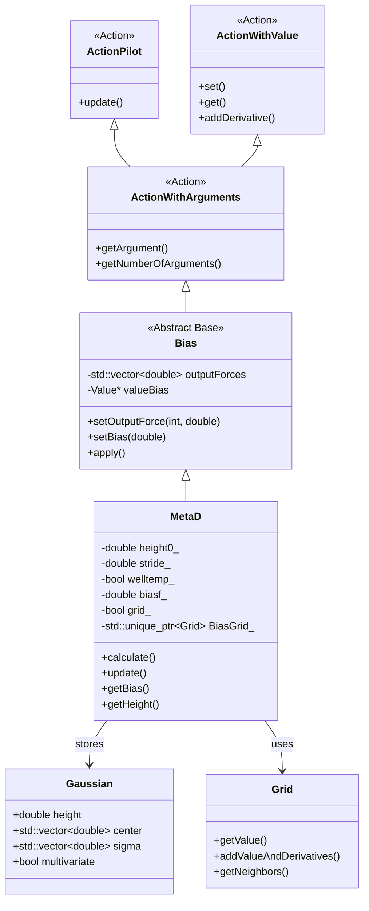

This page introduces the core concepts and implementation details of metadynamics in PLUMED. Metadynamics is an enhanced sampling method that adds a history-dependent bias potential to drive exploration of collective variable (CV) space and reconstruct free energy surfaces.

## Mathematical Foundation

Metadynamics builds a bias potential by depositing Gaussian functions at regular intervals along the trajectory in CV space. The bias potential at time t is expressed as:

$$
V(\vec{s},t) = \sum_{k\tau < t} W(k\tau) \exp\left(-\sum_{i=1}^{d} \frac{(s_i - s_i^{(0)}(k\tau))^2}{2\sigma_i^2}\right)
$$

where $s_i$ are the collective variables, $W(k\tau)$ is the height of the Gaussian deposited at step $k\tau$, and $\sigma_i$ defines the Gaussian width for each CV. This history-dependent potential forces the system away from kinetic traps by filling free energy minima with successive Gaussian deposits, eventually allowing the system to explore unvisited regions of the energy landscape [MetaD.cpp](/src/bias/MetaD.cpp#L26-L34).

The key theoretical insight is that the time-averaged bias potential converges to the negative free energy surface:

$$
V(\vec{s}) = -F(\vec{s})
$$

This relationship enables free energy reconstruction from the accumulated bias potential, which can be analyzed during post-processing using the `sum_hills` utility [MetaD.cpp](/src/bias/MetaD.cpp#L35-L38).

## Architecture Overview

The metadynamics implementation in PLUMED follows a modular architecture where the `MetaD` class inherits from the base `Bias` class, which itself integrates multiple action interfaces. This design provides a clear separation between the bias calculation logic and the action execution framework.



The bias framework provides essential functionality through the `Bias` base class, including force output management via `setOutputForce()` and bias value setting through `setBias()` [Bias.h](/src/bias/Bias.h#L66-L77). This allows metadynamics to seamlessly integrate with PLUMED's action execution model while providing specialized functionality for hill deposition and free energy reconstruction.

## Standard Metadynamics Configuration

### Basic Parameters

The minimal configuration for standard metadynamics requires specifying the collective variables to bias, Gaussian widths, initial hill height, and deposition frequency. Here is a typical two-dimensional example:

```plumed
d1: DISTANCE ATOMS=3,5
d2: DISTANCE ATOMS=2,4
restraint: METAD ARG=d1,d2 SIGMA=0.2,0.2 HEIGHT=0.3 PACE=500
PRINT ARG=d1,d2,restraint.bias STRIDE=100 FILE=COLVAR
```

In this example, distances between atoms (3,5) and (2,4) serve as collective variables. Gaussian hills with height 0.3 kJ/mol and widths of 0.2 nm in each CV direction are added every 500 MD steps. The CV values and bias potential are recorded to the COLVAR file every 100 steps [MetaD.cpp](/src/bias/MetaD.cpp#L45-L56).

### Configuration Parameters

| Parameter | Required | Description | Units |
|-----------|----------|-------------|-------|
| `ARG` | Yes | Collective variables to bias | CV-dependent |
| `SIGMA` | Yes | Gaussian width(s) for each CV | CV-dependent |
| `HEIGHT` | No | Initial Gaussian hill height | kJ/mol |
| `PACE` | Yes | Steps between hill depositions | dimensionless |
| `FILE` | No | Output file for hill information | filename |

The `SIGMA` parameter can be specified as a comma-separated list matching the number of CVs. Each value determines the standard deviation of the Gaussian in the corresponding CV dimension [MetaD.cpp](/src/bias/MetaD.cpp#L750-L767).

## Grid-Based Bias Evaluation

### Performance Optimization

In basic implementations, computational cost scales linearly with simulation time as the number of deposited hills increases. PLUMED addresses this through grid-based bias storage, where the potential is discretized onto a multidimensional grid for efficient evaluation [MetaD.cpp](/src/bias/MetaD.cpp#L60-L62).

Grid configuration requires defining boundaries and resolution:

```plumed
t1: TORSION ATOMS=1,2,3,4
t2: TORSION ATOMS=5,6,7,8
m: METAD ARG=t1,t2 SIGMA=0.1,0.1 HEIGHT=1.2 PACE=500 
    GRID_MIN=-pi,-pi GRID_MAX=pi,pi GRID_BIN=100,100
PRINT ARG=t1,t2,m.bias STRIDE=100 FILE=COLVAR
```

### Grid Parameters

| Parameter | Description | Default |
|-----------|-------------|---------|
| `GRID_MIN` | Lower boundary for each CV dimension | None (required) |
| `GRID_MAX` | Upper boundary for each CV dimension | None (required) |
| `GRID_BIN` | Number of grid points per dimension | None (required) |
| `GRID_SPACING` | Grid spacing alternative to `GRID_BIN` | None |
| `GRID_SPARSE` | Use sparse grid representation | false |

PLUMED validates grid spacing against Gaussian width to prevent artifacts. The grid spacing should be less than half the Gaussian width: if this condition is violated, a warning is issued [MetaD.cpp](/src/bias/MetaD.cpp#L1384-L1396).

### Hill Evaluation on Grids

When a new Gaussian is deposited, PLUMED calculates its support region—points on the grid where the Gaussian contribution is above the cutoff threshold (typically 10^-8 of the peak). Only points within this support region are updated, providing significant computational savings:

```cpp
std::vector<unsigned> nneighb = getGaussianSupport(hill);
std::vector<Grid::index_t> neighbors = BiasGrid_->getNeighbors(hill.center, nneighb);
// Update only neighbor grid points
for(size_t i = 0; i < neighbors.size(); ++i) {
    BiasGrid_->addValueAndDerivatives(ineigh, bias, der);
}
```

This approach maintains O(1) complexity for bias evaluation regardless of the total number of deposited hills [MetaD.cpp](/src/bias/MetaD.cpp#L1762-L1795).

> [!TIP]
> Grid storage is essential for long simulations. Without grids, the computational cost increases linearly with the number of deposited hills, making simulations with more than 10,000-100,000 hills prohibitively expensive.

## Well-Tempered Metadynamics

### Enhanced Convergence

Well-tempered metadynamics modifies the standard algorithm by reducing hill heights as the bias grows, ensuring convergence to a finite free energy estimate. The hill height at step t is scaled according to:

$$
W(t) = W_0 \exp\left(-\frac{V(\vec{s},t)}{k_B T (\gamma - 1)}\right)
$$

where $\gamma$ is the bias factor (typically 10-100), $W_0$ is the initial height, and $V(\vec{s},t)$ is the current bias potential [MetaD.cpp](/src/bias/MetaD.cpp#L2230-L2238).

### Configuration

Well-tempered metadynamics is activated by specifying both `BIASFACTOR` and `TEMP`:

```plumed
d1: DISTANCE ATOMS=3,5
d2: DISTANCE ATOMS=2,4
restraint: METAD ARG=d1,d2 SIGMA=0.2,0.2 HEIGHT=0.3 BIASFACTOR=10 PACE=500
PRINT ARG=d1,d2,restraint.bias STRIDE=100 FILE=COLVAR
```

The bias factor $\gamma$ controls the exploration depth. A value of 10 provides moderate exploration while maintaining good convergence properties [MetaD.cpp](/src/bias/MetaD.cpp#L196-L204).

### Well-Tempered Parameters

| Parameter | Required | Description | Typical Values |
|-----------|----------|-------------|----------------|
| `BIASFACTOR` | Yes | Bias factor $\gamma$ | 5-100 |
| `TEMP` | Conditional | Simulation temperature (in K) | from MD engine or specified |

> [!TIP]
> The hills file in well-tempered metadynamics stores rescaled heights corresponding to $-F(\vec{s})$ rather than the actual bias potential. This enables restarting simulations with different bias factors while maintaining the correct free energy estimate.

## Advanced Variants

### Adaptive Gaussian Widths

PLUMED supports adaptive Gaussian schemes that adjust hill widths based on system dynamics, useful when CVs have different sensitivities or cover varying scales:

- **Diffusion-based (`ADAPTIVE=DIFF`)**: Width adapts to the CV space covered during a specified number of time steps
- **Geometry-based (`ADAPTIVE=GEOM`)**: Width adapts to the Cartesian space covered by CV variations

Diffusion example:

```plumed
d1: DISTANCE ATOMS=3,5
d2: DISTANCE ATOMS=2,4
restraint: METAD ARG=d1,d2 SIGMA=20 HEIGHT=0.3 PACE=500 ADAPTIVE=DIFF
```

Geometry example:

```plumed
d1: DISTANCE ATOMS=3,5
d2: DISTANCE ATOMS=2,4
restraint: METAD ARG=d1,d2 SIGMA=0.05 HEIGHT=0.3 PACE=500 ADAPTIVE=GEOM
```

Width limits can be controlled with `SIGMA_MIN` and `SIGMA_MAX` [MetaD.cpp](/src/bias/MetaD.cpp#L238-L290).

### Multiple Walkers Metadynamics

Multiple walkers enable parallel exploration of CV space by synchronizing bias between multiple replicas:

```plumed
d1: DISTANCE ATOMS=3,5
restraint: METAD ...
   ARG=d1 SIGMA=0.05 HEIGHT=0.3 PACE=500
   WALKERS_N=10
   WALKERS_ID=3
   WALKERS_DIR=../
   WALKERS_RSTRIDE=100
...
```

Parameters:
- `WALKERS_N`: Total number of walkers
- `WALKERS_ID`: Current walker's ID (0 to N-1)
- `WALKERS_DIR`: Directory containing other walkers' hills files
- `WALKERS_RSTRIDE`: Frequency of reading other walkers' data [MetaD.cpp](/src/bias/MetaD.cpp#L307-L320)

### Acceleration Factor Calculation

Infrequent metadynamics analyzes transition kinetics using the acceleration factor, which quantifies rate enhancement:

```plumed
psi: ANGLE ATOMS=7,9,15
md1: METAD ...
 ARG=psi SIGMA=0.20
 HEIGHT=1.20 TEMP=300.0 BIASFACTOR=10
 PACE=500 GRID_MIN=0 GRID_MAX=pi GRID_BIN=10
 ACCELERATION
...
PRINT ARG=psi,md1.bias,md1.acc FILE=colvar STRIDE=10
```

The acceleration factor $\alpha(t)$ is computed as the time-average of $\exp(V(s,t)/k_B T)$ and accumulated continuously during the simulation [MetaD.cpp](/src/bias/MetaD.cpp#L343-L353).

## Hill Storage and Restart

### Hills File Format

PLUMED records deposited Gaussians in the HILLS file (customizable with `FILE` parameter). Each entry contains:

- Time: Step number
- CV coordinates: Center of deposited Gaussian
- Sigma parameters: Gaussian widths
- Height: Gaussian amplitude (rescaled for well-tempered)
- biasf: Bias factor used [MetaD.cpp](/src/bias/MetaD.cpp#L1828-L1879)

### Restart Procedure

Metadynamics simulations can be restarted using previously deposited hills:

```plumed
d1: DISTANCE ATOMS=3,5
d2: DISTANCE ATOMS=2,4
restraint: METAD ARG=d1,d2 SIGMA=0.2,0.2 HEIGHT=0.3 PACE=500 RESTART=YES
```

The `RESTART` flag causes PLUMED to read the existing HILLS file and reconstruct the bias potential from all previously deposited Gaussians [MetaD.cpp](/src/bias/MetaD.cpp#L1690-L1710).

## Summary

Metadynamics in PLUMED provides a flexible framework for enhanced sampling with the following key features:

- **Standard and well-tempered variants** with configurable hill deposition parameters
- **Grid-based storage** for computational efficiency in long simulations
- **Multiple advanced variants** including adaptive Gaussians, multiple walkers, and kinetic analysis
- **Robust restart capabilities** through hill file persistence
- **Free energy reconstruction** via post-processing with `sum_hills`

The implementation balances theoretical rigor with computational efficiency, making it suitable for studying complex free energy landscapes in molecular systems.

## Next Steps

After mastering these fundamentals, explore:

- [CV Fundamentals and Common CVs](10-cv-fundamentals-and-common-cvs) for building effective collective variables
- [Metadynamics Variants](14-metadynamics-variants) for specialized techniques including bias-exchange metadynamics
- [Reweighting and Free Energy Analysis](16-reweighting-and-free-energy-analysis) for analyzing biased simulations
- [Action Framework and Execution Model](6-action-framework-and-execution-model) for understanding the underlying architecture
