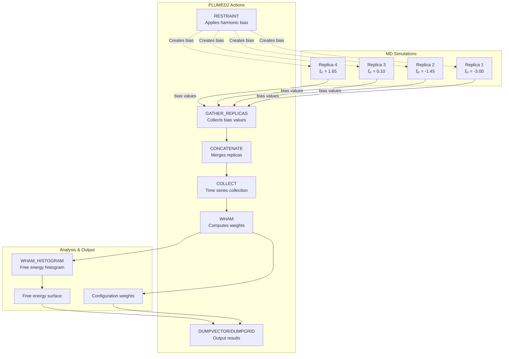
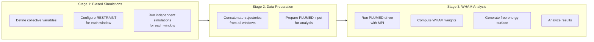

This guide provides a comprehensive introduction to umbrella sampling and the Weighted Histogram Analysis Method (WHAM) as implemented in PLUMED2. These techniques enable the calculation of free energy surfaces along collective variables by combining data from multiple biased simulations, making them essential tools for studying rare events and conformational transitions in molecular dynamics simulations.

Sources: [src/wham/module.md](/plumed/plumed2/blob/master/src/wham/module.md#L1-L5), [src/wham/module.yml](/plumed/plumed2/blob/master/src/wham/module.yml#L1-L5)

## Theoretical Foundation

### Umbrella Sampling Overview

Umbrella sampling is a molecular dynamics technique that enhances sampling along specific reaction coordinates or collective variables by applying harmonic restraints. The method divides the free energy landscape into overlapping windows, each biased toward a different reference point along the collective variable. By running independent simulations in each window and subsequently reweighting the data, you can reconstruct the unbiased free energy profile across the entire range of interest.

The bias potential applied in each window follows a harmonic form: V_bias(ξ) = (κ/2)(ξ - ξ₀)², where κ is the force constant, ξ is the collective variable value, and ξ₀ is the reference position for that window. The key insight is that while each simulation samples only a restricted region, the overlapping regions between windows provide the information needed to stitch together the complete free energy surface.

Sources: [src/bias/Restraint.cpp](/plumed/plumed2/blob/master/src/bias/Restraint.cpp#L1-L80)

### WHAM Mathematical Framework

The Weighted Histogram Analysis Method (WHAM) provides the formalism for combining data from multiple biased simulations. PLUMED2 implements the **binless formulation** of WHAM, which operates directly on individual configurations rather than requiring histogram binning.

The fundamental probability equation that WHAM maximizes is:

P(T) ∝ ∏_{j=1}^M ∏_{k=1}^N (c_k w_{kj} p_j)^{t_{kj}}

where the outer product runs over N trajectories with different biases, the inner product runs over M histogram bins, p_j is the unbiased probability we seek to extract, t_{kj} measures the number of frames from trajectory k in bin j, and w_{kj} is the weight factor accounting for the bias:

w_{kj} = e^{+βV_k(x_j)}

The normalization constants c_k ensure each biased probability distribution is normalized: ∑_j c_k w_{kj} p_j = 1. By maximizing the log-likelihood with Lagrange multipliers for the normalization constraints, we derive the iterative WHAM equations:

p_j ∝ (∑_{k=1}^N t_{kj})/(∑_k c_k w_{kj})
c_k = 1/(∑_{j=1}^M w_{kj} p_j)

Sources: [src/wham/Wham.cpp](/plumed/plumed2/blob/master/src/wham/Wham.cpp#L30-L95)

## PLUMED2 Architecture

### Component Overview

The WHAM implementation in PLUMED2 consists of three main components that work together to enable umbrella sampling analysis:



Sources: [src/wham/WhamWeights.cpp](/plumed/plumed2/blob/master/src/wham/WhamWeights.cpp#L29-L65), [regtest/wham/rt-wham/plumed.dat](/plumed/plumed2/blob/master/regtest/wham/rt-wham/plumed.dat#L1-L29)

### WHAM Core Implementation

The `WHAM` action implements the iterative solution to the WHAM equations. Key implementation details include:

**Initialization**: The action reads temperature, maximum iterations, and convergence tolerance from input parameters. Temperature can be obtained from the MD engine or explicitly specified.

**Bias Processing**: For each configuration, the algorithm computes the exponential weight factor: exp[(-V_bias + V_min)/kT], where V_min prevents numerical overflow by normalizing to the minimum bias value.

**Iterative Solution**: The algorithm alternates between:
1. Computing final weights for each configuration: w_j = 1/∑_k (exp_{jk}/Z_k)
2. Recomputing partition functions: Z_k = ∑_j (w_j × exp_{jk})
3. Checking convergence based on changes in Z values

The binless formulation's key advantage is that only ∑_k t_{kj} (total configurations in each bin) enters the final equations, eliminating the need to track which replica generated each frame.

Sources: [src/wham/Wham.cpp](/plumed/plumed2/blob/master/src/wham/Wham.cpp#L97-L233)

### Shortcut Action Architecture

The `WHAM_WEIGHTS` action provides a convenient shortcut that automatically orchestrates the full WHAM workflow. This action internally generates the necessary pipeline:

| Internal Action | Purpose |
|----------------|---------|
| GATHER_REPLICAS | Collects bias values from all replicas |
| CONCATENATE | Merges replica data into single vector |
| COLLECT | Creates time series of bias values |
| WHAM | Performs the WHAM weight calculation |
| DUMPVECTOR | Outputs final weights to file |

This abstraction simplifies user input while maintaining flexibility for advanced users who need custom configurations.

Sources: [src/wham/WhamWeights.cpp](/plumed/plumed2/blob/master/src/wham/WhamWeights.cpp#L68-L118)

## Practical Implementation

### Basic Umbrella Sampling Workflow

The complete workflow for umbrella sampling with WHAM analysis involves three stages:



### Configuration Options

The WHAM implementation provides several tunable parameters:

| Parameter | Default | Description |
|-----------|---------|-------------|
| MAXITER | 1000 | Maximum number of WHAM iterations |
| WHAMTOL | 1×10⁻¹⁰ | Convergence threshold for partition function changes |
| TEMP | From MD engine | Simulation temperature (required if not passed by MD) |
| STRIDE | 1 | Frequency of bias storage for WHAM calculation |

The convergence criterion is based on the sum of squared logarithmic changes in the partition functions across all replicas: ∑_k [log(Z_k/Z_k^old)]² < WHAMTOL.

Sources: [src/wham/Wham.cpp](/plumed/plumed2/blob/master/src/wham/Wham.cpp#L117-L129)

### Complete Example

The following example demonstrates a complete umbrella sampling analysis on a dihedral angle using four windows:

```plumed
# Define collective variables
phi: TORSION ATOMS=5,7,9,15
psi: TORSION ATOMS=7,9,15,17

# Apply harmonic restraints at different reference values
rp: RESTRAINT ARG=phi KAPPA=50.0 AT=@replicas:{-3.00,-1.45,0.10,1.65}

# Compute WHAM weights for reweighting
WHAM_WEIGHTS BIAS=rp.bias TEMP=300 FILE=wham-weights
```

This input must be executed with MPI to handle multiple replicas:

```bash
mpirun -np 4 plumed driver --mf_xtc alltraj.xtc --multi 4
```

For free energy reconstruction, you can also use the histogram-based approach:

```plumed
hh: WHAM_HISTOGRAM ARG=phi BIAS=rp.bias TEMP=300 GRID_MIN=-pi GRID_MAX=pi GRID_BIN=50
fes: CONVERT_TO_FES ARG=hh TEMP=300
DUMPGRID ARG=fes STRIDE=0 FILE=fes.dat
```

Sources: [regtest/wham/rt-wham/plumed.dat](/plumed/plumed2/blob/master/regtest/wham/rt-wham/plumed.dat#L1-L29)

### Input Parameter Comparison

The table below compares the two main approaches for WHAM analysis in PLUMED2:

| Feature | WHAM_WEIGHTS | WHAM + WHAM_HISTOGRAM |
|---------|--------------|----------------------|
| **Output** | Per-configuration weights | Histogram and free energy surface |
| **Use Case** | Reweighting observables | Direct free energy visualization |
| **Flexibility** | High (weights can be reused) | Medium (specific to CV grid) |
| **Complexity** | Low (single command) | Medium (multiple actions) |
| **Memory Usage** | Proportional to trajectory | Proportional to histogram bins |

> [!TIP]
> When working with large systems or long trajectories, consider using `STRIDE > 1` in `WHAM_WEIGHTS` to reduce memory usage. The WHAM algorithm is robust to subsampling as long as the stride is small compared to the correlation time of the system.

Sources: [src/wham/WhamWeights.cpp](/plumed/plumed2/blob/master/src/wham/WhamWeights.cpp#L29-L65)

## Advanced Considerations

### Binless vs. Binned WHAM

PLUMED2's binless WHAM implementation offers several advantages over traditional histogram-based methods:

1. **No binning artifacts**: Eliminates sensitivity to bin size selection
2. **Continuous resolution**: Preserves full trajectory resolution
3. **Memory efficiency**: No need to store large histograms
4. **Flexibility**: Weights can be applied to any observable calculation

The key innovation is recognizing that only the total count of configurations in each region (∑_k t_{kj}) matters, not which specific replica contributed them. This enables the algorithm to work with concatenated trajectories without replica tagging.

Sources: [src/wham/Wham.cpp](/plumed/plumed2/blob/master/src/wham/Wham.cpp#L64-L95)

### Convergence and Performance

The WHAM iteration typically converges in 10-100 iterations for well-behaved systems. Factors affecting convergence include:

- **Window overlap**: Insufficient overlap between windows slows convergence
- **Force constant**: Very stiff restraints (high κ) reduce sampling efficiency
- **Temperature**: Lower temperatures require more iterations due to exponential terms
- **Number of replicas**: More replicas increase computational cost per iteration

For production calculations, monitor the convergence behavior and adjust `MAXITER` and `WHAMTOL` accordingly. The default values are conservative for most applications.

> [!TIP]
> The minimum bias subtraction in the exponential calculation (using V_min) is crucial for numerical stability. Always ensure your bias values are finite and well-defined before WHAM analysis.

Sources: [src/wham/Wham.cpp](/plumed/plumed2/blob/master/src/wham/Wham.cpp#L152-L167)

### Integration with Collective Variables

The WHAM framework integrates seamlessly with PLUMED2's extensive collective variable library. Any CV that produces a scalar value can be used with umbrella sampling and WHAM:

- **Distance-based CVs**: DISTANCE, ANGLE, TORSION
- **Path CVs**: PATH, PATHMSD
- **Coordination CVs**: COORDINATION, Q4, Q6
- **Custom CVs**: User-defined CVs through the plugin interface

The RESTRAINT action supports both scalar and vector arguments, enabling multi-dimensional umbrella sampling along multiple CVs simultaneously.

Sources: [src/bias/Restraint.cpp](/plumed/plumed2/blob/master/src/bias/Restraint.cpp#L40-L65)

## Next Steps

To deepen your understanding of PLUMED2's capabilities, consider exploring these related topics:

- **[Collective Variables Fundamentals](10-cv-fundamentals-and-common-cvs)**: Learn about the full range of available CVs and their implementation
- **[Restraints and Walls](15-restraints-and-walls)**: Explore other biasing methods including upper/lower walls and moving restraints
- **[Reweighting and Free Energy Analysis](16-reweighting-and-free-energy-analysis)**: Discover alternative reweighting techniques including metadynamics reweighting
- **[Action Framework and Execution Model](6-action-framework-and-execution-model)**: Understand the underlying architecture that enables WHAM and other analyses

For practical implementation, examine the regression tests in [regtest/wham/](/plumed/plumed2/blob/master/regtest/wham/) which provide working examples of both basic and advanced WHAM usage patterns.
