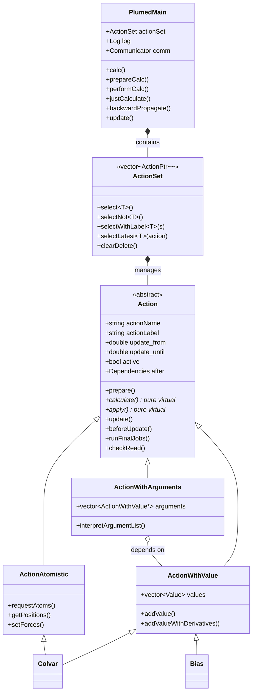
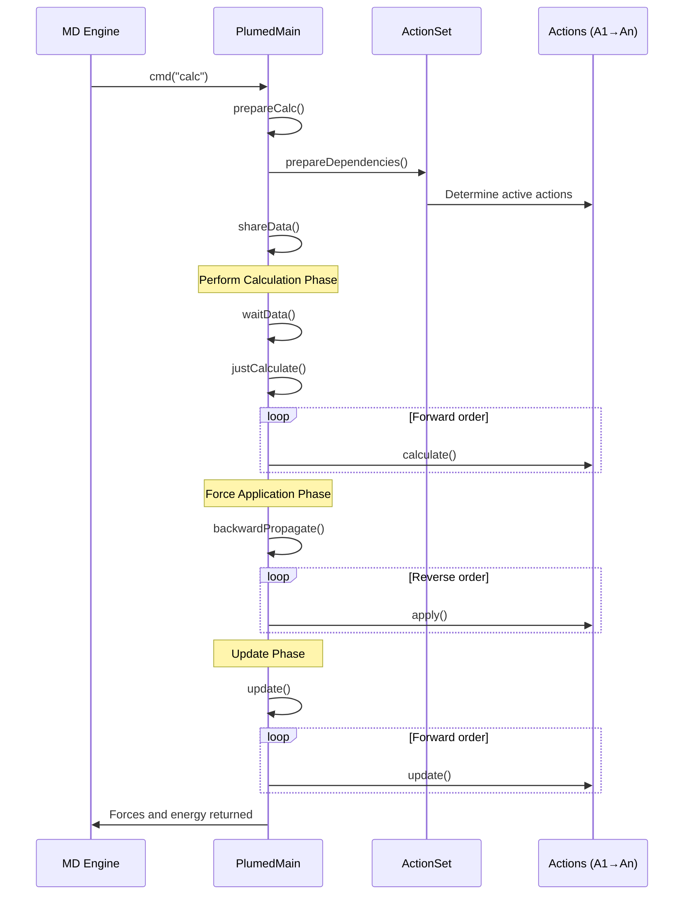

The PLUMED Action Framework forms the core computational architecture that enables flexible definition and execution of collective variables, biasing methods, and analysis tools. This framework provides a modular, extensible system where each computational operation is encapsulated as an "Action" that can be composed and chained to create complex enhanced sampling protocols.

## Architectural Overview

At its foundation, PLUMED implements an object-oriented Action hierarchy where every directive in a `plumed.dat` file corresponds to an Action instance. The architecture follows a **command pattern** with clear separation between input parsing, calculation, and force application phases. Actions are maintained in sequence within an ActionSet container and executed in a well-defined order that respects dependency relationships.

Sources: [Action.h](src/core/Action.h#L56-L94), [ActionSet.h](src/core/ActionSet.h#L23-L63)

## Core Action Hierarchy

The base `Action` class in [src/core/Action.h](src/core/Action.h#L56-L94) defines the fundamental interface that all computational operations must implement. Every Action contains metadata including its directive name, optional label, timing constraints (UPDATE_FROM/UPDATE_UNTIL), and dependency tracking.

The hierarchy extends through specialized base classes that provide additional capabilities:

- **ActionWithValue** ([src/core/ActionWithValue.h](src/core/ActionWithValue.h#L1)): Produces scalar or vector values with derivatives, used by collective variables and bias potentials
- **ActionAtomistic** ([src/core/ActionAtomistic.h](src/core/ActionAtomistic.h#L1)): Operates on atomic coordinates, handles atom requests and force application
- **ActionWithArguments** ([src/core/ActionWithArguments.h](src/core/ActionWithArguments.h#L1)): Takes other actions as input, enabling composition and chaining
- **ActionWithVirtualAtom**, **ActionWithMatrix**, **ActionWithVector**: Specialized capabilities for virtual atoms, matrix operations, and vector operations

The modular design enables mixins where actions can combine multiple capabilities—for example, a distance collective variable extends both ActionWithValue and ActionAtomistic.

Sources: [Action.h](src/core/Action.h#L56-L200), [ActionWithValue.h](src/core/ActionWithValue.h), [ActionAtomistic.h](src/core/ActionAtomistic.h)

## Action Lifecycle

Each Action follows a well-defined lifecycle from instantiation to calculation:

**1. Registration Phase**
Actions are registered through the `ActionRegister` system using static registration objects. Every action defines a `registerKeywords()` method that declares its input parameters through the `Keywords` class.

Sources: [ActionRegister.h](src/core/ActionRegister.h), [Action.cpp](src/core/Action.cpp#L39-L50)

**2. Construction Phase**
The `ActionOptions` object ([src/core/Action.h](src/core/Action.h#L33-L51)) passes configuration to the constructor, including reference to the main `PlumedMain` object and the parsed input line. Keywords are parsed using template methods like `parse<T>()`, `parseVector<T>()`, and `parseFlag()`.

Sources: [Action.h](src/core/Action.h#L155-L200)

**3. Dependency Resolution**
Actions declare dependencies via `addDependency(Action*)` and `checkForDependency(Action*)`. The system builds a dependency graph to ensure proper execution order.

Sources: [Action.h](src/core/Action.h#L93-L95)

**4. Calculation Phase**
The `calculate()` method computes values and derivatives. This method is called in forward order, respecting dependencies.

Sources: [Action.h](src/core/Action.h#L230-L235)

> [!TIP]
> Critical implementation detail: The calculate() method must only compute values and derivatives—never modify atomic positions. Force application is deferred to the apply() phase, which occurs after all calculations are complete. This separation enables correct chain rule derivatives through composed actions.

## Execution Model

PLUMED implements a **three-phase execution cycle** per MD timestep, orchestrated by the `PlumedMain` class ([src/core/PlumedMain.h](src/core/PlumedMain.h#L350-L430)):

**Phase 1: Preparation** ([PlumedMain.h](src/core/PlumedMain.h#L356-L380))
- `prepareCalc()`: Shortcut combining dependency preparation and data sharing
- `prepareDependencies()`: Scans actions to determine which are active based on timing constraints (UPDATE_FROM/UPDATE_UNTIL)
- `shareData()`/`waitData()`: In parallel implementations, transfers required atomic coordinates to all processes

**Phase 2: Calculation** ([PlumedMain.h](src/core/PlumedMain.h#L382-L395))
- `justCalculate()`: Iterates over active actions in forward order, calling each `calculate()` method
- Actions compute their values and derivatives based on current atomic positions and input arguments
- Forward order ensures that all dependencies are computed before actions that depend on them

**Phase 3: Force Application** ([PlumedMain.h](src/core/PlumedMain.h#L397-L405))
- `backwardPropagate()`: Iterates over active actions in reverse order, calling each `apply()` method
- Reverse order ensures correct force propagation through the action dependency graph
- Bias actions add forces to atoms; collective variable actions compute forces on their derivatives

**Phase 4: Update** ([PlumedMain.h](src/core/PlumedMain.h#L407-L410))
- `update()`: Updates internal state for the next timestep
- Used by methods like metadynamics to update the bias potential
- Called in forward order

Sources: [PlumedMain.h](src/core/PlumedMain.h#L356-L410), [PlumedMain.cpp](src/core/PlumedMain.cpp#L400-L500)

## ActionSet and Action Selection

The `ActionSet` class ([src/core/ActionSet.h](src/core/ActionSet.h#L18-L63)) extends `std::vector<std::unique_ptr<Action>>` with specialized query methods. This container manages the complete list of instantiated actions and provides type-safe selection mechanisms:

**Template Selection Methods:**
- `select<T>()`: Extract all actions of type T (e.g., `select<Colvar*>()` for all collective variables)
- `selectNot<T>()`: Extract all actions not of type T
- `selectWithLabel<T>(s)`: Find an action with specific label and type
- `selectLatest<T>(action)`: Find the most recent action of type T before a given action

These methods enable runtime introspection of the action graph, allowing actions to find their dependencies and enabling complex compositions.

Sources: [ActionSet.h](src/core/ActionSet.h#L33-L63), [ActionSet.cpp](src/core/ActionSet.cpp#L1-L60)

## Timing and Conditional Execution

Actions support conditional execution through timing keywords:

- **UPDATE_FROM**: Action only activates after this time
- **UPDATE_UNTIL**: Action only activates before this time
- **RESTART**: Per-action restart control (YES/NO/AUTO)

The `checkUpdate()` method ([src/core/Action.h](src/core/Action.h#L80-L82)) evaluates these conditions each timestep, determining whether an action should participate in calculation. This enables time-dependent protocols like annealing schedules and time-varying bias strengths.

Sources: [Action.h](src/core/Action.h#L66-L82), [Action.cpp](src/core/Action.cpp#L39-L50)

## Value and Derivative Computation

Actions that produce values extend `ActionWithValue`, which manages a collection of `Value` objects. Each Value can hold:
- Scalar or vector data
- Derivatives with respect to atoms (if ActionAtomistic)
- Derivatives with respect to other actions (if ActionWithArguments)

The derivative system implements automatic differentiation through the action dependency graph. When Action A depends on Action B, and both produce derivatives, the chain rule automatically propagates derivatives through the composition.

Sources: [ActionWithValue.h](src/core/ActionWithValue.h), [Value.h](src/core/Value.h)

## Parallel Execution Model

PLUMED supports parallel execution through multiple communicators:
- **comm**: Main communicator spanning all PLUMED processes
- **multi_sim_comm**: Communicator for replica exchange across multiple simulations

The `DomainDecomposition` class ([src/core/DomainDecomposition.h](src/core/DomainDecomposition.h)) handles atom distribution in parallel MD codes, managing which atoms each process needs based on action requirements.

Sources: [PlumedMain.h](src/core/PlumedMain.h#L48-L90), [PlumedMain.cpp](src/core/PlumedMain.cpp#L400-L500)

## Error Handling and Logging

Actions use a structured error handling system:
- `error(msg)`: Throws exceptions with backtrace information
- `warning(msg)`: Issues warnings without terminating
- `log`: Reference to global logging stream

The `checkRead()` method ([src/core/Action.h](src/core/Action.h#L208-L212)) verifies that all keywords in the input line were successfully parsed, catching misspelled or unrecognized parameters.

Sources: [Action.h](src/core/Action.h#L202-L220), [Log.h](src/tools/Log.h)

## Extension Points

The framework provides clear extension points for adding new functionality:

**Adding a New Collective Variable:**
1. Extend both `ActionWithValue` and `ActionAtomistic`
2. Implement `calculate()` to compute CV value and atomic derivatives
3. Implement `apply()` to apply forces (typically empty for CVs)
4. Register keywords in `registerKeywords()`
5. Use `PLUMED_REGISTER_ACTION` macro for registration

**Adding a New Bias Method:**
1. Extend `ActionWithValue` and `ActionWithArguments`
2. Implement `calculate()` to compute bias value and CV derivatives
3. Implement `apply()` to add forces to atoms via chain rule
4. Implement `update()` for adaptive methods (e.g., metadynamics)
5. Register keywords including the collective variables to bias

Sources: [developer-doc/AddingAColvar.md](developer-doc/AddingAColvar.md), [ActionRegister.h](src/core/ActionRegister.h)

## Integration with MD Codes

PLUMED integrates with MD codes through the `cmd()` interface ([src/core/PlumedMain.h](src/core/PlumedMain.h#L270-L300)), which accepts command strings and data pointers. The main execution entry point is the `cmd("calc")` call, which triggers the complete `calc()` workflow:

1. MD code calls `cmd("setStep", step)` at each timestep
2. MD code calls `cmd("setPositions", positions)` to provide coordinates
3. MD code calls `cmd("setMasses", masses)` and similar for other data
4. MD code calls `cmd("calc")` to trigger PLUMED calculation
5. MD code calls `cmd("getBias", &bias)` to retrieve bias energy
6. MD code calls `cmd("getForces", forces)` to retrieve forces

This clean separation enables PLUMED to work with any MD code implementing the minimal interface.
