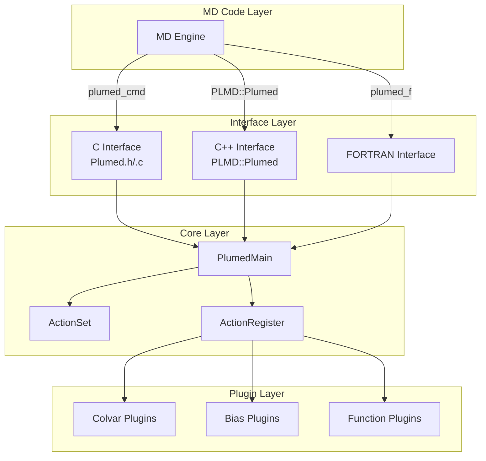
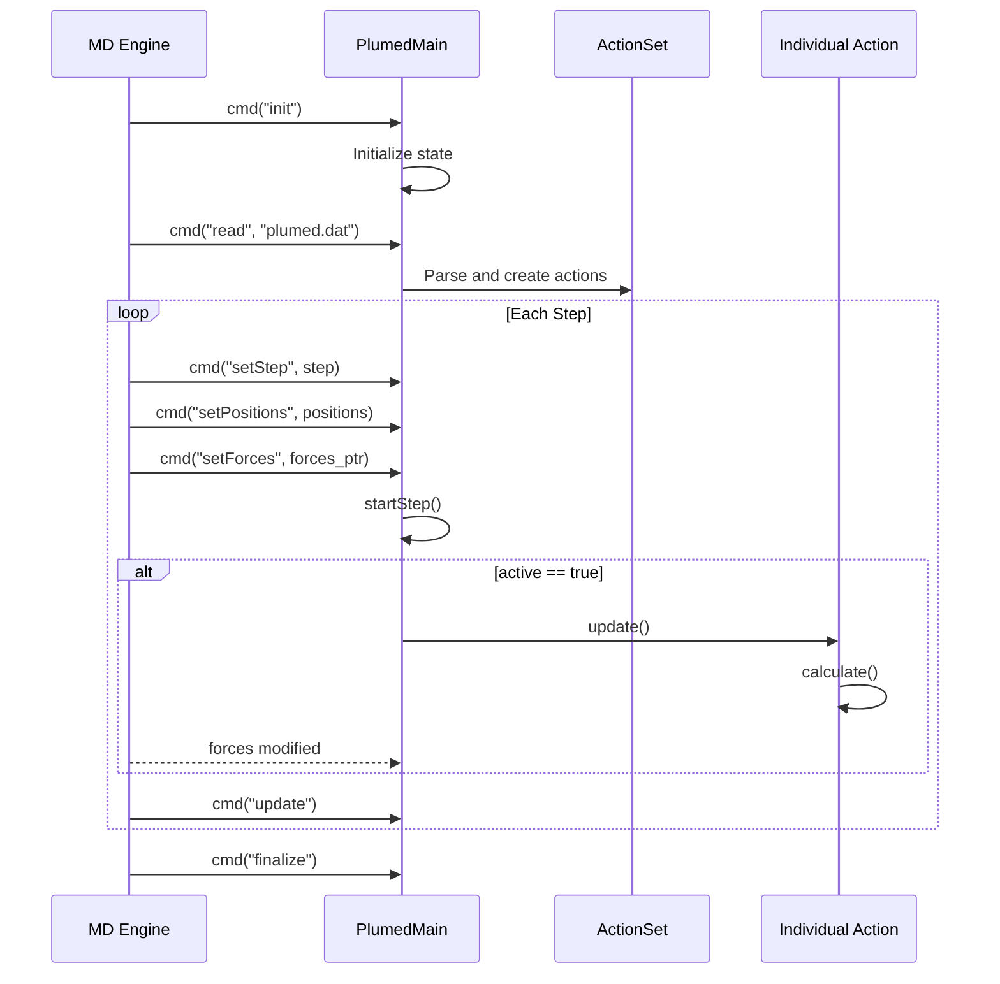
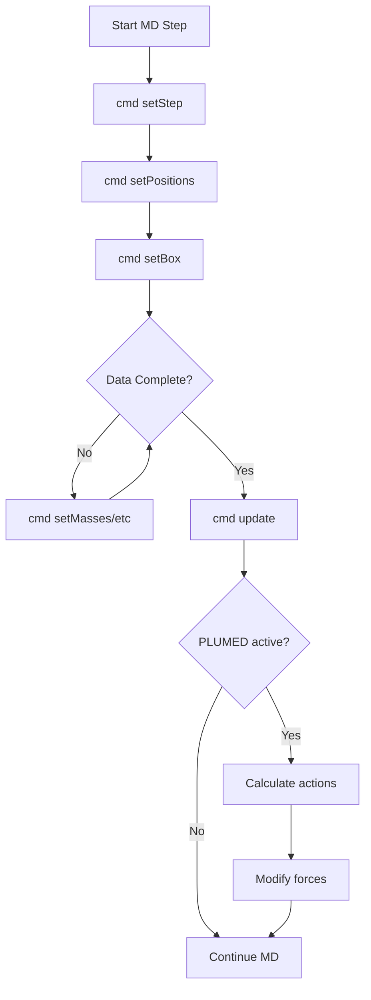

This documentation explores PLUMED's core architecture, focusing on the `PlumedMain` class that serves as the central kernel and the plugin system that enables extensibility through actions. Understanding this architecture is essential for developers integrating PLUMED with MD codes or creating custom collective variables and biasing methods.

Sources: [PlumedMain.h](src/core/PlumedMain.h#L80-L120), [ActionRegister.h](src/core/ActionRegister.h#L1-L60)

## Architecture Overview

PLUMED's architecture follows a **layered design** with clear separation between the external interface, wrapper layers, and core implementation. The `PlumedMain` class sits at the heart of this design, managing all PLUMED operations while remaining independent of static data to enable multiple instances.

The system uses a **command-based interface** pattern where the MD engine communicates with PLUMED through the `cmd()` method, passing strings and type-safe pointers. This design enables language-agnostic integration while maintaining strong type safety within the C++ core.



Sources: [PlumedMain.h](src/core/PlumedMain.h#L1-L100), [Plumed.c](src/wrapper/Plumed.c#L1-L50)

## PlumedMain: The Core Kernel

The `PlumedMain` class is the **primary orchestrator** of all PLUMED functionality. It manages the complete simulation lifecycle from initialization through step-by-step execution to finalization. As an instance-based design (no static data), it supports multiple concurrent PLUMED instances within a single MD code.

### Core Components

`PlumedMain` contains several critical members organized through forward declarations to control destruction order:

- **ActionSet** (`actionSet`): Container for all parsed actions from the input file
- **Communicators** (`comm`, `multi_sim_comm`): MPI communication for parallel execution and replica exchange
- **Data Passing Tools** (`passtools`): Handles data exchange between MD code and PLUMED
- **Interface Actions** (`inputs`): Vector of actions that receive data from MD code
- **Pilot Actions** (`pilots`): Actions that can trigger execution on specific steps

Sources: [PlumedMain.h](src/core/PlumedMain.h#L130-L200)

### State Management

The class maintains simulation state through several key variables:

- `step`: Current step number, incremented by the MD engine
- `active`: Boolean flag indicating if any action requires work this step
- `bias`: Accumulated bias energy from all restraints
- `work`: Total work computed from external potential changes
- `passMap`: Generic string-to-double map for cross-action communication

These state variables enable PLUMED to efficiently skip unnecessary calculations when no active actions exist.

Sources: [PlumedMain.h](src/core/PlumedMain.h#L200-L260)

### Command Interface

The `cmd()` method is the **primary entry point** for all MD code interactions. It processes string commands and handles data transfer through `TypesafePtr` objects. The method overrides `WithCmd::cmd()` to provide PLUMED-specific command handling.



Sources: [PlumedMain.h](src/core/PlumedMain.h#L280-L300), [PlumedMain.cpp](src/core/PlumedMain.cpp#L1-L100)

## Plugin System: Action Architecture

PLUMED's extensibility relies on the **Action framework**, where collective variables, biases, functions, and other features are implemented as Action subclasses. The registration system enables automatic discovery and instantiation of actions through a plugin-like mechanism.

### Action Registration Mechanism

The `ActionRegister` class maintains a **registry of all available actions**, mapping string keywords (directives) to creator functions. The registration process uses static initialization to automatically register actions at program startup:

```cpp
// In the action's .cpp file:
class MyColvar : public Colvar {
public:
  static void registerKeywords(Keywords& keys);
  MyColvar(const ActionOptions&);
  void calculate() override;
};

// Macro that creates static registration object:
PLUMED_REGISTER_ACTION(MyColvar, "MY_COLVAR")
```

The `PLUMED_REGISTER_ACTION` macro expands to create a static `ActionRegistration` object that registers the action with the global `ActionRegister` singleton during library initialization.

Sources: [ActionRegister.h](src/core/ActionRegister.h#L60-L125), [AddingAColvar.md](developer-doc/AddingAColvar.md#L1-L80)

### Registration Flow

The registration system works through template metaprogramming:

1. **ActionRegistration Template**: Specialized for each action class type, providing a `create()` method that calls the action's constructor
2. **Static Constructor**: Each `.cpp` file containing an action creates a static `ActionRegistration` instance
3. **Global Registry**: The `actionRegister()` function returns a reference to the singleton registry
4. **Creator Storage**: The registry stores creator pointers and keyword registration functions

This design enables **dynamic loading** of plugins while supporting both compile-time and runtime action discovery.

Sources: [ActionRegister.h](src/core/ActionRegister.h#L70-L110)

### Action Hierarchy

Actions are organized into a class hierarchy with specialized base classes:

| Base Class | Purpose | Typical Subclasses |
|------------|---------|-------------------|
| `Action` | Abstract base for all actions | All PLUMED actions |
| `ActionAtomistic` | Actions operating on atomic data | Colvar, Bias |
| `ActionWithValue` | Actions that compute/store values | Colvar, Function |
| `ActionWithArguments` | Actions taking other actions as input | Function, Bias |
| `ActionPilot` | Actions controlling execution flow | UPDATE, PRINT |
| `ActionForInterface` | Actions interfacing with MD code | SET, PUT |

Sources: [ActionRegister.h](src/core/ActionRegister.h#L1-L30)

## Interface Architecture: Multi-Language Support

PLUMED provides a **language-agnostic interface** enabling integration with MD codes written in C, C++, or FORTRAN. The architecture uses a C interface as the reference implementation, with C++ and FORTRAN interfaces as wrappers.

### C Interface (Reference)

The C interface in `Plumed.h` and `Plumed.c` defines the fundamental contract:

- **Structure-based**: All PLUMED functionality accessed through `plumed` struct containing a pointer
- **C-only compilation**: `Plumed.c` compiles without C++ library dependencies
- **Name prefixing**: All functions use `plumed_*` prefix to avoid conflicts

```c
struct plumed {
  void *ptr;  // Pointer to actual implementation
};

// Basic lifecycle:
plumed plumed_create(void);
void plumed_finalize(plumed p);
void plumed_cmd(plumed p, const char *key, void *val);
```

Sources: [Plumed.h](src/wrapper/Plumed.h#L20-L80)

### C++ Interface

The C++ interface (`PLMD::Plumed`) wraps the C interface with modern C++ features:

- **RAII**: Automatic resource management through constructor/destructor
- **Reference counting**: Smart pointer-like behavior for safe copying
- **Type safety**: Template overloads for `cmd()` method
- **Exception translation**: Converts PLUMED exceptions to standard C++ exceptions

The interface provides multiple `cmd()` overloads for different argument types, automatically handling shape information for arrays.

Sources: [Plumed.h](src/wrapper/Plumed.h#L3330-L3350), [Plumed.h](src/wrapper/Plumed.h#L1940-L2050)

### Command Catalog

The `cmd()` method supports a comprehensive set of commands:

| Command | Purpose | Arguments |
|---------|---------|-----------|
| `init` | Initialize PLUMED | Optional: restart flag |
| `read` | Read input file | Input file name |
| `readInputLine` | Process single input line | Input string |
| `setStep` | Set current step | Step number (long long) |
| `setPositions` | Set atom positions | Double array [3*natoms] |
| `setBox` | Set simulation box | Double array [9] |
| `setMasses` | Set atomic masses | Double array [natoms] |
| `setForces` | Provide forces array | Double array [3*natoms] |
| `getBias` | Retrieve bias energy | Double pointer |
| `update` | Perform step update | None |

Sources: [PlumedMain.h](src/core/PlumedMain.h#L280-L300), [WithCmd.h](src/core/WithCmd.h#L40-L80)

## Dynamic Loading and Modules

PLUMED supports **dynamic plugin loading** through the `DLLoader` class and module system. This enables runtime extension of PLUMED functionality without recompiling the core library.

### Module Organization

The `ModuleMap` provides a mapping between module names and their corresponding configuration. Modules are collections of related actions that can be compiled separately:

- **Core modules**: Built-in actions (colvar, bias, function, etc.)
- **Optional modules**: CUDA coordination, Python integration
- **User modules**: Custom actions developed by users

Sources: [ModuleMap.h](src/core/ModuleMap.h#L1-L31)

### Plugin Examples

The `plugins/` directory contains example plugins:

- **cudaCoord/**: GPU-accelerated coordination number calculation using CUDA
- **pycv/**: Python interface for creating collective variables in Python

These examples demonstrate the plugin architecture for extending PLUMED with new functionality written in different languages or using specialized hardware.

Sources: [plugins/](plugins/)

## Creating Custom Actions

Developers can extend PLUMED by creating custom actions. The process follows a consistent pattern:

### Step 1: Define the Action Class

Create a `.cpp` file in the appropriate module directory (e.g., `src/colvar/` for collective variables):

```cpp
#include "Colvar.h"
#include "ActionRegister.h"
#include <string>
#include <cmath>

namespace PLMD {
namespace colvar {

// Documentation block (used for manual generation)
//+PLUMEDOC COLVAR MY_COLVAR
/*
Calculate a custom collective variable.
...
*/
//+ENDPLUMEDOC

class MyColvar : public Colvar {
public:
  static void registerKeywords(Keywords& keys);
  explicit MyColvar(const ActionOptions&);
  void calculate() override;
};

PLUMED_REGISTER_ACTION(MyColvar, "MY_COLVAR")

void MyColvar::registerKeywords(Keywords& keys) {
  Colvar::registerKeywords(keys);
  // Add keyword descriptions here
}

MyColvar::MyColvar(const ActionOptions& ao):
  PLUMED_COLVAR_INIT(ao) {
  // Read input parameters
  vector<int> atoms;
  parseVector("ATOMS", atoms);
  checkRead();
  
  // Setup value and atoms
  addValueWithDerivatives("");
  requestAtoms(atoms);
}

void MyColvar::calculate() {
  // Calculate CV value and derivatives
  double cv_val = 0.0;
  vector<double> derivatives(getNumberOfAtoms(), 0.0);
  Tensor boxDerivatives;
  
  // ... calculation logic ...
  
  // Transfer results to PLUMED core
  for(unsigned i=0; i<derivatives.size(); i++) {
    setAtomsDerivatives(i, derivatives[i]);
  }
  setBoxDerivatives(boxDerivatives);
  setValue(cv_val);
}

} // namespace colvar
} // namespace PLMD
```

Sources: [AddingAColvar.md](developer-doc/AddingAColvar.md#L30-L139)

### Step 2: Implement Required Methods

Every action must implement:

1. **registerKeywords()**: Declare all input keywords and documentation
2. **Constructor**: Parse input and initialize the action
3. **calculate()**: Compute values, derivatives, and box derivatives

> [!TIP]
> The `PLUMED_COLVAR_INIT(ao)` macro is essential for proper initialization of collective variables. It sets up core dependencies and must be the first line in your constructor.

### Step 3: Add Regression Tests

Create test cases in `regtest/` to verify the action's correctness. Tests should include:

- Basic functionality tests
- Edge case handling
- Output validation
- Comparison with reference results

Sources: [AddingAColvar.md](developer-doc/AddingAColvar.md#L1-L20)

## Data Passing and Communication

PLUMED uses the `TypesafePtr` class for **type-safe data exchange** between the MD code and actions. This system supports:

- **Type preservation**: Maintains type information through enumeration
- **Shape information**: Handles multi-dimensional arrays
- **Zero-copy**: Passes pointers without copying when possible
- **Language bridging**: Works across C/C++/FORTRAN boundaries

The `DataPassingTools` class manages the interface actions that handle specific data types passed from the MD engine.

Sources: [PlumedMain.h](src/core/PlumedMain.h#L170-L190)

## Integration Patterns

When integrating PLUMED with an MD code, developers should follow established patterns:

### Initialization Phase

1. Create PLUMED instance using `plumed_create()` or `PLMD::Plumed()`
2. Call `cmd("init")` to initialize internal state
3. Call `cmd("read", "plumed.dat")` to read input file
4. Parse input to identify required data (atoms, energy, etc.)

### Simulation Loop



Sources: [PlumedMain.h](src/core/PlumedMain.h#L260-L280)

### Finalization Phase

1. Call `cmd("finalize")` to clean up
2. Destroy PLUMED instance (automatic in C++, explicit in C)

## Thread Safety and Multiple Instances

PLUMED supports **multiple concurrent instances** and is thread-safe when used correctly:

- Each `PlumedMain` instance has independent state
- The C interface uses reference counting for proper cleanup
- Global interface (`plumed_global_*` functions) is **not thread-safe** and should be avoided in multithreaded code

> [!TIP]
> When integrating PLUMED into parallel MD codes, create one PlumedMain instance per MPI rank or per simulation domain. Do not share instances across threads.

Sources: [PlumedMain.h](src/core/PlumedMain.h#L90-L100)

## Summary

The PlumedMain and Plugin Interface provide a robust, extensible architecture for enhanced sampling in molecular dynamics:

- **PlumedMain** serves as the central orchestrator, managing simulation state and action execution
- **ActionRegister** enables automatic plugin discovery through static initialization
- **Multi-language interface** supports C, C++, and FORTRAN MD codes
- **Command-based API** provides a simple, consistent interface for MD code integration
- **Dynamic loading** supports runtime extension with custom actions

This architecture balances flexibility with performance, enabling both core developers and external users to extend PLUMED's capabilities while maintaining backward compatibility with existing MD code integrations.

Sources: [PlumedMain.h](src/core/PlumedMain.h#L1-L120), [ActionRegister.h](src/core/ActionRegister.h#L1-L125)

## Next Steps

For deeper understanding of PLUMED's architecture:

- [Action Framework and Execution Model](6-action-framework-and-execution-model) - Detailed exploration of action lifecycle and execution
- [Data Passing and Communication](8-data-passing-and-communication) - In-depth coverage of data exchange mechanisms
- [Creating New CVs](24-creating-new-cvs) - Complete guide to implementing collective variables
- [Creating New Bias Methods](25-creating-new-bias-methods) - Tutorial for developing custom biasing potentials