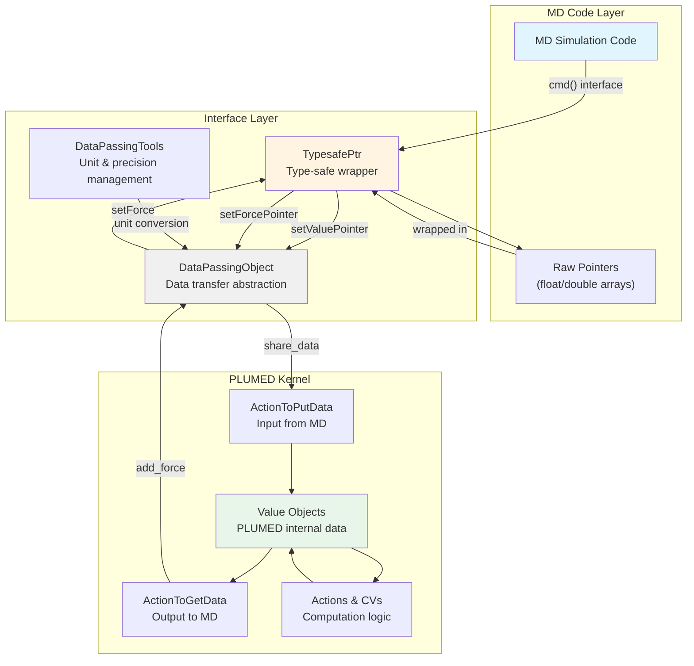

PLUMED's data passing and communication architecture forms the critical bridge between external MD simulation codes and the PLUMED kernel. This system enables bidirectional transfer of atomic coordinates, forces, energies, and arbitrary collective variables while maintaining type safety and supporting multiple precision levels through an abstraction layer that isolates PLUMED from the underlying MD implementation.

## Architecture Overview

The data passing infrastructure centers on three foundational abstractions: **DataPassingObject** handles the mechanics of data transfer and unit conversion, **DataPassingTools** manages precision and unit system coordination, and **TypesafePtr** provides a type-safe, compile-time checked wrapper for raw pointers from MD codes. These components work together through a well-defined interface orchestrated by **PlumedMain**, which manages the lifecycle of data exchange operations during MD simulation steps.



## Core Data Passing Components

### TypesafePtr: Type-Safe Pointer Wrapping

The **TypesafePtr** class serves as the foundation for safe cross-boundary data exchange. It encapsulates raw pointers from MD codes with compile-time type information, enabling type checking while preserving runtime flexibility. The wrapper supports multi-dimensional arrays up to rank 4, with automatic shape tracking and bounds checking in debug mode.

**Key Characteristics**:
- Template-based type safety with automatic size detection using `sizeof(type)` [TypesafePtr.h#L166-L177](/src/tools/TypesafePtr.h#L166-L177)
- Support for both scalar and array pointers with const/non-const variants
- Shape information storage enabling multi-dimensional array access
- Environment variable control (`PLUMED_TYPESAFE_IGNORE`) for bypassing checks in production [TypesafePtr.h#L43-L46](/src/tools/TypesafePtr.h#L43-L46)
- Maximum rank of 4 dimensions with automatic nelement calculation [TypesafePtr.h#L117](/src/tools/TypesafePtr.h#L117)

The implementation uses a sophisticated macro system to generate constructors for all necessary type combinations [TypesafePtr.h#L152-L178](/src/tools/TypesafePtr.h#L152-L178), ensuring comprehensive coverage while maintaining maintainability. For sized types (float, double, int), pass-by-value constructors are also generated, allowing both pointer and scalar data transfer.

### DataPassingObject: Data Transfer Abstraction

**DataPassingObject** provides the primary abstraction for bidirectional data flow between MD codes and PLUMED's internal **Value** objects. This polymorphic base class defines the complete interface for value and force exchange, with template-based implementations supporting both single and double precision.

**Core Interface Methods**:

| Method | Direction | Purpose |
|--------|-----------|---------|
| `setValuePointer()` | MD→PLUMED | Establish value pointer from MD code [DataPassingObject.h#L74](/src/core/DataPassingObject.h#L74) |
| `setForcePointer()` | PLUMED→MD | Establish force pointer back to MD code [DataPassingObject.h#L76](/src/core/DataPassingObject.h#L76) |
| `share_data()` | MD→PLUMED | Transfer values from MD to PLUMED (3 overloads) [DataPassingObject.h#L78-L82](/src/core/DataPassingObject.h#L78-L82) |
| `add_force()` | PLUMED→MD | Apply forces from PLUMED to MD code (3 overloads) [DataPassingObject.h#L84-L86](/src/core/DataPassingObject.h#L84-L86) |
| `setData()` | PLUMED→MD | Set data back to MD code [DataPassingObject.h#L90](/src/core/DataPassingObject.h#L90) |
| `rescale_force()` | PLUMED→MD | Scale forces (for replica exchange) [DataPassingObject.h#L88](/src/core/DataPassingObject.h#L88) |

The object maintains critical metadata for each data channel [DataPassingObject.h#L36-L46](/src/core/DataPassingObject.h#L36-L46):
- **start/stride**: Memory layout parameters for accessing strided data structures
- **unit/funit**: Unit conversion factors for values and forces
- **hasbackup/bvalue**: Backup mechanism for direct value storage when pointer isn't available

The typed implementation `DataPassingObjectTyped<T>` provides concrete implementations for both float and double precision [DataPassingObject.cpp#L73-L83](/src/core/DataPassingObject.cpp#L73-L83), with automatic instantiation via the factory method based on `sizeof(real)` in the MD code.

> [!TIP]
> The stride parameter is particularly important for accessing atom-based data where values may be interleaved (e.g., XYZ coordinates). The `getPointer()` helper function [DataPassingObject.cpp#L28-L38](/src/core/DataPassingObject.cpp#L28-L38) handles the complex pointer arithmetic for different array shapes, ensuring correct access to strided data structures.

### DataPassingTools: Unit System Coordination

**DataPassingTools** manages the relationship between MD code unit systems and PLUMED's internal units. This abstraction is essential because different MD codes use different units (kJ/mol vs kcal/mol, nm vs Å, etc.), and PLUMED must transparently handle conversions.

The class maintains two `Units` objects [DataPassingTools.h#L38-L40](/src/core/DataPassingTools.h#L38-L40):
- `units`: PLUMED's internal unit system
- `MDUnits`: The MD code's unit system

Unit conversion occurs via `getUnitConversion()` [DataPassingTools.cpp#L28-L48](/src/core/DataPassingTools.cpp#L28-L48), supporting standard physical quantities:
- **energy**: kJ/mol, kcal/mol, etc.
- **length**: nm, Å, etc.
- **mass**: amu, g/mol, etc.
- **charge**: elementary charge units
- **time**: fs, ps, etc.
- **number**: dimensionless (conversion factor = 1)

Like `DataPassingObject`, the typed implementation `DataPassingToolsTyped<T>` supports both single and double precision, with the precision automatically matched to the MD code's real type [DataPassingTools.cpp#L58-L68](/src/core/DataPassingTools.cpp#L58-L68).

## Interface Actions: Bidirectional Data Flow

PLUMED uses specialized action classes to manage data flow at the interface boundary.

### ActionToPutData: MD→PLUMED Data Ingestion

**ActionToPutData** (extends `ActionForInterface`) receives data from the MD code and makes it available within PLUMED's computational graph. This action is typically created automatically when the MD code passes quantities via the `cmd()` interface.

**Key Configuration Flags** [ActionToPutData.h#L38-L51](/src/core/ActionToPutData.h#L38-L51):
- `noforce`: Prevent force application (read-only quantity)
- `fixed`: Mark quantity as fixed (constant during simulation)
- `from_domains`: Flag for domain-decomposed data sources
- `resetable`: Whether PLUMED can modify the value
- `dataCanBeSet`: Timing control for data assignment
- `unit/funit`: Enum-based unit specification (energy/length/mass/charge/time)

The action manages the data flow lifecycle through several key methods [ActionToPutData.h#L68-L91](/src/core/ActionToPutData.h#L68-L91):
1. `resetForStepStart()`: Marks the beginning of a new MD step, enabling data assignment
2. `setValuePointer()`: Establishes the connection to MD code data arrays
3. `setForcePointer()`: Sets up the back-channel for force application
4. `wait()`: Completes data transfer (synchronization point)
5. `apply()`: Transfers computed forces back to the MD code

Unit conversion is applied when the action receives `updateUnits()` from `DataPassingTools` [ActionToPutData.h#L67](/src/core/ActionToPutData.h#L67), ensuring all data is internally represented in PLUMED's unit system.

### ActionToGetData: PLUMED→MD Data Export

**ActionToGetData** (extends `ActionWithArguments`) extracts data from PLUMED's internal `Value` objects and makes it available to external code, typically for Python scripting or custom MD integrations.

The action supports three data types [ActionToGetData.h#L36](/src/core/ActionToGetData.h#L36):
- `val`: Raw collective variable values
- `deriv`: Derivatives of CVs with respect to atomic positions
- `force`: Forces applied by PLUMED

**Interface Methods** [ActionToGetData.h#L44-L52](/src/core/ActionToGetData.h#L44-L52):
- `get_rank()`: Query output dimensionality (0=scalar, 1=vector, etc.)
- `get_shape()`: Get multi-dimensional array shape
- `set_memory()`: Establish destination buffer in external code
- `calculate()`: Perform the actual data transfer

This action enables advanced use cases where external code needs real-time access to PLUMED's computed quantities, such as custom feedback loops or machine learning integration.

## Data Transfer Mechanics

### Value → MD Code Transfer (Force Application)

When PLUMED computes forces on collective variables, they must be back-propagated to individual atoms in the MD code. The `DataPassingObjectTyped<T>::add_force()` method handles this with three overloads for different access patterns [DataPassingObject.cpp#L199-L242](/src/core/DataPassingObject.cpp#L199-L242):

**Scalar Force Application** [DataPassingObject.cpp#L200-L211](/src/core/DataPassingObject.cpp#L200-L211):
```cpp
void add_force( Value* value ) {
  if( value->getRank()==0 ) {
    *f.template get<T*>() += funit*static_cast<T>(value->getForce(0));
    return;
  }
  T* pp;
  getPointer( f, value->getShape(), start, stride, pp );
  unsigned nvals=value->getNumberOfValues();
  #pragma omp parallel for num_threads(OpenMP::getGoodNumThreads(pp,nvals))
  for(unsigned i=0; i<nvals; ++i) {
    pp[i*stride] += funit*T(value->getForce(i));
  }
}
```

**Indexed Force Application** [DataPassingObject.cpp#L214-L242](/src/core/DataPassingObject.cpp#L214-L242):
For scattered data access (e.g., forces on specific atoms in a subset), indexed versions force application using either integer indices or `AtomNumber` objects. The scatter version cannot be easily parallelized due to non-contiguous memory access patterns.

All force application uses OpenMP parallelization for contiguous data access [DataPassingObject.cpp#L207](/src/core/DataPassingObject.cpp#L207), with automatic thread count selection based on data size and architecture.

### MD Code → Value Transfer (Value Retrieval)

Value transfer from MD code to PLUMED occurs through the `share_data()` overloads [DataPassingObject.cpp#L145-L196](/src/core/DataPassingObject.cpp#L145-L196):

**Sequential Data Transfer** [DataPassingObject.cpp#L145-L165](/src/core/DataPassingObject.cpp#L145-L165):
For contiguous arrays, this method extracts a slice `[j, k)` from the source data, applying unit conversion and stride logic. The operation is fully parallelized with OpenMP for performance.

**Scatter Data Transfer** [DataPassingObject.cpp#L179-L196](/src/core/DataPassingObject.cpp#L179-L196):
When data is scattered (e.g., coordinates of specific atoms), the scatter version uses an `AtomNumber` index to populate the target `Value` object. The sequential access pattern prevents OpenMP parallelization due to potential race conditions on the target array.

> [!TIP]
> The unit conversion is applied during data transfer, not storage. The `unit` member is multiplied with raw MD values to produce PLUMED-internal values, while `funit` is multiplied with internal forces to produce MD-code forces. This design ensures that PLUMED's internal computations always occur in a consistent unit system regardless of the MD code's choice.

## Command Interface and Data Binding

The entire data passing system is orchestrated through **PlumedMain**'s `cmd()` method [PlumedMain.h#L300-L300](/src/core/PlumedMain.h#L300-L300), which serves as the universal command interpreter for MD code interaction. Key commands for data management include:

**Data Binding Commands** [PlumedMain.h#L250-L254](/src/core/PlumedMain.h#L250-L254):
- `setInputValue()`: Establish a named value channel from MD code data
- `setInputForce()`: Establish a named force channel back to MD code

The command interface uses the **TypesafePtr** wrapper system to provide type safety while allowing flexible argument types. The C++ wrapper (`Plumed.h`) provides template overloads that automatically wrap raw pointers and arrays with type information [Plumed.h#L3342-L3344](/src/wrapper/Plumed.h#L3342-L3344), making the interface both safe and convenient for MD code developers.

**Unit System Setup** [PlumedMain.h#L257](/src/core/PlumedMain.h#L257-L257):
The `setUnits()` command configures the relationship between MD code and PLUMED units, ensuring all subsequent data transfers apply correct conversions. This is typically called once during initialization.

## Parallel and Domain-Decomposed Data

PLUMED's data passing architecture explicitly supports domain-decomposed MD simulations through the `DomainDecomposition` class. When `from_domains` is set on an `ActionToPutData`, the system understands that the data source is distributed across multiple MPI ranks and manages the necessary communication patterns.

For replica exchange simulations, the `rescale_force()` method [DataPassingObject.cpp#L245-L257](/src/core/DataPassingObject.cpp#L245-L257) handles force rescaling after exchange events, ensuring energy conservation during replica swapping.

## Precision Management

The architecture cleanly separates precision management through the typed template implementations:
- **Float precision**: `DataPassingObjectTyped<float>` and `DataPassingToolsTyped<float>` for codes using 4-byte reals
- **Double precision**: `DataPassingObjectTyped<double>` and `DataPassingToolsTyped<double>` for codes using 8-byte reals

The factory methods in both base classes automatically select the correct implementation based on `sizeof(real)` from the MD code [DataPassingObject.cpp#L73-L83](/src/core/DataPassingObject.cpp#L73-L83), [DataPassingTools.cpp#L58-L68](/src/core/DataPassingTools.cpp#L58-L68), ensuring transparent interoperability regardless of the MD code's precision choice.

## Advanced Communication Patterns

### Step Lifecycle and Synchronization

The data passing system is tightly integrated with PLUMED's step lifecycle [PlumedMain.h#L226-L226](/src/core/PlumedMain.h#L226-L226):

1. **startStep()**: Resets `dataCanBeSet` flags on all `ActionToPutData` instances, preparing for new data
2. **MD code calls cmd()**: Passes coordinates, box dimensions, energies via `setInputValue()`
3. **calculate() phase**: Values propagate through action graph, CVs computed
4. **apply() phase**: Forces computed and written back via `setForcePointer()`
5. **MD code continues**: Reads updated forces and advances simulation

### Generic Data Passing

Beyond standard atomic data, the system supports generic scalar and array data through the same `DataPassingObject` mechanism. This enables custom CVs and advanced features to communicate with MD codes without requiring special-case handling in the interface.

The `passMap` member of `PlumedMain` [PlumedMain.h#L268-L270](/src/core/PlumedMain.h#L268-L270) provides an additional generic `std::map<std::string,double>` for cross-action communication within PLUMED, complementing the formal MD code interface.

## Next Steps

For deeper understanding of the execution context:
- See [Action Framework and Execution Model](6-action-framework-and-execution-model) for how data passing integrates with PLUMED's action execution pipeline
- Explore [Domain Decomposition and Parallelism](9-domain-decomposition-and-parallelism) for details on distributed data management
- Review [PlumedMain and Plugin Interface](7-plumedmain-and-plugin-interface) for the complete command interface specification

For practical implementation details:
- Examine `src/wrapper/Plumed.h` for the complete C API and C++ wrapper interface
- Study `src/core/ActionToPutData.cpp` and `src/core/ActionToGetData.cpp` for complete implementation examples
- Review regression tests in `regtest/basic/` for usage patterns