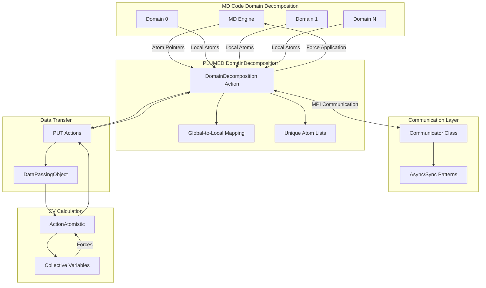
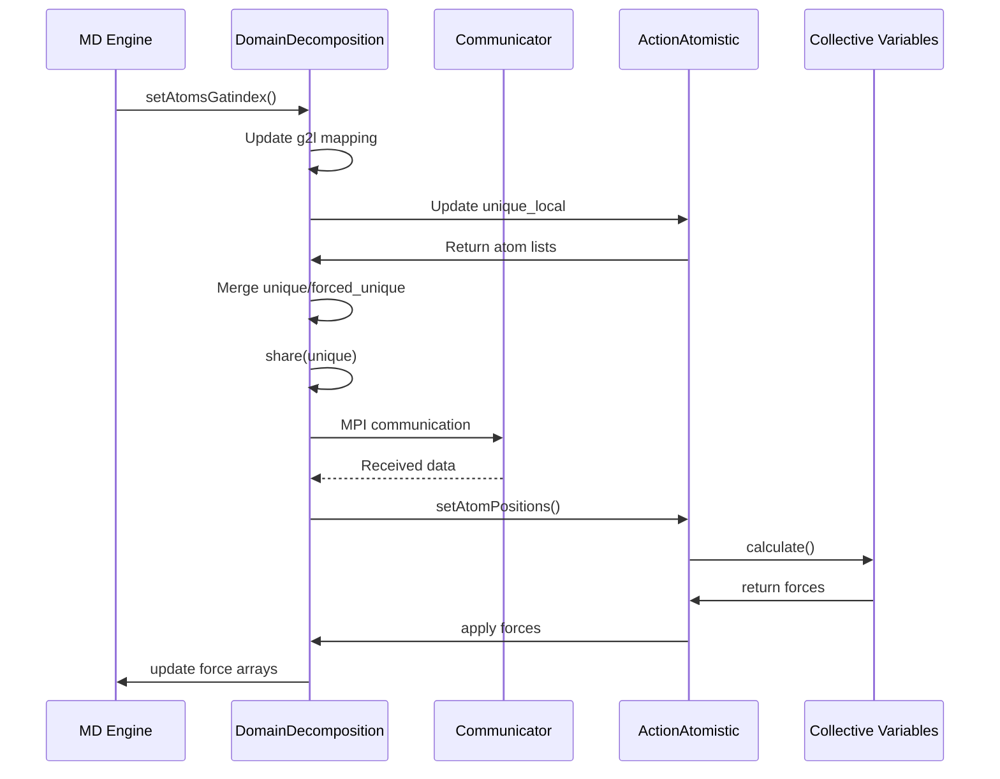

PLUMED's parallel execution model enables efficient collective variable calculation and biasing in large-scale molecular dynamics simulations running across multiple MPI processes. This architecture seamlessly integrates with domain-decomposed MD codes while providing optimization strategies for both parallel and serial environments.

## Architectural Overview

The parallel execution framework centers on the `DomainDecomposition` class, which manages data exchange between MPI domains and coordinates atom data transfer from MD codes to PLUMED's internal representation. This system handles three critical aspects: atom index mapping across domains, asynchronous communication of atomic properties, and force application back to the MD engine.



The architecture follows a layered approach where domain-specific atom data enters through the `DomainDecomposition` action, gets transformed via global-to-local index mapping, and is distributed to individual `ActionAtomistic` objects through PUT actions. Forces flow in the opposite direction through the same path.

Sources: [src/core/DomainDecomposition.h](src/core/DomainDecomposition.h#L33-L116), [src/core/DomainDecomposition.cpp](src/core/DomainDecomposition.cpp#L180-L230)

## Domain Decomposition Core

### DomainDecomposition Action

The `DOMAIN_DECOMPOSITION` action serves as the primary interface for receiving atomic data from domain-decomposed MD codes. Unlike regular PUT actions, it understands which atoms reside on each processor and manages communication accordingly. When an MD code calls `plumed.cmd("setNatoms",&natoms)`, PLUMED automatically creates a DOMAIN_DECOMPOSITION action with five PUT actions for positions (x, y, z), masses, and charges.

The action maintains several critical data structures:
- **gatindex**: Maps array indices from the MD engine to global atom numbers
- **g2l**: Maps global atom indices to local array positions (originally for domain decomposition, now also used for NAMD-like interfaces)
- **unique**: The consolidated list of atoms needed by all active actions
- **forced_unique**: Subset of unique atoms that actually have forces applied
- **dd**: Nested `DomainComms` object managing MPI communication

Sources: [src/core/DomainDecomposition.h](src/core/DomainDecomposition.h#L56-L79), [src/core/DomainDecomposition.cpp](src/core/DomainDecomposition.cpp#L32-L104)

### Atom Index Mapping

The global-to-local mapping system handles the translation between global atom identifiers and processor-local storage. When atoms are distributed across domains via `setAtomsGatindex()`, the system builds the g2l array: `g2l[gatindex[i]] = i`. This mapping allows efficient retrieval of atom data regardless of which processor actually stores it.

> [!TIP]
> The g2l mapping enables PLUMED to work seamlessly with both traditional domain decomposition (where each processor stores a contiguous block of atoms) and non-contiguous distributions (like NAMD's atom-by-atom passing). The shuffledAtoms flag detects when atoms are non-contiguously distributed, triggering optimized communication paths.

For contiguous atom distributions (common in GROMACS), the system can use optimized direct array access without the mapping overhead. The `shuffledAtoms` flag, computed via `dd.Sum(shuffledAtoms)` across all processors, determines whether to use the fast path or the general path requiring mapping.

Sources: [src/core/DomainDecomposition.cpp](src/core/DomainDecomposition.cpp#L313-L352)

### Unique Atom List Management

PLUMED optimizes parallel execution by maintaining a unique list of atoms needed by all active actions, eliminating redundant communication. The system distinguishes between two lists:

| Atom List | Purpose | Population Method |
|-----------|---------|-------------------|
| **unique** | All atoms referenced by any active action (for reading data) | Merged from all ActionAtomistic objects' unique_local vectors |
| **forced_unique** | Subset of unique with actual forces applied | Only includes atoms from actions where `actionHasForces()` returns true |

The `share()` method orchestrates this process each timestep. During the first step, `shareAll()` broadcasts all atoms to store constant properties like mass and charge (which don't change during simulation). Subsequent steps use heuristic optimization: if the largest action's atom list is less than half the total atoms, the system uses unique atom optimization in serial mode.

Sources: [src/core/DomainDecomposition.cpp](src/core/DomainDecomposition.cpp#L398-L483)

## Communication Patterns

### Synchronous vs Asynchronous Communication

The `DomainComms` nested class within `DomainDecomposition` manages MPI communication with configurable async/sync behavior. The decision is controlled by the `PLUMED_ASYNC_SHARE` environment variable and a heuristic based on communicator size (async enabled for fewer than 10 processors by default).

**Asynchronous Communication Path**:
```cpp
// Initiates non-blocking sends to all processors
dd.mpi_request_index[i] = dd.Isend(&dd.indexToBeSent[0], count, i, 666);
dd.mpi_request_positions[i] = dd.Isend(&dd.positionsToBeSent[0], ndata*count, i, 667);

// Later in wait():
dd.mpi_request_positions[i].wait();  // Wait for completion
```

**Synchronous Communication Path**:
```cpp
// Uses Allgatherv for collective communication
dd.Allgatherv(&dd.indexToBeSent[0], count, &dd.indexToBeReceived[0], &counts[0], &displ[0]);
dd.Allgatherv(&dd.positionsToBeSent[0], ndata*count, &dd.positionsToBeReceived[0], &counts5[0], &displ5[0]);
```

Synchronous communication uses MPI's `Allgatherv` collective operation, which is simpler but may incur higher latency. Asynchronous communication uses `Isend` with explicit `wait()` calls, potentially overlapping communication with computation.

Sources: [src/core/DomainDecomposition.h](src/core/DomainDecomposition.h#L35-L52), [src/core/DomainDecomposition.cpp](src/core/DomainDecomposition.cpp#L148-L162), [src/core/DomainDecomposition.cpp](src/core/DomainDecomposition.cpp#L545-L581)

### Communication Buffers

The system allocates several communication buffers for efficient data exchange:

| Buffer | Purpose | Size |
|--------|---------|------|
| `positionsToBeSent` | Atom data (positions, masses, charges) to send to other domains | n × nvals (n = local atoms needed) |
| `positionsToBeReceived` | Atom data received from all domains | natoms × nvals |
| `indexToBeSent` | Global atom indices being sent | n |
| `indexToBeReceived` | Global atom indices being received | natoms |

The buffer size dynamically adapts to the number of atoms actually needed, avoiding allocation for the full atom set when only a subset is used by collective variables.

Sources: [src/core/DomainDecomposition.h](src/core/DomainDecomposition.h#L40-L46), [src/core/DomainDecomposition.cpp](src/core/DomainDecomposition.cpp#L293-L311)

## Data Transfer Mechanism

### DataPassingObject Interface

The `DataPassingObject` class provides a type-safe abstraction for transferring data between MD codes and PLUMED. It handles unit conversions, stride patterns, and pointer management, supporting various data layouts from different MD engines.

Key methods include:
- `share_data()`: Extracts data from MD code pointers and populates PLUMED Value objects
- `add_force()`: Transfers computed forces from PLUMED back to MD code force arrays
- `MD2double()`: Converts MD code data types to PLUMED's double representation
- `setValuePointer()`/`setForcePointer()`: Establishes pointers to MD code data

The factory method `create(unsigned n)` instantiates concrete implementations based on data type precision (single/double precision).

Sources: [src/core/DataPassingObject.h](src/core/DataPassingObject.h#L34-L91)

### PUT Actions from DomainDecomposition

PUT actions created by DOMAIN_DECOMPOSITION behave differently from regular PUT actions in three critical ways:

1. **Dependency Chain**: Domain-created PUT actions depend on the DOMAIN_DECOMPOSITION action, so their `apply()` method does nothing
2. **Data Transfer**: Data moves from MD pointer to PLUMED Value within `DomainDecomposition::share()`, not in `ActionToPutData::wait()`
3. **Constant Values**: Constant values are set during the first MD step rather than initialization, as the data must be received from domains first

This specialization is necessary because PUT actions lack knowledge of which atoms reside on each processor—only the DOMAIN_DECOMPOSITION action has this domain topology information.

Sources: [src/core/DomainDecomposition.cpp](src/core/DomainDecomposition.cpp#L91-L103)

## Force Application and Distribution

### Force Collection and Application

The `apply()` method in `DomainDecomposition` manages the critical force feedback loop. Forces computed by collective variables on `forced_unique` atoms are mapped back to the MD code's force arrays:

```cpp
// Maps unique atom indices back to local array positions
for(unsigned i=0; i<forced_unique.size(); i++) {
    forced_uniq_index[i] = g2l[forced_unique[i].index()];
}

// Applies forces through DataPassingObject
(ip->mydata)->add_force(forced_unique, forced_uniq_index, ip->getPntrToValue());
```

For contiguous atom distributions without shuffling, a fast path applies forces directly to the full gatindex array without the mapping overhead.

Sources: [src/core/DomainDecomposition.cpp](src/core/DomainDecomposition.cpp#L625-L645)

### Force Reset Optimization

The `reset()` method implements an important optimization: rather than zeroing the entire force array, it only clears forces on atoms that will actually have forces applied. This is particularly beneficial when PLUMED only needs a small subset of atoms (e.g., specific reaction coordinates in a large protein).

```cpp
// Only clear forces on atoms that will be used
for(const auto & ip : inputs) {
    (ip->copyOutput(0))->clearInputForce(unique);
}
```

> [!TIP]
> When using virtual atoms or collective variables that reference only a small fraction of the total atoms, this force reset optimization can significantly reduce overhead. The system tracks which atoms actually have forces through the forced_unique list, ensuring precision without wasted computation.

Sources: [src/core/DomainDecomposition.cpp](src/core/DomainDecomposition.cpp#L647-L659)

## Configuration and Optimization

### Environment Variables

PLUMED provides several environment variables to control parallel execution behavior:

| Variable | Values | Default | Purpose |
|----------|--------|---------|---------|
| `PLUMED_ASYNC_SHARE` | yes/no/auto | auto | Enable asynchronous MPI communication (auto uses heuristics) |
| `PLUMED_FORCE_UNIQUE` | yes/no/auto | auto | Force use of unique atom lists in serial mode (auto chooses heuristically) |

The automatic heuristic for `PLUMED_FORCE_UNIQUE` activates unique atom optimization when the largest action's atom count is less than half the total atoms, reducing memory bandwidth in serial simulations.

Sources: [src/core/DomainDecomposition.cpp](src/core/DomainDecomposition.cpp#L129-L143), [src/core/DomainDecomposition.cpp](src/core/DomainDecomposition.cpp#L413-L434)

### Configuration Example

A complete DOMAIN_DECOMPOSITION configuration for GROMACS-style integration:

```cpp
// Creates domain decomposition with multiple value transfers
plumed.cmd("readInputLine dd: DOMAIN_DECOMPOSITION ...");
```

```plumed
dd: DOMAIN_DECOMPOSITION ...
   NATOMS=2000
   VALUE1=myposx UNIT1=length PERIODIC1=NO CONSTANT1=False ROLE1=x
   VALUE2=myposy UNIT2=length PERIODIC2=NO CONSTANT2=False ROLE2=y
   VALUE3=myposz UNIT3=length PERIODIC3=NO CONSTANT3=False ROLE3=z
   VALUE4=myMasses UNIT4=mass PERIODIC4=NO CONSTANT4=True ROLE4=m
   VALUE5=myCharges UNIT5=charge PERIODIC5=NO CONSTANT5=True ROLE5=q
   PBCLABEL=mybox
...
```

The ROLE keywords (x/y/z/m/q) are critical as they enable `ActionAtomistic` to locate atomic positions, masses, and charges. Custom quantities don't require ROLE specification.

Sources: [src/core/DomainDecomposition.cpp](src/core/DomainDecomposition.cpp#L71-L90)

### ActionAtomistic Integration

Actions that access atomic data inherit from `ActionAtomistic`, which provides the `requestAtoms()` method for specifying needed atoms. The class maintains its own `unique` and `unique_local` atom lists, which are updated each timestep via `updateUniqueLocal()`.

The friend relationship with `DomainDecomposition` allows direct access to internal state for optimization. Actions signal their force application needs through `actionHasForces()`, which determines inclusion in the `forced_unique` list.

Sources: [src/core/ActionAtomistic.h](src/core/ActionAtomistic.h#L46-L100), [src/core/ActionAtomistic.h](src/core/ActionAtomistic.h#L86-L87)

## Replica Exchange Parallelism

### ExchangePatterns Framework

Beyond domain decomposition, PLUMED supports replica exchange through the `ExchangePatterns` class. This system manages exchange pattern selection for parallel tempering or Hamiltonian replica simulations.

Available patterns:
- **RANDOM**: Random permutation of replicas (default)
- **NEIGHBOR**: Adjacent replica swaps
- **NONE**: No exchange pattern

The system uses a random number generator for pattern selection, with configurable seeds for reproducibility.

Sources: [src/core/ExchangePatterns.h](src/core/ExchangePatterns.h#L24-L48), [src/core/ExchangePatterns.cpp](src/core/ExchangePatterns.cpp#L50-L72)

### Exchange List Generation

The `getList()` method generates replica exchange pairings based on the selected pattern. For random exchange, it generates unique swap permutations to ensure each replica exchanges exactly once per cycle.

```cpp
case RANDOM:
    for(int i=0; i<NumberOfReplicas; i++) {
        // Generate unique random target for each replica
        iind[i] = (int) (random.U01() * NumberOfReplicas);
        // Ensure no duplicates in permutation
    }
    break;
```

This framework integrates with the GREX (GROMACS Replica EXchange) system for coordinated multi-replica simulations.

Sources: [src/core/ExchangePatterns.cpp](src/core/ExchangePatterns.cpp#L50-L72)

## Communicator Layer

### MPI Abstraction

The `Communicator` class provides a thin wrapper around MPI calls, enabling PLUMED to compile with or without MPI support. When `__PLUMED_HAS_MPI` is undefined, surrogate classes for MPI types allow serial compilation with minimal code changes.

Key communication methods used by domain decomposition:
- `Allgatherv()`: Gather variable-sized data from all processors
- `Isend()`: Non-blocking send operations
- `Recv()`: Receive with status checking
- `Bcast()`: Broadcast from root to all processors
- `Sum()`: Reduce operations across domains

The `Data` nested struct provides a flexible buffer abstraction supporting various C++ types including vectors, matrices, and tensor types.

Sources: [src/tools/Communicator.h](src/tools/Communicator.h#L52-L100)

## Performance Considerations

### Optimization Strategies

**1. Atom List Optimization**: The unique atom system dramatically reduces communication volume when collective variables only involve subsets of atoms. In systems with 100,000+ atoms but CVs focusing on active site residues (<100 atoms), this reduces bandwidth by >99%.

**2. Communication Latency**: Asynchronous communication can hide latency when compute time between `share()` and `wait()` is sufficient. For small atom counts or fast CV calculations, synchronous communication may be preferable due to lower overhead.

**3. Serial Optimization**: Even in serial mode, the `PLUMED_FORCE_UNIQUE` setting can improve cache locality by working on dense atom subarrays rather than sparse operations across the full system.

**4. Force Application**: The selective force reset in `reset()` avoids unnecessary memory writes, which is particularly valuable in simulations with large force arrays.

### Scalability Patterns

| System Size | Recommended Settings |
|-------------|---------------------|
| Small (<10K atoms, few CVs) | Default auto settings, sync communication |
| Medium (10K-100K atoms) | `PLUMED_ASYNC_SHARE=auto`, `PLUMED_FORCE_UNIQUE=auto` |
| Large (>100K atoms, sparse CVs) | `PLUMED_ASYNC_SHARE=yes`, `PLUMED_FORCE_UNIQUE=yes` |
| Very Large (>1M atoms) | Consider MD code-level CV integration for better locality |

The key scalability bottleneck is typically communication volume rather than computation, making atom list optimization the most impactful adjustment for large systems.

## Integration Points

### MD Code Interfaces

Different MD codes integrate with PLUMED's domain decomposition through standardized C API calls:

- **GROMACS**: Uses `setAtomsGatindex()` with contiguous atom blocks
- **NAMD**: Uses g2l mapping for scattered atom passing
- **LAMMPS**: Integrates via contiguous arrays with `setAtomsContiguous()`
- **Quantum ESPRESSO**: Uses custom atom index passing

The `DomainDecomposition` action detects the interface type through the calling pattern and adapts its communication strategy accordingly.

Sources: [src/wrapper/Plumed.h](src/wrapper/Plumed.h), [src/core/DomainDecomposition.cpp](src/core/DomainDecomposition.cpp#L354-L374)

### Communication Synchronization

The domain decomposition timeline during each MD step follows this sequence:



This tight integration ensures minimal overhead while maintaining data consistency across the MD-PLUMED boundary.

Sources: [src/core/DomainDecomposition.cpp](src/core/DomainDecomposition.cpp#L485-L582), [src/core/DomainDecomposition.cpp](src/core/DomainDecomposition.cpp#L584-L619)

## Debugging and Analysis

### Communication Analysis

For debugging parallel issues, several informative methods are available:

- `getGatindex()`: Returns the global-to-local mapping
- `getDdStep()`: Returns the step when domain info was last updated
- `getNumberOfAtoms()`: Returns total system size

Monitoring the `unique` and `forced_unique` list sizes provides insight into communication efficiency. If these lists approach the total atom count, optimization opportunities may be limited.

### Common Issues

**1. Force Application Errors**: Forces not appearing in MD trajectories typically result from missing atoms in `forced_unique` or incorrect `noforce` settings on PUT actions.

**2. Domain Mismatch**: Inconsistent atom distributions across processors cause communication failures. Verify gatindex consistency with `dd.Sum(shuffledAtoms)`.

**3. Memory Growth**: Accumulating atom lists in `unique` without proper cleanup indicates issues with action lifecycle or step synchronization.
