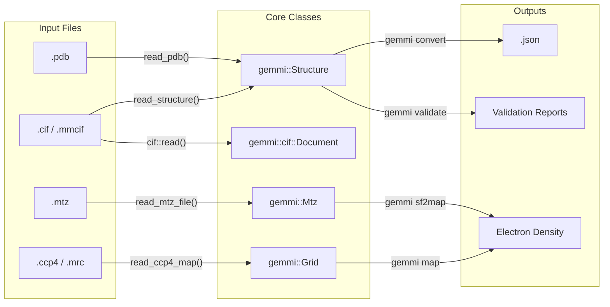
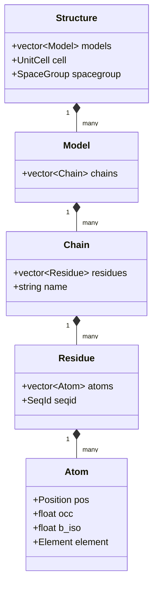

# Overview

<details>
<summary>Relevant source files</summary>

The following files were used as context for generating this wiki page:

- [.github/workflows/wheels2.yml](.github/workflows/wheels2.yml)
- [CMakeLists.txt](CMakeLists.txt)
- [README.md](README.md)
- [docs/conf.py](docs/conf.py)
- [docs/gemmi-help.txt](docs/gemmi-help.txt)
- [docs/index.rst](docs/index.rst)
- [docs/install.rst](docs/install.rst)
- [docs/misc.rst](docs/misc.rst)
- [docs/wcn-help.txt](docs/wcn-help.txt)
- [include/gemmi/mmdb.hpp](include/gemmi/mmdb.hpp)
- [include/gemmi/version.hpp](include/gemmi/version.hpp)
- [pyproject.toml](pyproject.toml)
- [python/common.h](python/common.h)
- [python/gemmi.cpp](python/gemmi.cpp)
- [run-tests.sh](run-tests.sh)
- [tools/compare_wheels.py](tools/compare_wheels.py)
- [tools/linux-wheels.sh](tools/linux-wheels.sh)
- [tools/release.txt](tools/release.txt)

</details>


GEMMI (Genome and Macromolecular Models & Information) is a comprehensive C++ library for structural biology with Python bindings. It provides tools for working with macromolecular structures, electron density maps, and crystallographic data. The library specializes in handling various file formats used in structural biology, performing geometric calculations, and analyzing atomic models.

GEMMI is a joint project of [CCP4](https://www.ccp4.ac.uk/) and [Global Phasing Ltd](https://www.globalphasing.com/) [docs/index.rst:38-40](). It is written in C++14 and supports modern Python (3.9+) [pyproject.toml:13-13]().

This page provides a high-level overview of GEMMI's architecture and components. For detailed information about specific components, please refer to the child pages.

Sources: [include/gemmi/version.hpp:8-8](), [python/gemmi.cpp:162-165](), [docs/gemmi-help.txt:1-6](), [docs/index.rst:32-33]()

## Key Features

GEMMI offers a broad range of functionality for structural biology applications:

1.  **Reading and writing structural biology file formats**
    *   PDB, mmCIF, mmJSON for atomic coordinates [README.md:6-6]()
    *   MTZ, structure factor CIF for crystallographic data [README.md:8-8]()
    *   CCP4/MRC and other formats for electron density maps [README.md:9-9]()
2.  **Macromolecular structure manipulation**
    *   Traversing and modifying atomic models (Structure → Model → Chain → Residue → Atom) [include/gemmi/model.hpp:119-918]()
    *   Handling of alternative conformations and microheterogeneity [include/gemmi/model.hpp:124-124]()
3.  **Crystallographic computations**
    *   Structure factor calculation and Fourier transforms [docs/gemmi-help.txt:37-38]()
    *   Symmetry operations and space group handling [docs/gemmi-help.txt:39-39]()
    *   Unit cell calculations and coordinate transformations [include/gemmi/unitcell.hpp:24-40]()
4.  **Accessibility options**
    *   Python bindings via `nanobind` for easy scripting [python/common.h:11-24]()
    *   Command-line interface (`gemmi` executable) for common tasks [docs/gemmi-help.txt:8-45]()
    *   WebAssembly (WASM) bindings for browser-based tools [docs/install.rst:171-180]()

For a full summary of capabilities, see [Key Features](#1.1).

Sources: [README.md:4-11](), [docs/gemmi-help.txt:10-45](), [docs/index.rst:13-21]()

## System Architecture

GEMMI is designed as a C++ library with multiple interface layers. While it was originally header-only, it now includes a compiled core library `libgemmi_cpp` for performance and modularity [docs/install.rst:10-20]().

### High-Level Component Diagram

This diagram maps the natural language concepts of the system to their primary code entities.

```mermaid
graph TD
    subgraph "Core Library (C++14)"
        [Structure] --> [Symmetry]
        [Structure] --> [UnitCell]
        [CIF_Parser] --> [Structure]
        [MTZ_Handler] --> [Reflection_Data]
        [Grid_System] --> [CCP4_Map]
    end
    
    subgraph "Interfaces"
        CLI["gemmi executable (prog/)"]
        PyAPI["gemmi_ext (python/)"]
        WASM["WebAssembly (wasm/)"]
        Fortran["Fortran Bindings (fortran/)"]
    end
    
    [Structure] -.-> |"wrapped by"| PyAPI
    [Structure] -.-> |"used by"| CLI
    [Grid_System] -.-> |"wrapped by"| PyAPI
    [MTZ_Handler] -.-> |"exposed to"| WASM
    [Structure] -.-> |"linked to"| Fortran
```

Sources: [CMakeLists.txt:21-28](), [python/common.h:27-49](), [docs/install.rst:10-20](), [docs/install.rst:147-154]()

### Data Flow Architecture

The following diagram illustrates the flow of data from external files through Gemmi's internal classes to final outputs.



Sources: [docs/gemmi-help.txt:10-45](), [python/common.h:34-40](), [docs/install.rst:184-196]()

For technical details on the build system and binding internals, see [Architecture Overview](#1.2).

## Core Data Structures

GEMMI's functionality is built around several key data structures. The central structure is the hierarchy representing macromolecular models.

### Structure Hierarchy

The structural hierarchy follows the standard PDB model:



Sources: [include/gemmi/model.hpp:119-164](), [include/gemmi/model.hpp:183-225](), [include/gemmi/model.hpp:482-572](), [include/gemmi/model.hpp:718-750](), [include/gemmi/model.hpp:883-918]()

### Summary of Key Classes

| Category | Class | Purpose |
| :--- | :--- | :--- |
| **Coordinates** | `gemmi::Structure` | Root object for macromolecular models [include/gemmi/model.hpp:883]() |
| **Symmetry** | `gemmi::SpaceGroup` | Space group information and operations [python/common.h:29]() |
| **Grid/Maps** | `gemmi::Grid` | 3D volumetric data storage [python/common.h:31]() |
| **Reflections** | `gemmi::Mtz` | MTZ reflection data file handling [python/common.h:37]() |
| **CIF** | `gemmi::cif::Document` | DOM-like representation of a CIF file [python/common.h:38]() |

Sources: [python/common.h:25-49](), [include/gemmi/model.hpp:883-918]()

## User Interfaces

### Command Line Interface (CLI)
The `gemmi` program provides subcommands for common structural biology tasks such as `convert`, `validate`, `mtz`, and `sfcalc` [docs/gemmi-help.txt:10-45]().

### Python API
The Python module `gemmi` (and its extension `gemmi_ext`) allows users to manipulate structures and data using NumPy-friendly interfaces [python/gemmi.cpp:159-165](). It uses `nanobind` for efficient C++/Python interop [pyproject.toml:4-4]().

For details on the CLI, see [Command Line Interface](#6). For Python usage, see [Python API](#7).

Sources: [docs/gemmi-help.txt:1-45](), [python/gemmi.cpp:159-185](), [pyproject.toml:1-7]()

---